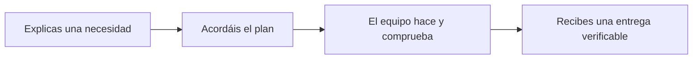

# Cómo usar custom-agents: manual para personas y equipos

[English](en/CUSTOMIZATION.md) · **Español**

custom-agents ayuda a convertir una necesidad en trabajo organizado, revisado y
comprobado. Puedes empezar explicando lo que quieres con tus palabras. El producto
reparte el trabajo entre asistentes especializados y deja un registro para retomarlo.

Este manual está escrito para responsables de área, producto y equipos de trabajo.
**No necesitas saber programar para seguir los recorridos de uso.** Cuando una acción
requiera a un administrador o a un equipo técnico, el texto lo indica y explica qué
pedirles. Los nombres de comandos, agentes y skills se presentan junto a su función.

## Un ejemplo que seguiremos de principio a fin

Usaremos un caso ficticio: **un portal de solicitudes internas**. Una persona envía
una solicitud y un responsable la aprueba o rechaza. Queremos saber quién tomó la
decisión, evitar que la misma solicitud se resuelva dos veces y explicar el rechazo.

Verás cómo pasar de esa idea a un plan, cómo aparecen las tareas, qué comentarios
reciben y cuándo pueden darse por terminadas. Después repetiremos el recorrido con
Jira/Confluence y con Redmine/una wiki. Los nombres y números de tarjetas son ejemplos;
no representan trabajo publicado en una cuenta real.



## Por dónde empezar

| Si necesitas... | Empieza aquí | Qué aprenderás |
|---|---|---|
| Entender qué es el producto | [1. Conceptos y responsabilidades](guides/product.md) | Qué hace cada pieza y qué decisiones siguen siendo tuyas |
| Preparar y ejecutar trabajo | [2. Recorrido del trabajo](guides/core-workflows.md) | Desde explicar una idea hasta aceptar la entrega y retomarla después |
| Trabajar con Jira y Confluence | [3. Atlassian explicado](guides/atlassian.md) | Crear tarjetas, elegir tareas o fases, comentar, cambiar estados y publicar documentos |
| Usar Redmine u otra wiki | [4. Redmine y otras herramientas](guides/redmine.md) | Qué se configura y cómo se mantiene el mismo método con otro proveedor |
| Entender y conectar memoria | [7. Memoria e integraciones opcionales](guides/memory.md) | Memoria local, curación, Kwipu, Graphify y Graphiti, con ejemplos y recuperación |
| Adaptarlo a tu equipo | [5. Personas, agentes, skills y herramientas](guides/customization.md) | Qué puedes personalizar y a quién corresponde hacerlo |
| Ponerlo en marcha y resolver problemas | [6. Uso diario y adopción](guides/operations.md) | Un piloto de equipo, ejemplos de incidencias y un glosario para consultar |
| Trabajar desde una sola consola | [8. Dashboard común](guides/dashboard.md) | Proyectos independientes, sesiones/chat, planes y kanban, notas, actividad y recuperación |

Lee primero los capítulos 1 y 2. Después elige la integración que vaya a utilizar tu
área. El capítulo 5 sirve cuando quieres adaptar el producto; el 6 ayuda en el uso
diario. El 7 explica la memoria y cómo conectar sus herramientas opcionales. Cada recorrido identifica una situación real, los pasos, el resultado y los
problemas que pueden aparecer. Los diagramas muestran el orden; la explicación que
los acompaña detalla las decisiones.

## Cómo pedir el trabajo

Puedes escribir, por ejemplo:

```text
Quiero que las solicitudes internas puedan aprobarse o rechazarse.
Antes de implementar nada, ayúdame a concretar qué debe ocurrir y
muéstrame un plan que pueda revisar.
```

En algunas pantallas también puedes elegir un comando: una instrucción corta que
inicia un recorrido. Este manual usa nombres abreviados, como `/setup` para preparar
el proyecto y `/dev-cycle` para ejecutar una iniciativa. **No hace falta memorizar
los nombres para entender el proceso.** Si la pieza no aparece en tu entorno, pide
al administrador que revise la instalación; no cambies archivos para intentar forzarla.

Para quien configure la herramienta: en el plugin de Claude Code se usa
`/custom-agents:setup`; en Codex, la skill de comando generada
`$custom-agents:custom-agents-setup`, disponible también desde `/skills`;
en OpenCode, `/setup`. Una copia local de Claude puede usar el nombre corto.
El mismo recorrido puede tener un nombre visible distinto según el entorno.

## Qué puedes esperar y qué debes comprobar

Al terminar una etapa debes poder responder tres preguntas: **qué se hizo, dónde
está el resultado y qué falta por decidir**. Una explicación convincente no sustituye
a los documentos o pruebas que el sistema dice haber producido.

Una configuración de Jira o Redmine no demuestra que se haya creado una tarjeta.
Para comprobarlo, pide su enlace y abre el destino. Una tarea marcada como terminada
no demuestra por sí sola que funcione: pide la evidencia de revisión y pruebas.
El manual enseña a leer estas diferencias sin tener que interpretar registros técnicos.

El PDF reúne la guía explicada, sus diagramas, los ejemplos y una referencia avanzada.
Los capítulos Markdown son la fuente que se mantiene. Los administradores pueden
consultar los [contratos y detalles técnicos](reference/product.md) cuando los necesiten.
