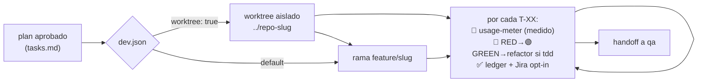

# Agente: implementer

Implementa un **plan aprobado** ejecutándolo **fase a fase**. Es el eslabón entre
`planner` y `qa`: convierte `improvement-plan.md` + `tasks.md` en **código funcionando**.



## Qué hace

- Lee la iniciativa en `docs/roadmap/<fecha>-<slug>/` (`improvement-plan.md`, `tasks.md`, `test-plan.md` si hay UI) y `docs/CONSTITUTION.md` si existe (la respeta y la cita).
- Trabaja sobre una **rama de trabajo** (`feature/<slug>`) — o, con `worktree: true` en `.claude/dev.json`, en un **worktree de git aislado** por iniciativa (degradación a rama normal si no hay soporte).
- Implementa cada tarea `T-XX` cumpliendo sus criterios de aceptación. Con `tdd: true`, sigue **RED-GREEN-REFACTOR** con la **evidencia del rojo** registrada en el ledger (`RED: <test> falló con <error> · <fecha>`); tareas sin código testeable se declaran `TDD n/a`.
- **Regenera lo generado antes de cerrar la tarea** (arista E2 de [`CONTRACTS.md`](CONTRACTS.md)): si tocó `commands/`, `agents/` o `hooks/`, ejecuta `python3 scripts/export-interop.py` y pega la evidencia de `python3 scripts/export-interop.py --check` (exit 0) en el ledger. La Lente A corre ese mismo `--check` por su cuenta, así que llegar a la revisión con `interop/` desincronizado es un gap seguro. Y actualiza en la MISMA tarea las piezas que **describen** lo tocado (arista E3), que el `planner` ya dejó en `Archivos`.
- **Mide cada tarea** con `usage-meter.py` (tokens reales → horas-IA `(medido)` en el ledger, que son las que se imputan a Jira).
- Mantiene **`tasks.md` como ledger canónico**: marca cada tarea (checkbox + estado) y actualiza el resumen a medida que avanza. Al marcarla `completado` escribe además el campo opcional **`- **Cerrada**: AAAA-MM-DD`** (la fecha de cierre, mismo patrón que `Changelog`): lo lee el burndown de la página Plan del panel (`agent-kits/shared/ledger-view.py`) y `ledger-lint` valida solo su formato y que no sea anterior a la creación del ledger.
- Es el **dueño único de los commits** de tarea (`T-XX: …`) y de su procedimiento de selección exacta con `commit-selection.py` (P4 del prompt; [selección de commits](../COMMIT-SELECTION.md)). La Fase 6 de `/dev-cycle` solo lo verifica y lo reutiliza para los artefactos del orquestador.
- Hace **handoff a `qa`** al terminar. La documentación (`documenter`) va después, solo si `qa` queda en verde.

## Ledger y perfil de ejecución

Para estados, evidencias RED y cabeceras de revisión, usa `ledger-write.py` del
shared según `ledger-write.md`: es preferente en normal y obligatorio en `lite`.
El writer valida el ledger, conserva campos ajenos y publica tras bloqueo y
comprobación de versión. Un conflicto exige releer; no sobrescribas su evidencia.
El fallback manual de una instalación normal parcial conserva `ledger-lint.py`.

`execution-profile.py` resuelve los flags efectivos. En lite, cada tarea se
despacha en secuencia, sin paralelismo, a esta identidad nativa (`implementer`), para
que su guardia aplique: nunca al hilo principal ni a un subagente genérico. Consume el brief completo
que genera `task-brief.py`: techo6000, exit2 y stdout vacío si falta el writer o
el contexto obligatorio no cabe. Diseño aprobado no verificable impide ese
despacho. No recortes criterios, verificación, diseño, persona ni gates para entrar
en el techo. Normal conserva sus presupuestos y techo10000. Revisores frescos
secuenciales, TDD elegido, QA, cobertura y Knowledge Gate conservan sus puertas.

## Qué NO hace

- No planifica ni evalúa (eso es `planner`/`evaluator`).
- No prueba el producto (E2E lo hace `qa`) ni escribe la documentación de referencia (`documenter`).
- No toca `docs/roadmap/` salvo `tasks.md` (progreso) y el índice `docs/roadmap/README.md`, ni `docs/security-scan/`.

## A diferencia del resto

Es el **único agente que modifica el código** del proyecto. Por eso trabaja sobre rama, respeta
los guardrails del repo (p. ej. el local-only de `nemesis`) y no marca completado nada con tests
fallando o criterios sin cumplir.

## Guardrails deterministas (hook de guardia con alcance del agente)

Sus reglas duras usan `agent-kits/shared/guardrail-check.py`. El dispatcher
`agent-kits/shared/native-guardrail.py` selecciona los IDs propios exactos de
`implementer` y `architect` en Claude, Codex y OpenCode. No restringe agentes
ajenos por parecido del nombre. Claude ignora hooks del frontmatter de agentes
de plugin; una copia local conserva `hooks/implementer-guardrail.sh`.
El registro global no convierte las reglas del implementer en reglas para
`planner`/`evaluator`, que escriben en `docs/roadmap/` legítimamente.
Las reglas del implementer deniegan con una razón y cómo proceder:

| Regla (`dev.json` → `guardrails`) | Qué bloquea |
|---|---|
| `alcance` | Write/Edit/MultiEdit/NotebookEdit sobre `docs/roadmap/**` que no sea `tasks.md` (incl. `testing/`, de qa) y sobre `docs/security-scan/**`; rutas case-insensitive (`Docs/Roadmap/…` también). `docs/knowledge/**` sigue permitido por la política de rutas histórica; ello no autoriza nuevas escrituras de memoria fuera del servicio compartido ni prueba confinamiento nativo de esa vía. En la raíz de `docs/roadmap/` solo se permite `README.md` (índice de iniciativas, que el cierre de cada iniciativa actualiza); `CALIBRATION.md`, `DRIFT.md` y `BACKLOG.md` quedan bloqueados **por diseño**: los escriben `/retro`, `/spec-drift` y `/pm-backlog`, que son comandos y no pasan por este hook. |
| `ramaPrincipal` | Escrituras fuera del ledger con HEAD en `main`/`master` («trabaja en `feature/<slug>`»). Sin git → no aplica. |
| `git` | `git push --force|-f|--force-with-lease`, refspec `+rama`, `git branch -D`, `git branch -D|-M|-C|-f` y `--force` (también con `-d`), `git update-ref -d|--stdin`, `git reset --hard|--keep|--merge`, `git checkout-index -f`, `git read-tree -u|--reset`, `git rm -f`, `git worktree remove -f`, `git clean -f*` sin simulación (analizado de verdad: lo que sigue a `--` son rutas, `-e`/`--exclude` consumen su valor y gana el último de `-n`/`--dry-run` frente a `--no-dry-run`; `-fn` es simulación, `-fen` no), `git push --delete|-d|--mirror|--prune` o refspec `:rama`, `git stash drop|clear`, las restauraciones que descartan cambios sin comitear (`git checkout -f`, `git checkout|restore` que tocan el árbol con un pathspec que no sea una ruta relativa literal (lista de permitidos: sin magia `:`, sin comodines `*?[`, sin `$`/backtick/`~` inicial, absolutas fuera, y que, normalizada, quede dentro del proyecto sin ser el directorio actual, un ancestro ni la raíz; `../otro.py` pasa si sigue dentro del proyecto, `..` o `../..` no; en `restore` todo argumento que no es opción cuenta como pathspec, antes o después de `--`; en `checkout` los de tras `--` y, sin `--` ni `-b/-B`, los sueltos; el valor separado de `-s`/`--source` NO cuenta como pathspec; si la orden cambia la base (`git -C`, `--work-tree`, `--git-dir`, `env -C`/`--chdir` o un `cd`/`pushd`/`popd` en CUALQUIER punto de la misma orden —también tras `command`, `builtin`, `time`, `!`, asignaciones, `{`, `if/then/do` o entre paréntesis, y heredado por `bash -c`/`sh -c`/`eval`—, salvo un `cd` cuyo destino resuelto es el propio directorio de trabajo; solo en POSICIÓN DE PROGRAMA —`echo cd` o `git restore src/cd` no cuentan—; el cuerpo de un heredoc se analiza SIEMPRE como órdenes, sin lista de intérpretes ni reglas de salto; la única excepción son las dos FORMAS EXACTAS de `git commit` con mensaje —`git commit [opciones] -m "$(cat <<'D'⏎…⏎D⏎)"` y `git commit [opciones] -F - <<'D'⏎…⏎D`, con delimitador entrecomillado— donde el cuerpo es el mensaje y no se analiza (las opciones sí: `--no-verify`/`-n` se deniegan). Lo que precede a la forma se lee entero y sin heredocs y cada orden se analiza normalmente (`git add …`, `cd <propio dir>`, `pytest`, `timeout 600 …`, unidas con `&&`, `;` o saltos de línea). El precio aceptado: un heredoc fuera de esas formas cuyo cuerpo tenga comillas impares se deniega con `git`, y el mensaje explica la salida (escribir el fichero con la herramienta de edición y usar `git commit -F <fichero>`). `<<<` y el `<<` aritmético (`$((1<<2))`, `$[1<<2]`) no cambian nada: si el guardarraíl cree ver un heredoc donde bash no lo ve, las líneas siguientes se analizan igual. Las sustituciones con backticks se leen como bash (quita las barras de `` \` ``, `\$`, `\\` y lee el contenido: `` \` `` anida otra), `$'…'` (ANSI-C) y `$"…"` no son parte de la palabra, el CR es un carácter normal (una orden con CR y `git` se deniega) y `2>&1`, `&>f` o `>f` antes de la orden no la ocultan. Lo que quede abierto al terminar de leer la orden —comilla, `$(`, backtick, heredoc sin cierre, escape final— la deniega ENTERA si contiene `git` o un cambio de base; por encima de 4.000 palabras o 16 KB (de la orden completa) se deniega ANTES de tokenizar si el texto contiene `git` (sin distinguir mayúsculas) o algo que cambia la base, y por encima de 256 KB en bruto, siempre; el análisis es lineal (la aritmética `$(( … ))` usa una tabla de paréntesis única por orden). `bash -c`/`eval` anidados a más de 3 niveles se deniegan) la restauración que toca el árbol se deniega («cambia la base»): ejecútala desde ese directorio; `git -C <dir> status|log|diff` y `restore --staged` siguen permitidos) o con `--pathspec-from-file`, `git restore --worktree|-W`, `git switch -f|--discard-changes`; una orden `git` destructiva que no se puede tokenizar entera (escape final o comilla sin cerrar) falla cerrado con «orden incompleta» (las órdenes sin git, no); siguen permitidos `git checkout <rama>`, `git checkout main -- <fichero>`, `git checkout -b|-`, `git restore <fichero>` y `git restore --staged <lo que sea>`, que solo toca el índice) — toda opción larga destructiva por CUALQUIER prefijo (`--h`, `--m`, `--force-w`), como la acepta git. Configuración por LISTA BLANCA: `-c`/`--config-env` solo con `user.name`, `user.email`, `core.quotepath`, `commit.gpgsign` (solo a verdadero), `init.defaultBranch`, `color.*` o `advice.*` (`core.editor`, `core.pager`, `core.sshCommand`, `core.hooksPath`, `alias.*`, `include*`, `remote.*`… se deniegan); `git config` escribe solo esas claves (lecturas permitidas; `--file`/`--blob`, `--rename-section`, `--remove-section` y `--edit` se deniegan); variables `GIT_*`, `HOME` y `XDG_CONFIG_HOME` (sin distinguir mayúsculas; en prefijo, `env`, `export` o `set`) cuando la orden ejecuta git; y cualquier opción global de git no reconocida, `git checkout|switch main|master` (también `refs/heads/master`, `origin/main`, `master^0`, `MAIN`, `-` y `@{-1}`) desde una rama de trabajo y `rm -rf` de `/`, `~`, `.git` o `.`. También `git commit` con verificación desactivada (`--no-verify`/`-n`) o un override explícito de `core.hooksPath`. Órdenes con efecto fuera del repo: `npm|pnpm|yarn publish`, `docker|podman system|volume prune`, `kubectl delete` (salvo `--dry-run`) y `DROP TABLE|DATABASE|SCHEMA` pasado a un cliente SQL; análisis literal (no ve SQL desde fichero ni por tubería). |

La regla `git` también protege al `architect`. El parser consume valores de
opciones de commit, incluidos prefijos largos unívocos, y respeta `--` antes
de las rutas: un mensaje con `-n` no es un flag ejecutable. Un `--verify` o
`--no-no-verify` posterior restaura la verificación;
`--amend` por sí solo no la desactiva. Un override de `core.hooksPath` durante
el commit requiere revisión explícita, incluso si apunta a otra carpeta válida.

Cada orden conserva su propia decisión, también entre líneas. La puntuación
entre comillas es texto; los comentarios no aportan flags. Un salto de línea
escapado conserva la orden. Los wrappers reconocen clusters de sus flags
soportados y valores pegados, como `exec -cl` y `env -C.`.

El parser reconoce asignaciones literales y estos wrappers: `env -i` o
`--ignore-environment`; `-u NAME`, `-uNAME` o `--unset=NAME`; `-C DIR` o
`--chdir=DIR`; `command -p`; `exec -a NAME`, `-c` o `-l`. Analiza opciones
Git `-c` y `--config-env` contra una LISTA BLANCA (`user.name`, `user.email`,
`core.quotepath`, `commit.gpgsign` (solo a verdadero), `init.defaultBranch`, `color.*`, `advice.*`;
cualquier otra clave se deniega), clasifica `git config` en lectura o escritura
(solo escribe claves de la lista blanca, sin `--file`/`--blob`, sin renombrar ni
borrar secciones) y deniega las variables `GIT_*`, `HOME` y `XDG_CONFIG_HOME`
cuando la orden ejecuta git (en el mismo segmento o exportadas antes). Los envoltorios que se desenvuelven para encontrar el programa real son los mismos para «qué git se invoca» y «qué cambia la base»: `timeout [opciones] N`, `nice [-n N]`, `stdbuf …`, `time [-p]`, `setsid`, `sudo [opciones]`, `env [-S «línea»]`, `xargs [opciones]`, `ionice`, `nohup`, `command`, `exec` y `builtin`; el cambio de base se busca también dentro de `eval` y se asume en `source`/`.` con un fichero. La comparación del nombre base del ejecutable ignora
mayúsculas y contempla nombres Windows con `.exe`.

**Modelo de amenaza (T-06 fix6, decisión del usuario, 2026-11-13).** El guardarraíl
frena los **errores de un agente honesto**; no detiene a quien busca saltárselo, y
no es un sandbox. Tras seis revisiones en que cada intento de leer bash con un
tokenizador propio abrió un hueco nuevo, el modelo se fija así: se analiza lo
que la orden **dice** (programas, opciones, rutas y el cuerpo de los heredocs), no
lo que acabaría ejecutándose tras expansiones e indirecciones. **Límite conocido,
sin corrección**: variables como programa u opción (`g=git; $g reset --hard`,
`X='git restore .'; eval "$X"`), código por stdin hacia un intérprete
(`echo '…' | bash`, `bash <<< '…'`, `bash <(echo …)`), `find -exec git …`,
`xargs git …` con los argumentos por stdin, un heredoc a `python3`/`perl`/`ex` con
código que arranca git por dentro, y los ficheros de configuración o scripts que
escriba el propio agente (ADR-023, ADR-007). `test_guardrail_differential.py`
fija esos casos en una lista `LIMITE` (comprueba que bash los ejecuta y que el
guardarraíl no los ve), de modo que el límite es explícito y un cambio lo mueve a
la lista de denegados en el mismo commit.

**Falla cerrado para el rol protegido** (punto 1 del diseño de fix6). Si el
guardarraíl no puede decidir —plazo agotado, entrada de más de 64 KiB, error o
salida inválida del evaluador, intérprete ausente— el lanzador
`hooks/run-hook.mjs` **deniega** cuando la identidad es `implementer` o
`architect` (la política de roles de ADR-023) y conserva `continue` para el
resto; `native-guardrail.py` hace lo mismo con `input-too-large` y el puente de
OpenCode (`hooks/opencode-plugin.js`) lanza un error de herramienta. Una entrada
truncada se atribuye al rol por la primera clave de identidad de su prefijo.
Los tres runtimes pasan por el mismo lanzador y se comportan igual
(`tests/test_native_guard_failclosed.py`, `tests/hook-guard-failclosed.test.mjs`).

Conserva la recursión existente de shell `-c` y `eval`, hasta profundidad 3.
No expande variables, resuelve aliases, abre scripts ni inspecciona
configuración Git externa. El dispatcher reconoce la tool PowerShell, pero
sus asignaciones y scripts quedan fuera de esta gramática literal. No
constituye un sandbox. `{"git": false}` desactiva esta regla en
`.claude/dev.json` → `guardrails`.

Degradación: sin `python3` el hook avisa una vez (`systemMessage`) y no bloquea; un error interno
del script permite (nunca bloqueo fantasma). Desactivación: `.claude/dev.json` →
`"guardrails": false` (todo, con aviso) o `{"alcance": false, …}` por regla. **Un DENY no es un
error**: el agente lee la razón y cambia de fichero o rama.

Sus skills (`jira-sync`, `confluence-publish`) son opt-in y se invocan bajo demanda: el agente
**no** las precarga con el campo nativo `skills:` (≈15k tokens por arranque; regla token-diet de
la regla 4 de `CONVENTIONS.md`).

**Skills sin la herramienta `Skill`.** `Skill` es de Claude Code y `tools:` no la incluye a propósito: el cuerpo
del agente da la ruta `skills/<x>/SKILL.md` de cada skill que ordena invocar (`tdd`, `debug-root-cause`,
`dependency-upgrade`, `adversarial-review`, `unit-tests`), que vale en los tres runtimes; `tests/test_agent_tools_skill.py`
lo vigila para todos los agentes. Añadir `Skill` a `tools:` queda sujeto a una prueba en sesión real (M-A).

Aparte, el alcance del **diff completo** lo comprueba `agent-kits/shared/scope-check.py`
(ficheros cambiados vs. campos `Archivos` del ledger; exit 0 obligatorio en su DoD y como puerta
previa a la revisión de dos lentes en `/dev-cycle`). Y **exit 0 no basta**: si el script imprime
⚠️ —por **stderr**, y en la clave `avisos` si se repite el comando con `--json`— es que un glob de
`alcance.excluir` está apagando la puerta, y el DoD lo trata como gap Important —acotar el glob,
declarar los ficheros o justificar la exclusión en el ledger—; la skill `adversarial-review` lee los
mismos avisos en su puerta previa. El ⚠️ es **un solo disparo con dos formas**, y las dos
exigen que la exclusión de usuario esté haciendo el trabajo pesado (≥ 3 ficheros y ≥ la mitad del
diff, contando solo lo que el default NO excluye), ya deje la lista «fuera de alcance» vacía o se
coma esa fracción con un único glob: una exclusión legítima que se limita a quitar ruido no avisa
nunca, porque un ⚠️ en cada pasada verde sería un gap Important perpetuo e imposible de cerrar.
Por debajo de ese umbral no hay ⚠️, pero tampoco silencio: el script publica **siempre** una línea
ℹ️ —stderr, y claves `info`/`excluidos_usuario` del `--json`— con los ficheros que esconde cada
glob de usuario y su patrón. Es visibilidad, no veredicto: el DoD manda leerla y comprobar que lo
excluido es lo que se quería excluir; el gap aparece si ahí sale código sin declarar.

## Memoria técnica del proyecto

Consulta memoria pertinente con `agent-kits/shared/knowledge-check.md`: legado aceptado y
approved conservan estados/autoridad; propuestas no se aplican como doctrina. Una ambigüedad resuelta que cruza el umbral se propone con decisión y evidencia del código.
Usa `agent-kits/shared/knowledge-curation.py propose --root <proyecto> --filename <nombre.md>
--producer implementer` con Markdown por stdin y salida JSON. El servicio redacta, crea sólo pending
sin `estado` y devuelve ruta/SHA. No escribe ni promueve nuevas entradas en legado. Sin servicio,
informa pendiente y no recurre a Write/Edit. Curator decide; `apply` persiste ligado al SHA original,
con motivo y metadatos válidos. Conflicto/alto impacto requieren resolución humana, no fecha.
[Contrato](../roadmap/2026-10-07-catalog-capabilities/comparisons/memory-curation-contract.md).

## Ledger canónico

`tasks.md` es la **fuente única de verdad** del progreso. Si conviven otras herramientas con su
propio registro (todo-list, orquestadores SDD externos), esos registros son
espejo, no fuente. Ver regla 8 de [`CONVENTIONS.md`](../CONVENTIONS.md).

## Uso

```
@implementer implementa el plan docs/roadmap/2026-07-10-mi-feature/
@implementer ejecuta la fase 2
```

O, dentro del ciclo completo, mediante el command `/dev-cycle`. `implementer` es **el** motor de
implementación del plugin: el ciclo no delega la implementación en ningún orquestador externo.
`tasks.md` es siempre el ledger canónico.
Con `subagentes: true` en `dev.json`, las tareas las despacha `/dev-cycle` a **subagentes de
contexto fresco** (brief determinista de `task-brief.py`) y `implementer` actúa como fallback
cuando un despacho falla dos veces.

## Dependencias

- Agente `qa` (handoff de pruebas al terminar).
- Kit shared: `usage-meter.py` (medición por tarea), `constitution-check.md`, `ledger-lint.py`.
- Config `.claude/dev.json` (opt-in: `tdd` · `worktree` · `subagentes`; defaults off).

## Contexto técnico común

Aplica `agent-kits/shared/capability-check.md` con tu rol y el paquete/áreas de
la tarea. La selección comparte criterios y escenarios del ledger; consulta
solo mapas/referencias pertinentes. Stack-practices consolida PHP/CodeIgniter,
Python y React. Los métodos, artefactos y puertas del rol conservan su dueño.
Sin selector o guía disponible, avisa del límite y continúa con el contrato de
la tarea; no confundas selección con ejecución, tools o permisos.

## Integraciones opcionales por proyecto

El rol usa `project-integrations.md` para sus eventos, sin exigir Jira ni Confluence. Consulta el [workflow detallado](../guides/core-workflows.md) y los [adaptadores del proyecto](../CUSTOMIZATION.md). Destino remoto, recibos y permisos pertenecen al adaptador; los gates locales mantienen su dueño.

## Contexto y lecturas

Aplica la [disciplina compartida](../../agent-kits/shared/read-discipline.md):
reutiliza navegación vigente, consulta fuentes pertinentes y conserva todos los
criterios y gates del rol. Los recibos no sustituyen análisis, aprobación o tests.
[Medición y ejemplos](../TOKEN-EFFICIENCY.md).

### Autoridad de cierre

El implementador actualiza tareas y fases en `tasks.md`. `/dev-cycle` coordina los estados del plan y la spec; también cuando la implementación se invoca por separado se entrega un handoff. QA aporta evidencia, y la spec sólo pasa a `implementada` con la puerta de retro en verde.
