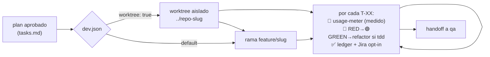

# Agente: implementer

Implementa un **plan aprobado** ejecutándolo **fase a fase**. Es el eslabón entre
`planner` y `qa`: convierte `improvement-plan.md` + `tasks.md` en **código funcionando**.



## Qué hace

- Lee la iniciativa en `docs/roadmap/<fecha>-<slug>/` (`improvement-plan.md`, `tasks.md`, `test-plan.md` si hay UI) y `docs/CONSTITUTION.md` si existe (la respeta y la cita).
- Trabaja sobre una **rama de trabajo** (`feature/<slug>`) — o, con `worktree: true` en `.claude/dev.json`, en un **worktree de git aislado** por iniciativa (degradación a rama normal si no hay soporte).
- Implementa cada tarea `T-XX` cumpliendo sus criterios de aceptación. Con `tdd: true`, sigue **RED-GREEN-REFACTOR** con la **evidencia del rojo** registrada en el ledger (`RED: <test> falló con <error> · <fecha>`); tareas sin código testeable se declaran `TDD n/a`.
- **Regenera lo generado antes de cerrar la tarea** (arista E2 de [`CONTRACTS.md`](CONTRACTS.md)): si tocó `commands/`, `agents/` o `hooks/`, ejecuta `python3 scripts/export-interop.py` y pega la evidencia de `python3 scripts/export-interop.py --check` (exit 0) en el ledger. La Lente A corre ese mismo `--check` por su cuenta, así que llegar a la revisión con `interop/` desincronizado es un gap seguro. Y actualiza en la MISMA tarea las piezas que **describen** lo tocado (arista E3), que el `planner` ya dejó en `Archivos`.
- **Mide cada tarea** con `usage-meter.py` (tokens reales → horas-IA `(medido)` en el ledger, que son las que se imputan a Jira).
- Registra en **tasks.md** los criterios comprobados y la evidencia. El despacho o **usage-meter start** mueve la tarea a `en-progreso` y **usage-meter close** la deja en `en-revision`. Un `ledger-write.py verdict` limpio marca `completado` con los criterios verificados y escribe `Cerrada` para el burndown. Un veredicto con gaps reabre las tareas afectadas. El writer recalcula la fase y el resumen.
- Es el **dueño único de los commits** de tarea (`T-XX: …`) y de su procedimiento de selección exacta con `commit-selection.py` (P4 del prompt; [selección de commits](../COMMIT-SELECTION.md)). La Fase 6 de `/dev-cycle` solo lo verifica y lo reutiliza para los artefactos del orquestador.
- Hace **handoff a `qa`** al terminar. La documentación (`documenter`) va después, solo si `qa` queda en verde.

## Ledger y perfil de ejecución

Para estados, evidencias RED y cabeceras de revisión, usa `ledger-write.py` del
shared según `ledger-write.md`: es preferente en normal y obligatorio en `lite`.
El writer valida el ledger, conserva campos ajenos y publica tras bloqueo y
comprobación de versión. Un conflicto exige releer; no sobrescribas su evidencia.
El fallback manual de una instalación normal parcial conserva `ledger-lint.py`.

`execution-profile.py` resuelve los flags efectivos. En lite, cada tarea se
despacha en secuencia, sin paralelismo, a esta identidad nativa (`implementer`), para
que su guardia aplique: nunca al hilo principal ni a un subagente genérico. Consume el brief completo
que genera `task-brief.py`: techo6000, exit2 y stdout vacío si falta el writer o
el contexto obligatorio no cabe. Diseño aprobado no verificable impide ese
despacho. No recortes criterios, verificación, diseño, persona ni gates para entrar
en el techo. Normal conserva sus presupuestos y techo10000. Revisores frescos
secuenciales, TDD elegido, QA, cobertura y Knowledge Gate conservan sus puertas.

## Qué NO hace

- No planifica ni evalúa (eso es `planner`/`evaluator`).
- No prueba el producto (E2E lo hace `qa`) ni escribe la documentación de referencia (`documenter`).
- No toca `docs/roadmap/` salvo `tasks.md` (progreso) y el índice `docs/roadmap/README.md`, ni `docs/security-scan/`.

## A diferencia del resto

Es el **único agente que modifica el código** del proyecto. Por eso trabaja sobre rama, respeta
los guardrails del repo y entrega a revisión la evidencia de las pruebas y los criterios.

## Guardrails deterministas (hook de guardia con alcance del agente)

Sus reglas duras usan `agent-kits/shared/guardrail-check.py`. El dispatcher
`agent-kits/shared/native-guardrail.py` selecciona los IDs propios exactos de
`implementer` y `architect` en Claude, Codex y OpenCode. No restringe agentes
ajenos por parecido del nombre. Claude ignora hooks del frontmatter de agentes
de plugin; una copia local conserva `hooks/implementer-guardrail.sh`.
El registro global no convierte las reglas del implementer en reglas para
`planner`/`evaluator`, que escriben en `docs/roadmap/` legítimamente.
Las reglas del implementer deniegan con una razón y cómo proceder:

| Regla (`dev.json` → `guardrails`) | Qué bloquea |
|---|---|
| `alcance` | Write/Edit/MultiEdit/NotebookEdit sobre `docs/roadmap/**` que no sea `tasks.md` (incl. `testing/`, de qa) y sobre `docs/security-scan/**`; rutas case-insensitive (`Docs/Roadmap/…` también). `docs/knowledge/**` sigue permitido por la política de rutas histórica; ello no autoriza nuevas escrituras de memoria fuera del servicio compartido ni prueba confinamiento nativo de esa vía. En la raíz de `docs/roadmap/` solo se permite `README.md` (índice de iniciativas, que el cierre de cada iniciativa actualiza); `CALIBRATION.md`, `DRIFT.md` y `BACKLOG.md` quedan bloqueados **por diseño**: los escriben `/retro`, `/spec-drift` y `/pm-backlog`, que son comandos y no pasan por este hook. |
| `ramaPrincipal` | Escrituras fuera del ledger con HEAD en `main`/`master` («trabaja en `feature/<slug>`»). Sin git → no aplica. |
| `git` | `git push --force|-f|--force-with-lease`, refspec `+rama`, `git branch -D`, `git branch -D|-M|-C|-f` y `--force` (también con `-d`), `git update-ref -d|--stdin`, `git reset --hard|--keep|--merge`, `git checkout-index -f`, `git read-tree -u|--reset`, `git rm -f`, `git worktree remove -f`, `git clean -f*` sin simulación (analizado de verdad: lo que sigue a `--` son rutas, `-e`/`--exclude` consumen su valor y gana el último de `-n`/`--dry-run` frente a `--no-dry-run`; `-fn` es simulación, `-fen` no), `git push --delete|-d|--mirror|--prune` o refspec `:rama`, `git stash drop|clear`, las restauraciones que descartan cambios sin comitear (`git checkout -f`, `git checkout|restore` que tocan el árbol con un pathspec que no sea una ruta relativa literal (lista de permitidos: sin magia `:`, sin comodines `*?[`, sin `$`/backtick/`~` inicial, absolutas fuera, y que, normalizada, quede dentro del proyecto sin ser el directorio actual, un ancestro ni la raíz; `../otro.py` pasa si sigue dentro del proyecto, `..` o `../..` no; en `restore` todo argumento que no es opción cuenta como pathspec, antes o después de `--`; en `checkout` los de tras `--` y, sin `--` ni `-b/-B`, los sueltos; el valor separado de `-s`/`--source` NO cuenta como pathspec; si la orden cambia la base (`git -C`, `--work-tree`, `--git-dir`, `env -C`/`--chdir` o un `cd`/`pushd`/`popd` en CUALQUIER punto de la misma orden —también tras `command`, `builtin`, `time`, `!`, asignaciones, `{`, `if/then/do` o entre paréntesis, y heredado por `bash -c`/`sh -c`/`eval`—, salvo un `cd` cuyo destino resuelto es el propio directorio de trabajo; solo en POSICIÓN DE PROGRAMA —`echo cd` o `git restore src/cd` no cuentan—; el cuerpo de un heredoc se analiza SIEMPRE como órdenes, sin lista de intérpretes ni reglas de salto; la única excepción son las dos FORMAS EXACTAS de `git commit` con mensaje —`git commit [opciones] -m "$(cat <<'D'⏎…⏎D⏎)"` y `git commit [opciones] -F - <<'D'⏎…⏎D`, con delimitador entrecomillado— donde el cuerpo es el mensaje y no se analiza (las opciones sí: `--no-verify`/`-n` se deniegan). La forma solo vale si EMPIEZA una sentencia según el tokenizador real —fuera de comentario, comilla, heredoc y sustitución: `true # ok; git commit -m "$(cat <<'EOF'…` NO es la forma, porque para bash todo es un comentario y el cuerpo se ejecuta—, no hay otro heredoc antes y ninguna línea del cuerpo, sin sus tabuladores iniciales, EMPIEZA por el delimitador sin ser la línea de cierre exacta (`D)`, `D;`, `D x`: bash 5.2 cierra el heredoc dentro de `$(…)` con `D)` y ejecuta lo que sigue); su coste es lineal. Cada orden se analiza normalmente (`git add …`, `cd <propio dir>`, `pytest`, `timeout 600 …`, unidas con `&&`, `;` o saltos de línea). El precio aceptado: un heredoc fuera de esas formas cuyo cuerpo tenga comillas impares se deniega con `git`, y el mensaje explica la salida (escribir el fichero con la herramienta de edición y usar `git commit -F <fichero>`). `<<<` y el `<<` aritmético (`$((1<<2))`, `$[1<<2]`) no cambian nada: si el guardarraíl cree ver un heredoc donde bash no lo ve, las líneas siguientes se analizan igual. Las sustituciones con backticks se leen como bash (quita las barras de `` \` ``, `\$`, `\\` y lee el contenido: `` \` `` anida otra), `$'…'` (ANSI-C) y `$"…"` no son parte de la palabra, el CR es un carácter normal (una orden con CR y `git` se deniega) y `2>&1`, `&>f` o `>f` antes de la orden no la ocultan. Lo que quede abierto al terminar de leer la orden —comilla, `$(`, backtick, heredoc sin cierre, escape final— la deniega ENTERA si contiene `git` o un cambio de base; por encima de 4.000 palabras o 16 KB (de la orden completa) se deniega ANTES de tokenizar si el texto contiene `git` (sin distinguir mayúsculas) o algo que cambia la base, y por encima de 256 KB en bruto, siempre; el análisis es lineal (la aritmética `$(( … ))` usa una tabla de paréntesis única por orden). `bash -c`/`eval` anidados a más de 3 niveles se deniegan) la restauración que toca el árbol se deniega («cambia la base»): ejecútala desde ese directorio; `git -C <dir> status|log|diff` y `restore --staged` siguen permitidos) o con `--pathspec-from-file`, `git restore --worktree|-W`, `git switch -f|--discard-changes`; una orden `git` destructiva que no se puede tokenizar entera (escape final o comilla sin cerrar) falla cerrado con «orden incompleta» (las órdenes sin git, no); siguen permitidos `git checkout <la rama actual>`, `git checkout HEAD` (conserva la rama con git real), `git checkout main -- <fichero>`, `git checkout -b|-c <nueva>`, `git restore <fichero>` y `git restore --staged <lo que sea>`, que solo toca el índice) — toda opción larga destructiva por CUALQUIER prefijo (`--h`, `--m`, `--force-w`), como la acepta git. Configuración por LISTA BLANCA: `-c`/`--config-env` solo con `user.name`, `user.email`, `core.quotepath`, `commit.gpgsign` (solo a verdadero), `init.defaultBranch`, `color.*` o `advice.*` (`core.editor`, `core.pager`, `core.sshCommand`, `core.hooksPath`, `alias.*`, `include*`, `remote.*`… se deniegan); `git config` escribe solo esas claves (lecturas permitidas; `--file`/`--blob`, `--rename-section`, `--remove-section` y `--edit` se deniegan); variables `GIT_*`, `HOME` y `XDG_CONFIG_HOME` (sin distinguir mayúsculas; en prefijo, `env`, `export` o `set`) cuando la orden ejecuta git; y cualquier opción global de git no reconocida, `git checkout|switch main|master` (también `refs/heads/master`, `origin/main`, `master^0`, `MAIN`, `-`, `@{-N}`, cualquier ref remota como `origin/HEAD`, y `--detach`/`-d`, que suelta HEAD de la rama) desde una rama de trabajo (salvo con `-b|-c|-t`, que crean una rama nueva; el `--` no exime —`git switch main --`, `git switch -- main`, `git checkout main --` salen de la rama; solo `git checkout <ref> -- <ficheros>` restaura ficheros—; fix17: la regla de rama es una **lista blanca** —con una posicional, `checkout`/`switch` solo permiten la rama actual, `HEAD` (en `checkout`) y, en `checkout`, una ruta que exista SIN ser una ref (fix18: una rama, un tag o una remota gana a una ruta con su nombre —`git checkout main` con un directorio `main` cambia de rama—, y delante de `--` sigue siendo una ref; las refs se leen de `.git/refs` y `packed-refs` sin lanzar git y las rutas se resuelven contra el `cwd` del payload); cualquier otra ref (otra rama de trabajo, un tag sin `tags/`, `FETCH_HEAD`/`ORIG_HEAD`/`MERGE_HEAD`, `fork/main`, un SHA de cualquier longitud, `HEAD~1`, `@{1}`, `-`) se deniega porque no se puede saber sintácticamente si suelta HEAD (falso deny declarado: cambiar a OTRA rama de trabajo existente; crear una con `-c`/`-b` sigue permitido); `-B|-C|--force-create` solo valen sobre la rama actual y sin punto de partida; `-t`/`--track` sin nombre hacia `main`/`master` se deniega; `-p`/`--patch`/`--ours`/`--theirs` operan con ficheros—; `git symbolic-ref HEAD <ref>`, `git update-ref HEAD <sha>` y `git update-ref refs/heads/<rama> …` se deniegan; `git rebase <upstream> <rama>` (2 posicionales, o `--root <rama>`) cambia a la rama y la reescribe: se deniega (`git rebase <upstream>` sigue permitido); `git bisect` con cualquier subcomando salvo `log|visualize|view|help` se deniega (fix18: `start` a secas seguido de `good|bad <ref>` suelta HEAD); y con la rama DESCONOCIDA —sin repositorio o con HEAD ilegible— las órdenes que sacan de la rama se deniegan, falla cerrado) y `rm -rf` de `/`, `~`, `.git` o `.`. También `git commit` con verificación desactivada (`--no-verify`/`-n`) o un override explícito de `core.hooksPath`. Órdenes con efecto fuera del repo: `npm|pnpm|yarn publish`, `docker|podman system|volume prune`, `kubectl delete` (salvo `--dry-run`) y `DROP TABLE|DATABASE|SCHEMA` pasado a un cliente SQL; análisis literal (no ve SQL desde fichero ni por tubería). |

La regla `git` también protege al `architect`. El parser consume valores de
opciones de commit, incluidos prefijos largos unívocos, y respeta `--` antes
de las rutas: un mensaje con `-n` no es un flag ejecutable. Un `--verify` o
`--no-no-verify` posterior restaura la verificación;
`--amend` por sí solo no la desactiva. Un override de `core.hooksPath` durante
el commit requiere revisión explícita, incluso si apunta a otra carpeta válida.

Cada orden conserva su propia decisión, también entre líneas. La puntuación
entre comillas es texto; los comentarios no aportan flags. Un salto de línea
escapado conserva la orden. Los wrappers reconocen clusters de sus flags
soportados y valores pegados, como `exec -cl` y `env -C.`.

El parser reconoce asignaciones literales y estos wrappers: `env -i` o
`--ignore-environment`; `-u NAME`, `-uNAME` o `--unset=NAME`; `-C DIR` o
`--chdir=DIR`; `command -p`; `exec -a NAME`, `-c` o `-l`. Analiza opciones
Git `-c` y `--config-env` contra una LISTA BLANCA (`user.name`, `user.email`,
`core.quotepath`, `commit.gpgsign` (solo a verdadero), `init.defaultBranch`, `color.*`, `advice.*`;
cualquier otra clave se deniega), clasifica `git config` en lectura o escritura
(solo escribe claves de la lista blanca, sin `--file`/`--blob`, sin renombrar ni
borrar secciones) y deniega las variables `GIT_*`, `HOME` y `XDG_CONFIG_HOME`
cuando la orden ejecuta git (en el mismo segmento o exportadas antes). Los envoltorios que se desenvuelven para encontrar el programa real son los mismos para «qué git se invoca» y «qué cambia la base»: `timeout [opciones] N`, `nice [-n N]`, `stdbuf …`, `time [-p]`, `setsid`, `sudo [opciones]`, `env [-S «línea»]`, `xargs [opciones]`, `ionice`, `flock`, `nohup`, `command`, `exec` y `builtin`. Hay UNA sola implementación (`_desenvuelve`, fix7): el valor de `env -S` se analiza entero (se trocea solo por espacio y tabulador, como GNU env; un LF, VT, FF o CR suelto es una forma AMBIGUA y se deniega si la orden lleva git: coreutils 8.x los toma como parte de la palabra y 9.x separa por ellos y abre un comentario tras `#`, fix10; `$'…'` se decodifica con la semántica de bash (`\t`, `\x20`, `\040`, `\u00e9`…), así que `env -S $'git\trestore .'` se ve como git, fix11; en el análisis de `$(…)`, `<(…)` y `>(…)` el `)` de un patrón de `case` no cierra la sustitución, pero solo se sigue la forma simple (`case` sin comillas ni escapes como primera palabra, sin prefijos y a profundidad 0; `in` seguido de blanco; patrones sin comillas, escapes, corchetes ni `esac`): cualquier otra aparición de `case`/`esac` —en un subshell, tras `time`, `coproc`, `function` o `!`, citada, escapada, `in(`, `esac` como patrón o argumento— deja la lectura incompleta y se deniega si hay git, fix11, también su cambio de base (`env -S 'git -C .. restore a.txt'`), y se consumen las opciones con el valor separado (`timeout --kill-after 5 30`, `--signal KILL`, `nice --adjustment 5`, `stdbuf -o L`, `sudo --user root`, `flock -w 5 f`); una opción DESCONOCIDA de un envoltorio en una orden con `git` se deniega («opción … de un envoltorio»), y `bash -c -- '…'` salta el `--`. `xargs … git restore|checkout|reset|clean|rm|checkout-index|read-tree` se deniega SIEMPRE (las rutas llegan por stdin: mismo caso que `--pathspec-from-file`). Esa marca de «rutas por stdin» se HEREDA al recursar en `sh|bash -c`/`env -S`/`eval` lanzados por `xargs`: `xargs -I{} sh -c 'git restore {}'` se deniega con o sin `{}` (fix8). `--replace`, `--eof` y `--max-lines` de GNU xargs llevan el valor OPCIONAL solo pegado con `=`, así que `xargs --replace git restore {}` ejecuta `git`; el valor de `env -S` se trocea como lo hace GNU env, con sus propios escapes (`\_` es un espacio, `\c` corta, `\t \n \v \f \r \\ \' \" \# \$`; fix9) y uno ilegible —con una comilla abierta, de más de 2.048 caracteres o a partir del quinto troceo anidado— se deniega SIEMPRE para el rol protegido, con o sin git; un escape desconocido (env también falla) se deniega si la orden contiene git. Una sustitución de proceso `<(…)`/`>(…)` es parte de la palabra que la lleva: su interior se analiza aparte y la orden exterior sigue entera (`xargs -a <(git diff --name-only) git restore` se deniega, fix9). El cambio de base se busca también dentro de `eval` y de `source`/`.` cuyo contenido se ve (`/dev/stdin`, `<(…)`, un heredoc); un `source` de un fichero normal (`source .venv/bin/activate`) NO cuenta: su contenido no se ve y es un límite conocido (abajo). La comparación del nombre base del ejecutable ignora
mayúsculas y contempla nombres Windows con `.exe`.

**Modelo de amenaza (T-06 fix6, decisión del usuario, 2026-11-13).** El guardarraíl
frena los **errores de un agente honesto**; no detiene a quien busca saltárselo, y
no es un sandbox. Tras seis revisiones en que cada intento de leer bash con un
tokenizador propio abrió un hueco nuevo, el modelo se fija así: se analiza lo
que la orden **dice** (programas, opciones, rutas y el cuerpo de los heredocs), no
lo que acabaría ejecutándose tras expansiones e indirecciones. **Límite conocido,
sin corrección**: variables como programa u opción (`g=git; $g reset --hard`,
`X='git restore .'; eval "$X"`), código por stdin hacia un intérprete
(`echo '…' | bash`, `bash <<< '…'`, `bash <(echo …)`), `find -exec git …`,
`source ./script.sh` cuyo contenido cambia de directorio o lanza git, `trap 'cd …' DEBUG`
(se ejecuta ANTES de cada orden: fix8, `LIMITE7`), una sustitución como palabra de mando
(`$(true) git reset --hard`, `` `true` git restore . ``: bash ejecuta lo que sigue; fix11,
`LIMITE11`), `xargs git …` con un
subcomando no destructivo de ficheros, expansiones en la palabra de mando (`{git,} reset --hard`, `{g..g}it reset --hard`, `x=; g${x}it reset --hard`,
`g$()it reset --hard`, un glob como `./g[i]t`, y `${VAR}` dentro de `env -S`; fix15, `LIMITE15`), `xargs git` con el subcomando por stdin
(`echo reset --hard | xargs git`), un NUL crudo `g<NUL>it` (bash lo ignora o no según la versión), un heredoc a `python3`/`perl`/`ex` con
código que arranca git por dentro, y los ficheros de configuración o scripts que
escriba el propio agente (ADR-023, ADR-007). `test_guardrail_differential.py`
fija esos casos en una lista `LIMITE` (comprueba que bash los ejecuta y que el
guardarraíl no los ve), de modo que el límite es explícito y un cambio lo mueve a
la lista de denegados en el mismo commit.

**Criterio por clase y límites de fix16 (T-06, intento 16).** La revisión de envoltorios no convergía forma a forma (cada intento hallaba una sintaxis nueva), así que
el cierre es **por clase**: si el programa de una orden simple no es git (tras desenvolver) pero una palabra de esa misma orden SÍ lo es (nombre base, sin distinguir
mayúsculas, decodificada, con `.exe`), se analiza también el sufijo que empieza en esa palabra como si fuera la orden; vale aunque el envoltorio no esté en la tabla
(`chroot / git …`, `strace git …`, `env 1=x git …`, `coproc NAME { git …; }`) y aunque la tabla se equivoque con sus opciones. La tabla de envoltorios queda solo para la
cadena de orden (`-c`, `--command`) y para el cambio de base. Además: `env` solo acepta como asignación un argumento con `=` y sus opciones de señal (`--block-signal`,
`--default-signal`, `--ignore-signal`) llevan argumento solo con `=`; `eval --`, `builtin --` y `trap` (cuya cadena se analiza como `eval`) saltan el `--`; `-o`/`-O` de
las shells consumen su valor dentro del clúster (`bash -oc errexit '…'`); `flock` sigue buscando `-c` tras una opción desconocida; el punto fijo de la decodificación
(8 rondas, opaca si se agota) también se aplica a las palabras decodificadas y a una pasada generosa de shell (`$'…'` y `\X`) sobre la lectura incompleta.
**Falsos deny aceptados y declarados**: `echo`/`printf`/`grep`… con git SIN comillas y una forma destructiva detrás (`echo git reset --hard is blocked`,
`printf '%s\n' git checkout main`, `docker run img git reset --hard`) se deniegan; con comillas (`echo 'git reset --hard'`) el texto es una sola palabra y se permite;
más de 32 apariciones de `git` como argumento de un programa que no es git se deniegan (no se puede acotar el coste). **`LIMITE16`** (bash las ejecuta y el guardarraíl
no las ve): la inyección aritmética (`[[ 'a[$(git reset --hard)]' -eq 1 ]]`), `mapfile -C 'git …'`, `${x@P}` con una sustitución de órdenes, y las órdenes recibidas en UNA
cadena por programas que no son shells de la tabla (`script -c '…'`, `runuser -c '…'`). La rama se lee de `.git/HEAD` (`rama_barata`: resuelve `gitdir:` de worktrees y
submódulos; 0,8 ms en reposo y 47 ms con la máquina saturada, frente a 150-500 ms de `git rev-parse`) y recurre a git solo si no es concluyente (`GIT_DIR`/`GIT_WORK_TREE`/
`GIT_COMMON_DIR` en el entorno, reftable, HEAD ilegible o sin `.git`); `current_branch` conserva su contrato. Sin repositorio la rama es desconocida y cada orden Bash
puede mostrar «role guard unavailable; normal permissions continue» (diagnóstico `branch-unavailable` del lanzador): es el aviso de que la regla de rama no se pudo evaluar.
**Re-anclaje general y límites de fix17 (T-06, intento 17).** El criterio por clase deja de mirar solo palabras `git`: en cada orden simple, cualquier palabra (decodificada, sin
mayúsculas, nombre base, `.exe`) que sea git, un envoltorio de la tabla (`env`, `xargs`, `sudo`, `timeout`…), una shell (`sh`, `bash`, `dash`, `zsh`, `ksh`) o `eval`/`trap` abre un
sufijo que se analiza como un SEGMENTO NUEVO y completo (sus propias asignaciones, `env -S`/`-C`, `xargs`, `bash -c`, configuración y cambio de base): `uv run bash -c 'git clean -fdx'`,
`chroot / sh -c '…'`, `strace env GIT_WORK_TREE=.. git restore a.txt`, `strace xargs git restore`. Dentro de git, lo que git pasa a una shell se analiza como código: `submodule foreach`,
`rebase -x|--exec`, `bisect run`, los filtros de `filter-branch` y `--upload-pack`/`--receive-pack`; los alias `!…` ya los deniega la lista blanca de configuración. Más de 32 palabras de
este tipo en una orden se deniegan. **Falsos deny nuevos declarados**: cambiar a otra rama de trabajo existente con `checkout`/`switch` (lista blanca), `git checkout <ruta que no existe>`
(git también falla salvo que el fichero esté borrado: usa `git checkout -- <ruta>`), `git submodule foreach 'git checkout …'` y todo lo que `git rebase -x` ejecute con una forma
destructiva. Si una revisión posterior vuelve a hallar envoltorios forma a forma, la clase se declara límite conocido con el usuario. `rama_barata` exige un repositorio válido
(`HEAD` + `objects/` + `refs/`, o `commondir` en un worktree); un `.git` a medias recurre a git.
**Clases, deny nuevos y límite de fix18 (T-06, intento 18).** *Rama sin ambigüedad de ruta*: una ref (rama local o remota, tag, pseudo-ref, `x~1`, `@{u}`) gana a una ruta homónima. *Movimientos de `refs/heads/*` como clase*: `fetch`/`pull` con un refspec de destino local con `+`, `--force` o desde `.`; `push . <src>:<rama>`; `push <remoto> <src>:main|master`; `worktree add -B`; `filter-branch` y `filter-repo`; `rebase` con la aridad real de sus opciones (`-S` no consume la palabra siguiente; `-s`, `-X`, `-x`, `-C`, `--onto`, `--whitespace`, `--empty`, `--trailer` sí); `git -C <dir>` se analiza con el HEAD de ese directorio (con HEAD en la rama principal, `merge|pull|rebase|cherry-pick|revert|am|commit|reset` se deniegan). *Destruyen*: `submodule update|deinit --force|-f`, `gc --prune=now|all`, `prune`, `reflog expire|delete` (salvo `--dry-run`). *Ejecutan una shell*: se añaden `difftool -x|--extcmd`, `grep -O|--open-files-in-pager`, `archive --exec`, `fetch-pack --upload-pack`, `send-pack --receive-pack`, `instaweb --httpd` y `filter-branch --setup` a la tabla de opciones cuyo valor se analiza como código (`git difftool -x 'diff -u'` sigue permitido). `rama_barata` valida `commondir` (debe apuntar a un directorio con `objects/` y `refs/`). **Falsos deny nuevos declarados**: `git bisect start|reset|good|bad|run` (y todo salvo `log|visualize|view|help`), `git prune`, `git gc --prune=now`, `git reflog expire|delete`, `git push <remoto> <src>:main|master`, `git filter-branch|filter-repo`, `git fetch --force origin x:rama`, `git -C <dir en main> commit`. Siguen permitidos `git worktree add <dir> -b <rama>` (el flujo de P2), `git push -u origin <rama>`, `git push origin HEAD:<rama de trabajo>`, `git fetch origin`, `git checkout -- <ruta>`, `git checkout HEAD`, `status`, `diff`, `add`, `commit`, `log`, `stash`, `restore --staged`. **LÍMITE conocido (decidido por el usuario el 2026-11-17): cadenas de programas fuera de la tabla.** El sufijo que se desenvuelve no se re-ancla otra vez, así que quedan fuera `uv run env -S 'strace git reset --hard'`, `uv run xargs -a f strace git restore`, `chroot / env GIT_WORK_TREE=.. chroot / git restore a.txt`, `echo a.txt | chroot / xargs chroot / git restore` y las shells `ash`/`mksh`/`fish` como programa desconocido: hacen falta dos envoltorios anidados que la tabla no conoce, algo poco plausible en un agente honesto; la clase no se persigue forma a forma (`test_guardrail_fix18.py::LIMITE18` las fija como permitidas, con su motivo). También quedan fuera `cd <worktree de main> && git merge …` (el destino de un `cd` no se resuelve) y los `push` sin refspec explícito.
**Lista blanca de git de fix24 (T-06, intento 19; decisión del usuario 2026-11-20).** La guarda de git del implementer pasa de perseguir formas sueltas a una **lista blanca** (`_lista_blanca`, última capa de `_razon_git`; política única, ADR-023): lo que las reglas anteriores dejan pasar solo vale si el subcomando y sus opciones globales están en la lista; todo lo demás se deniega con un mensaje que dice qué se permite. *Lectura*: `status`, `diff`, `log`, `show`, `rev-parse`, `ls-files`, `blame`, `grep`, `merge-base`, `describe`, `cat-file`, `shortlog`, `ls-tree`, `rev-list`, `show-ref`, `for-each-ref` y afines. *Escritura sobre la rama de trabajo*: `add`, `commit`, `mv`, `rm` (sin `-f`; `--cached` sí), `revert`, `cherry-pick`, `merge`, `rebase` y `pull` (solo HACIA la rama de trabajo: con HEAD en la principal se deniegan), `reset` (`--soft`/`--mixed`/ruta; nunca `--hard`/`--merge`/`--keep`), `switch`/`checkout` a la rama actual, `HEAD` o `-b`/`-c`, `checkout|restore -- <ruta>` (**una ruta solo vale tras `--`**: sin él el nombre puede ser una rama, un tag, `-`, un SHA o una remota que git crea por DWIM, aunque exista un fichero con ese nombre), `restore --staged`, `stash push|list|show|pop|apply`, `branch` (listar, crear, `-d`; nunca `-m|-M|-c|-C|-f|-D`), `push` (solo la rama actual a su remoto: `push [-u] [<remoto> [<rama>|HEAD|HEAD:<rama>]]`, sin refspec a otra rama, `.` como remoto ni `--force|--delete|--mirror|--no-verify`), `fetch` y `pull` sin refspec, `worktree list|add|remove|prune` (sin `--force`), `tag` y `notes` y `remote` y `reflog` de lectura, `apply`, `format-patch`, `clean -n`, `config` (claves inocuas), `submodule status|update|init|sync|summary|foreach`, `bisect log|visualize|view|help`. *Opciones globales*: `-C <dir>` (con `$PWD`, `~`, `$HOME`, `/c/…` de Git Bash en Windows y rutas cortas 8.3 resueltos; con un destino que solo la shell resuelve —`$VAR`, `$(…)`, globs, `~usuario`— solo valen subcomandos de lectura), `-c` con claves inocuas, `--no-pager`, `-p`/`-P`, `--no-optional-locks`, `--no-advice`, `--*-pathspecs`; `--git-dir`, `--work-tree`, `--exec-path`, `--bare`, `--namespace`, `--config-env` y cualquier global desconocida se deniegan. Con esto se cierran POR CLASE los gaps 4-11 y 24 del intento 19 (DWIM de remota, `checkout -`/SHA, `-C` irresoluble, `@:main`, `gc --prune=<fecha>`, `branch -m`, `fast-import`, `send-email --*-cmd`, `bisect reset`); el test prueba la clase (`test_guardrail_fix24.py`: corpus denegado + control negativo de órdenes normales, todas permitidas). **Cambios de conducta declarados** (antes permitidos, ahora deny): `git checkout <ruta>` sin `--`, `tag`/`gc`/`archive`/`clone`/`ls-remote`/`difftool`/`fetch-pack`/`update-ref`/`read-tree`/`checkout-index`/`am`/`init`, `submodule deinit`, `reflog expire --dry-run`, `branch -m|-c`, `push <remoto> <otra-rama>`, `push --porcelain|--no-prune|--push-option` y `--git-dir|--work-tree|--bare`. Los envoltorios encadenados siguen siendo límite conocido: la lista se aplica a lo que el guard reconoce como git.

**Lista blanca de OPCIONES de fix25 (T-06, intento 20; misma decisión del usuario).** La lista de fix24 filtraba subcomandos pero no sus opciones, y varias mueven la rama principal con un subcomando permitido. Ahora cada subcomando que escribe (`add`, `commit`, `merge`, `rebase`, `fetch`, `pull`, `branch`, `stash`, `reset`, `cherry-pick`, `revert`, `switch`, `checkout`, `restore`, `rm`, `mv`, `apply`, `worktree add|list|prune|remove`) acepta SOLO sus opciones conocidas e inocuas (`--x=v`, `--x v` y cortas agrupadas como `-am`); cualquier otra —incluidas las que git añada en el futuro y sus abreviaturas— se deniega con un mensaje que lista las aceptadas. Cierra por clase `rebase --update-refs` (reescribe otras ramas locales), `fetch|pull --refmap`/`-u|--update-head-ok` (fuerzan la principal local) y `--no-verify` en `merge|pull|rebase`. Además: `branch -d|--delete` de la rama principal o de la rama de trabajo actual se deniega (borrar y recrear equivale a `branch -f`), igual que crear una rama con el nombre de la principal (`branch main`, `switch -c main`, `checkout -b main`, `worktree add -b main`); `worktree add` solo vale con `-b <rama nueva>` (el mensaje y el código dicen ya lo mismo); `-C <dir>` hacia un worktree cuyo HEAD es la principal solo admite subcomandos de lectura (`push`, `add`, `commit`, `fetch`… se deniegan); `_expande_C` imita a la shell (nada se expande entre comillas simples y `~` no se expande entre dobles). Fluidez recuperada: `git push [-u] origin "$(git branch --show-current)"` y `$(git rev-parse --abbrev-ref HEAD)` (solo esas sustituciones exactas, una por orden) y `refs/heads/<rama actual>` valen como destino de `push`. **Cambios de conducta declarados** (antes permitidos, ahora deny): `--update-refs`, `--refmap`, `fetch|pull -u|--update-head-ok`, `fetch|pull|rebase|merge --no-verify` y `merge|pull -s|--strategy` (la estrategia ejecuta `git-merge-<s>`); cualquier opción de esos subcomandos que no esté en su lista; `branch -d main|<rama actual>`; `branch|switch -c|checkout -b` con el nombre de la principal; `worktree add` sin `-b` (p. ej. `worktree add <dir> <rama>`, `--detach`); `-C <wt en la principal>` con subcomandos que no son de lectura; `git -C '~/x'`/`"~/x"` (antes expandía `~`, ahora se trata como irresoluble). `tag`, `notes`, `remote`, `reflog`, `bisect`, `config`, `clean`, `submodule`, `format-patch` y `push` conservan sus reglas semánticas propias (ninguna de sus opciones mueve una rama). El test prueba la clase (`test_guardrail_fix25.py`).
**Journal (hijo de SessionEnd).** El plazo del proceso de captura es `max(_ARRANQUE + 0,35 s, primera espera + 0,10 s)`: 0,35 s desde el arranque del proceso, y el mínimo de
0,10 s se gasta en la primera espera REAL de un estado transitorio (no en la primera llamada ni en el marcador de `queue()`); la cota de 800 ms del hijo en frío es en reposo:
con carga, el arranque de Python y los imports quedan fuera de todo plazo interno (2 de 10 pasaron de 800 ms con 12 bucles de CPU).

**Falla cerrado para el rol protegido** (punto 1 del diseño de fix6). Si el
guardarraíl no puede decidir —plazo agotado, entrada de más de 64 KiB, error o
salida inválida del evaluador, intérprete ausente— el lanzador
`hooks/run-hook.mjs` **deniega** cuando la identidad es `implementer` o
`architect` (la política de roles de ADR-023) y conserva `continue` para el
resto; `native-guardrail.py` hace lo mismo con `input-too-large` y el puente de
OpenCode (`hooks/opencode-plugin.js`) lanza un error de herramienta, también si
no puede resolver el proyecto de la sesión (sin `sessionID` o sin ubicación; una
sesión de otra ubicación CONOCIDA conserva el salto documentado; dos ubicaciones son la misma si coincide su ruta REAL —enlaces, nombres 8.3 y mayúsculas resueltos— y sus `workspaceID` no se contradicen, fix8). Con más de 64 KiB
la clave del rol se busca en TODO el flujo (un escáner lineal con una ventana deslizante de memoria
constante y SIN tope de tamaño, sin parsear el JSON entero), porque el orden de las claves no es contrato; el adaptador Python y el lanzador usan el mismo patrón y un test de paridad les pasa el mismo corpus (fix9). Límite del modelo de amenaza (fix9): la lectura del lanzador tiene un plazo de 4,5 s, así que un payload hostil de claves densas de 128 MiB o más agota el plazo antes de llegar al rol y sale `continue` (antes de fix8 ocurría ya por encima de 16 MiB); ninguna herramienta de un agente honesto produce una entrada así; una excepción
dentro del evaluador es `evaluator-unavailable` (deniega) y solo la validación del
esquema antes de evaluar produce `input-unrecognized` (permisos normales). El modo `pre-tool` de
`guardrail-check.py` (la ruta heredada de la copia del paquete) sigue el mismo criterio (fix12): una
excepción interna de su `main()` (también un `realpath` que lanza `ValueError` o `UnicodeEncodeError` con un
surrogate suelto) deniega con un motivo explícito; un stdin que no es JSON se sigue permitiendo. `$'…'` se
delimita por pares `\X` como el lexer de bash y solo después se decodifica (`\cX`, `\xHH`, `\x{H…}` de
bash 5.2, octal, `\u`, `\U`); un `\c` seguido de un carácter no ASCII es una lectura **opaca** (fix13 lo marcó incompleta; fix14 lo deniega siempre: bash
aplica el control al primer byte UTF-8 y el resultado depende del locale, así que no se emula, y git puede llegar escapado o partido
sin el texto `git`). Son lecturas **opacas** —el guardarraíl pierde texto o no sabe qué ejecuta— `\c` + no ASCII, `\U` fuera de rango,
un anidado de más de 20 niveles y un LF/VT/FF/CR suelto en el valor de `env -S` (coreutils 8 y 9 lo leen distinto): se **deniegan
siempre** para el rol protegido, con o sin git, y el motivo nombra la forma. En el resto de lecturas incompletas (`case` fuera de la lista
blanca, comillas o heredoc sin cerrar) git se busca sin distinguir mayúsculas (`GIT`, `Git`) en el texto crudo, en cada palabra decodificada
y en un texto aplanado (escapes numéricos aplicados, sin comillas ni barras), y la marca se hereda al reanalizar `bash -c`/`eval`. Una
opción de envoltorio que el guardarraíl no conoce (p. ej. `nice -+5`) deniega con git en cualquier grafía o con un intérprete (`bash`,
`sh`, `eval`, `env`, `xargs`…) detrás: el intérprete se busca en TODA la orden simple, sin ventana de palabras (fix15). Los envoltorios van en
una tabla única (`nohup`, `time`, `timeout`, `nice`, `flock`, `su`, `sudo`, `doas`, `chrt`, `taskset`, `winpty`, `stdbuf`, `ionice`, `setsid`, `xargs`, `env`…): cada
uno declara sus opciones, sus argumentos propios y si admite `--`, y se normaliza por el nombre base (`/usr/bin/time`); `flock -c` y `su -c`
(también `--command`) analizan su cadena como `bash -c`, heredando la marca; las abreviaturas de `env -S` (`--split`, `--s`, `--split=`) equivalen a `-S`.
La decodificación de los escapes numéricos de una lectura incompleta se repite hasta un **punto fijo** (8 rondas; si aún cambia, es lectura
opaca y se deniega), de modo que un git codificado dos veces (`$'\x24\x27\x5cx67it\x27'`) tampoco pasa. La rama de trabajo se consulta **siempre**
(`decide()` llama a `branch_fn` en cualquier orden Bash no vacía): ninguna decisión depende de que aparezca `git` en minúsculas.
Los tres runtimes pasan por el mismo lanzador y se comportan igual
(`tests/test_native_guard_failclosed.py`, `tests/hook-guard-failclosed.test.mjs`).

Conserva la recursión existente de shell `-c` y `eval`, hasta profundidad 3.
No expande variables, resuelve aliases, abre scripts ni inspecciona
configuración Git externa. El dispatcher reconoce la tool PowerShell, pero
sus asignaciones y scripts quedan fuera de esta gramática literal. No
constituye un sandbox. `{"git": false}` desactiva esta regla en
`.claude/dev.json` → `guardrails`.

Degradación: con el lanzador del plugin (`hooks/run-hook.mjs`), sin `python3` se **deniega** al rol protegido (intérprete ausente, ver
arriba) y se continúa para el resto; solo el envoltorio heredado `hooks/implementer-guardrail.sh` avisa una vez (`systemMessage`) y no
bloquea. Un error interno del script **deniega** con un motivo explícito (falla cerrado, fix12: el modo `pre-tool` solo lo lanzan
los hooks del rol protegido, implementer y architect; permitir ante una excepción abriría justo la
protección que existe para ellos), y un stdin que no es JSON sigue permitiéndose. Desactivación: `.claude/dev.json` →
`"guardrails": false` (todo, con aviso) o `{"alcance": false, …}` por regla. **Un DENY no es un
error**: el agente lee la razón y cambia de fichero o rama.

Sus skills (`jira-sync`, `confluence-publish`) son opt-in y se invocan bajo demanda: el agente
**no** las precarga con el campo nativo `skills:` (≈15k tokens por arranque; regla token-diet de
la regla 4 de `CONVENTIONS.md`).

**Skills sin la herramienta `Skill`.** `Skill` es de Claude Code y `tools:` no la incluye a propósito: el cuerpo
del agente da la ruta `skills/<x>/SKILL.md` de cada skill que ordena invocar (`tdd`, `debug-root-cause`,
`dependency-upgrade`, `adversarial-review`, `unit-tests`), que vale en los tres runtimes; `tests/test_agent_tools_skill.py`
lo vigila para todos los agentes. Añadir `Skill` a `tools:` queda sujeto a una prueba en sesión real (M-A).

Aparte, el alcance del **diff completo** lo comprueba `agent-kits/shared/scope-check.py`
(ficheros cambiados vs. campos `Archivos` del ledger; exit 0 obligatorio en su DoD y como puerta
previa a la revisión de dos lentes en `/dev-cycle`). Y **exit 0 no basta**: si el script imprime
⚠️ —por **stderr**, y en la clave `avisos` si se repite el comando con `--json`— es que un glob de
`alcance.excluir` está apagando la puerta, y el DoD lo trata como gap Important —acotar el glob,
declarar los ficheros o justificar la exclusión en el ledger—; la skill `adversarial-review` lee los
mismos avisos en su puerta previa. El ⚠️ es **un solo disparo con dos formas**, y las dos
exigen que la exclusión de usuario esté haciendo el trabajo pesado (≥ 3 ficheros y ≥ la mitad del
diff, contando solo lo que el default NO excluye), ya deje la lista «fuera de alcance» vacía o se
coma esa fracción con un único glob: una exclusión legítima que se limita a quitar ruido no avisa
nunca, porque un ⚠️ en cada pasada verde sería un gap Important perpetuo e imposible de cerrar.
Por debajo de ese umbral no hay ⚠️, pero tampoco silencio: el script publica **siempre** una línea
ℹ️ —stderr, y claves `info`/`excluidos_usuario` del `--json`— con los ficheros que esconde cada
glob de usuario y su patrón. Es visibilidad, no veredicto: el DoD manda leerla y comprobar que lo
excluido es lo que se quería excluir; el gap aparece si ahí sale código sin declarar.

## Memoria técnica del proyecto

Consulta memoria pertinente con `agent-kits/shared/knowledge-check.md`: legado aceptado y
approved conservan estados/autoridad; propuestas no se aplican como doctrina. Una ambigüedad resuelta que cruza el umbral se propone con decisión y evidencia del código.
Usa `agent-kits/shared/knowledge-curation.py propose --root <proyecto> --filename <nombre.md>
--producer implementer` con Markdown por stdin y salida JSON. El servicio redacta, crea sólo pending
sin `estado` y devuelve ruta/SHA. No escribe ni promueve nuevas entradas en legado. Sin servicio,
informa pendiente y no recurre a Write/Edit. Curator decide; `apply` persiste ligado al SHA original,
con motivo y metadatos válidos. Conflicto/alto impacto requieren resolución humana, no fecha.
[Contrato](../roadmap/2026-10-07-catalog-capabilities/comparisons/memory-curation-contract.md).

## Ledger canónico

`tasks.md` es la **fuente única de verdad** del progreso. Si conviven otras herramientas con su
propio registro (todo-list, orquestadores SDD externos), esos registros son
espejo, no fuente. Ver regla 8 de [`CONVENTIONS.md`](../CONVENTIONS.md).

## Uso

```
@implementer implementa el plan docs/roadmap/2026-07-10-mi-feature/
@implementer ejecuta la fase 2
```

O, dentro del ciclo completo, mediante el command `/dev-cycle`. `implementer` es **el** motor de
implementación del plugin: el ciclo no delega la implementación en ningún orquestador externo.
`tasks.md` es siempre el ledger canónico.
Con `subagentes: true` en `dev.json`, las tareas las despacha `/dev-cycle` a **subagentes de
contexto fresco** (brief determinista de `task-brief.py`) y `implementer` actúa como fallback
cuando un despacho falla dos veces.

## Dependencias

- Agente `qa` (handoff de pruebas al terminar).
- Kit shared: `usage-meter.py` (medición por tarea), `constitution-check.md`, `ledger-lint.py`.
- Config `.claude/dev.json` (opt-in: `tdd` · `worktree` · `subagentes`; defaults off).

## Contexto técnico común

Aplica `agent-kits/shared/capability-check.md` con tu rol y el paquete/áreas de
la tarea. La selección comparte criterios y escenarios del ledger; consulta
solo mapas/referencias pertinentes. Stack-practices consolida PHP/CodeIgniter,
Python y React. Los métodos, artefactos y puertas del rol conservan su dueño.
Sin selector o guía disponible, avisa del límite y continúa con el contrato de
la tarea; no confundas selección con ejecución, tools o permisos.

## Integraciones opcionales por proyecto

El rol usa `project-integrations.md` para sus eventos, sin exigir Jira ni Confluence. Consulta el [workflow detallado](../guides/core-workflows.md) y los [adaptadores del proyecto](../CUSTOMIZATION.md). Destino remoto, recibos y permisos pertenecen al adaptador; los gates locales mantienen su dueño.

## Contexto y lecturas

Aplica la [disciplina compartida](../../agent-kits/shared/read-discipline.md):
reutiliza navegación vigente, consulta fuentes pertinentes y conserva todos los
criterios y gates del rol. Los recibos no sustituyen análisis, aprobación o tests.
[Medición y ejemplos](../TOKEN-EFFICIENCY.md).

### Autoridad de cierre

El implementador registra criterios y evidencias en `tasks.md`. El plugin mueve tareas y recalcula la fase en cada traspaso. `/dev-cycle` coordina los estados del plan y la spec; también cuando la implementación se invoca por separado se entrega un handoff. QA aporta evidencia, y la spec sólo pasa a `implementada` con la puerta de retro en verde.
