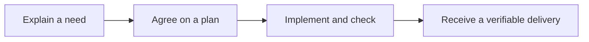

# Using custom-agents: a handbook for people and teams

**English** · [Español](../CUSTOMIZATION.md)

custom-agents helps turn a need into organized, reviewed and verified work. Start
by describing what you want in your own words. The product coordinates specialist
assistants and keeps a record so that the team can understand and resume the work.

This handbook is for department leads, product owners and working teams.
**You do not need programming experience to follow the operating workflows.**
When a step needs an administrator or technical team, the guide explains what to
ask them for. Commands, agents and skills appear alongside their purpose.

## One example from the first idea to delivery

Our fictional example is an **internal requests portal**. Someone submits a
request and a responsible person approves or rejects it. We need to record who
made the decision, prevent a second decision on the same request and explain a
rejection. The examples describe intended behavior, not work published to a real
account. Issue identifiers and names are illustrative.



The guide follows the idea into a plan, explains how tasks and comments appear,
and shows what allows work to be closed. It then follows the same method with
Jira/Confluence and Redmine/a wiki. The process does not depend on either vendor.

## Where to start

| Your need | Chapter | What you will learn |
|---|---|---|
| Understand the product | [1. Concepts and responsibilities](guides/product.md) | What each component does and which decisions remain yours |
| Prepare and execute work | [2. Core workflows](guides/core-workflows.md) | From an idea to acceptance, including resuming work |
| Work with Jira and Confluence | [3. Atlassian](guides/atlassian.md) | Task or phase issues, comments, states and documentation |
| Use Redmine or another wiki | [4. Redmine and other tools](guides/redmine.md) | Configure another provider while preserving the method |
| Adapt the product | [5. People, agents, skills and tools](guides/customization.md) | What can be customized and who maintains it |
| Introduce it to a team | [6. Daily operation](guides/operations.md) | A pilot, common problems and a glossary |
| Understand and connect memory | [7. Memory and optional integrations](guides/memory.md) | Local curation, Kwipu, Graphify and Graphiti with recovery |
| Use one working console | [8. Shared dashboard](guides/dashboard.md) | Independent projects, sessions/chat, plans/kanban and activity |

Read chapters 1 and 2 first, then choose the integration your department uses.
Every workflow explains a recognizable situation, its prerequisites, the steps,
the people and components involved, decisions, verification and recovery. The
arrows show the order; the surrounding explanation describes the actual work.

## How to request work

For example:

```text
We want people to approve or reject internal requests.
Before implementing anything, help me clarify the expected behavior
and show me a plan I can review.
```

Some interfaces also offer a command: a short instruction that starts a workflow.
This guide uses short names such as `/setup` and `/dev-cycle`. **You do not have to
memorize commands to understand the process.** If a component is missing from your
runtime, ask the administrator to check the installation rather than editing files
to force it to appear.

For administrators: the Claude Code plugin uses `/custom-agents:setup`; Codex uses
the generated command skill `$custom-agents:custom-agents-setup`, also available
through `/skills`; OpenCode uses `/setup`. A local Claude copy may use the short
name. The same workflow can have a different visible invocation across runtimes.

## What to expect and what to check

At the end of a step, ask **what was done, where the result is and what remains to
be decided**. A convincing explanation is not a substitute for evidence or checks.

A configured Jira integration does not prove that an issue was created. A published
page does not approve the implementation. A task marked complete must retain its
acceptance criteria, review and verification. The manual teaches you to distinguish
these results and the receipts that support them.

The Spanish delivery PDF combines the explained guide, graphical diagrams,
examples and technical appendices for department leads. Markdown remains the
maintainable source. Advanced contracts are linked from each chapter; they are
optional reading for administrators rather than prerequisites for the everyday
workflows. External services, accounts, permissions and MCP connections must be
configured and verified separately. Mentioning one does not install or authorize it.
