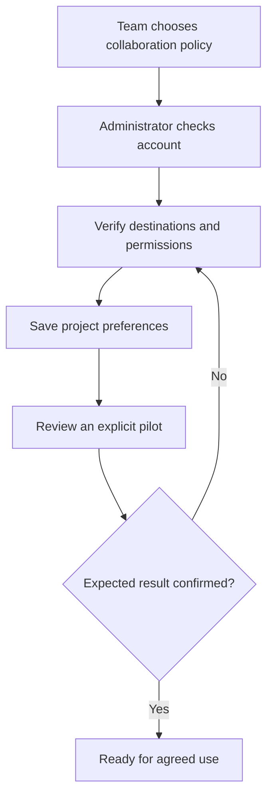
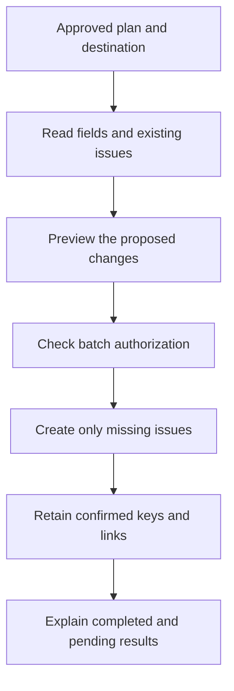
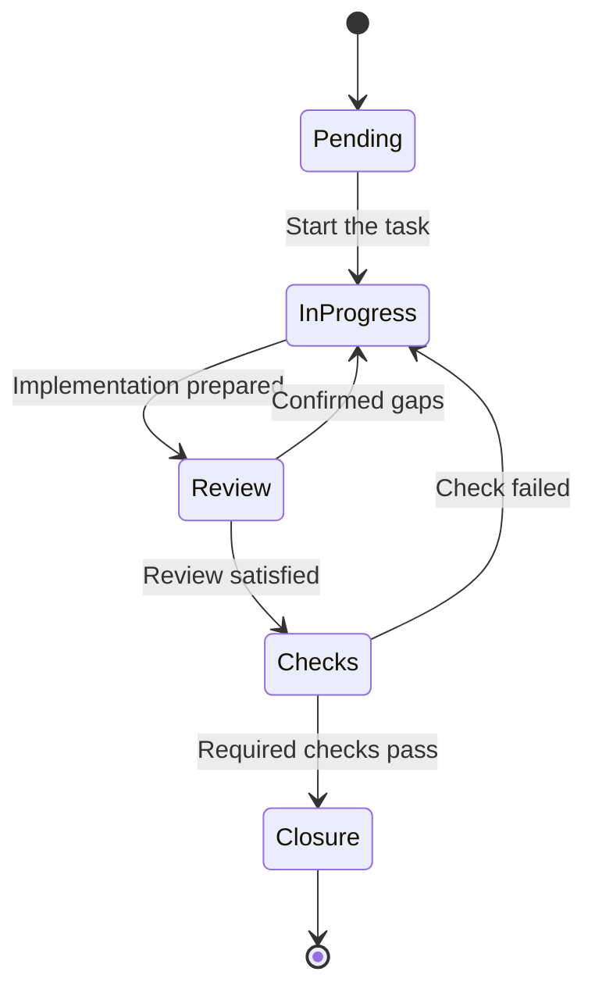
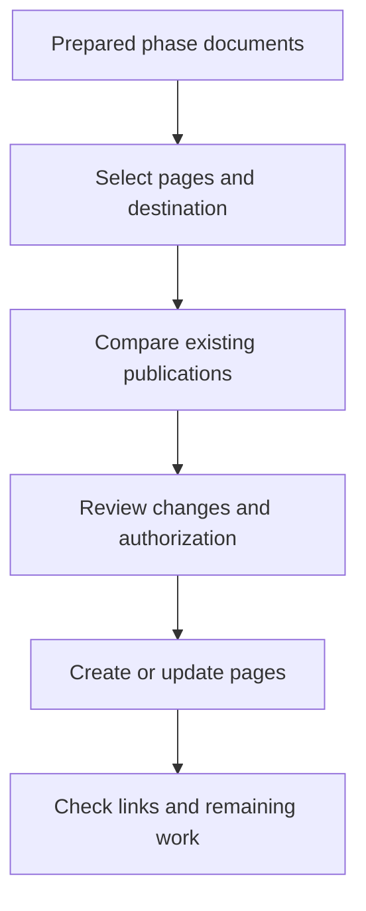
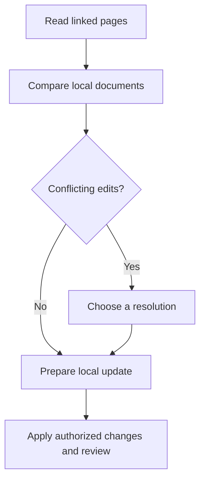

# 3. Working with Jira and Confluence while retaining project control

Jira helps organize issues on a board. Confluence shares documentation in pages.
They are different products: enabling one does not automatically configure the
other. custom-agents maintains the project’s authoritative local records and can
mirror agreed information through a project integration and an available connector.
The examples below describe an illustrative workflow, not a publication to a real account.

## W-08. Prepare Atlassian for a team

### Decisions the team needs to make

Before configuring anything, agree on which Jira project should receive issues,
who may create or edit them, how they should be grouped, and which Confluence
space should receive approved instructions. An administrator checks accounts and
permissions; a department lead decides the collaboration policy.

```text
We use Jira for portal tasks and Confluence for instructions.
Help us choose the destination and whether issues should represent tasks
or phases. Show a pilot proposal before publishing the plan.
```



1. **Validate the account and environment.** The administrator sets up the supported
   connector. Credentials stay with their owner; they are not pasted into a work
   request, project document or example configuration.
2. **Select functions separately.** `/setup` and the project configuration identify
   whether the team needs task tracking, document publication or both. Installed
   skills are not proof that their service operations are available in a session.
3. **Resolve real destinations.** The connector lists accessible projects or spaces.
   Select the correct one by its verified identifier and name; do not invent an ID
   because a similar-looking project appeared in an example.
4. **Agree on grouping and responsibility.** Choose task or phase issues, the initial
   assignee policy and the document destination. Accounts and permissions must be
   valid in the external system. A local domain persona is not an assignee account.
5. **Save preferences for this project.** The administrator checks the schema and
   selected adapter. Examples show a possible configuration shape, not an implicit
   grant of access to every service in the account.
6. **Run a bounded pilot.** Read the destination, preview one issue or page and
   execute the authorized operation. Verify its returned link and actual content.
   A successful read is not evidence of a successful write.
7. **Report readiness.** Explain what was tested and what is still pending. The
   department can use the confirmed functions without assuming the rest are ready.

**Components:** `/setup` coordinates project preferences; `jira-sync` adapts task
tracking; `confluence-publish` and `confluence-pull` adapt document operations.
Their official connector tools must exist and have the required permissions in
the current runtime. Integration bindings select purpose, adapter, events and
capabilities. They neither create credentials nor authorize effects on their own.

## Choose one issue per task or one issue per phase

The choice describes what a card on the board represents. It preserves the
acceptance criteria for each underlying task.

**Per task** is useful for separate responsibilities, priorities and detailed
progress. Our portal might have AREA-101 Permissions, AREA-102 Record decision,
AREA-103 Experience and AREA-104 Verification/documentation.

**Per phase** provides a shorter board. Foundation might contain T-01 and T-02;
Delivery might contain later tasks. The phase issue must explain that internal
breakdown. It is not complete merely because its first task finishes.

| Team question | Per task | Per phase |
|---|---|---|
| Do tasks need separate owners? | Usually clearer | Detail must remain in the phase description |
| Is the board becoming too crowded? | More issues | Fewer issues with an explicit breakdown |
| Where are criteria retained? | Each issue and the local register | Phase description and the local task register |
| What if one task is unfinished? | Its issue remains pending | The phase stays open until all its conditions are met |

You may choose different policies for different projects. Changing a grouping
policy after issues exist needs a preview and reconciliation plan; it does not
permit creating a new duplicate set because the original mapping is inconvenient.

## W-09. Create the plan’s issues in Jira

### What needs to be ready

Use an approved plan, a selected Jira destination, the agreed grouping policy,
working connector access and authorization covering the proposed creation. The
planner prepares the local task breakdown; `jira-sync` adapts it to actual board
fields and operations.

```text
Prepare Jira publication of the portal plan in the chosen project.
Use one issue per task. Before creating, show what will be created,
what already exists and what cannot be mapped yet.
```



1. The adapter reads the approved structure and actual Jira issue types, fields,
   existing issues and any required parent relationships. It checks the chosen
   project rather than accepting a guessed identifier.
2. The preview lists each intended issue, its summary, description, type and
   available assignment mapping. For a phase issue, include its tasks and criteria.
   The owner reviews the batch and unresolved mappings.
3. Existing local-to-remote links are checked. A real issue corresponding to T-02
   is reused instead of duplicated. A title match alone is weaker than an established
   reference and may require reconciliation.
4. Only covered, valid operations execute. A required field or missing permission
   leaves the affected item pending with a reason; the adapter does not fabricate a
   value just to produce a successful response.
5. Confirmed issue keys and links are retained in the project’s mapping. If only
   three of four creations succeed, the summary identifies those three and the
   unresolved one. It does not claim that the entire batch is published.
6. If a response is lost, consult the actual board before retrying. A timeout does
   not prove that Jira did not create the issue. Reconciliation prevents duplicates.

**Check the result:** a readable created/reused/pending list with actual links,
matching descriptions and the agreed parent structure. For our example, check
that each real issue corresponds to the intended portal task and project.

## W-10. Understand comments and state changes

### Different moments represent different evidence

An implementation comment explains a code change. A review comment reports findings.
A QA comment reports checks. The coordinator closes only after combining the
required evidence. The project adapter can mirror these events when configured.

The following state names are illustrative. Your Jira workflow may use different
names or fewer columns; the adapter discovers the transitions actually available.



1. **Start.** The coordinator starts T-02. If supported and authorized, the adapter
   requests the actual transition representing work in progress.
2. **Implementation.** `implementer` adds recording of the decision reason. A comment
   says what changed, what evidence exists and what remains. It does not yet claim
   acceptance: “Decision saving added; review and QA pending.”
3. **Review.** `adversarial-review` coordinates `reviewer` lenses. They find an empty
   reason still accepted. One signed review event records the attempt, findings
   and evidence. The issue can return to correction when its workflow permits it.
4. **Correction.** The implementer fixes that behavior and records the next attempt.
   The previous finding and its resolution remain visible; history is not rewritten
   to imply that the first implementation was already correct.
5. **QA.** `qa` executes the required permission, reason and duplicate-decision cases.
   A failure returns the task to correction. An environment that cannot run a
   required check remains explicitly unverified.
6. **Closure.** The coordinator checks criteria, review and QA. Only then can the
   adapter request a real closing transition if authorized and available. For a
   phase issue, every underlying condition must be met. If no suitable transition
   exists, explain the limitation and pending manual action.

### What a useful comment contains

This is an example of structure, not an actual external publication:

```text
[custom-agents · qa] Verification of T-02

Checked that one request cannot receive a second decision and
that rejecting without a reason is explained and remains pending.
Result: required cases passed; evidence is in the verification report.
Closure requires the coordinator’s criteria/review/QA check.
```

The role signature explains the source of the update. It does not create a separate
Jira account for every agent. The connector’s account remains the real external
author. Assignees and mentions must resolve to valid identities in your organization.
`adversarial-review` owns its review comments per attempt; QA reports verification;
the coordinator mirrors start, progress and closure through configured events.

### Time records and unconfirmed operations

If the project enables recorded time and measurement, explain its source. A
measured implementation interval, reported supervision and estimated effort are
different kinds of information. Do not convert a missing measurement into an
asserted worklog or present an estimate as hours actually spent.

An operation without confirmation is uncertain, not automatically failed. Query
its real result and reconcile it before a retry. Preserve the receipt or unresolved
state so the next person can understand what happened.

## W-11. Publish operating instructions in Confluence

### Publish documentation that the team has prepared

At phase closure, the department may need a usable guide. `documenter` prepares
the local content and `confluence-publish` adapts it to the selected destination.
Publishing a page does not approve the underlying implementation.

```text
Prepare publication of the portal instructions in the agreed space.
Show which pages would be created or updated and what remains uncertain.
```



The adapter reads the real space, page hierarchy and existing mapping. A possible
structure has a portal landing page followed by use, permissions and daily operation.
It checks existing pages to avoid creating a new sibling tree on every run.

Review the proposed tree and differences. Internal evidence or unrelated files
are not automatically public because they are in the repository. Authorize the
applicable publication scope, then confirm actual page identifiers, versions,
links and content. The manifest permits a later bounded update.

If a remote page changed since the previous synchronization, retain the conflict
and compare versions. The adapter does not overwrite it simply to clear an error.
A correct summary can report one updated page and one pending conflict or permission.

## W-12. Bring a Confluence edit back into local documents

### A normal collaboration case

A department lead edits the user guide directly in Confluence. The project needs
to review that change and keep its local documents current. `confluence-pull`
uses the shared manifest to identify linked pages and documents.

```text
Review Confluence changes to the portal guide and compare them with
our documents. Before updating local files, explain differences and conflicts.
```



First validate the relationship between remote pages and local paths. A search
result is not automatically part of the project. Compare available versions and
show the proposal; a conflict requires an explicit resolution rather than choosing
one side silently.

Local frontmatter and ownership metadata retain their contract. A failed receipt,
changed page or ambiguous path remains pending. At the end, explain updated files,
omitted changes and conflicts. A text update that changes product behavior may
need its own implementation plan and verification rather than being accepted as
an editorial correction.

Administrators can consult the [advanced Atlassian reference](../reference/atlassian.md)
for configuration, event, mapping and provider-tool contracts. Every example needs
verification against the selected real account and current runtime.
