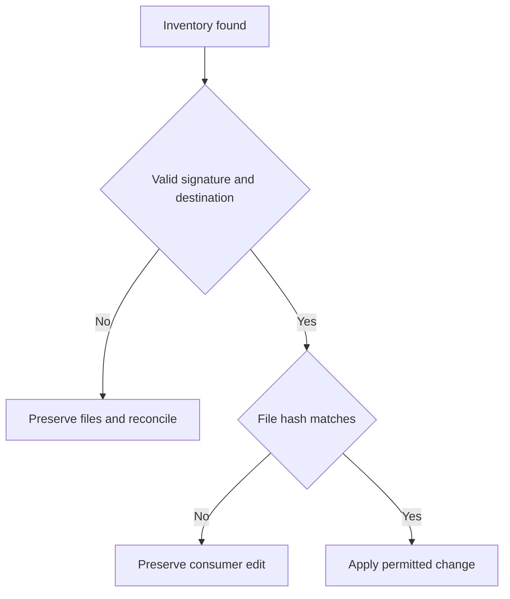

# Installer and integration security and recovery changes

This guide describes the fixes following the 3.2.1 audit. npm review is independent of product tests: a package that passes its tests can still be blocked by the registry and require its appeal procedure.

## Installation ownership

The installer authenticates inventories with HMAC-SHA256. Its private key lives at `~/.custom-agents/installer-auth-v1/key`, outside the project. It is not a Claude, Codex, OpenCode or npm credential; never commit or share it. The receipt binds provider, scope, project and destination. Editing the JSON, copying it into another project or losing the key prevents using that inventory to delete files or execute cleanup actions.

Legacy unsigned inventories no longer authorize automatic migration or uninstallation. On `unverified installation manifest`, back up the installation and inventory, compare paths with provider documentation and manually reconcile files genuinely belonging to the plugin. Do not sign an unknown inventory or remove other projects' files to unblock the operation. A lost key cannot be reconstructed from its receipts.

Claude's default copy uses the ownership-checked `full` profile. Existing files without established ownership block replacement; consumer edits survive uninstallation. Invalid `--scope` values are rejected before any action.

Profile copies prepare each file in a private directory whose identity is recorded in the signed inventory before payload writes. After an abrupt interruption, uninstall can remove complete or partial scratch files. A replaced directory, unknown contents, or a linked scratch file is preserved with a warning; cleanup never recursively deletes the staging tree.

## Publish only what remains authorized

The outbox retains the need to retry, not permission to resend old bodies. Recovery replans against entries that remain approved and routed. Withdrawn content is not sent simply because it remains queued. Adapter partial receipts still participate in recovery.

Graphiti `summary` sends the explicit summary or first paragraph, never the full body as a fallback. Projection identity is compared alongside source hash and version. Changing a projection for an already published identity requires incrementing the approved version; an actionable error prevents silently reporting an unchanged synchronization as successful. Remote identities are immutable: neither this change nor a rebuild deletes history already received by the server. Evaluate remote data removal separately using the backend's procedures.

Confluence always excludes `docs/security-scan/**`, candidates and journal, even when project policy includes all Markdown and removes exclusions. Knowledge proposals record `content_origin` on creation; approval cannot relabel an agent proposal as human. These are declared provenance labels, not authenticated personal identities.

## Sessions, journal and exports

A definitively failed turn with a connected process permits a new explicit message. Uncertain deliveries are never resent automatically. OpenCode can recover after transient polling failure. Disconnections release capacity after owned-process cleanup and discard late events from the old connection. Oversized requests permit only denial or cancellation and direct operators to the native interface.

Journal I/O rejects redirected parents, links and shared hardlinks for both default and configured queue paths. Entry reads are bounded. Unowned READMEs are not adopted or overwritten as generated indexes. Optional capture preserves existing data and degrades without blocking the session when safe storage is unavailable.

Portable skill bundles include a capability catalog limited to delivered skills. Interop export validates all destinations before writing and publishes files atomically. Jira comments use the recognized-secret redactor; generated commands retain configuration, date and state through absolute paths even when run from another directory.

## Shared caches

Claude caches and their marketplace registration are shared at user scope. They have separate receipts and are not part of any project's inventory. Uninstalling an instance removes its registration and keeps these caches, even for the last instance: this avoids deleting files used by other projects or versions. Retained cache files do not mean an instance remains active. Project files and consumer edits retain their independent ownership lifecycle.

## Large histories

Ledger archival keeps reads bounded. The default budget for `execution-history.md` is 8 MiB; when history grows, it stops before changing it and explains how to increase the explicit budget: `python agent-kits/shared/ledger-archive.py docs/roadmap/<initiative> --apply --history-max-bytes 16777216` allows 16 MiB. Existing content and links are preserved. The ceiling is 128 MiB; reaching it requires planning historical archival outside this operation, without truncating records or removing their references.

Profile configuration, commit snapshots and diagnostic responses have an explicit limit of 32 nested object/list levels. Excessively deep JSON produces a controlled warning or invalid result; successfully decoding a document does not establish that lite is active. Simplify or externalize the structure before continuing. The training-data validator retains its existing 50-level limit.

## npm publication

The package contains authorized audit and pentest tooling. It therefore declares `contentPolicy: {"class":"dual-use"}` and includes a plain-text root `DISCLOSURE` in the tarball. Once published, both must remain in subsequent versions and publishing must enforce 2FA. Declaring them does not guarantee npm approval.

Account suspension requires npm review; code changes do not lift it. Preserve the rejected tarball, SHA-512 and reference ID for the official appeal. Do not automate repeated publication on a 404 or use another account or package name to bypass the restriction.

Direct publication of a dual-use package requires an interactive session with 2FA. Automation tokens and trusted publishing (OIDC) must use staging and promotion with 2FA under npm’s specific policy. Declaring dual-use does not authorize direct publishing that bypasses this protection.

Sources: [publish-time scanning](https://github.blog/changelog/2026-07-28-npm-publish-time-malware-scanning-and-dual-use-metadata/), [dual-use policy](https://docs.npmjs.com/policies/dual-use/), [appeal and reinstatement](https://docs.github.com/en/site-policy/acceptable-use-policies/github-appeal-and-reinstatement).
