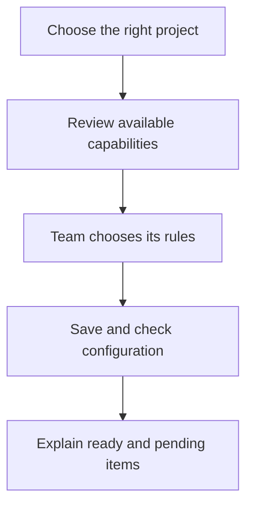
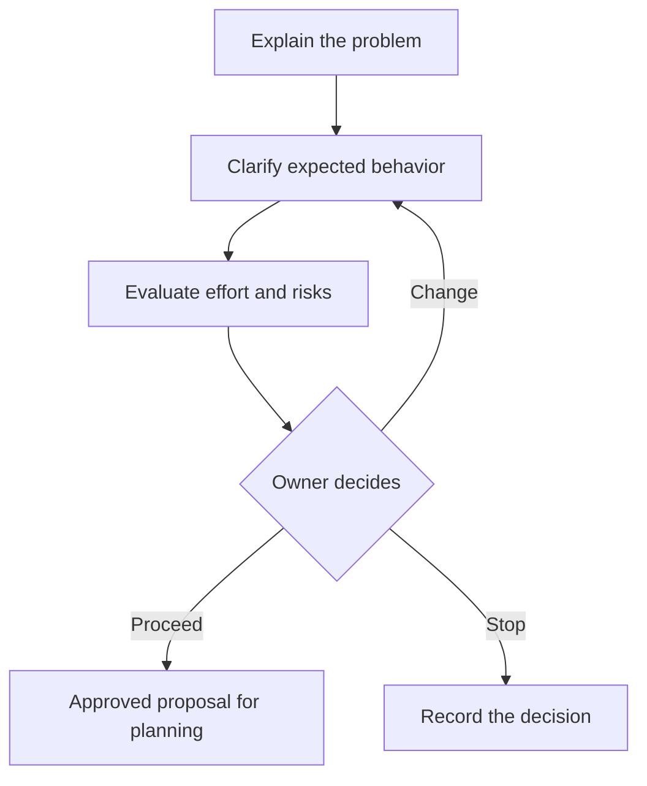
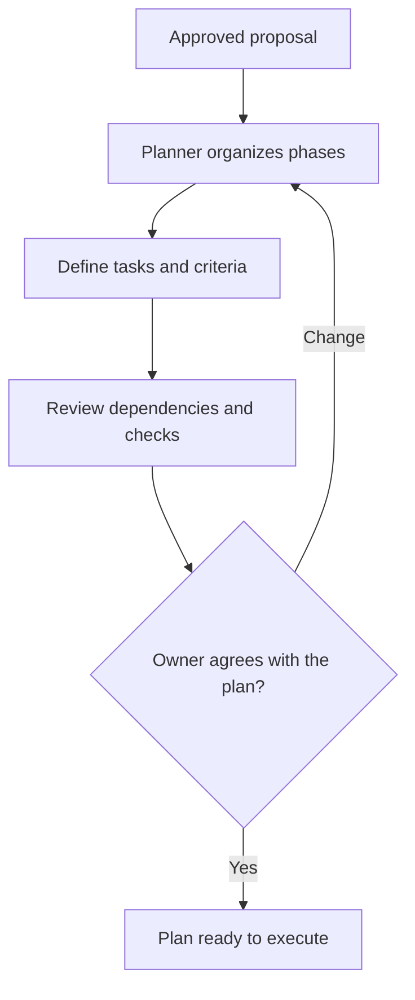
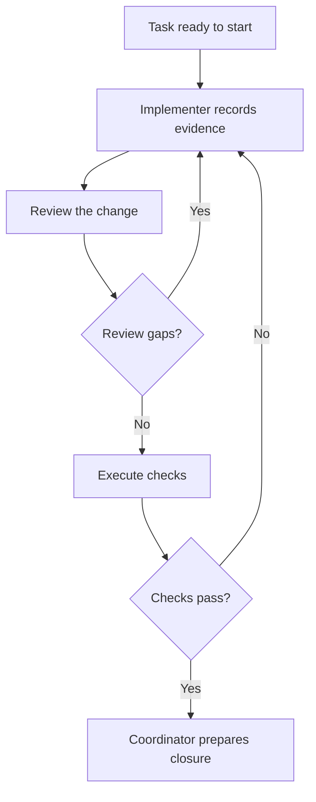
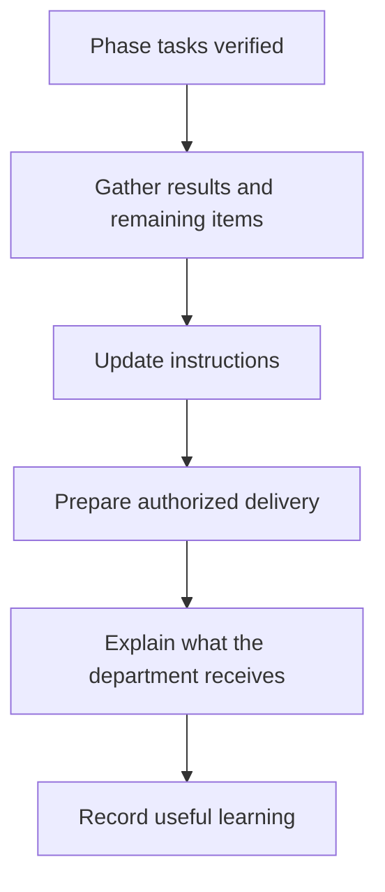
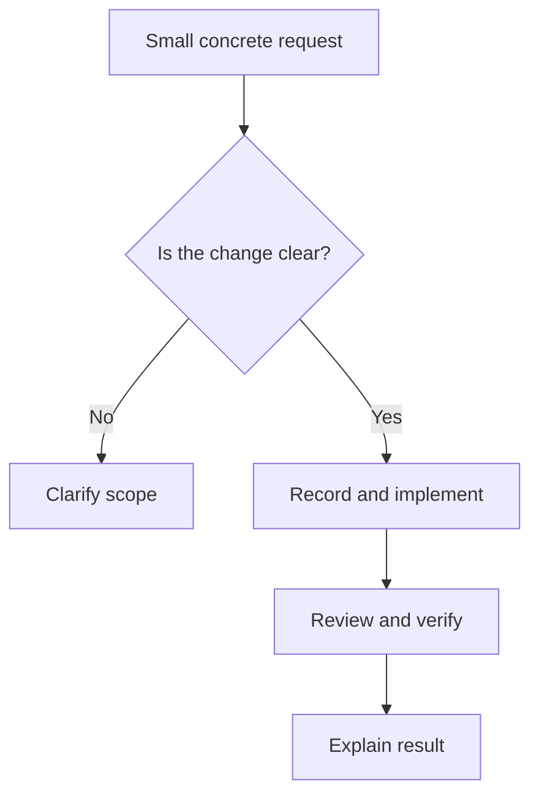
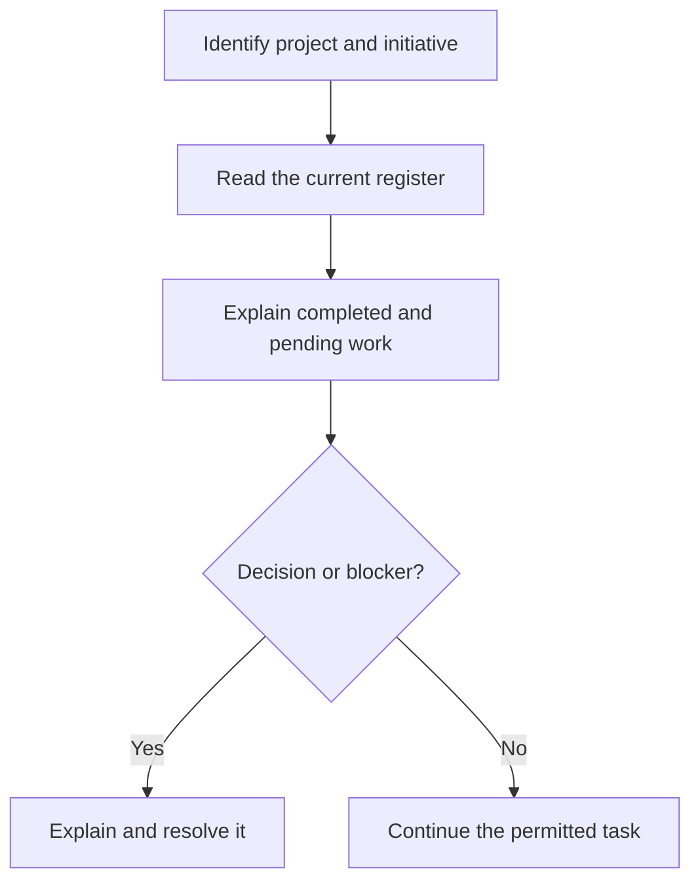

# 2. From a request to a delivery: the core workflows

Core organizes work without requiring Jira, Redmine or a wiki. Our portal example
continues here. Every initiative has its own records and verifiable tasks. Commands
start or consult the process in the supported runtime; they are not a substitute
for understanding and agreeing on the goal.

## W-01. Prepare a project for work

### When to use it and what you need

Use this workflow when a team first starts in a project. You need an administrator
or technical contact, the right project folder, an installed plugin or supported
copy, and someone who can decide the team’s working rules. Installation and accounts
must already be prepared by their respective owners.

You can ask:

```text
Prepare this project for our team. We want to organize work locally,
use tests before changes and share documentation only when we agree.
Explain the available options and check what still needs setup.
```



1. **Identify the project.** The coordinator checks which folder and initiative you
   mean. With multiple open projects, it clarifies the target rather than guessing
   from a nearby folder or a preference from another team.
2. **Check installation.** `/doctor` explains what it could verify and which
   capabilities are absent or unconfirmed. A historical diagnostic report is not
   evidence of a currently working connection.
3. **Agree on rules.** `/setup` guides development rules, review and test preferences,
   memory choices and external services. Ask for a sensible proposal; you do not
   have to understand every internal identifier to make an informed decision.
4. **Record the choices.** The project configuration captures the agreed preferences.
   A setting that requires permission does not create that permission in the runtime.
   An unavailable requested function remains visibly unavailable.
5. **Check each external service separately, if chosen.** Its administrator validates
   the account and destination. Saving a Jira preference does not prove that an issue
   was created. Core remains usable without an external service.
6. **Receive a readiness summary.** It should say what is ready, what was tested,
   what remains and who needs to act. The presence of a file is not a passing check.

**Participants and components:** the team makes the process decisions; the coordinator
uses `/setup`, `/doctor` and configuration readers, involving an administrator when
needed. `plugin-panel` and `/work-context` can inventory declared capabilities.
No mandatory MCP or external account is needed for a local pilot.

If something is missing, ask which step failed and what evidence is available.
Correct installation or access at its owner; do not widen permissions blindly.

## W-02. Turn an idea into a proposal you can approve

### The portal example

The department wants approval and rejection. The product still needs to clarify who
may decide, whether a reason is mandatory and what happens if someone clicks twice.
The product workflow `/pm-cycle` helps define the need and decide whether to proceed.
Its output is a proposal, not an implementation that has already been authorized.

```text
We want a portal for approving and rejecting internal requests.
Help me define the expected behavior, risks and scope before building it.
```



1. **The analyst makes the request concrete.** `analyst` asks about real cases:
   who can approve, whether a rejection may be empty, and whether the same request
   may receive two decisions. It turns the answers into observable acceptance
   conditions, not merely descriptions of buttons.
2. **The evaluator explains uncertainty.** `evaluator` estimates effort, cost and
   risks from available evidence. Ask what is measured, estimated or unknown. A
   missing number should remain missing, rather than being invented for a table.
3. **Compare approaches when needed.** `architect` can explain alternatives and
   their implications. Its recommendation supports the owner’s decision rather
   than replacing it. `research-first` may compare existing tools or solutions;
   `code-health` may provide evidence about the repository’s condition.
4. **The owner decides.** Approve, request changes or stop. A clear approval might
   allow the three agreed behaviors while leaving automatic notifications out.
   The specification retains that scope and the reasoning behind it.
5. **Prepare the next stage.** The coordinator explains how to plan and execute an
   approved initiative. A proposal on disk is not permission to implement every
   idea mentioned during the discussion.

**Check the result:** the specification explains desired behavior and boundaries;
its evaluation states assumptions. You can identify the decision and what the
team is now authorized to do. If answers or evidence are missing, clarify them
rather than treating silence as approval.

## W-03. Divide the proposal into understandable phases and tasks

### What a plan does

A phase groups related work that produces a reviewable result. Our portal might
have a Foundation phase and a Delivery phase. The tasks below are illustrative:
`planner` adapts them to the real project and its dependencies.

```text
Plan the approved portal proposal. Show phases, each task’s outcome,
its dependencies and the checks we will use to accept it.
```



| Phase | Example task | Observable result | Example check |
|---|---|---|---|
| Foundation | T-01: responsible-person permission | Only an authorized person can decide | Another person is denied |
| Foundation | T-02: record a decision | Approval or rejection and its reason are retained | An empty rejection remains pending |
| Experience | T-03: show progress | People can understand the current result | Pending and rejected requests are distinguishable |
| Delivery | T-04: verify and document | The team can use and recover the change | Review, tests and usable instructions |

1. Read the proposed phases in `improvement-plan.md`. Ask what each phase delivers,
   why it comes first and which dependencies constrain it.
2. Inspect representative tasks in `tasks.md`. Each needs a purpose and acceptance
   criteria, not just a name such as “backend.” Checks must address behavior that
   the department recognizes.
3. `work-context` and `capability-check` help choose available agents and skills.
   For example, `stack-practices` contributes language/framework guidance,
   `api-contract` checks an API specification, and `frontend-quality` helps assess
   keyboard use and interaction. They are included when relevant.
4. Compare scope, order and estimates. If the project needs an external task mirror,
   it can be prepared from the approved plan without creating a second authoritative
   list. The Atlassian and Redmine chapters explain task-versus-phase choices.
5. Agree on the plan before execution. A new request that expands scope must be
   assessed rather than quietly folded into an unrelated task.

**Check the result:** you can explain what every task achieves and how the team
will verify it. The plan and task register agree. Unresolved decisions remain
explicit; they are not disguised as ready implementation work.

## W-04. Implement a task, review it and verify that it works

### What starts this workflow

An approved plan identifies a permitted next task. `/dev-cycle` coordinates the
execution. You do not have to direct every specialist, but you should be able to
see results, evidence, pending decisions and the next action.

```text
Continue the approved portal plan using the next permitted task.
Show the change, review and verification. Ask about any scope decision
that the current agreement does not already cover.
```



1. **Implement.** `implementer` starts the selected task and performs the change.
   When the project enables TDD, the `tdd` skill requires an observed failing test
   before the implementation, followed by a passing check and refactoring. It
   does not add a test after the fact and claim that the earlier RED occurred.
2. **Review.** `adversarial-review` coordinates the required fresh review lenses.
   `reviewer` checks the agreement and correctness, adding security/performance
   perspectives when selected. Findings have evidence and a disposition. The
   implementer corrects valid gaps and records why a mistaken finding is rebutted.
3. **Verify.** `qa` runs the relevant checks and reports what passed, failed or could
   not run. `unit-tests` handles the project’s configured coverage rule. A run that
   cannot execute the required checks cannot be described as verified success.
4. **Revisit failures.** Failed checks return to correction. Repeated failures can
   require `debug-root-cause` to reproduce and isolate the cause before another fix.
   A failed test is not solved by changing its reported result.
5. **Prepare closure.** The coordinator combines criteria, review and QA. If external
   tracking is configured, the project adapter can mirror the authorized events.
   An implementation comment is still different from an accepted delivery.

For the portal, the implementer saves a rejection reason. Review may find that an
unauthorized person can still reject. QA may show that an empty reason is accepted.
Either issue sends the task back. A final “done” needs evidence of the agreed
permission, valid/invalid reason and duplicate-decision behavior.

**If something is uncertain:** ask for the exact failed case, available evidence
and what cannot be verified. A timeout while preparing a test does not demonstrate
that the application’s business rule failed. Preserve that distinction.

## W-05. Close a phase and deliver its result to the department

### Closure requires more than a promise

When a phase’s tasks satisfy their required checks, the coordinator can prepare
closure and handover. It explains implemented behavior, verification, documentation
and anything still pending. This is part of the development cycle.

```text
Prepare the portal delivery for our department.
Show what is complete, its checks, operating instructions and limitations.
```



1. `implementer` checks the phase result; `documenter` explains use and recovery.
   `changelog-sync` helps maintain the change notes. A release note states what
   changed, not a claim that a new public version already exists.
2. If the agreed delivery includes Confluence, a wiki, a PR or another publication,
   verify that effect separately. A phase can have a verified local result and a
   publication still pending because of access or an unresolved conflict.
3. Ask for links and confirmed receipts when something was published. A provider
   response lost in transit requires reconciliation before retrying.
4. The department receives instructions that match the actual product and its
   limits. The coordinator says which acceptance decision or next task remains.
5. `/retro` can record useful learning. `documenter` may propose knowledge;
   `knowledge-curator` alone decides whether a candidate becomes approved local
   knowledge. `knowledge-services` publishes only selected, approved content through
   an optional integration; it does not approve a candidate or publish by default.

## W-06. Make a small change without inventing a large initiative

### When the shorter path fits

A small change has a clear objective, boundaries and a sensible check. For example,
“the Reject button must stay disabled while its request is in flight.”
`quick-implement` is a shorter route through the same discipline, not a way to skip
review or QA. Ambiguous or multi-phase work needs a fuller plan.

```text
Make this specific change: disable Reject while submission is pending.
Keep the agreed review and verification steps.
```



The coordinator checks that the assignment is contained. `implementer` records
and performs it with the selected skills; `reviewer` and `qa` retain their roles.
If the actual work expands into authorization changes or a new service, pause
that expansion for a scope decision rather than treating it as part of the button.
At the end, distinguish completed changes, checks and authorized publications.

## W-07. Consult status and resume work with its current context

### Useful everyday requests

You do not need to open every file to know what remains. Ask a focused question
and distinguish a historical snapshot from the currently read register.

```text
Resume the portal initiative. Before continuing, explain what is complete,
what remains, any blockers and the next permitted action.
```



| Everyday question | Useful component | Expected result |
|---|---|---|
| What should we prioritize? | `/pm-backlog` | Comparable proposals and priorities |
| How are the plans progressing? | `/roadmap-status`, `roadmap-dashboard` | Portfolio from current records |
| Where is the work of one initiative? | `/roadmap-brief` | A concrete brief with evidence |
| Estimated versus observed? | `/roadmap-metrics` | Figures with sources and gaps |
| Can I use a board? | `plugin-panel`, `/roadmap-live` where supported | A view of the same canonical records |
| Did work drift from the agreement? | `/spec-drift` | Differences with evidence |
| Continue where we stopped | `/work-resume` | Initiative selection and a permitted next step |

These consultations need no external account unless the chosen question requires
one. Ask for the source and observation time if a view is partial or old. A task
in progress does not prove that a worker is alive. A missing figure is not zero.
The canonical sources are project records, events and verified tool outputs,
not these fictional example identifiers. The [advanced lifecycle reference](../reference/core-workflows.md)
provides detailed contracts for administrators.
