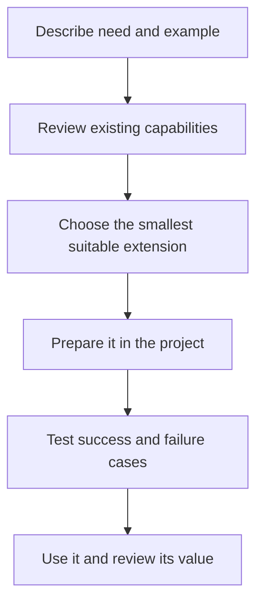
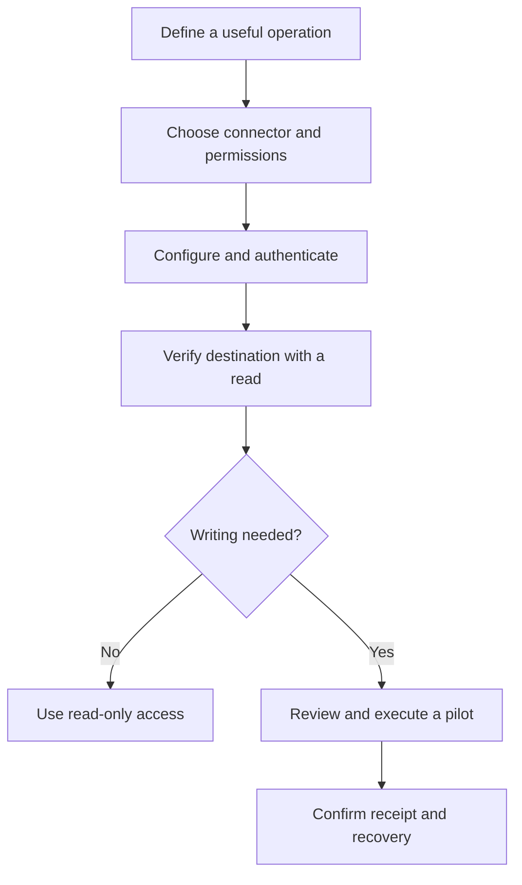

# 5. Adapt the product to your people and work

Different projects can use different tools and specialties without filling the
plugin with components nobody needs. Start with a concrete need, reuse the smallest
suitable component and verify it with a real case. This chapter describes choices
for process owners and administrators; you do not need to edit configuration to
request a useful improvement.

## W-16. Choose and add the right extension

### Start with a working example

Suppose the portal must follow billing-area rules:

```text
We need billing criteria when reviewing this portal.
Propose how to include those criteria without repeating the whole plan.
Explain what the domain owner decides and what the assistant will check.
```



### Choose by purpose, not by unfamiliar folder names

| Need | Likely component | Example |
|---|---|---|
| A useful perspective | Domain persona | Review invoicing implications |
| A specialist with responsibility and limits | Agent | Analyze permissions and report evidence |
| A reusable method | Skill | Check a framework’s implementation patterns |
| A sequence of coordinated stages | Command | Prepare a requested delivery |
| An enduring rule | Project instructions | Every decision needs an attributable reason |
| A concrete executable operation | Tool | Read an issue using an available connector |
| Access to a service | Connector or MCP server | Query a verified team wiki |
| Provider participation in the lifecycle | Adapter and integration binding | Mirror a review event to Redmine |

1. **The owner defines the result.** Give typical inputs, expected results and
   failures. “Detect an unauthorized billing decision” is a more useful example
   than “add another expert.”
2. **Review what already exists.** `/work-context` and `/plugin-catalog` inventory
   declared components; `research-first` compares suitable maintained solutions
   before adding a dependency or tool. Do not duplicate an existing owner merely
   because a different name sounds attractive.
3. **Prepare a project extension.** One project may use Redmine and another Jira.
   Keep project-specific tools, connectors and guidance with their project. A shared
   organizational extension can use a supported user scope, with visible origin.
4. **Set inputs, outputs, limits and failures.** An agent needs clear authority,
   tools and expected evidence. A tool needs a contract, permission boundary and
   error behavior. A skill should identify when its method is useful.
5. **Test before adoption.** Include missing input, service unavailability and
   repeated invocations. Confirm that the new component does not duplicate review,
   QA or publication ownership or publish by surprise.
6. **Record why it belongs.** `planner` incorporates useful capabilities into the
   initiative. A core addition needs reusable value, a maintenance owner and checks
   that justify its continuing cost. A project adapter need not become core.

### Real people and domain personas

A person joins through your organization’s real account, permissions and work
assignment process. custom-agents does not create that identity.

A domain persona is a set of review criteria. For example:

```text
Billing perspective: check currency, tax, rounding and period boundaries.
Ask the business owner when the applicable rule is not established.
```

The technical team stores it in the supported persona location, such as
`.claude/personas/facturacion.md`, and selects it for relevant tasks. It does not
replace the department’s owner or gain authority to approve knowledge or spending.

To add an actual colleague, an administrator grants suitable access to the project
and connected services. Documentation may explain responsibilities and profiles;
it must not invent company accounts. Different domain teams can provide criteria
without duplicating every agent.

### Agents, skills, commands and rules

A developer can prepare an agent with a mission, allowed tools and evidence-backed
output, such as a billing reviewer. Use project pieces first, follow native formats
and avoid names that collide with bundled owners.

A skill contains an activation description and a reusable method. Some skills are
selected automatically; a task can also request one explicitly. A name alone does
not prove that the runtime loaded the file or that its tools are available.

A command organizes a workflow rather than replacing a specialist. A rule applies
when its project instructions are in scope. Placing files in an arbitrary folder
does not make them active. Native Claude, Codex and OpenCode formats differ; the
[advanced customization reference](../reference/customization.md) and
[project extensions guide](../PROJECT-EXTENSIONS.md) provide concrete formats.

### Languages and frameworks

`stack-practices` selects relevant implementation/review guidance. Its Go reference
covers versions, modules, concurrency, cancellation and tests. Rust currently has
security and testing references; that does not claim a complete general Rust
specialty. Do not install a compiler merely to read guidance.

Broader team requests include CodeIgniter 4, Laravel, Symfony, Next.js, React,
Python, .NET, C and C#. Check the installed catalog for the actual coverage and
applicable versions rather than promising an equally complete specialist for
every language. Add depth where a real project and maintenance owner justify it.

### Outcome and recovery

The team should know what was added, where it lives, who maintains it and which
cases were verified. A general-purpose extension belongs in the plugin only when
it adds reusable value without duplicate ownership. If it fails a pilot, disable
the selected capability, keep evidence and correct it before wider adoption.

## W-17. Connect a tool or an MCP server

### A connection makes operations available

A tool is an operation the assistant can invoke. An MCP server can expose operations
from another system. A declared name is not a working connection: the environment
must support, authenticate and expose the operation with suitable permissions.

```text
We need to read the portal approval page from the team wiki.
Prepare that connection and prove a read. Do not enable publication
until we agree on its destination, permissions and pilot.
```



1. **Explain the missing operation.** Start with reading the approval page; add
   updating only when useful. `research-first` compares official or maintained
   connectors, compatibility, licenses, maintenance and available alternatives.
2. **The administrator limits access.** Choose the real account and destination.
   Keep secrets outside documents. Decide project versus user scope according to
   the environment’s supported rules rather than granting all service permissions.
3. **Configure and authenticate natively.** Claude, Codex and OpenCode have different
   formats. Examples using `.invalid` are deliberately non-operational. Replace
   them with an approved endpoint and validate the installed version’s schema.
4. **Verify the current session.** Inventory actual operations and perform a bounded
   read. Confirm the returned title and space belong to the selected destination.
   `/doctor` and `/work-context` support diagnosis and inventory, not automatic trust.
5. **Bind lifecycle operations when needed.** An adapter explains how to use tools;
   the integration binding selects when and for which purpose. Connecting a wiki
   does not decide what to publish or when to close a task.
6. **Test writes separately.** Preview a selected pilot page, check authorization,
   execute it and compare the real result. Test reconciliation after a lost response
   so retries do not duplicate or overwrite unrelated content.
7. **Recheck after changes.** Yesterday’s permissions or version do not prove today’s
   connection. `delivery-practices` helps assess configuration, recovery and MCP
   boundaries when they form part of a project delivery.

There is no closed vendor list preventing a project from adding another tool.
A new integration needs a contract and meaningful checks. If a function is absent,
state the limit rather than simulating it. To diagnose failures, identify operation,
destination and account role without sharing credentials or whole conversations.

## What the dashboard can do

The operating console brings registered, independent projects to one local address.
It supports compatible native sessions/chat, portfolios and kanbans, task notes,
preparation of the next work and received operations. [Chapter 8](dashboard.md)
explains the full workflows.

Static HTML remains a capability snapshot without chat. The console reports native
limits and does not promise universal Desktop window control. Declared integrations,
connected runtimes and historical activity retain their different sources and
levels of verification.
