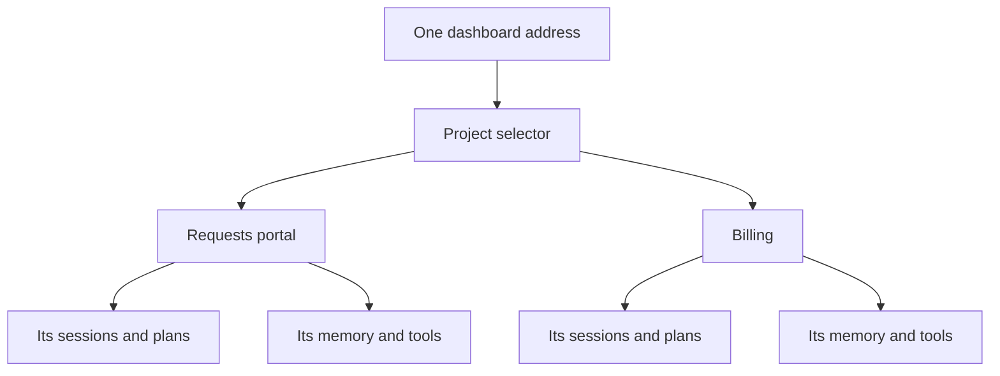
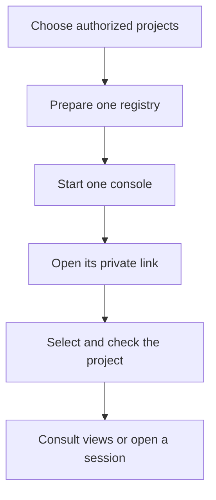
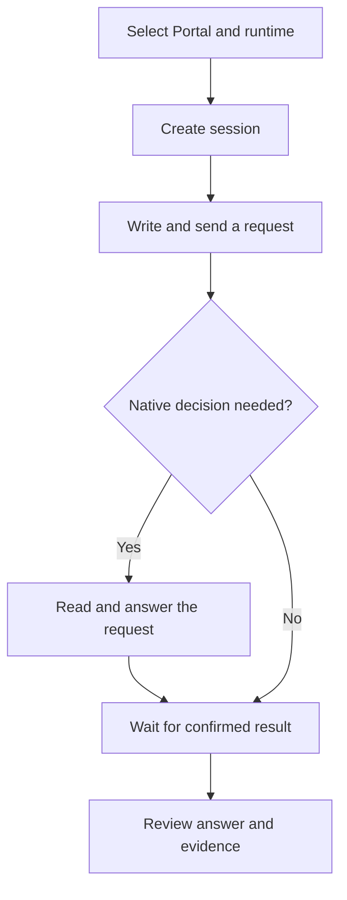
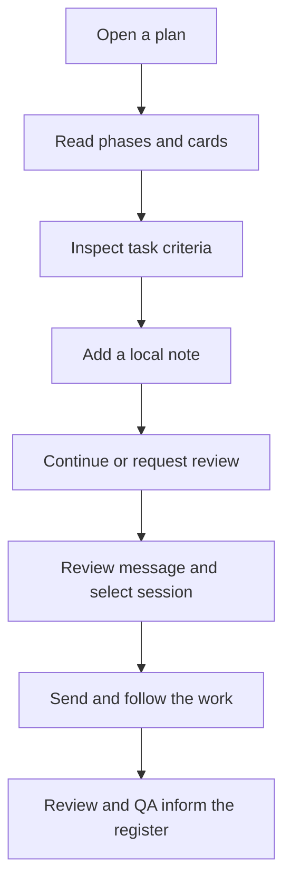
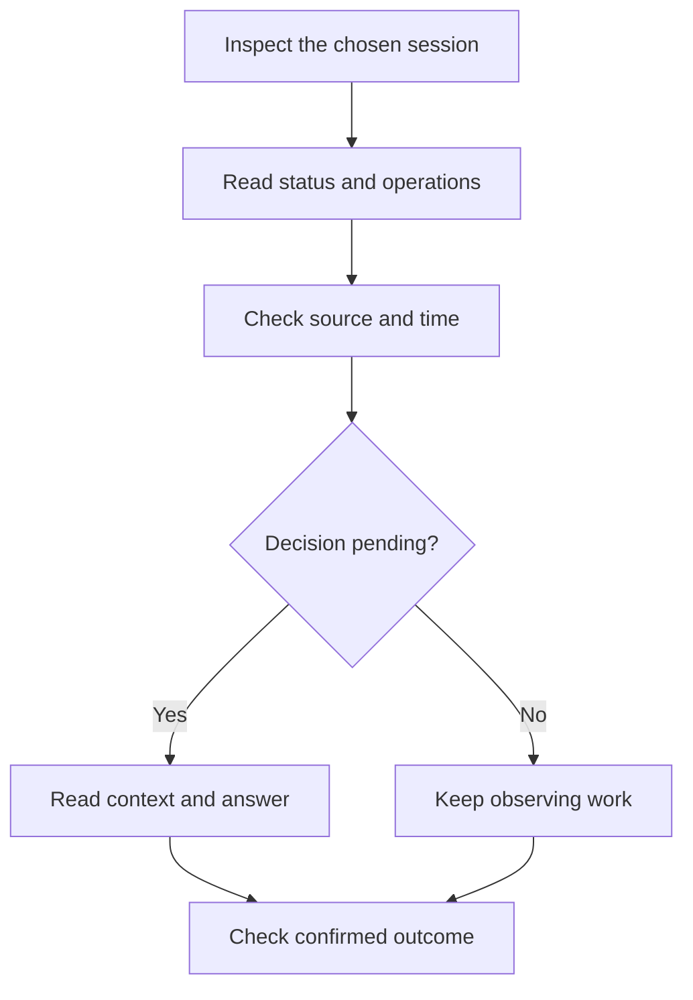
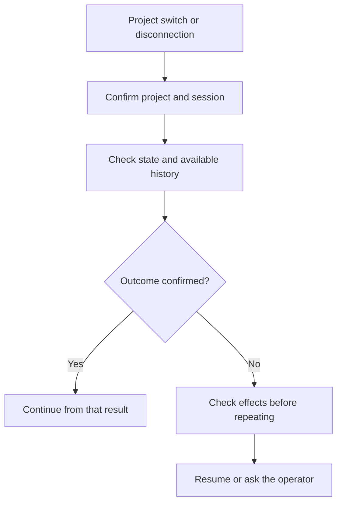

# 8. One shared dashboard for independent projects

## One place to start

Suppose your team maintains the requests portal and a billing application. You do
not need a dashboard address for every project. The custom-agents console provides
**one local address with a project selector**. Select Portal to see its work; select
Billing to see Billing’s work.

Conversations, plans, task notes, memory and events remain separate. Switching
projects does not move work between folders. Each session retains the project
where it was created. A running turn may continue while you consult another project;
return to that session to request an interruption.



This is a local console for its operator. Its private link grants access to the
registered projects; it does not provide separate user accounts. Network access
for different people with different permissions requires another deployment with
identity and authorization. Native assistants retain the operator’s permissions
and their own policies; selecting a project is not an operating-system sandbox.

## Find your way around the screen

| Area | Purpose | Useful example |
|---|---|---|
| Project selector | Change the context of the console | Switch from Portal to Billing |
| Overview | Consult pending work and conversations | Resume yesterday’s review |
| Sessions | Chat with a native runtime and answer its requests | Investigate why an empty rejection reason is accepted |
| Plans and tasks | Open portfolio, phase kanban and task details | Read T-02 criteria and add a note |
| Live agents | Inspect received operations and their source | See a file read or a completed tool call |
| Memory | Query local knowledge and understand its authority | Open an approved decision |
| Integrations | Inspect project declarations and detected runtimes | Check whether a wiki or memory backend is configured |
| Capabilities | Explore agents, skills, commands and project extensions | Find Go or testing guidance |

Use the light or dark theme. `Ctrl+K`, or `Cmd+K` on macOS, opens action/project
search; Escape closes dialogs. Controls have labels and visible keyboard focus,
and the interface adapts to narrow screens. An absent measurement remains
unconfirmed instead of becoming a convenient zero.

## W-23. Prepare the shared console and register projects

**Situation:** the department lead wants to consult Portal and Billing together.
An administrator or technical operator prepares the console; everyday use does
not require editing configuration files.

**Prerequisites:** the plugin/bundle with `plugin-panel`, native Python and the
chosen project folders. Chat additionally needs a permitted, installed and
authenticated compatible runtime. The dashboard does not install Claude Code,
Codex or OpenCode or ask you to enter provider credentials into its own form.

**Participants and components:** the operator maintains the registry;
`/plugin-catalog` uses the `plugin-panel` skill to locate and start the console.
No implementation agent is required to list registered projects. Python provides
the local process; the chosen native CLI executes work only when requested. No MCP
is mandatory for opening the interface.



1. **The administrator registers chosen folders.** Each entry has a stable ID,
   display name, absolute root and allowed runtimes. For example, `portal` and
   `facturacion`. The console does not scan the machine for nearby repositories.
   Keep a common operator registry outside project Git history when appropriate.
2. **Start one instance.** `/plugin-catalog --serve --workspaces <registry>` tells
   the assistant to use the operating console. Its default port is 8769. If occupied,
   inspect or reuse the existing instance; do not silently start another dashboard
   on a different port. The technical startup reference explains direct invocation.
3. **Give the private link only to its intended operator.** The initial link contains
   local access authority. Do not put it in Jira, Git, the manual or a log. The browser
   removes that credential from the address after authentication. A server restart
   creates a different access link.
4. **The lead checks the selector.** Recognize the project names and choose Portal
   before starting. Billing may allow fewer runtimes; each project retains its
   own configuration and capabilities.
5. **Add another project when useful.** The administrator edits the same registry
   and restarts the instance after checking active work. Another folder does not
   require another dashboard server. The browser cannot edit the registry or send
   an arbitrary project path to the API.

**Verify:** both projects appear at the same address and display their own plans.
A runtime-free pilot can still use local views; it does not prove chat is available.
Fix an invalid registry or missing folder at its source rather than registering a
broader personal directory to hide the error.

## W-24. Open a session, chat and answer a request

**Situation:** investigate why the portal accepts a rejection without a reason,
before authorizing an implementation.

**Prerequisites:** Portal selected and an allowed, installed, authenticated runtime.
A session is a native working conversation in that project. It is neither a new
account nor an import of all your private conversations.

**Participants and components:** you explain the goal; the native environment
coordinates the response. It may use `analyst` to clarify requirements or
`debug-root-cause` for a requested investigation. File operations and MCP tools
are those actually available in that native session. The dashboard transports
messages and observed events rather than inventing its own permissions.



1. Select **New session**, name it “Investigate rejected requests” and choose the
   runtime. The console prepares the connection and reports its state. Creating
   the session does not itself send an objective or change project files.
2. Write a concrete message, for example:

   ```text
   Investigate why rejecting without a reason is accepted in this portal.
   Explain the behavior and its evidence before changing code.
   ```

3. Select **Send**. Admission is not completion. The console distinguishes connection
   preparation, queued admission, native execution, a pending decision and a terminal
   result. You can draft another message while waiting; a second accidental turn
   cannot be submitted to a busy session.
4. Read any permission request and its context. Allow once or deny when those
   decisions are supported. This does not grant permanent permission. If the full
   context cannot be displayed, the console does not permit blind approval.
5. Answer supported native questions. Advanced forms may require the original
   application; the limit remains explicit. Do not use a different field or decision
   to force unsupported input through the adapter.
6. Ask for the file, case or check supporting the result. One completed operation
   does not establish acceptance of the whole objective. Agree on a plan if the
   investigation leads to implementation.

**Retention and limits:** the console persists a session link, not an extra raw
conversation copy. Visible messages/events are bounded in process memory; the
native runtime owns its history. A resumed view may be partial. Internal reasoning
is not exported. Automatic import of every historical conversation, attachments
and Desktop window control are not supported in this version.

## W-25. Inspect a kanban, comment on a task and continue a plan

**Situation:** the approval initiative has four tasks. You want to understand T-02
and leave useful context before continuing.

**Prerequisites:** an initiative with a plan and `tasks.md`. Executing work also
needs an available native session in the same project.

**Participants and components:** the lead reads and comments. `roadmap-dashboard`
and canonical ledger readers supply data that `plugin-panel` presents. Continuing
prepares a request to follow `/dev-cycle`; the coordinator uses `implementer`,
`reviewer`, `qa`, `tdd`, `adversarial-review` and other relevant capabilities.
Tools/MCP execute within the selected native session. Opening a task card itself
performs no remote publication.



1. Find the initiative under **Plans and tasks** and open its detail. The portfolio
   offers list/board views; the plan kanban groups tasks by recorded state and can
   filter by phase. An empty column is a view of the register, not evidence of
   execution or failure.
2. Open T-02. Read description, criteria, checks and unresolved findings. A partial
   detail requires consulting its source before accepting a result. Document tabs
   show requirements, evaluation and design when present.
3. Add a note such as “An empty rejection must remain pending and explain how to
   correct it.” The note belongs to that task and project. It neither changes an
   approved criterion by itself nor posts a Jira/Redmine comment.
4. If another tab updated notes at the same time, your draft is retained and the
   conflict is reported. Refresh and compare before saving. Retrying the same
   receipted note request should not add a duplicate.
5. Choose **Work on this task**, **Request review** or **Continue in a session**.
   Inspect the prepared message, initiative, task and contextual notes. Choose an
   available Portal session. If none exists, create one and return to the preview
   when its connection is ready.
6. Send the request. The current plan sources are checked again first. If they
   changed, review the refreshed preview before sending. Follow questions, native
   decisions and evidence in the chat.
7. Return to the kanban and check the updated canonical record. Dragging a card or
   writing “done” in a note does not establish completion. Criteria, independent
   review and QA remain part of the normal lifecycle.

**With integrations:** a configured and authorized tracking binding may let the
session workflow publish its events under that adapter’s contract. The dashboard
note remains a separate local source. Inspect external receipts rather than
assuming that everything visible on this screen was synchronized remotely.

## W-26. Understand observed activity and tool use

**Situation:** a lead wants to know whether work is running, which operation is
waiting and why a task state has not changed.

**Prerequisites:** a connected session for native events. Optional hook capture is
a separate, potentially historical source; it can be disabled. External memory
services need not be enabled to observe a native session.

**Participants and components:** `plugin-panel` projects received information.
Agents, skills, tools and MCP operations belong to native execution. Shared-kit
activity producers contribute when enabled. `/doctor` can diagnose configuration;
it is not automatically executed to fill an empty view. Animation is not evidence.



1. Read the session state. Waiting for a decision means an actual request needs
   attention. Queued admission has not yet confirmed execution. An uncertain result
   requires checking before another submission.
2. Inspect the session tools or **Live agents**. A file operation or MCP call may
   report start, completion or failure with a timestamp. A missing role remains
   unreported rather than being automatically attributed to an implementer.
3. Separate **available** from **used**. A catalog entry or MCP declaration does not
   prove loading, connection or execution. An observed use event is different evidence.
4. Compare source and time. Hook capture may contain older events; a connected
   session supplies its received native operations. A ledger task in progress does
   not establish that a corresponding worker is alive.
5. To stop a turn, request **Interrupt** in that session and wait for confirmation.
   Cancellation does not undo writes already performed or prove an external call
   never reached its destination. Check its actual receipt and effects.

**Verify:** you can identify the received event, source, observation time and what
is still unknown. The console does not invent productivity or time-saved figures.

## W-27. Switch projects and recover after a disconnection

**Situation:** you leave a Portal draft, consult Billing and lose the connection.
You want to continue without mixing context or repeating an effect.

**Participants and components:** the user selects and checks the context;
`plugin-panel` scopes reads, drafts and actions; the native runtime confirms turns.
`/work-context` or the agreed resumption workflow helps reconstruct actual work.
No MCP or remote publication is required to recover local records.



1. Switch using the project selector. The previous chat and notes disappear; a late
   response from that project must not populate the new view. Switching itself does
   not cancel a turn already executing there.
2. Return to Portal and select its session. Chat/idea drafts remain separated in
   tab memory while the tab exists; closing it does not guarantee draft retention.
   Conversation text is not stored in browser localStorage.
3. After a lost response, inspect native status/history before retrying. Work may
   have completed even though its confirmation was lost. The console does not
   automatically resend an uncertain turn.
4. **Disconnect** releases an owned connection when no turn is active. **Resume**
   reconnects a session already known to the console and verifies its native project.
   It does not claim an unrelated session or close another operator’s processes.
   Available history can be partial.
5. After a server restart, obtain its new private access link. Local notes and
   known-session links remain in their project; connections and the in-memory
   chat window do not. Verify the actual situation before continuing work.
6. An unexpected folder replacement or invalid state file requires diagnosis.
   Preserve evidence rather than deleting it to remove the notice. A copied project
   may need its own registration and new native connections.

[Memory workflows](memory.md) explain Kwipu, Graphify and Graphiti recovery.
The [console startup contract](../../../skills/plugin-panel/references/control-center.md)
provides the registry JSON, direct startup, resource budgets and protocol limits.
