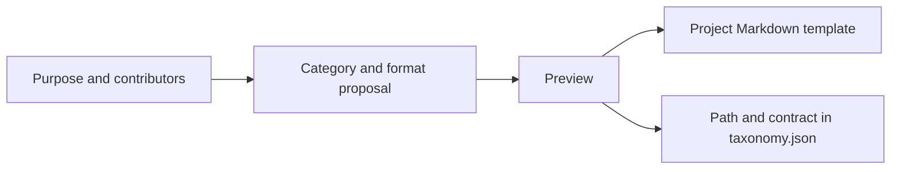
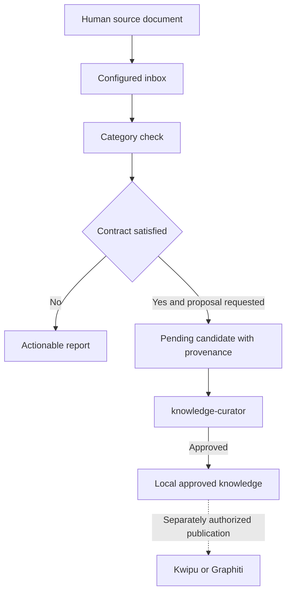

# Project knowledge categories and templates

[Español](../../guides/knowledge-categories.md)

A category organizes reusable project knowledge: decisions, procedures, resolved
incidents, meeting records or FAQs. Projects choose their own categories; the
plugin does not add meetings or FAQs to their defaults.

A template helps authors write. A contract checks required information. Curation
decides whether the content should become approved knowledge. Passing a format
check does not prove that an agreement or answer is correct.

## W-28. Define a category from its purpose

Ask the `knowledge-category-template` skill to create a meetings category with a
date, participants, purpose, agreements and references. It prepares a template in
the consuming project and a category entry in
`.claude/knowledge-services/taxonomy.json`, preserving unrelated preferences.

The deterministic helper produces a preview. Applying it requires the same
request and its `expected_sha256`, which binds the observed files; it is not an
authentication token. When creation is already authorized, no repeated permission
step is necessary. A changed input requires a fresh preview.

| Category property | Purpose |
|---|---|
| `key`, `folder`, `min_evidence` | Existing category identity, approved storage and evidence threshold. |
| `inbox` | Project-relative original document directory, separate from candidate and approved storage. |
| `template` | Project-relative Markdown template outside the installed plugin. |
| `allowed_producers` | `human`, `agent`, or both as a nonempty list. |
| `required_metadata` | Frontmatter keys requiring nonempty scalar or string-list values. |
| `required_sections` | Nonempty ATX sections, named without heading markers. |
| `routing` | Existing per-backend complete, excluded or summary routing. |

Paths cannot escape the project. Templates are data: no execution or interpolation.
The contract is independent of the current template file. Removing a template
does not invalidate historical approved documents. Existing different template
files are preserved; create a revised file and update the reference instead.

## W-29. Check documents and propose candidates

Save original records in the configured inbox and invoke
`/knowledge-category-check meetings`, or ask for the same check in natural language.
Claude Code uses its plugin namespace, Codex exposes a command skill adapter, and
OpenCode uses the short command; see [INTEROP](../INTEROP.md).

Checks are read-only. Reports identify missing metadata, empty sections, origin
conflicts and incomplete inventories. Headings inside code or comments do not
satisfy required sections. Files and read sizes are bounded; an incomplete scan
cannot authorize proposals.

When explicitly requested, `check --propose --expected-sha256 <hash>` submits valid
documents through `knowledge-curation.py`. It preserves originals, source path
and source byte SHA, and creates pending candidates. Repeating an identical
pending proposal reuses its candidate; a different collision is reported.

The command neither approves nor publishes documents. Curation retains its existing
owner and SHA-bound decision process. Changing the category contract governs new
approvals; review pending candidates before tightening a contract.

## W-30. Agent FAQs and mixed categories

A project may define FAQ content with `allowed_producers: ["agent"]` and required
Question, Answer and References sections. An existing producer such as documenter
uses the template, supports its answers with sources and declares `--origin agent`.
No new agent or model provider is required for each category.

For mixed categories, permit both values. Each check declares its batch origin;
the default `human` represents human-supplied documents. Conflicting declarations
are reported, not rewritten to pass a check.

`content_origin` describes declared content provenance; `proposed_by` labels the
submitting producer. Human review does not change generated content into human
authorship. These labels are not authenticated identities or filesystem ACLs.

## Publication and recovery

New categories default to empty routing. Existing backend declarations and
preferences remain intact. Complete, excluded and summary routing remain separate
from backend enablement, approval, export and external indexing. This capability
does not migrate Graphiti episode identities or receipts.

If the template was created but taxonomy publication failed, `partial` is explicit.
Keep the created file, obtain a fresh preview and resume. Configuration backups
are kept in an owned `.category-backups` directory excluded from Git. Writes use
the curation service's cooperative lock; external editors must cooperate.

See the synthetic [meeting, FAQ and mixed examples](../../examples/memory/categories/README.md).
