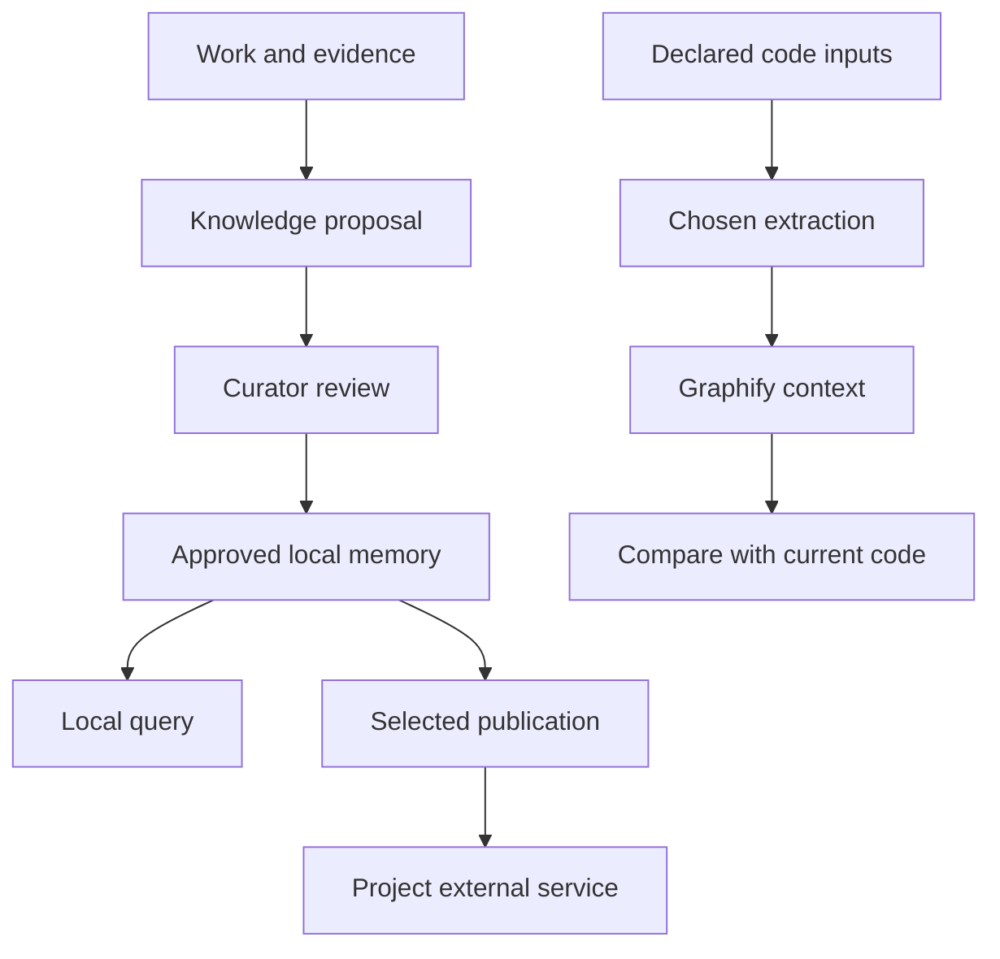
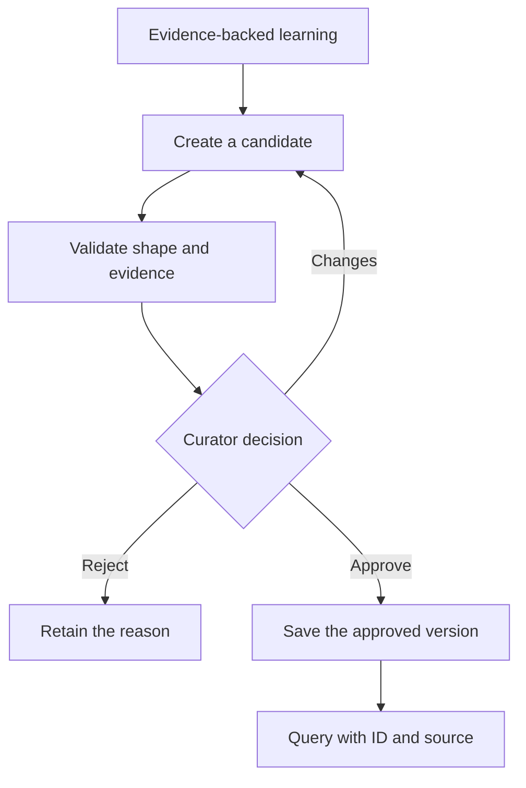
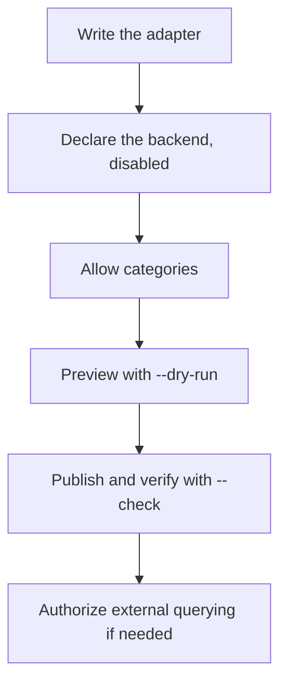
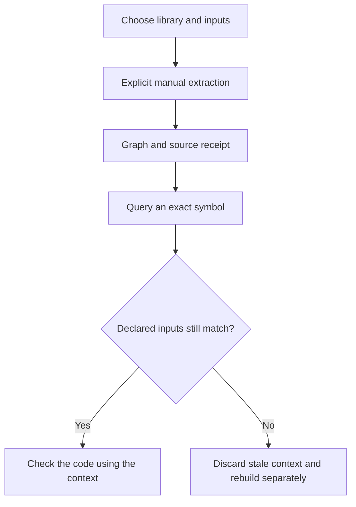

# 7. Memory: retain useful knowledge and choose optional services

Memory helps recover decisions and lessons without reading an old conversation.
It is not a store of everything an assistant says. Continuity notes, proposed
knowledge and approved knowledge have different authority.

For the portal, “a rejection needs a reason” can become an approved rule. “This
particular test failed once” is a session observation. Deciding which claims should
become reusable knowledge requires evidence and judgment, not automatic copying.

## What belongs to core and what is optional

Core retains local memory, its proposal/approval process, the Curator and local
querying. **You do not need any external service or Graphify to work.** External services
are selected per project, like Jira, Confluence or Redmine. The optional
`memory-integrations` module distributes the `knowledge-services` framework (adapter
loader, closed routing and recovery queue) **with no bundled adapters**: the project adds
its own. Installation alone activates nothing.

| Component | Useful purpose | What it does not prove |
|---|---|---|
| Local journal | Resume what happened and what remains in a session | That every observation is an approved rule |
| Knowledge candidates | Propose a decision or lesson with evidence | That the proposal has been accepted |
| Approved memory | Query knowledge accepted for this project | That a model-generated answer is itself approved |
| Project-owned external service | Project approved documents to a service through the project's adapter and, if authorized, query it | That publishing updated the service's index or that a generated answer is correct |
| Optional Graphify | Extract selected code into a navigable relationship artifact | That code context is approved knowledge or still current |

A graph organizes related information. A decision linked to a process and a
function linked to its callers use graphs for different purposes. These products
are not interchangeable brands of a single memory database.



## W-19. Create, approve and query local memory

### When it is useful and who participates

Capture a reusable decision or lesson after work produces evidence. A statement
found in a chat is not approved simply because it sounds confident.

```text
Propose the portal’s mandatory rejection reason as reusable knowledge.
Include the decision, its justification and supporting checks.
Have the Curator review it before treating it as approved.
```



1. **Propose reusable knowledge.** `documenter`, `planner`, `implementer` or a data
   producer may submit a candidate. Identify category, decision, source and evidence.
   Exclude secrets, raw conversations, internal reasoning and unnecessary private data.
   Not every observation needs promotion to memory.
2. **Check completeness.** The Knowledge Gate validates category, minimum evidence,
   sources and tags. It does not make the human judgment that every claim is correct.
   The project’s policy is not weakened merely to get a candidate through a validator.
3. **Have the Curator decide.** `knowledge-curator` alone approves, rejects or requests
   changes. High-impact or contradictory knowledge can require the responsible
   person’s decision. A producing agent cannot approve its own candidate. Repeating
   an unverified assertion does not turn it into a fact.
4. **Preserve an accepted version.** Keep identity, version, evidence and the approval
   process. Accepted content is stored under `docs/knowledge/approved/` with the
   project’s identity. This is local approved knowledge, not automatic publication
   to any external destination.
5. **Query sources.** `knowledge-find.py` searches approved local knowledge and valid
   legacy entries under their respective contracts. Open the actual entry and check
   ID, version and state. Ambiguity or incomplete corpus reading must remain explicit;
   no search hit does not prove that no relevant decision exists.
6. **Version changes.** When a rule changes, propose and review a new version. Preserve
   the history of what supersedes what; do not disguise a changed rule as an unchanged
   accepted source. Moving knowledge to another project requires target-project review.

### A technical query example

In these PowerShell examples, `$PluginRoot` is the installed bundle located by the
administrator and `$ProjectRoot` is the consumer project. Do not reuse an obsolete
cache path or assume that the consumer is the plugin repository itself.

```powershell
$SharedKit = Join-Path $PluginRoot "agent-kits/shared"
python (Join-Path $SharedKit "knowledge-find.py") --root $ProjectRoot --json "motivo de rechazo"
python (Join-Path $SharedKit "knowledge-find.py") --root $ProjectRoot --show "portal.decision.reject-reason" --json
```

The shown ID is illustrative: use an actual returned ID. Verify the source, version
and state rather than only the summary. The search index can be reconstructed; it
is not the source of authority. The separate journal supports continuity and is
not repaired by dumping a whole conversation into approved knowledge.
[Memory portability](../MEMORY-PORTABILITY.md) explains destination review and governance.

## Before connecting a service: shared decisions

The process owner chooses which categories may leave the project and for which
purpose. The administrator maintains accounts, endpoints, the service and any
models. The technical team configures and tests an adapter. The Curator retains
local approval; publication cannot substitute for it.

The **taxonomy** at `.claude/knowledge-services/taxonomy.json` defines categories,
evidence policy and routing to backends. A backend is a configured destination.
Routing is closed by default: a category is not published to a destination unless
it explicitly permits that destination.

The complete [taxonomy example](../../examples/memory/taxonomy.json) uses the fictional
`portal` prefix, declares one disabled example backend and leaves all category
routes disabled. Review and merge relevant settings instead of overwriting an
existing project configuration. Each service needs its own verified setup.

The common port uses [memory bindings](../../examples/integrations/memory.json) with
purpose `knowledge` and the optional `knowledge-services` skill. Binding ID matches
the backend ID exactly. These examples subscribe to no automatic events: approving
knowledge does not publish it. Append bindings alongside existing integrations;
configuring a binding grants neither publication nor external read permission.

Explicit administration retains its CLI. The common binding selects workflow
participation; taxonomy retains category and query controls. Do not duplicate the
Curator, query router or recovery queue for each provider brand.

## W-20. Connect a service of your own

### When it fits

Choose this when your team already operates a memory service (for example, an MCP
server) and needs approved knowledge published there or queried from there. The plugin
ships the framework and **no adapters**: the two it bundled up to 3.x were removed in
4.0.0 (see the CHANGELOG) and local memory is unchanged. It installs and starts nothing.

```text
We want to publish the portal's approved decisions to our memory service.
Explain what must be written and declared, preview the permitted entries and keep
external querying off until publication and sources are verified.
```



1. **The administrator prepares the service.** Account, endpoint and credentials are theirs;
   the plugin neither stores nor discovers them.
2. **The technical team writes the adapter.** One file with the six functions of the
   [contract](../../../skills/knowledge-services/backends/README.md) (`health`, `plan`,
   `apply`, `verify`, `rebuild`, `revoke`), loaded by `type` from `backends/<type>.py` or from
   your own folder through `--backends-dir`. A reference test adapter lives in
   `skills/knowledge-services/scripts/fixtures/`.
3. **Declare the backend, disabled.** In the taxonomy, `backends.<id>` with `type`,
   `enabled: false` and its `config`. A `type` without an adapter exits with a clear
   message, not a traceback.
4. **Allow categories.** For example, `DECISION` with `routing: {"<id>": true}`. Every other
   category stays off. Validate the file before operating.
5. **Preview and publish.** `--dry-run` shows which approved entries would change. After
   authorization, the run publishes and the recovery queue keeps whatever fails. `--check`
   compares health and correspondence; “incomplete” is not a green result.
6. **Reading is separate.** An adapter that implements `puede_leer` and `consultar` can serve
   `knowledge-find.py --intent`, with the backend enabled and the intent authorized; a failure
   falls back to local search with its reason.

Commands for the administrator, run from the right project:

```powershell
$MemorySkill = Join-Path $PluginRoot "skills/knowledge-services"
$Sync = Join-Path $MemorySkill "scripts/knowledge-sync.py"
python (Join-Path $SharedKit "knowledge-schema.py") (Join-Path $ProjectRoot ".claude/knowledge-services/taxonomy.json")
python $Sync --root $ProjectRoot --backend my-service --backends-dir $AdapterFolder --dry-run
# After review and authorization:
python $Sync --root $ProjectRoot --backend my-service --backends-dir $AdapterFolder
python $Sync --root $ProjectRoot --backend my-service --backends-dir $AdapterFolder --check
```

### Results and recovery

A generated answer from the service is **unverified text without authority**: open the
concrete entry before an important decision. If the service fails, the query falls back
to local memory and says why. If a publication is cut off, some files may already be
updated: the pending journal is kept and `--outbox-status` shows the queue; do not delete
the inventory to start blind. `--rebuild` rebuilds the adapter's projection; the service's
index remains its administrator's responsibility.

## W-21. Integrate Graphify to inspect code relationships

### What it provides and who prepares it

Graphify supplies code navigation context. It is not approved project knowledge.
The technical team may use it to find callers and dependencies while checking the
current source. You do not need it to use the portal or consult business decisions.

```text
We want to inspect relationships around the portal’s decision function.
Extract only the declared inputs into a new artifact and receipt.
Verify freshness before using the result as code context.
```



1. The administrator installs or prepares a trusted compatible Graphify library
   and its parsers. Selecting a local library path does not install every grammar
   or make arbitrary external code safe. Verify the actual extraction API.
2. Declare real project-relative inputs and their intended scope. Two files do not
   establish whole-repository coverage. `code-context-build.py` produces a graph
   and a source-fingerprint receipt from the selected input list.
3. Use new output paths. The producer checks that declared inputs do not change
   during extraction and does not replace an existing graph. The fictitious
   `src/requests.py` below must be replaced with a real allowed project input.
4. `code-context.py` accepts an exact ID or exact file/label selection. Text search
   can be ambiguous. The result provides locations for code review rather than
   approving a business conclusion.
5. If declared input bytes changed, the reader returns `artifact-stale` without
   that context. Create a new graph/receipt pair; do not manufacture a new receipt
   to make an old graph appear current.

`$GraphifyRoot` is the trusted external library directory prepared by the administrator.

```powershell
$Build = Join-Path $SharedKit "code-context-build.py"
$Query = Join-Path $SharedKit "code-context.py"
# GraphifyRoot: trusted external library prepared by the administrator.
python $Build --project $ProjectRoot --graph "graphify-out/pilot-01.json" --input "src/requests.py" --graphify-root $GraphifyRoot
python $Query --project $ProjectRoot --graph "graphify-out/pilot-01.json" --source-file "src/requests.py" --label "decide()"
```

The illustrative `decide()` label must match the artifact. Its receipt is named
`pilot-01.json.sources.json`. “Verified declared inputs” establishes the observed
match of those declared files only; coverage remains unknown and the context
unapproved. It proves neither semantics nor detection of all new files.

A missing library, grammar or parser stays unavailable; normal code search remains
possible. Receipt publication failure can leave an orphan graph. Preserve the
diagnostic and use a new destination. A legacy graph without a producer receipt
has no verified freshness. Hooks and opening the dashboard do not launch extraction.
See [the code-context contract and pilot](../CODE_CONTEXT.md).

## Capture knowledge in the team's format

[Workflows W-28 to W-30](knowledge-categories.md) cover project categories and
templates: human meeting notes, agent FAQs and mixed procedures. Checking an
inbox preserves originals. Proposing candidates, approving them and publishing
them remain separate steps.

## Choose and retire integrations without losing memory

Start from the need: local continuity, retrieval from a service of your own
or code navigation. Enable only useful capabilities and test representative questions
with sources. An administrator can withdraw external reads without deleting approved
local knowledge. Keep receipts, mappings and the evidence needed to resume later.

When moving away from a provider, disable its participation deliberately and review
pending publications or revocations with the administrator. Do not assume that
removing a local setting deletes remote data. Document the resulting state and who
maintains any remaining service or projection. Advanced contracts provide detailed
configuration and recovery guidance alongside the examples above.
