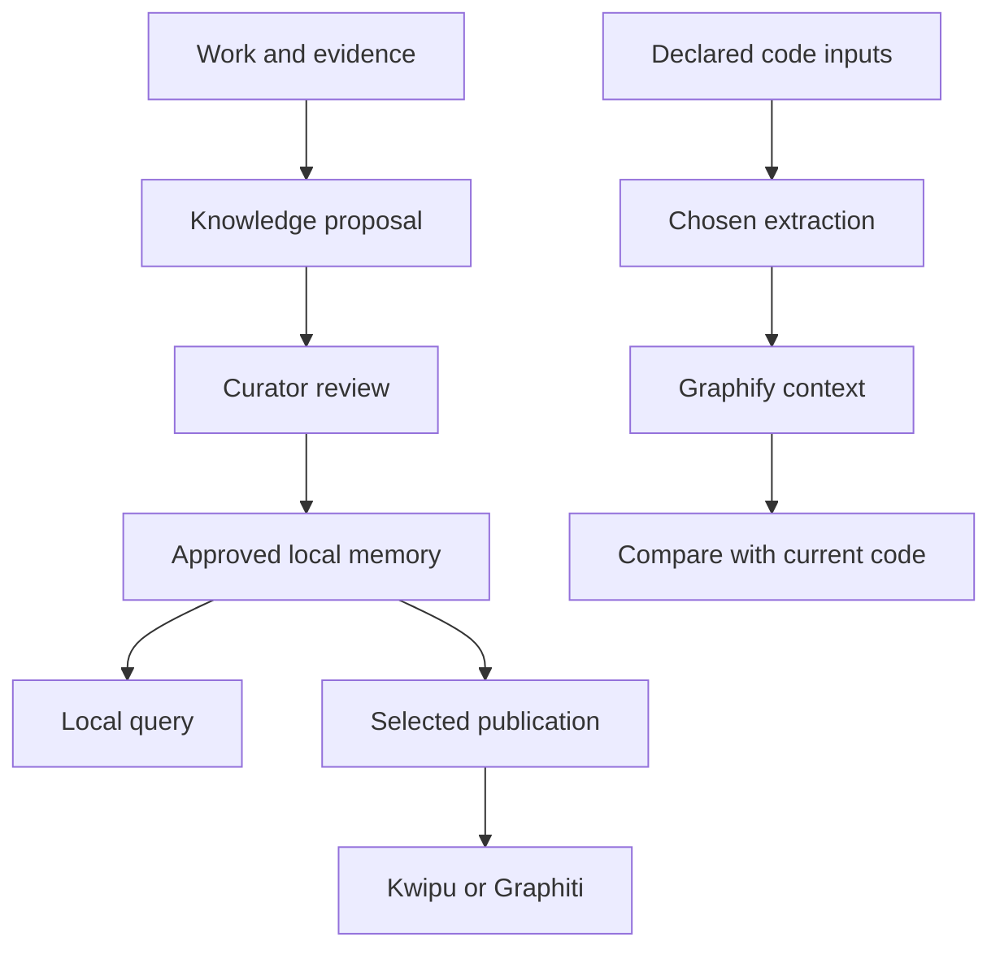
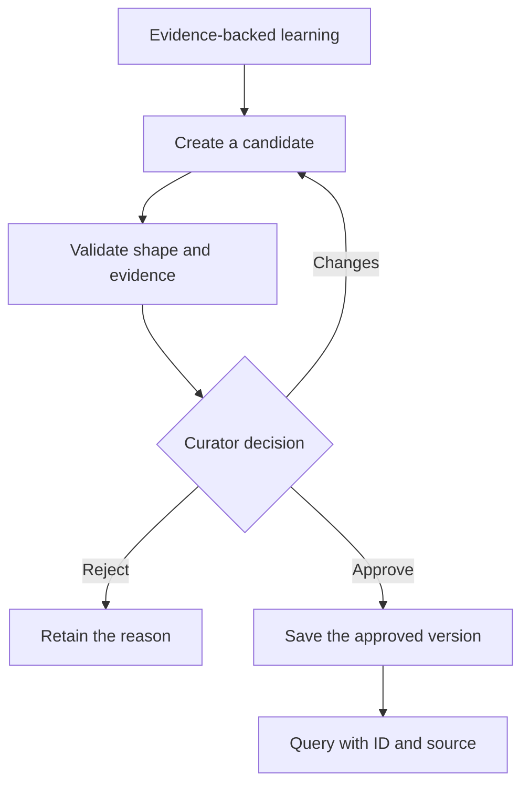
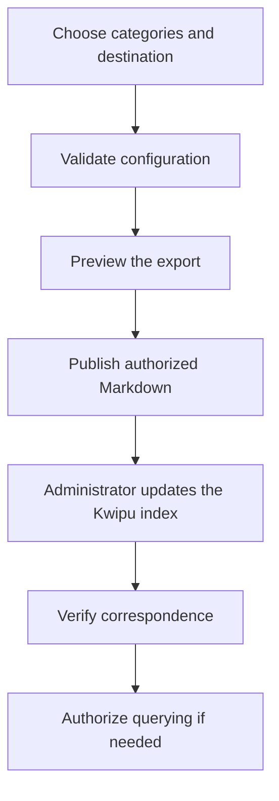
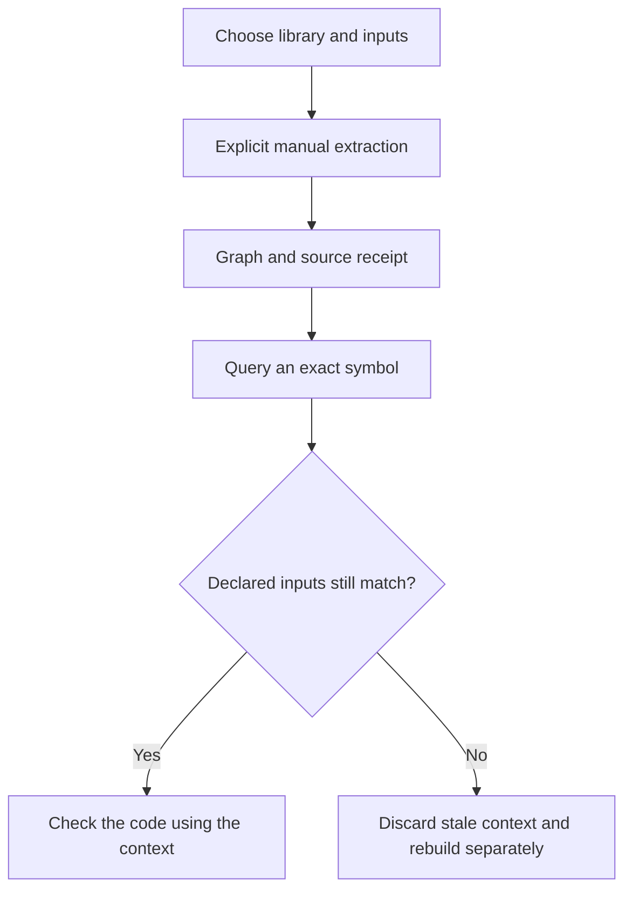
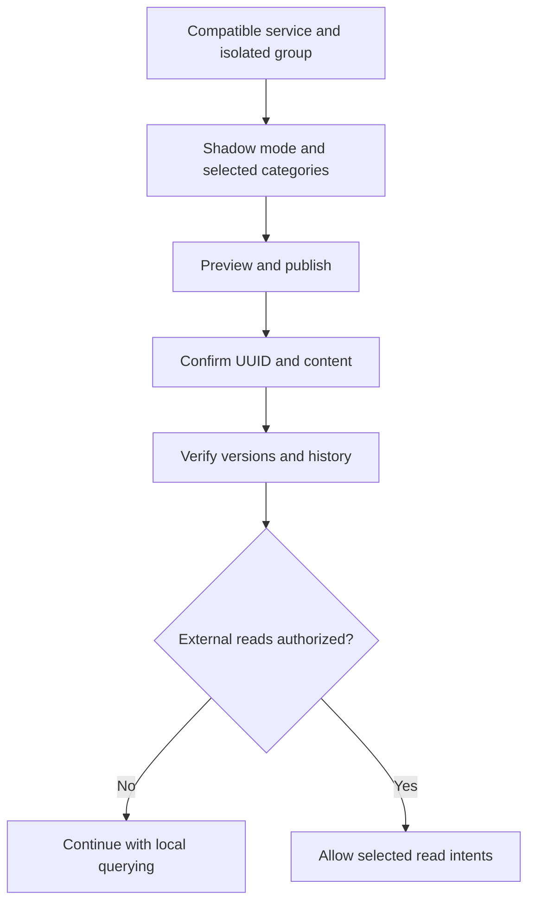

# 7. Memory: retain useful knowledge and choose optional services

Memory helps recover decisions and lessons without reading an old conversation.
It is not a store of everything an assistant says. Continuity notes, proposed
knowledge and approved knowledge have different authority.

For the portal, “a rejection needs a reason” can become an approved rule. “This
particular test failed once” is a session observation. Deciding which claims should
become reusable knowledge requires evidence and judgment, not automatic copying.

## What belongs to core and what is optional

Core retains local memory, its proposal/approval process, the Curator and local
querying. **You do not need Kwipu, Graphify or Graphiti to work.** External services
are selected per project, like Jira, Confluence or Redmine. The optional
`memory-integrations` module distributes `knowledge-services` for publication and
service queries; installation alone activates neither.

| Component | Useful purpose | What it does not prove |
|---|---|---|
| Local journal | Resume what happened and what remains in a session | That every observation is an approved rule |
| Knowledge candidates | Propose a decision or lesson with evidence | That the proposal has been accepted |
| Approved memory | Query knowledge accepted for this project | That a model-generated answer is itself approved |
| Optional Kwipu | Project approved documents and retrieve authorized current sources | That writing local export files updated the external index |
| Optional Graphiti | Project episodes and relationships with provenance controls | That a graph extracted the source faithfully or queried the right group |
| Optional Graphify | Extract selected code into a navigable relationship artifact | That code context is approved knowledge or still current |

A graph organizes related information. A decision linked to a process and a
function linked to its callers use graphs for different purposes. These products
are not interchangeable brands of a single memory database.



## W-19. Create, approve and query local memory

### When it is useful and who participates

Capture a reusable decision or lesson after work produces evidence. A statement
found in a chat is not approved simply because it sounds confident.

```text
Propose the portal’s mandatory rejection reason as reusable knowledge.
Include the decision, its justification and supporting checks.
Have the Curator review it before treating it as approved.
```



1. **Propose reusable knowledge.** `documenter`, `planner`, `implementer` or a data
   producer may submit a candidate. Identify category, decision, source and evidence.
   Exclude secrets, raw conversations, internal reasoning and unnecessary private data.
   Not every observation needs promotion to memory.
2. **Check completeness.** The Knowledge Gate validates category, minimum evidence,
   sources and tags. It does not make the human judgment that every claim is correct.
   The project’s policy is not weakened merely to get a candidate through a validator.
3. **Have the Curator decide.** `knowledge-curator` alone approves, rejects or requests
   changes. High-impact or contradictory knowledge can require the responsible
   person’s decision. A producing agent cannot approve its own candidate. Repeating
   an unverified assertion does not turn it into a fact.
4. **Preserve an accepted version.** Keep identity, version, evidence and the approval
   process. Accepted content is stored under `docs/knowledge/approved/` with the
   project’s identity. This is local approved knowledge, not automatic publication
   to any external destination.
5. **Query sources.** `knowledge-find.py` searches approved local knowledge and valid
   legacy entries under their respective contracts. Open the actual entry and check
   ID, version and state. Ambiguity or incomplete corpus reading must remain explicit;
   no search hit does not prove that no relevant decision exists.
6. **Version changes.** When a rule changes, propose and review a new version. Preserve
   the history of what supersedes what; do not disguise a changed rule as an unchanged
   accepted source. Moving knowledge to another project requires target-project review.

### A technical query example

In these PowerShell examples, `$PluginRoot` is the installed bundle located by the
administrator and `$ProjectRoot` is the consumer project. Do not reuse an obsolete
cache path or assume that the consumer is the plugin repository itself.

```powershell
$SharedKit = Join-Path $PluginRoot "agent-kits/shared"
python (Join-Path $SharedKit "knowledge-find.py") --root $ProjectRoot --json "motivo de rechazo"
python (Join-Path $SharedKit "knowledge-find.py") --root $ProjectRoot --show "portal.decision.reject-reason" --json
```

The shown ID is illustrative: use an actual returned ID. Verify the source, version
and state rather than only the summary. The search index can be reconstructed; it
is not the source of authority. The separate journal supports continuity and is
not repaired by dumping a whole conversation into approved knowledge.
[Memory portability](../MEMORY-PORTABILITY.md) explains destination review and governance.

## Before connecting a service: shared decisions

The process owner chooses which categories may leave the project and for which
purpose. The administrator maintains accounts, endpoints, the service and any
models. The technical team configures and tests an adapter. The Curator retains
local approval; publication cannot substitute for it.

The **taxonomy** at `.claude/knowledge-services/taxonomy.json` defines categories,
evidence policy and routing to backends. A backend is a configured destination.
Routing is closed by default: a category is not published to a destination unless
it explicitly permits that destination.

The complete [taxonomy example](../../examples/memory/taxonomy.json) uses the fictional
`portal` prefix, includes Kwipu and Graphiti, and leaves both services and category
routes disabled. Review and merge relevant settings instead of overwriting an
existing project configuration. Each service needs its own verified setup.

The common port uses [memory bindings](../../examples/integrations/memory.json) with
purpose `knowledge` and the optional `knowledge-services` skill. Binding ID matches
the backend ID exactly. These examples subscribe to no automatic events: approving
knowledge does not publish it. Append bindings alongside existing integrations;
configuring a binding grants neither publication nor external read permission.

Explicit administration retains its CLI. The common binding selects workflow
participation; taxonomy retains category and query controls. Do not duplicate the
Curator, query router or recovery queue for each provider brand.

## W-20. Integrate Kwipu and verify publication and querying

### When it fits

Choose this when your team already operates a compatible Kwipu stack and needs
approved document retrieval. **The plugin does not install Kwipu.** It exports
approved Markdown and verifies the selected projection. Indexing is a separate
operation owned by the external stack’s administrator.

```text
We want to publish the portal’s approved decisions to Kwipu.
Show categories, files and destination first. Do not send questions
or modify the service stack until we select and verify those operations.
```



1. **Prepare the external service.** The administrator checks a compatible bridge,
   model settings, authentication and index operation. The adapter does not prescribe
   a universal Docker command for every Kwipu installation. A healthy endpoint does
   not prove correct indexing or retrieval for this project.
2. **Prepare the project.** Select `memory-integrations` where physical module
   selection is supported. Configure the `kwipu` backend, safe export location and
   health/query endpoints under the actual schema. Example `127.0.0.1:8765` URLs do
   not start a service or prove one is present.
3. **Allow categories deliberately.** For an eligible category, routing might enable
   `kwipu` while keeping `graphiti` disabled. Every unspecified route stays off.
   Approved knowledge must still meet its evidence policy.
4. **Preview.** `--dry-run` shows which approved IDs, versions, categories and files
   would change without applying them. Review the destination and operation. The
   authorized execution writes only its owned files and `manifest.json`.
5. **Register the project in Kwipu if required.** `/setup` can help through
   `kwipu-project-add.py`. It previews the block and fingerprint for the selected
   `projects.yaml`; applying requires that exact current fingerprint. It appends
   only its marked block and retains a backup. Unsupported formats require manual
   administrator handling, not overwriting existing entries.
6. **Update the external index.** The project-add helper prints stack-specific
   `build_view`/restart guidance but does not execute it. The administrator reviews
   and runs the appropriate commands in the chosen stack. An export file on disk
   does not prove that Kwipu can retrieve it.
7. **Verify.** `--check` compares health and correspondence. An incomplete window is
   not success. Drift identifies the remedy without silently reindexing. Open a
   pilot source and compare identity, version and content with local authority.
8. **Enable querying only when chosen.** In addition to an enabled backend, document
   reads need `config.read.enabled: true` and the selected allowed intent in
   `config.router.intents`, such as `evidencia`. Current canonical/export/manifest
   bindings and retrieved chunks are checked before and after the external query.

`$MemorySkill` and `$Sync` below name the installed optional skill and its publisher;
`$SharedKit` is defined by the local example above.

```powershell
$MemorySkill = Join-Path $PluginRoot "skills/knowledge-services"
$Sync = Join-Path $MemorySkill "scripts/knowledge-sync.py"
python (Join-Path $SharedKit "knowledge-schema.py") (Join-Path $ProjectRoot ".claude/knowledge-services/taxonomy.json")
python $Sync --root $ProjectRoot --backend kwipu --dry-run
# After reviewing and authorizing publication:
python $Sync --root $ProjectRoot --backend kwipu
python $Sync --root $ProjectRoot --backend kwipu --check
# Only after enabling and authorizing document retrieval:
python (Join-Path $SharedKit "knowledge-find.py") --root $ProjectRoot --intent evidencia --json "regla sobre rechazo"
```

For optional registration, `$StackRoot` is the selected directory containing
`kwipu/config/`. Replace the fingerprint placeholder with the actual preview value:

```powershell
$AddProject = Join-Path $MemorySkill "scripts/kwipu-project-add.py"
python $AddProject --root $ProjectRoot --stack $StackRoot --backend kwipu --json
# After reviewing the block, use the exact current preview fingerprint:
python $AddProject --root $ProjectRoot --stack $StackRoot --backend kwipu --apply --esperado "<preview-sha256>"
```

### Results and recovery

The query separates canonical sources from `respuesta_generada`. Generated text is
**unverified and has no authority**. Its `source_nodes` link retrieved sources but
do not verify every sentence or provide a per-claim citation guarantee. Open the
source entry before a consequential decision.

Service failure falls back locally with a reason. Changed bindings, current source
drift or pending projection can reject an external answer. An interrupted publication
may already have changed some owned files; inspect `--outbox-status` and reconcile
receipts rather than deleting the manifest. An authorized retry recovers owned work.
`--rebuild` reconstructs the adapter’s projection; it does not reindex the Kwipu stack.

## W-21. Integrate Graphify to inspect code relationships

### What it provides and who prepares it

Graphify supplies code navigation context. It is not approved project knowledge.
The technical team may use it to find callers and dependencies while checking the
current source. You do not need it to use the portal or consult business decisions.

```text
We want to inspect relationships around the portal’s decision function.
Extract only the declared inputs into a new artifact and receipt.
Verify freshness before using the result as code context.
```



1. The administrator installs or prepares a trusted compatible Graphify library
   and its parsers. Selecting a local library path does not install every grammar
   or make arbitrary external code safe. Verify the actual extraction API.
2. Declare real project-relative inputs and their intended scope. Two files do not
   establish whole-repository coverage. `code-context-build.py` produces a graph
   and a source-fingerprint receipt from the selected input list.
3. Use new output paths. The producer checks that declared inputs do not change
   during extraction and does not replace an existing graph. The fictitious
   `src/requests.py` below must be replaced with a real allowed project input.
4. `code-context.py` accepts an exact ID or exact file/label selection. Text search
   can be ambiguous. The result provides locations for code review rather than
   approving a business conclusion.
5. If declared input bytes changed, the reader returns `artifact-stale` without
   that context. Create a new graph/receipt pair; do not manufacture a new receipt
   to make an old graph appear current.

`$GraphifyRoot` is the trusted external library directory prepared by the administrator.

```powershell
$Build = Join-Path $SharedKit "code-context-build.py"
$Query = Join-Path $SharedKit "code-context.py"
# GraphifyRoot: trusted external library prepared by the administrator.
python $Build --project $ProjectRoot --graph "graphify-out/pilot-01.json" --input "src/requests.py" --graphify-root $GraphifyRoot
python $Query --project $ProjectRoot --graph "graphify-out/pilot-01.json" --source-file "src/requests.py" --label "decide()"
```

The illustrative `decide()` label must match the artifact. Its receipt is named
`pilot-01.json.sources.json`. “Verified declared inputs” establishes the observed
match of those declared files only; coverage remains unknown and the context
unapproved. It proves neither semantics nor detection of all new files.

A missing library, grammar or parser stays unavailable; normal code search remains
possible. Receipt publication failure can leave an orphan graph. Preserve the
diagnostic and use a new destination. A legacy graph without a producer receipt
has no verified freshness. Hooks and opening the dashboard do not launch extraction.
See [the code-context contract and pilot](../CODE_CONTEXT.md).

## W-22. Integrate Graphiti with controlled publication and querying

### When to choose it

Graphiti projects approved sources into episodes and knowledge relationships. An
episode is a published source document with identity and provenance. Querying can
retrieve temporal or relational context when the compatible service and project
policy permit it. This is not Graphify.

```text
We want a pilot of relationships between approved portal decisions.
First verify a compatible Graphiti service and an isolated project group.
Do not enable external reads until publication and verification are complete.
```



1. **Prepare the external service.** Its administrator maintains MCP, storage,
   extraction and embeddings. The plugin does not download or serve a model.
   A provider declaration guides the client request; it does not configure the
   service’s model. `provider.llm: none` omits those instructions and **does not
   disable server extraction or guarantee zero cost**.
2. **Reserve an exclusive group.** A value such as `portal-solicitudes` logically
   separates this project’s publications. Verify what the real server does with
   that group. A group declaration is not OS sandboxing or an authorization model.
   Remote access remains off unless explicitly approved under the guardrail.
3. **Choose shadow first.** `mode: shadow` permits configured publication without
   external querying. `off` disables that backend; `read` is a later, separately
   authorized step. Category routing remains an independent control.
4. **Preview, publish and read back.** The adapter shows its plan, submits the
   authorized episode and confirms the returned UUID/content. Identity alone is
   not permission to call indexing complete. Keep links between local ID, version,
   group, episode UUID and manifest.
5. **Check history.** A replacement must preserve supersession; revocation must
   retain identity. Default transition relations use control episodes. Direct
   `triplet` handling requires a server with verified isolation/provenance. Do not
   replace a failed episode relation with a globally ambiguous triple.
6. **Consider read mode only after complete verification.** Enable the selected
   intents in `config.router.intents` as well as the backend and `mode: read`.
   Healthy state, current sources, verified bindings and complete windows are
   required. Group-scoping, provenance or pagination uncertainty remains a typed
   failure and falls back locally.
7. **Recover explicitly.** A lost send is uncertain; reconcile receipts before
   retrying. Revoking a published version does not automatically prove that every
   derived relation has been removed. Check the actual service’s capabilities.

This backend fragment belongs inside the complete taxonomy. It remains disabled
until reviewed; `127.0.0.1:8001` is an example, not a running service:

```json
{
  "type": "graphiti",
  "enabled": false,
  "config": {
    "mode": "shadow",
    "endpoint": "http://127.0.0.1:8001/mcp",
    "group_id": "portal-solicitudes",
    "allow_remote": false,
    "provider": {"llm": "none"},
    "entity_map": {},
    "relations": [],
    "transition_relations": "episode",
    "router": {"intents": {"relacional": false}},
    "telemetria": false,
    "timeout_ms": 3000,
    "concurrency": 1
  }
}
```

After enabling the reviewed backend and category routing, use the administration
commands below. External query permission is still a separate decision:

```powershell
python $Sync --root $ProjectRoot --backend graphiti --dry-run
# After reviewing and authorizing:
python $Sync --root $ProjectRoot --backend graphiti
python $Sync --root $ProjectRoot --backend graphiti --check
python $Sync --root $ProjectRoot --backend graphiti --outbox-status
# Only when mode=read and the relacional intent are authorized and verified:
python (Join-Path $SharedKit "knowledge-find.py") --root $ProjectRoot --intent relacional --json "qué regla sustituye a la anterior"
```

### Interpreting results and limits

Extracted facts and summaries are **derived content without authority**. Approval
of the local source does not approve every model-extracted assertion. Similar names
are insufficient provenance; query results need verified links to published episodes.
An incomplete window cannot be relabeled successful.

Rebuild creates and verifies a new generation before switching the manifest; it
preserves the old group instead of emptying graphs. It is not a routine repair for
a permission error or timeout. Resolve uncertain sends and pending relations using
their receipts rather than deleting evidence.

Existing evidence covers bounded fixtures on a temporary compatible server.
**Deployment to your service, native-client workflows, comparative usefulness and
global acceptance still require testing.** The installed 0.30.1 revision had a
cross-group reading problem; the temporary compatible fixture did not update that
service. Green health or synthetic tests do not establish complete acceptance.

## Choose and retire integrations without losing memory

Start from the need: local continuity, document retrieval, temporal relationships
or code navigation. Enable only useful capabilities and test representative questions
with sources. An administrator can withdraw external reads without deleting approved
local knowledge. Keep receipts, mappings and the evidence needed to resume later.

When moving away from a provider, disable its participation deliberately and review
pending publications or revocations with the administrator. Do not assume that
removing a local setting deletes remote data. Document the resulting state and who
maintains any remaining service or projection. Advanced contracts provide detailed
configuration and recovery guidance alongside the examples above.
