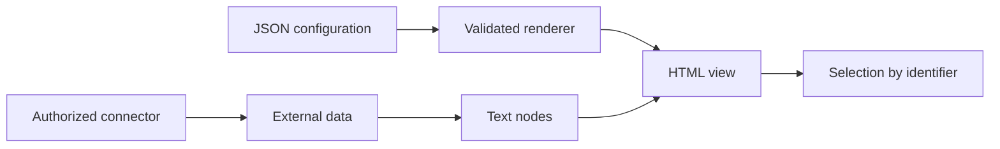
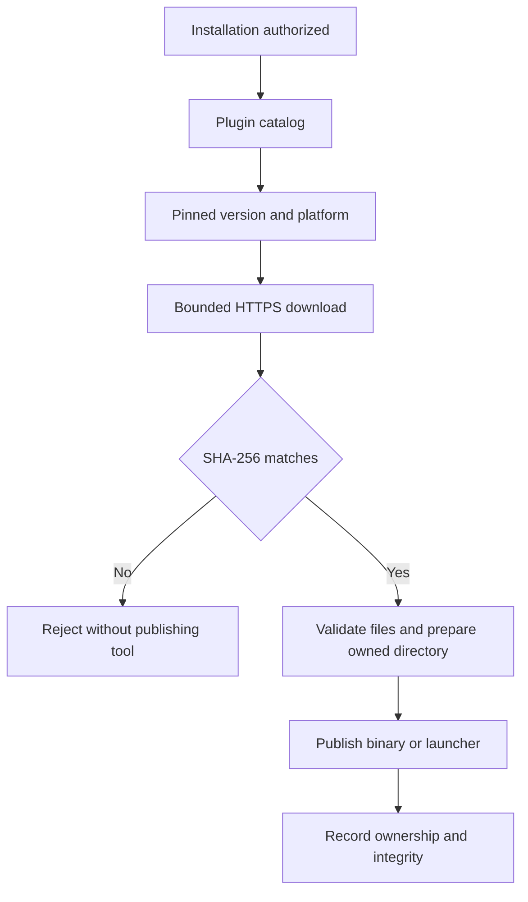

# Security remediation: views, PDF, CI and optional tools

This guide covers the November 6, 2026 Nemesis remediation. The confirmed fix prevents Jira and Confluence data from becoming executable HTML. Three additional measures strengthen PDF conversion, GitHub workflows and the optional security-tool installer.

This work does not establish why npm rejected a package. No new package, appeal or knowledge-service change is part of this remediation.

## Jira and Confluence views

Names, titles and errors become text nodes. HTML-like titles display literally, while selection retains the original issue or page identifier. Views remain optional and use the project's authorized connector; this change adds no MCP server or credentials.

Render a local JSON configuration using the bundle helper:

```bash
python3 agent-kits/shared/render-artifact.py --template jira-live --config config.json > view.html
```

```json
{"SERVER_SEARCH":"connector-name","CLOUD_ID":"site-id","LABEL":"example-initiative","TITULO":"Team plan"}
```

Other templates are `jira-picker` and `confluence-tree`; their skill references specify the fields. Do not interpolate configuration by replacing literal markers. The helper validates fields and sizes and escapes JSON for a script block. Use the conversational flow if the helper is missing.



## PDF conversion

Chromium's sandbox stays enabled. JavaScript and network resources are disabled by default. Atomic output still replaces the destination only after successful generation.

Copy every `.mjs` file and `package.json` from `skills/to-pdf/scripts/`, plus `skills/to-pdf/assets/theme.css`, into an external tool directory. Install dependencies there as described by the skill. Copying only the main script omits its two helper modules.

```bash
node to-pdf.mjs document.md --out document.pdf
node to-pdf.mjs trusted.html --allow-origin https://assets.example.org
```

Repeat `--allow-origin` for each required HTTPS origin. Credentials, paths, queries and other schemes are rejected. Other hosts and local files remain blocked. Blocked resources produce a warning; inspect missing images before sharing the PDF. Local Markdown images are also blocked: embed data images or use an authorized HTTPS origin.

`--allow-js` explicitly enables JavaScript for trusted documents. `--unsafe-no-sandbox` explicitly disables Chromium's sandbox and prints a warning; there is no automatic fallback after launch failure. Avoid that exception in normal use. Resource interception is a renderer defense, not an operating-system network boundary or a hostile-HTML rendering service. Do not enable JavaScript for unknown documents.

## GitHub workflows

External actions use complete commit SHAs. Updating one requires review of the commit and action inputs.

| Workflow | Permissions and secrets |
|---|---|
| CI | `contents: read`, with credential persistence disabled at checkout. |
| Optional headless | Only the two model-calling steps receive the Anthropic key. The initial gate sees only whether a key exists. Claude CLI is pinned to `2.1.311`. |
| Release | A read-only build creates assets. A separate publisher downloads them with `contents: write`, without running project scripts. |

Each workflow has an identical root `*.yml.MANUAL-COPY`. Tests check parity and privilege boundaries. Static release validation does not publish a release; static headless validation does not call paid models.

## Optional Nemesis tools

Loading the plugin does not install tools. The agent requests authorization before invoking the installer. This initiative's tests install or execute no external tools.

Requirements: Python 3.10+, Bash for the wrapper and script-tool launchers. Native binaries can be installed directly with Python. testssl needs Bash and OpenSSL; nikto needs Perl; wafw00f needs pip in the selected Python. Later tool use can download other resources, such as templates or vulnerability databases; those downloads are outside this installer's integrity contract.

List reviewed versions without installing or accessing the network:

```bash
python3 agent-kits/nemesis/tools/install-tools.py --list
```

After authorization, install only the required tools:

```bash
bash agent-kits/nemesis/tools/install-tools.sh --only gitleaks,hadolint
```

`SECURITY_TOOLS_DIR` selects a directory outside every Git repository. The default is `~/.claude/security-tools`. Redirected paths are rejected, as is a final POSIX directory writable by other users. The lock coordinates this installer's writers; it is not protection against a malicious process replacing directories under the same account.



### Integrity and maintenance

`tools-lock.json` pins versions, revisions, URLs and SHA-256 hashes. Native binaries come from specific release assets. testssl, sqlmap and nikto use archives of pinned commits, without cloning HEAD or running `git pull`. testssl uses its current official repository, `testssl/testssl.sh`.

wafw00f uses a private package target per installation. `wafw00f-requirements.txt` pins every dependency and hash. Isolated pip accepts hashed wheels only, resolves no new dependencies and leaves global packages unchanged. Its launcher uses the selected Python and avoids bytecode writes. The private target is not a virtual environment independent of that interpreter.

Hashes are reviewed trust anchors shipped in the plugin. They detect different bytes; they do not certify upstream software as benign. New versions require maintainer review. Recompressed upstream archives also fail verification; there is no unchecked fallback.

The installer rejects escaping paths, links, special files, ambiguous binaries and oversized archives. It does not execute downloaded binaries to discover versions. Missing platform assets produce a failure instead of silently selecting another architecture. Other requested tools continue; any failure makes the final exit code nonzero.

### Existing installations and interruptions

A pre-existing file without a new receipt is unmanaged and is preserved even with `--force`. Modified managed binaries or script trees are also preserved and refused. `--force` reinstalls only an unchanged managed tool. Availability detection may find older tools in PATH; presence does not establish this integrity contract.

To migrate, retain the old directory and select a new empty `SECURITY_TOOLS_DIR`. Verify it before changing PATH. The installer neither deletes nor adopts the old installation automatically.

Interrupted preparation may leave version directories without launchers in `vendor/`; these are neither executed nor automatically removed. If receipt publication fails after an output file was published, the next run rejects it as unknown or modified. Inspect the state or use a fresh directory; do not adopt it by editing receipts. Old versions remain for inspection, with no automatic garbage collection.

## Evidence boundaries

Tests use synthetic connector metadata and tool fixtures. DOM tests run in Edge/Chromium with an owned temporary profile and do not establish Cowork host privileges. Installer tests contact no target and install no real tools. Real PDF conversion evidence is recorded separately in the ledger.

See the [remediation ledger](../../roadmap/2026-11-06-nemesis-remediation/tasks.md) for current validation, fresh-context review and CI. A security review cannot prove absence of malware or explain npm's rejection without evidence from npm.

## Sources

Checked November 6, 2026: [GitHub Actions secure use](https://docs.github.com/en/actions/reference/security/secure-use), [Puppeteer request interception](https://pptr.dev/guides/request-interception/), [Page API](https://pptr.dev/api/puppeteer.page), [official testssl releases](https://github.com/testssl/testssl.sh/releases). Tool source URLs and wheel provenance are stored in `tools-lock.json`. Refresh pins by reviewing releases/commits, each platform asset and its digest, then run regressions and review the diff.
