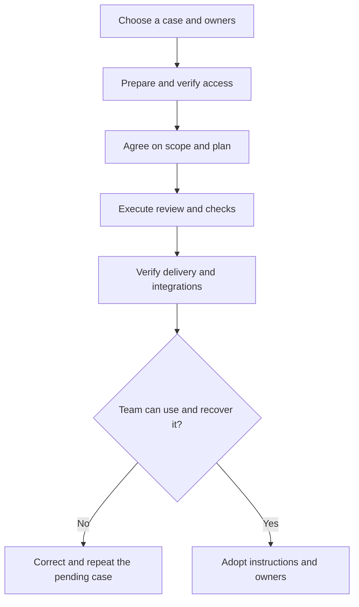

# 6. Introduce the product to a team and handle everyday problems

Start with one initiative whose result the team can recognize. Our portal must
require a rejection reason and prevent a second decision. The pilot should check
both the product result and whether the team can use, understand and recover the
working method.

## W-18. Run a pilot and adopt the product

### People, prerequisites and a useful request

Choose a process owner, a technical contact and an administrator. A small team can
share roles, but the decisions and responsibilities should remain explicit. Start
with a prepared project, suitable access and a concrete case rather than a large
configuration rollout.

```text
Prepare a pilot for the portal. We want to define each stage, review the
plan before implementation, verify behavior and share clear instructions.
At the end, show result, limits and recovery steps.
```



1. **Prepare.** Use W-01: the administrator checks installation and available tools;
   `/setup` records the agreed choices; `/doctor` explains its checks and gaps. The
   owner chooses the local method and any external service worth testing. There is
   no need to enable every capability merely to try the product.
2. **Agree on the work.** W-02 and W-03 define requirements, evaluation and plan.
   `analyst`, `evaluator` and `planner` make the proposal understandable. The owner
   reviews examples and acceptance conditions rather than approving a board title.
3. **Execute and observe.** W-04 brings `implementer`, `reviewer` and `qa` together.
   `tdd`, `adversarial-review`, stack guidance and relevant tools are selected by
   the project. A short feedback loop is more useful than many unverified changes.
4. **Test collaboration where it will be used.** For Jira or Redmine, verify at least
   one real creation, review comment and permitted final transition. For a wiki,
   check publication, update and a conflicting edit. A service mentioned in setup
   is not a verified part of the pilot.
5. **Close the pilot with usable guidance.** W-05 combines evidence and documentation.
   The department should be able to resume the initiative after a handoff. Ask for
   an explanation of limits and anything still pending.
6. **Introduce it to more teams deliberately.** Keep owners, examples, maintenance
   and access clear. Another area may use different integrations. Adoption does
   not authorize silently expanding every project’s permissions or publications.

### Check before extending the rollout

| Owner’s question | Evidence to expect |
|---|---|
| Was the agreed result delivered? | Plan, criteria and actual behavior |
| Who reviewed and checked it? | Separate review and verification results |
| Were remote issues created correctly? | Confirmed links and field mappings |
| Is the publication current? | Real page content/version and resolved conflicts |
| Can someone continue tomorrow? | Current state, next step and unresolved items |
| What was not verified? | An explicit limit and a way to address it |

If the pilot stops, keep its progress and exact remaining work. Do not repeat issue
creation or publication just because the summary was interrupted. The technical
contact isolates failures; the process owner decides scope changes. A service
permission belongs to its administrator, not to an assistant inventing a new account.

## A simple daily routine

At the start, ask for the current portal state, the previous result and the next
step. `/roadmap-status` helps consult the portfolio; `/work-resume` prepares continuation. A historical board snapshot is not live state.

During the task, explain the change you need and ask for its review and checks.
If new scope appears, decide explicitly rather than hiding it in the existing task.
At closure, request the phase summary, updated instructions and any remaining
publication. `/retro` helps capture learning. Current source files and receipts
are more useful for a handoff than a copy of an entire conversation.

## When something goes wrong

| What you see | What to clarify | Useful next action |
|---|---|---|
| A skill is missing | Installation, selected module or runtime availability | Administrator checks inventory and delivery mode |
| Configured but disconnected | A declaration without an established connection | Test a bounded read in the actual destination |
| External publication pending | Permission, conflict or effect still unconfirmed | Reconcile versions/receipts before retrying |
| Review or QA gaps | A required condition has not passed | Read the evidence, correct and rerun the case |
| Preparation timeout | The test or process was not ready within its budget | Separate preparation from the intended semantic check |
| Board state differs | Mirroring may be stale or unsupported | Compare both sources and confirmed operations |
| A memory query returns an old answer | A derived service may be stale or unauthorized | Verify local authority, versions, bindings and read policy |

### Hooks, notifications and approvals

A hook is an automatic action associated with a runtime event, such as starting a
session. A message does not always identify which process actually failed. The
team should distinguish process execution from how a desktop interface displays
its notifications.

“Plugin contents changed; hook approval required” means the runtime needs approval
for changed plugin content. Review the origin and change before using the runtime’s
approval interface. In the Codex CLI interface reported during this work, selecting
an entry and pressing `t` worked. Available keys and labels depend on the installed
version; the plugin should provide meaningful names where that schema supports it.
A trust entry alone does not certify current execution or the validity of every hash.

“The system cannot find the file specified” requires checking the actual launcher
path and arguments. A private script pointing to an obsolete cache version does
not prove a failure of the plugin’s native hook definitions.

The observed Windows error 206 concerned `legacy_notify` configured for
`codex-computer-use.exe`. It does not establish a custom-agents execution failure.
Likewise, Desktop’s unknown-conversation messages for hook notifications describe
a notification-routing problem without proving the hook process result. Ask for a
bounded diagnostic with source, date, runtime and actual process evidence.

## Ask for help without exporting a whole conversation

Explain the attempted action, expected result, environment/version and exact visible
message. Identify the initiative or relevant artifact. A technical contact can gather
bounded logs and a reproduction without credentials, raw transcripts or reasoning.

Repeated failures warrant systematic debugging: `debug-root-cause` separates
reproduction, isolation, a tested hypothesis and a regression check. For memory,
`knowledge-curator` owns knowledge judgment, while the optional service’s administrator
owns its connectivity, indexing and recovery. State which layer is uncertain.

## Glossary for everyday use

| Term | Meaning |
|---|---|
| Core | The common local lifecycle and its governance |
| CLI | A text interface in a terminal |
| Desktop | A desktop application that may expose different interfaces from a CLI |
| Runtime | The environment that loads the plugin and provides execution/tools |
| Workflow | An ordered process with roles, decisions and an outcome |
| Skill | Instructions reused by an assistant for a particular method |
| Tool | An operation currently available to the session |
| MCP | A protocol through which a server exposes tools or resources |
| Adapter | A component mapping the common method to a service |
| Binding | A project declaration selecting adapter, purpose and capabilities |
| Event | A notice that a lifecycle moment occurred, such as a task starting |
| Ledger | The authoritative local plan/task record |
| Kanban | A view grouping tasks by recorded state |
| Gate | A condition that must be satisfied before continuing |
| QA | Verification through relevant checks and evidence |
| Receipt | A record linking an operation to its observed result |
| Reconciliation | Checking what actually happened before retrying or repairing a link |
| Idempotence | A retry does not create another copy of the same intended effect |
| Outbox | Pending operations retained for controlled recovery |
| Routing | Rules selecting which source is allowed for a declared purpose |
| Hash | A fingerprint used to detect content changes |
| Frontmatter | Structured metadata at the beginning of a document |
| Snapshot | A bounded observation at a particular time |
| Evidence | A source or result supporting a verifiable claim |
| Opt-in | A capability activated through explicit configuration and authorization |

[Advanced operations](../reference/operations.md) documents packaging, migration and
technical checks. [The dashboard workflows](dashboard.md) explain normal use and
recovery of the shared local console.
