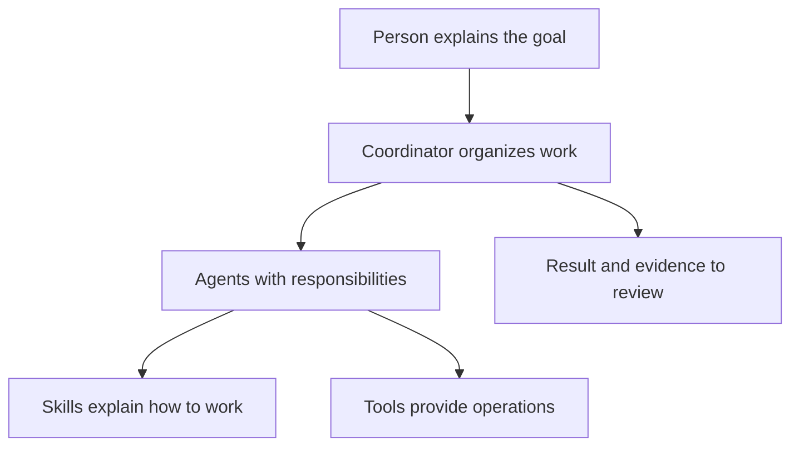
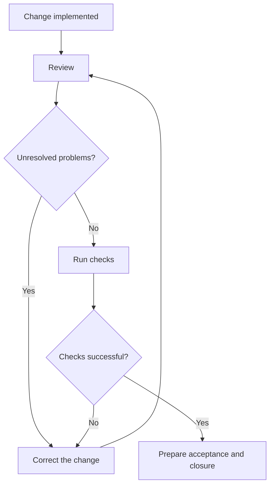

# 1. Understanding the product and who does what

## Help organizing work and decisions

A department asks for a way to approve internal requests. Several questions still
need answers: who may approve, what information they need, whether a rejection
requires a reason, and how the team will know that it works.

custom-agents organizes those questions and the subsequent work. It clarifies
the need, prepares an evaluation and plan, then implements, reviews and tests.
The records let another person understand what happened and continue later.
You and your team decide the outcome you need and what you accept.

You can start without Jira. The product maintains local documents and tasks.
If your team uses Jira, Redmine or a wiki, a project integration can share the
relevant information there. Choosing an external tool preserves the delivery
checks that the project requires.

## The components in everyday language

Think of an office receiving an assignment: someone coordinates, specialists
contribute, procedures guide the work, and tools carry out operations.

| Term | Everyday meaning | Portal example |
|---|---|---|
| Project | The working space containing code, tasks and documents | The internal requests portal |
| Initiative | A particular improvement within the project | Add approval and rejection |
| Workflow | The ordered steps towards a result | Define, plan, implement, review and test |
| Command | A short instruction to start or consult a workflow | `/dev-cycle` coordinates an initiative |
| Agent | An assistant with a particular responsibility | The planner divides work into tasks |
| Skill | A guide an assistant uses when needed | Guidance for testing acceptance behavior |
| Tool | An operation the current session can actually perform | Read a file or create an issue |
| MCP connector | A bridge exposing operations from another system | Read Jira through the working session |
| Domain persona | Business criteria included in a task | Consider the requester’s perspective |

A real team member has an account, permissions and responsibilities. A domain
persona is a way to include a perspective in an assistant’s work; it does not
create an account or give someone authority to approve a request.

A skill explains **how to work**. A tool lets a session **perform an operation**.
Instructions for publishing a wiki page do not mean that a working connector or
permission to publish is available.

## Participants and useful results

The identifiers in parentheses help the technical team find a component. You do
not need to invoke each agent manually; the workflow can coordinate them.

| Participant | Responsibility | What you can ask to receive |
|---|---|---|
| Department lead or product owner | Explain the need and decide scope | An agreed goal and acceptance conditions |
| Analyst (`analyst`) | Turn questions into clear requirements | Included behavior and explicit boundaries |
| Evaluator (`evaluator`) | Estimate effort, cost and risks from available data | Assumptions and options for deciding whether to proceed |
| Architect (`architect`) | Compare implementation approaches when needed | Alternatives, tradeoffs and a recommendation |
| Planner (`planner`) | Divide the goal into phases and verifiable tasks | An ordered plan with criteria and checks |
| Implementer (`implementer`) | Carry out the agreed changes | Changes and evidence of checks performed |
| Reviewer (`reviewer`) | Find defects and deviations from the agreement | Findings with evidence |
| Quality verifier (`qa`) | Run relevant checks | Passed, failed and unverified cases |
| Documenter (`documenter`) | Explain use and maintain documentation | Instructions the team can actually follow |
| Coordinator or orchestrator | Order the stages and combine results | A status explanation and the next decision |

Other specialists participate when relevant. `knowledge-curator` decides which
proposed lessons qualify as approved knowledge. `nemesis` supports requested
specialist security audits when available. Neither is automatically required
for every assignment.

For example, the implementer reports adding a Reject button. The reviewer may
find that authorization is missing; QA may show that the reason is not saved.
The coordinator combines those findings before proposing closure. Finishing a
code change does not by itself establish acceptance.

## Reviewed and tested are separate claims

Review looks for defects and deviations from the agreement. Tests exercise
particular behaviors with concrete cases and tools. Reading a validation in code
does not prove that the program rejects an invalid request when run.

A quality **gate** is a condition that must be satisfied before continuing, such
as no unresolved review gaps and successful required checks. Failed checks send
the work back for correction; the results are not renamed to make a board green.

## Records that make work understandable and resumable

Different records answer different questions. You can ask for them in ordinary
language without remembering the file names.

| Question | Record | Example request |
|---|---|---|
| What result was agreed? | Specification, `spec.md` | Show the requirements we approved |
| What effort and risks were estimated? | Evaluation, `evaluation.md` | Explain the assumptions behind the estimate |
| Why was an approach chosen? | Design, `design.md`, when appropriate | Why did we choose this option? |
| What is the order of work? | Plan, `improvement-plan.md` | Show the phases and dependencies |
| What is pending or complete? | Task register, `tasks.md` | What remains, and what evidence supports each state? |
| What was checked? | The `testing/` folder | Open the verification report |

The task register is the main source for local progress. **Canonical ledger**
means the authoritative record used to resolve questions about that progress.
An external board can mirror it. A difference requires investigation; a card in
Done is not proof that the required checks passed.

## What the team can choose

Core contains the common local lifecycle. Optional modules add capabilities such
as a publication adapter or an external memory service. They are not requirements
for every project. Local memory and its approval process remain available without
Kwipu, Graphify or Graphiti.

A **profile** selects a starting set of modules: `core` for the local lifecycle,
`developer` for the included technical specialties, `research` for research and
content, or `full` for the complete catalog. A module groups distributed capabilities;
it is neither an external account nor an access permission.

The practical team decision is where to work and what to share. One project can
use Jira/Confluence, another Redmine/a wiki, and another local files only. The
administrator checks which installation mode physically selects files. Some native
plugin installations deliver the entire bundle, with capabilities used on demand.

## Recognizing a good delivery

Ask for the agreed outcome, completed work, checks, documentation and limitations.
For an external publication, ask for the confirmed link. Unfinished work should
remain visible with its next action.

A useful result might say: the four tasks are verified, the report and instructions
are available, and publication still needs a suitable service permission. Those
are separate results; the team can address the remaining issue without repeating
all implementation work.

Administrators can consult the [advanced product reference](../reference/product.md)
for module contracts and internal identifiers. Daily use does not require reading it.
