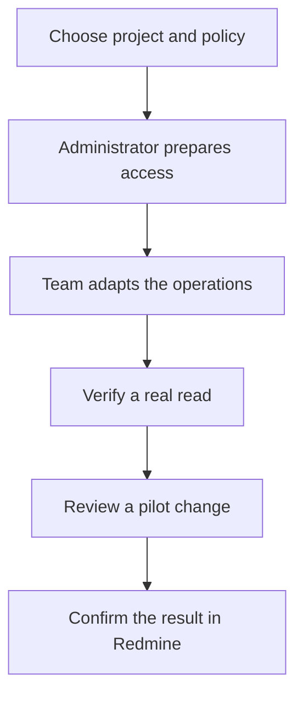
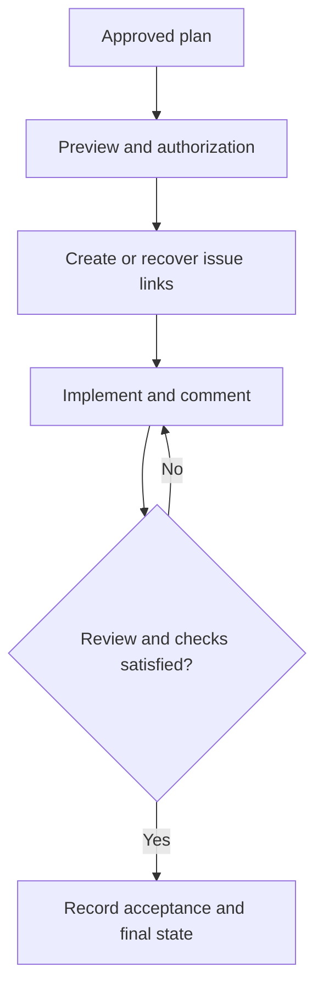
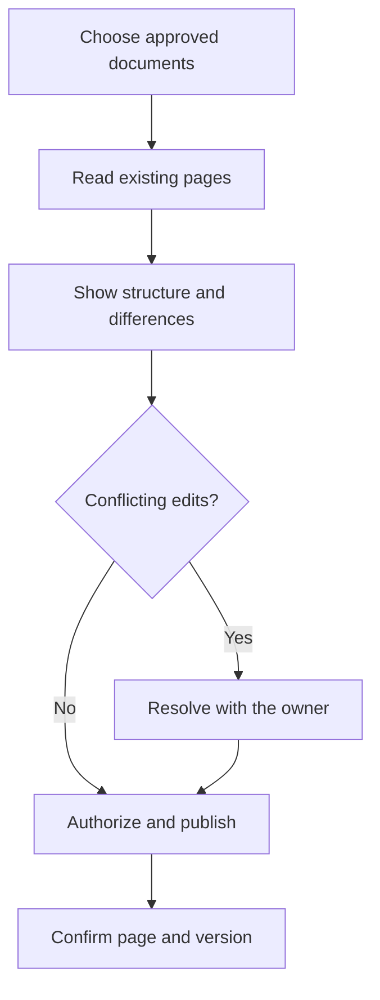

# 4. Working with Redmine and a team wiki

The lifecycle in chapter 2 works without Jira. Redmine changes where the team sees
tasks and how it communicates about them. **It does not change which checks make a
delivery acceptable.** A wiki can share operating instructions; it does not replace
the task board or become an automatic source of implementation approval.

Redmine uses terms such as issue and tracker. Project, category, assignee and status
names depend on the installation. This handbook supplies a reference adapter,
`project-redmine`, that the technical team must adapt and validate. **It neither
installs a connector nor proves a working connection to your account.**

## W-13. Prepare Redmine for your project

### When to use it and what you need

Do this before the first publication. The department chooses the destination and
collaboration policy. An administrator provides an authorized account. The technical
team checks the installation and available connector operations. You do not need
to edit configuration to decide how the team should organize its work.

```text
We use Redmine for the portal initiative. We want one issue per task,
without inventing account identities. Before publishing, show the
project, tracker, available states and proposed changes.
```



1. **Agree on task or phase issues.** Separate task issues make different owners
   and dependencies clearer; phase issues summarize a related group. Their
   descriptions must still retain the internal task breakdown and acceptance
   criteria. Decide who may assign or close issues.
2. **Set up the service access.** A connector or MCP server exposes operations
   towards the chosen instance. The administrator checks URL, account, version
   and permissions. Tokens stay outside documents and work requests.
3. **Adapt the project component.** The `project-redmine` skill explains how to use
   those operations. `.claude/integrations.json` selects its purpose, events and
   capabilities; a separate settings file identifies the destination and policy.
   Saving those declarations does not execute or authorize a publication.
4. **Check actual operations and identifiers.** Resolve the real project, tracker,
   priorities, users and states. The adapter maps create/read/comment/progress and
   worklog functions to the available tools. Missing operations remain unsupported.
5. **Make a bounded read.** Check that the returned name and identifier match the
   intended project. `/doctor` diagnoses configuration; `/work-context` inventories
   components. Finding a declaration does not establish a connected service.
6. **Preview and authorize a pilot.** The preview explains destination, tracker,
   content and the concrete effect. After execution, inspect its real link and
   content. Only functions actually exercised can be described as verified.

**Participants and components:** the owner decides the workflow; the administrator
controls access; the technical team adapts and tests the skill. `planner` and the
coordinator continue the normal lifecycle; `research-first` can compare maintained
connectors before adopting one. MCP operations belong to the selected session.
No Redmine brand or mandatory new command is added to core.

The output should identify the tested destination, supported operations, limits
and pilot link. The project keeps the binding, settings and local-to-remote map.
A sample appears in [the complete configuration](../../examples/integrations/project.json)
and [reference adapter](../../examples/integrations/project-redmine/SKILL.md).
If access fails, the local lifecycle can continue while the mirror remains pending.

## W-14. Execute the portal plan and keep issues current

### Request and expected behavior

Start with the approved plan and a verified W-13 configuration.

```text
Publish the approved Redmine plan using the tested policy. Show issues
before creating them. During execution, distinguish implementation,
review and verification updates; do not close work with failed checks.
```



1. **Plan the structure.** `planner` prepares the approved breakdown. The project
   adapter shows title, description, tracker, project and valid assignment for each
   issue. A phase issue explains all its underlying tasks and criteria.
2. **Establish real links.** The adapter checks existing issues and retains confirmed
   IDs. If an existing issue already represents T-02, it is reused. A lost response
   calls for reconciliation, not immediate creation of another copy.
3. **Reflect the start.** When `implementer` starts T-02, the configured event can
   request a permitted in-progress transition. If the installation cannot perform
   it, report the limitation rather than silently claiming a board update.
4. **Explain implementation.** The change comment says what changed, where evidence
   is recorded and what is still pending. Adding decision saving does not close a
   task while review or QA remains outstanding.
5. **Publish review and verification separately.** `adversarial-review` coordinates
   review, with one owned event per attempt. `reviewer` supplies findings; `qa`
   reports actual checks. An empty rejection still accepted is a confirmed gap,
   so correction remains pending even if the first implementation comment sounded
   confident.
6. **Close only a verified result.** The coordinator combines criteria, review and
   QA, then requests the configured final transition if it is supported and covered
   by authorization. A phase closes only when all its required conditions hold.

An illustrative comment, not an external publication:

```text
[custom-agents · qa] T-02 · attempt 2
Result: pending. Rejection without a reason still accepts an empty value.
Evidence: project verification report.
Next action: correct the change and repeat the relevant check.
```

The connector account remains the real external author. A role signature explains
where the update came from; it does not create an account for each assistant.
A real person can be mentioned or assigned only through a verified identity.

### Verification and recovery

Open the real issue and compare state, comments and evidence. Time estimates,
measured intervals and reported supervision must retain their respective sources;
an estimate does not become a worklog of actual hours.

When delivery is uncertain, consult the issue and its operation reference before
retrying. If a confirmed effect is missing from the local map, recover the link
rather than recreating all issues. Never assert a remote state just because the
local ledger requested it. Failed external mirroring remains distinct from the
verified or unverified implementation result.

## W-15. Share operating instructions in a wiki

### A separate documentation integration

The team may use a Redmine wiki, a corporate wiki or another document service.
These are provider options, not verified connections. Choose approved documents,
a destination and a documentation integration with a tested contract.

```text
Prepare publication of the portal operating guide in our wiki.
Show which pages would be created or updated. Do not publish internal
verification artifacts unless they were explicitly selected and authorized.
```



1. `documenter` prepares an understandable guide. Closing a development phase may
   produce publishable content, but it does not authorize every connector operation.
2. The documentation skill or tool reads pages at the chosen destination. The
   administrator has already tested its actual create, update and version behavior.
3. The preview presents the page tree and changes. Markdown may need a provider
   transformation. A remote edit conflicts with the local document until the team
   resolves it; the adapter preserves ownership and local metadata.
4. Execute the covered publication and check the actual page, title, body and
   version. Store receipts for a bounded later update without duplication.
5. If remote edits should return to the project, the corresponding pull operation
   must have its own verified contract and local review. Publication does not imply
   automatic bidirectional synchronization.

Check the page using the team’s normal account. A locally created file is not proof
that the wiki contains it. The [advanced Redmine reference](../reference/redmine.md)
explains mappings, states, comments, working time and recovery requirements for
administrators implementing another provider.
