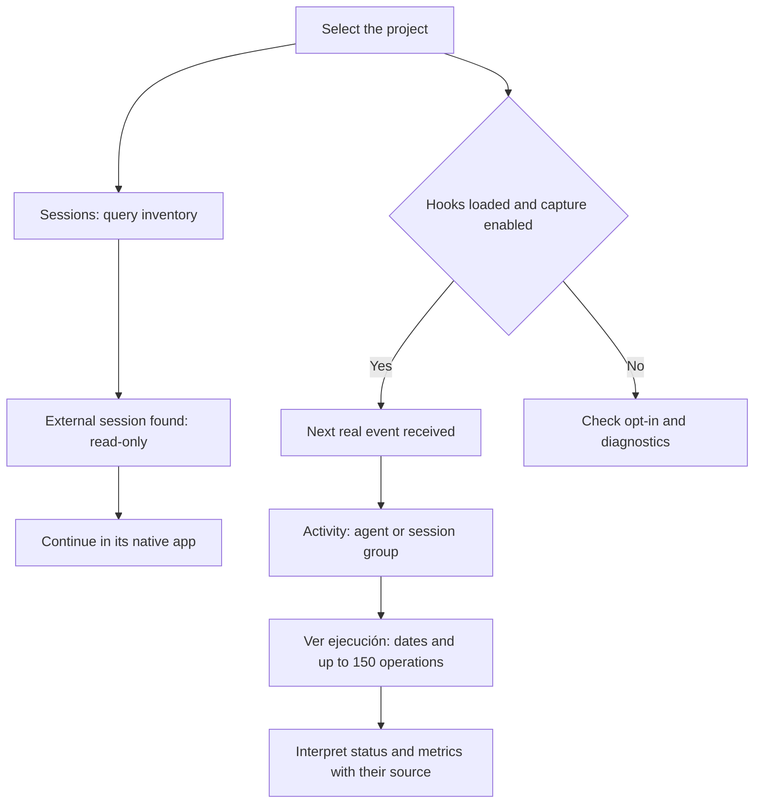

# Find sessions, agents and operations in the dashboard

**English** · [Español](../../guides/session-visibility.md)

**Updated: 2026-11-02 · Unreleased change, after v3.0.0.**

Open **Sesiones** to find project conversations. Open **Actividad** to inspect
identified agents, session signals and reported tools. A card does not prove that
a process is alive. Control names below match the current Spanish interface.

## Find the conversation already open in Codex

1. Select the project whose registered root matches the conversation's working directory.
2. Open **Sesiones** and wait for the native inventory query to finish.
3. Find the title under **Sesiones externas del proyecto**. Check the provider,
   identifier and last update without publishing that private information.
4. Continue chatting or interrupt the session in its native application.
5. Choose **Ver actividad capturada del proyecto** to inspect received signals.

| What you see | What it means | Next step |
|---|---|---|
| External session · Estado no confirmado | Codex reports an indexed conversation for this project | Use Codex to chat; this inventory is read-only |
| Console conversation | The console created or knows the native connection | Open its conversation and use the available controls |
| Lectura parcial | A limit or error prevented a complete query | Treat the list as a sample rather than a total |
| Inventario no disponible | The inventory could not be confirmed | Check diagnostics; this does not mean zero sessions |
| Sin descubrimiento externo | Claude Code/OpenCode do not provide this inventory in this version | Their console connections and hooks can still report activity |

Codex discovery reads indexed, non-archived metadata for the registered project's
**exact working directory**, up to 200 results. Subdirectories and worktrees with
different roots are not included automatically. Register the roots you need separately.
Discovery does not load turns, start inference or resume external conversations.

The **Sesiones** counter combines known console connections and observed external
sessions. It deduplicates by provider and native identity: a conversation found
through both paths counts once. This is not a count of active processes. If nothing
has been observed and discovery fails, it may show **—** instead of an unverified zero.

## Read Activity without mistaking a tool for an agent

The navigation entry is **Actividad**. Under **Sesiones y agentes observados**,
hook cards group events using the identity reported by the runtime: an agent
when attribution exists, otherwise a session.

A card may show **reviewer**, **Subagente sin rol informado** or
**Actividad de sesión**. The panel does not infer an agent from a tool name.
For example, **Herramienta: apply_patch** identifies an operation, not an agent.
Codex may report its session without identifying the subagent that performed an operation.

**Agentes en curso**, **Agentes terminados** and **Sin actualizar** count captured
subagent groups. **Sesiones sin atribución** counts session groups without an
agent identity. Console connections keep their cards and **Abrir conversación** action.

| Hook status shown | Available evidence | Interpretation |
|---|---|---|
| En curso | A subagent has no reported end and a signal less than 60 s old | Its last observed state; no process check |
| Actividad reciente | A session group has no reported end and a recent signal | Session activity without attributing it to an agent |
| Terminado | A response/execution end event was received | Confirms that boundary, not agent destruction or plan completion |
| Sin actualizar | No recent signal, or a timestamp that cannot establish freshness | Waiting, silent work or a missing end event are all possible |

Roadmap task status is separate. An in-progress task does not prove that an agent is running.

## Open the detail and understand time, tokens and cost

1. In **Actividad**, find the hook card using its role, provider and last signal.
2. Choose **Ver ejecución**. **Detalle de ejecución** shows status, start,
   last signal, local identifier, source and captured operations.
3. Read **Operaciones de esta ejecución**: tool, summary, timestamp, result and
   duration when reported. A task appears when attribution was possible.
4. If the read fails, choose **Reintentar**. Use **Cerrar detalle** to return to the card.
   Keyboard users can activate buttons with Enter. Closing a loaded detail returns focus to the trigger.

| Field | What this version measures | When missing |
|---|---|---|
| Tiempo observado | Interval since the reported start; may include waiting | No disponible when no start was reported |
| Inicio / Última señal | Reception timestamps used by local capture | No comunicado; no timestamp is reconstructed |
| Tokens | Current hook capture does not provide token usage | No disponible, never an assumed zero |
| Coste | Current hook capture does not provide monetary usage | No disponible; never calculated from elapsed time |
| Operation result | Correcto or Error, when reported | Resultado no comunicado |
| Operation duration | Reported milliseconds for that tool | Duración no comunicada |
| Source / Local identifier | Project hooks and the group's local identity | These do not authenticate an external process |

Observed time advances to the current read while the signal remains recent.
A received end fixes it at that boundary. A stale group freezes at its last signal.
This interval is neither CPU time nor exclusive model execution time.

**Ver ejecución** opens a group based on reported identity. Another start can
update the same group and its start timestamp; it does not necessarily create
a separate record for each turn. The detail shows at most the **150 most recent
operations** for that group, in reception order, within retained capture.
A truncation notice indicates omitted operations. This is not an exhaustive turn-by-turn history.

Fictional example: a `reviewer` group shows **Terminado**, **Tiempo observado:
4 s** and **Herramienta: apply_patch**. If Tokens and Coste show **No disponible**,
you know the received signals and observed interval; usage remains unknown.

## Enable capture for future events

Console connections report activity through their native bridge. Receiving hook
signals from external sessions also requires **project opt-in**. Merge this option
into the existing `.claude/dev.json`, preserving its other keys:

```json
{
  "sesion": {
    "actividad": true
  }
}
```

If `sesion` already exists, add `actividad` inside that object without duplicating
it. The runtime must have loaded and approved its hooks. If a hook fails, check
its native hook management or installation diagnostics. Updated plugin definitions
may require a new native session. You do not need to edit global permissions,
approval hashes or the plugin cache.

Enabling capture **does not recover past events**. Wait for a real operation and
check its last signal in Activity. External discovery and operation capture are
separate reads: either can work while the other is unavailable.



## When information is missing

| Symptom | What to check |
|---|---|
| The current conversation is absent | Selected project, exact cwd, indexed/non-archived session, provider status and read limit |
| The session appears without operations | Opt-in, loaded hooks and events after capture was enabled |
| Activity shows a session rather than an agent | The runtime may not have supplied a subagent identity; no role is invented |
| An agent stays Sin actualizar | Last signal and native application; absent events do not prove it stopped |
| An older operation is missing | Read window, truncation and retention; consult native history for context available there |
| Tokens and Coste stay unavailable | Current hooks do not provide these metrics; waiting longer cannot reconstruct them |

The inventory and hook capture described here do not display internal reasoning
or raw conversations. This guide covers the **Unreleased** change; the published
v3.0.0 PDF retains its historical content.

## Sources for this behavior

- [Console operating contract](../../../skills/plugin-panel/references/control-center.md).
- [Sessions and counter](../../../skills/plugin-panel/assets/console-sessions.js) and
  [deduplication](../../../skills/plugin-panel/assets/console-dom.js).
- [Activity cards and detail](../../../skills/plugin-panel/assets/console-context.js),
  [service metrics](../../../skills/plugin-panel/scripts/console_service.py),
  [detail window](../../../skills/plugin-panel/scripts/panel_data.py) and
  [states and duration](../../../agent-kits/shared/agent-activity.py).
- [Initiative scenarios](../../roadmap/2026-11-02-session-visibility/test-plan.md) and
  [QA report](../../roadmap/2026-11-02-session-visibility/testing/report.md), including fixture tests and limits of the real check.
