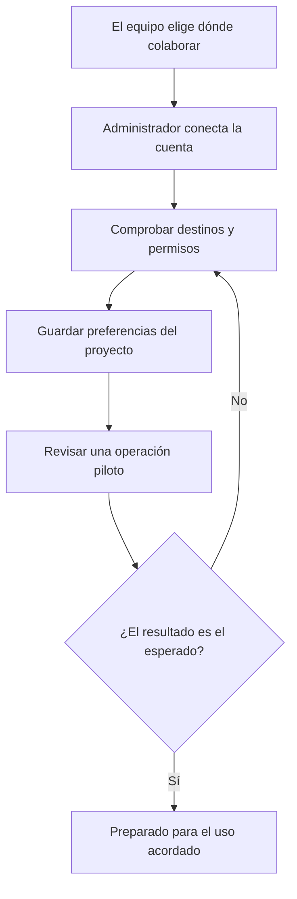
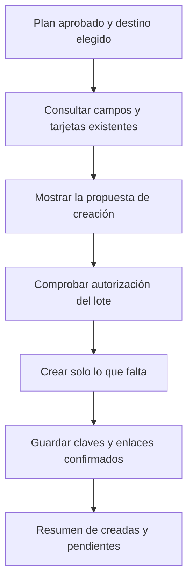
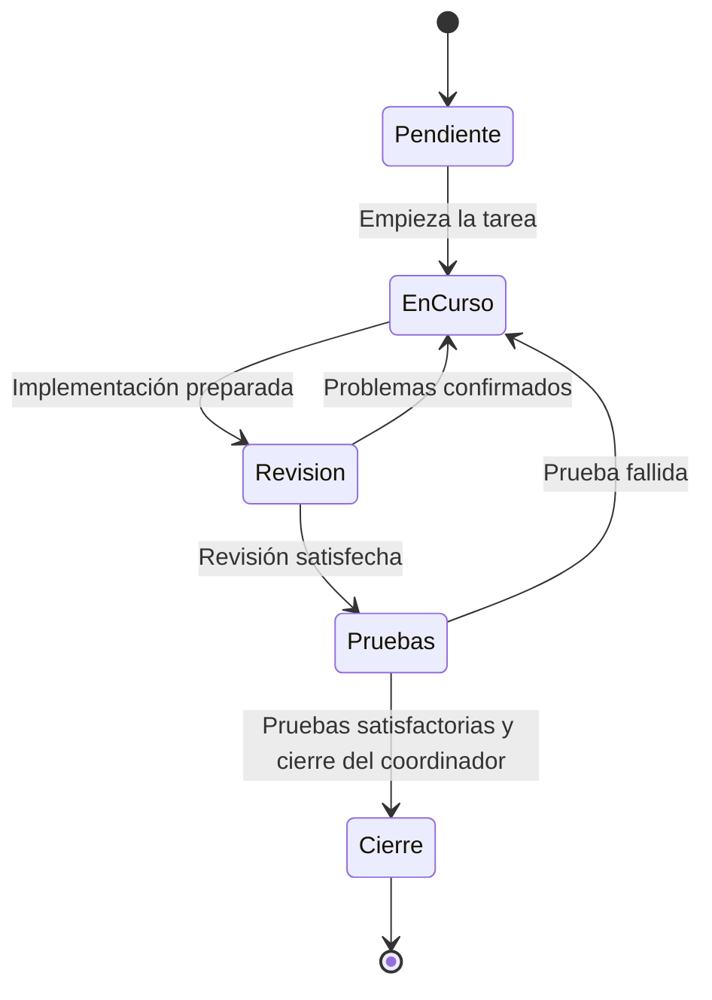
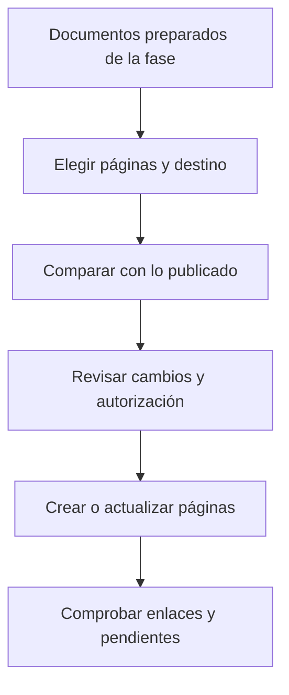
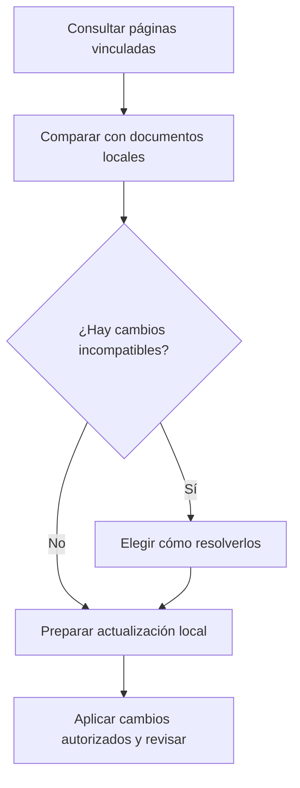

# 3. Trabajar con Jira y Confluence sin perder el control del proyecto

Jira sirve para organizar tarjetas de trabajo en un tablero. Confluence sirve para
compartir documentos en páginas. Son dos productos distintos de Atlassian: puedes
usar uno, los dos o ninguno. Tener acceso a Jira no implica tener acceso a Confluence.

custom-agents puede preparar y mantener una representación del trabajo en estas
herramientas cuando el proyecto lo configura y la sesión dispone de un conector
compatible. Los documentos y verificaciones del proyecto siguen siendo necesarios.
En este capítulo, las claves `AREA-101` y similares son ejemplos ficticios.

## W-08. Preparar Atlassian para un equipo

### Qué tienes que decidir

Antes de conectar nada, responde con el equipo: ¿en qué proyecto de Jira se crearán
las tarjetas?, ¿quién podrá verlas y modificarlas?, ¿dónde estarán las instrucciones
en Confluence?, ¿quién autoriza las publicaciones? Un proyecto de Jira es un espacio
de trabajo para tarjetas; un espacio de Confluence agrupa páginas de documentación.

```text
Queremos usar Jira para seguir las tareas del portal y Confluence para
sus instrucciones. Ayúdame a elegir los destinos visibles para mi cuenta.
Muéstrame una operación de prueba antes de publicar el plan completo.
```



### Pasos que debe seguir la preparación

1. El administrador autoriza el conector en el entorno que utilizará el equipo.
   La cuenta y sus credenciales pertenecen a ese entorno; no se pegan en una petición
   ni se guardan dentro de los ejemplos del manual.
2. El configurador `/setup` recoge qué funciones queréis utilizar. Seguimiento de
   tareas y publicación de documentos se eligen por separado.
3. El adaptador consulta los destinos realmente accesibles. Elige el proyecto o
   espacio por su nombre y comprueba que corresponde al área correcta. No reutilices
   una clave de ejemplo como si fuera un identificador válido.
4. Se decide la organización de las tarjetas, la asignación inicial y el destino
   de las páginas. La siguiente sección explica «por tarea» y «por fase».
5. Se guardan las preferencias del proyecto. El diagnóstico comprueba que tienen
   una forma válida; eso todavía no demuestra que la cuenta pueda escribir.
6. Se prepara una operación piloto: una tarjeta o una página claramente identificada
   como prueba en el destino acordado. Revisa qué se va a crear y con qué cuenta.
7. Después de la autorización correspondiente, comprueba el enlace del resultado.
   Si aparece donde esperabais y con el contenido correcto, el equipo puede aceptar
   esa configuración para su uso previsto.

### Qué piezas intervienen

`/setup` coordina la preparación. `jira-sync` es la skill que adapta el plan a Jira;
`confluence-publish` publica documentación y `confluence-pull` trae cambios de vuelta.
Las herramientas reales del conector deben existir y disponer de los permisos
necesarios. Sus nombres y disponibilidad pueden variar según la integración instalada.

La respuesta final debe distinguir «preferencias guardadas», «lectura comprobada» y
«escritura piloto comprobada». Si falta acceso, pide al administrador el permiso
concreto; el asistente no debe intentar concedérselo a sí mismo.

## Elegir una tarjeta por tarea o una tarjeta por fase

Esta elección afecta a lo que el equipo verá en el tablero. No reduce los criterios
que cada tarea debe cumplir en el registro local.

**Una tarjeta por tarea** facilita responsables distintos, prioridades individuales y
seguimiento detallado. En el portal, podrías tener `AREA-101 Permisos`, `AREA-102 Registrar
decisión`, `AREA-103 Pantalla` y `AREA-104 Verificación`. Cada tarjeta representa su tarea.

**Una tarjeta por fase** ofrece un tablero más resumido. Podrías tener «Base», «Uso» y
«Entrega». La tarjeta «Base» contiene o referencia T-01 y T-02. No está terminada cuando
solo se completó T-01: la fase se evalúa sobre el conjunto de tareas que le corresponden.

| Pregunta del responsable | Por tarea | Por fase |
|---|---|---|
| ¿Necesito asignar cada parte a una persona distinta? | Suele resultar más claro | Debe explicarse cómo se conserva ese detalle |
| ¿Busco una vista ejecutiva con pocas tarjetas? | Habrá más tarjetas | Agrupa el trabajo sin borrar las tareas del plan |
| ¿Dónde veo los criterios completos? | En la tarea local y su referencia externa | En las tareas locales y el desglose de la fase |
| ¿Qué pasa si una parte está pendiente? | Su tarjeta permanece pendiente | La fase permanece abierta hasta cumplir sus condiciones |

Puedes decir «prefiero una tarjeta por tarea porque los responsables cambian» o
«prefiero por fase para dirección, conservando el desglose local». Si ya se publicaron
tarjetas, cambiar esta decisión requiere reconciliar las existentes. Borrar el mapa
para volver a empezar puede crear duplicados y perder la relación con el plan.

## W-09. Crear las tarjetas del plan en Jira

### Qué debe estar preparado

Necesitas un plan local aprobado, el destino elegido, una cuenta con permisos y la
organización por tareas o fases. El planificador prepara el trabajo; la skill
`jira-sync` realiza su adaptación al tablero mediante las herramientas disponibles.

```text
Prepara la publicación del plan del portal en el proyecto de Jira elegido.
Usa una tarjeta por tarea. Antes de crear, enséñame cuántas tarjetas habrá,
sus títulos, la asignación y cualquier elemento padre.
```



### Qué ocurre con el ejemplo del portal

El adaptador lee T-01 a T-04 y consulta los tipos de tarjeta y campos que exige el
proyecto de Jira. Algunos proyectos usan épicas o subtareas; otros tienen estructuras
distintas. Un **elemento padre** es una tarjeta que agrupa otras. La integración debe
comprobar qué relaciones admite el proyecto en lugar de asumir que son universales.

La vista previa muestra cuatro tarjetas, sus títulos y su asignación. Si el equipo
quiere agruparlas bajo una épica existente, se comprueba cuál es y si la relación
está permitida. Si Jira exige un campo que falta, se resuelve antes de crear.

Cuando el lote esté autorizado, se consulta el mapa de publicaciones anteriores.
Ese mapa recuerda qué tarjeta corresponde a cada tarea o fase. Se crean las que
faltan y se guardan los identificadores que Jira confirme. Al retomar el trabajo,
el sistema puede reconocer esas tarjetas y evitar crearlas de nuevo.

### Qué debes recibir y qué hacer con un resultado parcial

Pide una lista separada de tarjetas nuevas, ya existentes, fallidas e inciertas,
con enlaces cuando estén confirmados. Abre una tarjeta y comprueba título, proyecto,
contenido y responsable. «He preparado el JSON» no significa «he creado las tarjetas».

Imagina que Jira confirma tres tarjetas y la cuarta se interrumpe por un timeout:
el tiempo de espera termina antes de saber el resultado. No se deben repetir las
cuatro. Se conservan las tres confirmadas y se busca si la cuarta llegó a crearse.
Si no puede demostrarse, queda pendiente de reconciliación. Puedes pedir: «Comprueba
el resultado de la cuarta antes de volver a enviarla».

## W-10. Entender los comentarios y los cambios de estado

### Qué representa cada momento

Una tarjeta cuenta una historia del trabajo. El comentario de implementación explica
qué se cambió; el de revisión, qué se encontró; el de QA, qué se probó. Ninguno debe
publicarse dos veces por reanudar la conversación.

Los nombres de columna dependen de vuestro Jira. En este manual «En curso» y «Done»
son objetivos de trabajo, no identificadores que funcionen en cualquier proyecto.
El adaptador consulta qué cambios de estado están permitidos para esa tarjeta.



Este dibujo explica el método. **No promete que vuestro tablero tenga esas seis
columnas.** Puede representar revisión y pruebas con comentarios y mantener menos
estados. Lo que se conserva es la condición que permite dar por terminado el trabajo.

### Un ejemplo de principio a fin

1. Se empieza T-02. El implementador comunica el inicio; el adaptador puede solicitar
   el estado que vuestro workflow utilice para «trabajo en curso».
2. Se implementa el guardado de la decisión. El comentario explica cambios y
   comprobaciones realizadas, enlazando la evidencia. La tarjeta no pasa a Done solo
   porque el implementador haya terminado su parte.
3. La revisión detecta que se permite un rechazo sin motivo. Se añade un comentario
   de ese intento y se solicita la reapertura o continuidad necesaria.
4. Se corrige y se registra el siguiente intento. El historial conserva el problema
   anterior y su resolución; no se borra para hacer parecer que nunca existió.
5. QA ejecuta los casos y añade su resultado. Si falla un caso, el trabajo vuelve al
   ciclo de corrección. Si pasa, aporta evidencia al coordinador.
6. El coordinador verifica los controles requeridos y puede solicitar el cierre de
   la tarjeta. Si el workflow de Jira no permite esa transición, se explica la
   limitación y queda pendiente su proyección externa.

### Qué contienen los comentarios

Ejemplo ilustrativo de un comentario, no una publicación real:

```text
[custom-agents · qa] Verificación de T-02

Se ha comprobado que una solicitud resuelta no admite otra decisión
 y que un rechazo necesita explicación.
Resultado: satisfactorio en los casos indicados en el informe.
Evidencia: informe de pruebas de la iniciativa.
El cierre corresponde al coordinador tras reunir revisión y QA.
```

La firma indica qué rol aporta el comentario. La cuenta que aparece como autora en
Jira es la cuenta del conector; no se está creando una identidad humana nueva para
cada agente. Las menciones a personas y sus asignaciones deben utilizar identidades
reales resueltas en vuestro sistema, con los permisos correspondientes.

`adversarial-review` coordina los comentarios de revisión por intento; `qa` aporta
el resultado de verificación; el coordinador proyecta el cierre. El adaptador Jira
traduce estos momentos a operaciones concretas. Los registros internos evitan volver
a publicar un evento ya confirmado.

### Horas y operaciones que no se pudieron confirmar

Si se habilitan imputaciones de tiempo, su cálculo sigue la configuración y medición
del proyecto. Se distingue implementación de revisión y se aplican las reglas de
jornada. Una duración de terminal o una estimación no se transforma en horas reales
sin explicar su procedencia.

Un comentario enviado justo antes de una interrupción puede existir aunque no se
haya recibido su confirmación. Antes de repetirlo, el adaptador debe consultarlo.
Si no puede comprobarse, pide reconciliar el resultado. «Pendiente» no siempre
significa «no ocurrió».

## W-11. Publicar las instrucciones en Confluence

### Cuándo conviene publicar

Al cerrar una fase, el equipo puede compartir la documentación que ya está preparada.
El documentador mantiene las instrucciones; `confluence-publish` adapta la publicación.
La integración no sustituye la revisión de lo que se va a compartir.

```text
Prepara la publicación de las instrucciones del portal en el espacio acordado.
Muéstrame qué páginas se crearán o actualizarán y qué documentos quedarán fuera.
```



El adaptador consulta el espacio y la página raíz elegidos. Prepara un árbol legible,
por ejemplo «Portal de solicitudes», con páginas de uso, permisos y operación.
Consulta las páginas existentes para conservar su identidad en actualizaciones y
para detectar cambios hechos por otras personas.

La vista previa debe indicar qué documentos entran y cuáles quedan fuera. Los
informes de pruebas con capturas y otros materiales excluidos por la política no
se publican por el mero hecho de estar dentro del proyecto. Si quieres ampliar el
alcance, se decide expresamente y se comprueba qué soporta el conector.

Después de la publicación autorizada se guardan los identificadores y versiones
confirmados. Pide enlaces y abre las páginas: comprueba títulos, jerarquía, texto e
imágenes que se hayan podido publicar. Si alguien editó una página desde la última
sincronización, no se sobrescribe para salir del conflicto; se comparan los cambios.

Una respuesta correcta puede ser: «Se actualizaron Uso y Permisos. Operación queda
pendiente por conflicto con una edición remota». Ese pendiente necesita decisión,
no una afirmación general de que «Confluence está sincronizado».

## W-12. Traer a los archivos locales un cambio hecho en Confluence

### Un caso cotidiano

Un responsable mejora las instrucciones de uso directamente en Confluence. El
proyecto local todavía conserva la versión anterior. `/confluence-pull`, mediante
la skill del mismo nombre, permite revisar e incorporar la diferencia.

```text
Revisa los cambios de Confluence del portal y compáralos con nuestros documentos.
Antes de actualizar los archivos locales, explícame los conflictos y qué conservarías.
```



Primero se comprueba la relación entre página remota y documento local. No se
importa cualquier página que aparezca en una búsqueda como si fuera parte del
proyecto. Después se comparan las versiones disponibles y se prepara una propuesta.

Si solo cambió Confluence, se puede incorporar esa mejora tras la revisión acordada.
Si también cambió el archivo local, se presenta el conflicto. Puedes pedir que se
conserve un párrafo, se incorpore otro y se revise el resultado combinado. La
actualización debe respetar los metadatos locales que utiliza el proyecto.

Al terminar, el coordinador resume archivos actualizados, cambios omitidos y conflictos
pendientes. Que el documento se haya descargado no prueba que una función del programa
se haya implementado; el plan y sus verificaciones siguen teniendo su propio recorrido.

Para configurar archivos, eventos, idempotencia y contratos de las herramientas,
consulta la [referencia técnica Atlassian](../reference/atlassian.md).
