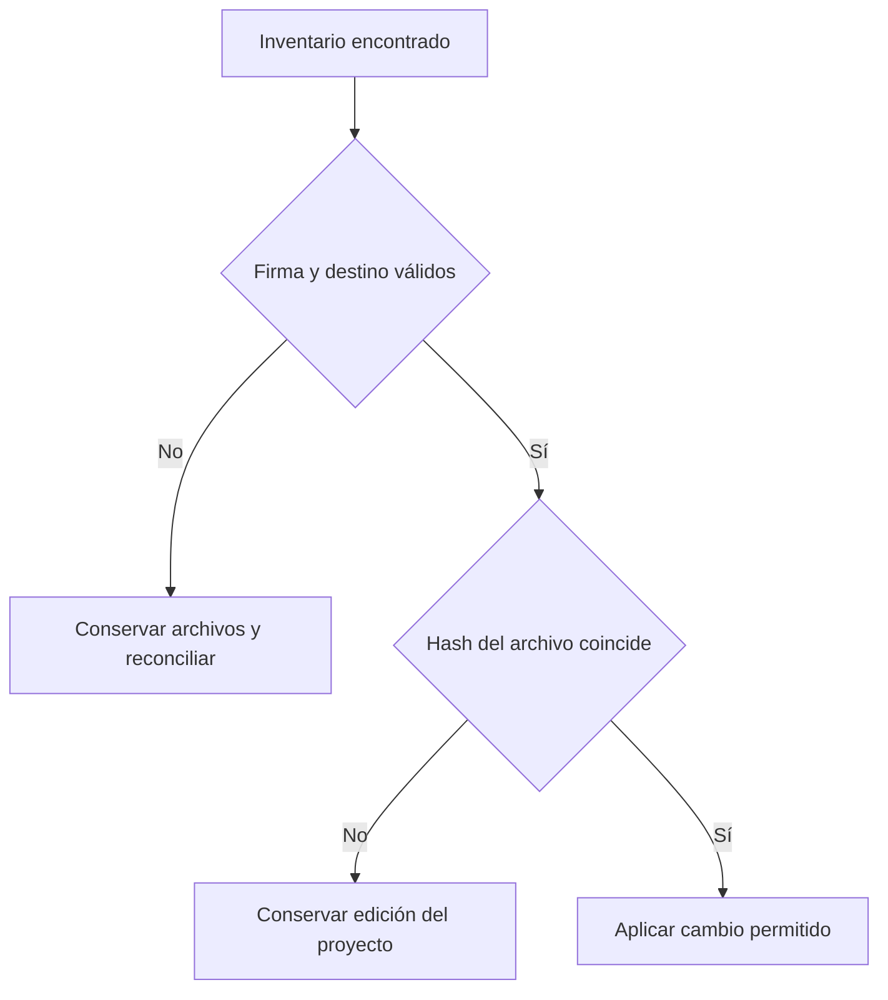

# Cambios de seguridad y recuperación del instalador y las integraciones

Esta guía describe las correcciones posteriores a la auditoría de 3.2.1. La revisión de npm es independiente de las pruebas del producto: un paquete que pasa sus tests puede quedar bloqueado por el registro y requiere su procedimiento de apelación.

## Propiedad de la instalación

El instalador autentica sus inventarios con HMAC-SHA256. La clave privada vive en `~/.custom-agents/installer-auth-v1/key`, fuera del proyecto. No es una credencial de Claude, Codex, OpenCode ni npm; no la añadas a Git ni la compartas. El recibo vincula proveedor, ámbito, proyecto y destino. Cambiar el JSON, copiarlo a otro proyecto o perder la clave impide usar ese inventario para borrar archivos o ejecutar acciones de limpieza.

Los inventarios antiguos sin firma dejan de ser autoridad para migración y desinstalación automática. Si aparece `unverified installation manifest`, conserva una copia de la instalación y del inventario; contrasta las rutas con la documentación del proveedor y reconcilia manualmente los archivos que realmente pertenecen al plugin. No firmes un inventario desconocido ni elimines archivos de otros proyectos para desbloquear la operación. La clave perdida no se puede reconstruir desde el recibo.

La copia predeterminada de Claude usa el perfil `full` con control de propiedad. Un archivo preexistente sin propiedad acreditada bloquea la sustitución; un archivo editado por el consumidor se conserva al desinstalar. Un `--scope` inválido se rechaza antes de actuar.

## Publicar únicamente lo que sigue autorizado

La outbox conserva la necesidad de reintentar, no el permiso para reenviar un cuerpo antiguo. Cada recuperación vuelve a planificar con las entradas que siguen aprobadas y enrutadas. Un contenido retirado no vuelve a enviarse por permanecer en una cola. Los recibos parciales del adaptador siguen participando en la recuperación.

En Graphiti, `summary` envía el resumen explícito o el primer párrafo. No utiliza el cuerpo completo como sustituto. La proyección se compara además del hash y la versión originales. Cambiar una proyección de una identidad ya publicada exige incrementar la versión aprobada; el error explica este paso y evita declarar una sincronización correcta sin haber cambiado nada. Las identidades remotas son inmutables: ni este cambio ni un rebuild borran el historial que ya recibió el servidor. Evalúa por separado cualquier retirada de datos remotos según el procedimiento del backend.

Confluence excluye siempre `docs/security-scan/**`, candidatos y journal, incluso si el proyecto define un `include` muy amplio y vacía sus exclusiones. Las propuestas de conocimiento registran `content_origin` desde su creación y la aprobación no puede convertir una propuesta declarada de agente en una humana. Estas etiquetas expresan procedencia declarada; no autentican personas.

## Sesiones, journal y exportaciones

Un turno fallido con proceso conectado permite enviar un mensaje nuevo explícito. Una entrega incierta no se reenvía automáticamente. OpenCode puede recuperar el estado tras un sondeo transitorio fallido; una desconexión libera su plaza después de cerrar el proceso propio, e ignora eventos tardíos de esa conexión. Las solicitudes demasiado grandes sólo permiten rechazo o cancelación y remiten a la interfaz nativa.

El journal rechaza padres redirigidos, enlaces y archivos compartidos por hardlink, tanto en su cola predeterminada como en rutas configuradas. Las lecturas de entradas son acotadas. Un README ajeno no se adopta como índice generado ni se sobrescribe. Si la captura opcional no puede escribir con seguridad, conserva los datos existentes y degrada sin bloquear la sesión.

Los paquetes de skills portables incluyen el catálogo de capacidades limitado a las skills entregadas. El exportador de interoperabilidad valida todos los destinos antes de escribir y publica archivos de forma atómica. Los comentarios de Jira pasan por el redactor de secretos reconocidos; los comandos generados conservan configuración, fecha y estado mediante rutas absolutas, aunque se ejecuten desde otra carpeta.

## Cachés compartidas

Las cachés de Claude y su registro de marketplace son compartidos por el usuario. Tienen recibos propios y no pertenecen al inventario de un proyecto. Desinstalar una instancia retira su registro y conserva esas cachés, incluso si es la última: así no elimina archivos que pueden servir a otros proyectos o versiones. No confundas esta conservación con una instancia todavía activa. Los archivos de proyecto y sus ediciones siguen teniendo su propio ciclo de propiedad.

## Históricos grandes

El archivador de ledgers mantiene las lecturas acotadas. Su presupuesto predeterminado para `execution-history.md` es 8 MiB; si el histórico crece, se detiene antes de modificarlo y explica cómo ampliarlo explícitamente: `python agent-kits/shared/ledger-archive.py docs/roadmap/<iniciativa> --apply --history-max-bytes 16777216` permite 16 MiB. Se conserva íntegro el contenido anterior y sus enlaces. El máximo admitido es 128 MiB; alcanzar ese límite exige planificar el archivo histórico fuera de esta operación, sin truncarlo ni borrar sus referencias.

La configuración del perfil, los snapshots de commit y las respuestas del diagnóstico tienen un límite explícito de 32 niveles de objetos/listas. Un JSON excesivamente profundo se rechaza con un aviso o un resultado inválido controlado; no se deduce que el perfil lite esté activo por poder decodificar el documento. Simplifica o externaliza esa estructura antes de continuar. El límite de 50 niveles del validador de datos de entrenamiento permanece igual.

## Publicación npm

El paquete contiene herramientas de auditoría y pentest autorizado. Por eso declara `contentPolicy: {"class":"dual-use"}` e incluye un `DISCLOSURE` de texto en la raíz del tgz. Tras publicarse, ambos deben permanecer en versiones siguientes y la publicación debe exigir 2FA. Declararlos no garantiza la aprobación de npm.

Una suspensión de cuenta requiere revisión de npm; cambiar el código no la levanta. Conserva el tgz rechazado, SHA-512 e identificador de referencia, y presenta una apelación oficial. No automatices publicaciones repetidas ante un 404 ni uses otra cuenta o nombre para eludir el bloqueo.

La publicación directa de un paquete dual-use requiere una sesión interactiva con 2FA. Los tokens de automatización y trusted publishing (OIDC) deben pasar por staging y promoción con 2FA, según la política específica de npm. Declarar dual-use no autoriza un envío directo que omita esa protección.

Fuentes: [escaneo de publicación](https://github.blog/changelog/2026-07-28-npm-publish-time-malware-scanning-and-dual-use-metadata/), [política de doble uso](https://docs.npmjs.com/policies/dual-use/), [apelación y restitución](https://docs.github.com/en/site-policy/acceptable-use-policies/github-appeal-and-reinstatement).
