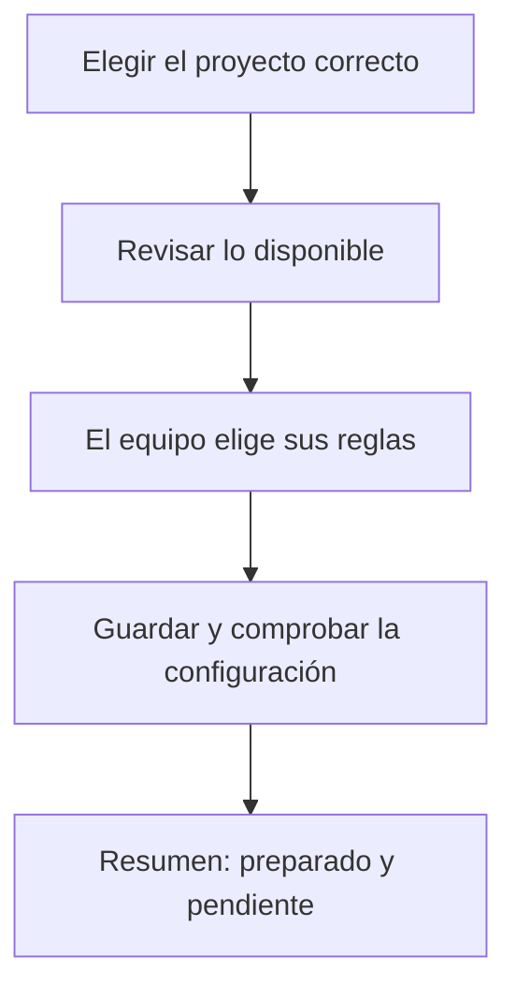
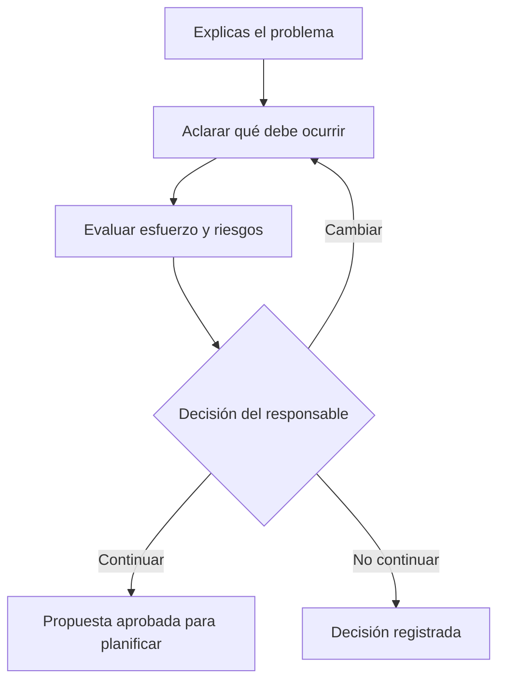
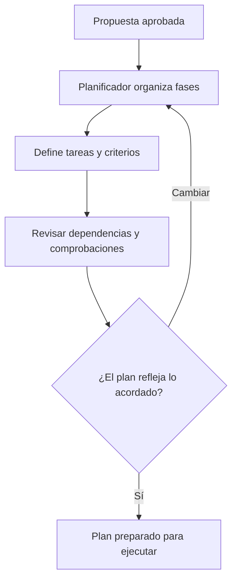
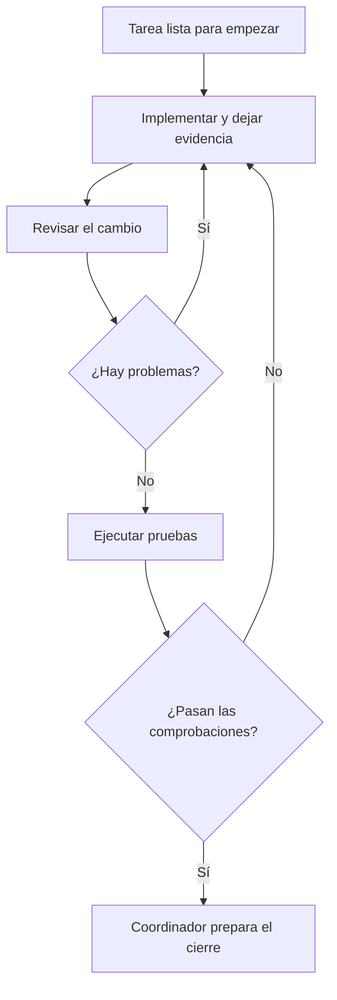
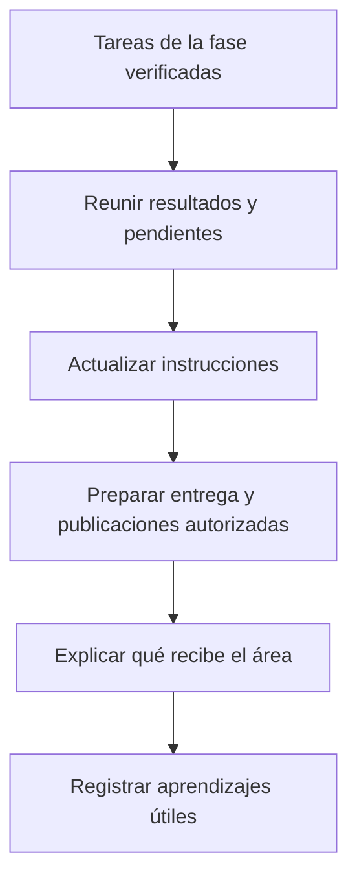
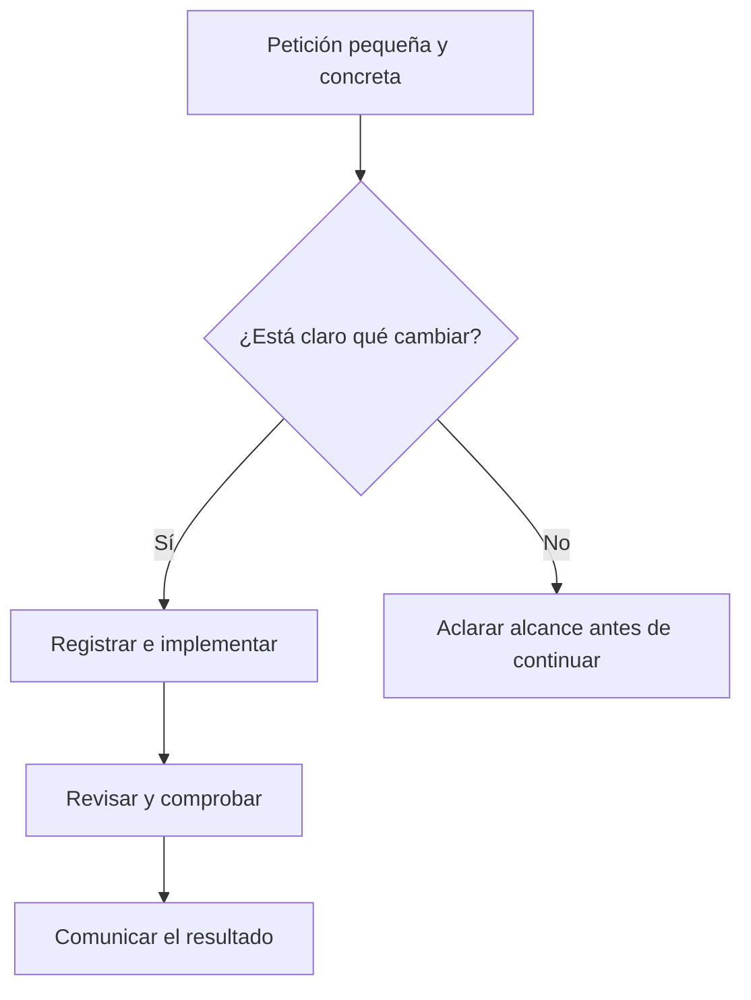
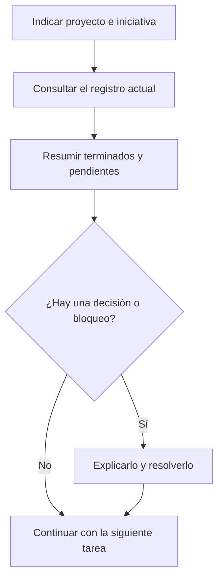

# 2. De una petición a una entrega: los recorridos del núcleo

El núcleo es la parte que organiza el trabajo aunque no haya una conexión con Jira,
Redmine o una wiki. En este capítulo seguiremos el portal de solicitudes internas.
Cada recorrido puede iniciarse con una petición en lenguaje natural; los comandos
indicados son atajos para quien ya los tenga disponibles en su entorno.

## W-01. Preparar el proyecto para empezar a trabajar

### Cuándo lo necesitas y qué debes tener

Usa este recorrido cuando un equipo vaya a trabajar por primera vez en un proyecto.
Necesitas acceso al espacio de trabajo y una persona que pueda decidir sus reglas:
qué se quiere medir, cómo se revisará y si se utilizarán herramientas externas.
La instalación y las cuentas deben estar preparadas por el administrador correspondiente.

Puedes pedir:

```text
Prepara este proyecto para nuestro equipo. Queremos organizar el trabajo
localmente y revisar las pruebas antes de aceptar una entrega.
Explícame las opciones y todavía no publiques nada en sistemas externos.
```



### Qué ocurre paso a paso

1. El coordinador identifica el proyecto. Si tienes varios abiertos, confirma cuál
   debe preparar. Así no se aprovechan por error las preferencias de otro equipo.
2. La comprobación de instalación, `/doctor`, informa de lo que falta o no puede
   verificar. Diagnosticar no significa que el producto vaya a cambiarlo por su cuenta.
3. El configurador, `/setup`, presenta las decisiones: reglas de desarrollo y revisión,
   preferencias de medición y funciones externas. Puedes elegir «solo trabajo local».
4. Si se va a estimar coste, una persona responsable revisa los datos económicos.
   Una tarifa introducida a mano es una decisión del equipo; no una factura ni una
   garantía del coste final. La skill `rates-verify` comprueba precios cuando se pide.
5. Si eliges una herramienta externa, se preparan sus preferencias. El administrador
   comprueba aparte la cuenta y los permisos. Guardar «usaremos Jira» no prueba acceso.
6. El coordinador resume qué está preparado, qué no se ha comprobado y qué necesita
   una acción del administrador. Ese resumen es el punto de partida del equipo.

### Quién interviene y cómo reconoces el resultado

Actúan la persona responsable, el coordinador y, para instalación o cuentas, un
administrador. `/setup` y `/doctor` son los comandos principales; las herramientas
son la lectura y escritura de configuración del proyecto. Si eliges cobertura de
pruebas, `unit-tests` aplica los criterios acordados.

Pide: «Dime qué opciones has guardado y qué no está conectado todavía». Un resultado
correcto distingue **configurado**, **disponible** y **probado**. Si un archivo de
configuración está dañado, se revisa y recupera; no se borra para hacer desaparecer
el problema. Si no hay acceso a una integración opcional, se puede empezar localmente.

## W-02. Convertir una idea en una propuesta que puedas aprobar

### La situación del ejemplo

«Añadir aprobación de solicitudes» no explica todavía quién aprueba ni qué ocurre
con un rechazo. El recorrido de producto, `/pm-cycle`, ayuda a aclararlo y a decidir
si merece la pena continuar. Su resultado es una propuesta; no cambios ya implementados.

```text
Queremos que un responsable apruebe o rechace solicitudes internas.
Ayúdame a definir el comportamiento, los riesgos y el alcance antes de construirlo.
```



### La conversación que debes esperar

El analista (`analyst`), cuando hace falta aclarar la idea, pregunta por situaciones
concretas. Por ejemplo: «¿Puede aprobar cualquiera?», «¿Es obligatorio indicar el
motivo del rechazo?» o «¿Qué ocurre si dos responsables actúan a la vez?».

Puedes responder que solo el responsable asignado puede decidir; que el rechazo
necesita explicación; y que una solicitud resuelta no admite una segunda decisión.
El analista convierte estas respuestas en requisitos y criterios de aceptación:
condiciones observables que permitirán comprobar el resultado.

El evaluador (`evaluator`) estudia esfuerzo, riesgos y datos de coste disponibles.
Si una cifra es una estimación, debe decirlo. Si falta un dato, debe quedar como
incógnita. Puedes pedir qué parte de la estimación depende de ese supuesto.

Cuando procede comparar soluciones, el arquitecto (`architect`) presenta opciones.
Una puede resultar más rápida y otra más adecuada para futuras ampliaciones. La
recomendación no sustituye la decisión que el recorrido te pide tomar.

### Qué decides y qué queda al terminar

Puedes aprobar la propuesta, pedir cambios o descartarla. Una aprobación clara sería:
«Continuamos con esos tres requisitos; las notificaciones automáticas quedan fuera».
La especificación conserva ese alcance y la evaluación conserva los supuestos.

Las skills `research-first` y `code-health` pueden aportar información si se compara
una herramienta o se necesita conocer el estado del código. No tienen que usarse en
todas las propuestas. Las herramientas consultan el proyecto y producen documentos.

El coordinador ofrece pasar a `/dev-cycle` sobre la misma iniciativa. No convierte
por sí solo la propuesta en una implementación ni crea todas las tarjetas externas.
Si no entiendes una estimación, pide una explicación con un ejemplo antes de aprobarla.

## W-03. Dividir la propuesta en fases y tareas comprensibles

### Para qué sirve el plan

Una fase agrupa trabajo relacionado. Una tarea es una unidad con un resultado que
puede comprobarse. En nuestro portal, una fase puede reunir permisos y reglas; otra,
la pantalla; y una tercera, pruebas y documentación. Las tareas concretan esas partes.

```text
Planifica la propuesta aprobada del portal. Quiero ver las fases,
qué resultado entrega cada tarea y cómo sabremos que está terminada.
Todavía no crees tarjetas externas hasta que revisemos el desglose.
```



### Un desglose posible del ejemplo

| Fase | Tarea ilustrativa | Qué resultado se espera | Cómo se comprueba |
|---|---|---|---|
| Base | T-01: permisos de aprobación | Solo el responsable autorizado decide | Una persona sin permiso recibe una denegación |
| Base | T-02: registrar una decisión | Se guarda aprobación o rechazo con su motivo | Una solicitud resuelta no puede decidirse otra vez |
| Uso | T-03: mostrar la acción en pantalla | La persona entiende qué puede hacer y qué pasó | La pantalla muestra éxito, rechazo y error de forma comprensible |
| Entrega | T-04: verificar y documentar | El equipo tiene pruebas e instrucciones | Revisión y pruebas satisfactorias; guía de uso disponible |

Esta tabla es un ejemplo de planificación, no un plan ya ejecutado. El planificador
(`planner`) adapta el desglose al proyecto real, al diseño elegido y a los criterios
aprobados. Debe explicar qué tarea depende de otra y qué puede verificarse por separado.

El contexto de trabajo, consultable con `/work-context`, ayuda a elegir las guías
adecuadas. Por ejemplo, `stack-practices` aporta criterios del lenguaje o framework;
`api-contract` ayuda si hay un contrato de API; `frontend-quality` si cambia la
interacción de pantalla. Una API es una forma de comunicación entre programas;
no tienes que diseñarla tú para revisar el resultado que debe ofrecer al usuario.

### Qué revisar antes de dar paso a la ejecución

Comprueba que cada tarea tenga un propósito y una prueba de aceptación, no solo un
título como «hacer backend». Pregunta qué queda fuera y cómo se tratará un cambio
de alcance. Los archivos del plan y el registro de tareas quedan en la misma carpeta.

Si hay una integración configurada y se autoriza la proyección del plan, se podrá
crear su representación externa. La elección de «una tarjeta por tarea» o «una por
fase» se explica en el capítulo Atlassian. El detalle de las tareas locales se conserva
en ambos casos. Si no hay conexión, el plan sigue siendo utilizable.

## W-04. Hacer una tarea, revisarla y comprobar que funciona

### Qué inicia el recorrido

El plan está aprobado y se selecciona una tarea. `/dev-cycle` coordina la ejecución.
No necesitas dirigir manualmente cada especialista; sí necesitas poder ver sus
resultados y las decisiones pendientes.

```text
Continúa con T-02 del portal según el plan aprobado.
Al terminar, muéstrame lo implementado, la revisión y las pruebas.
Si aparece un cambio de alcance, explícalo antes de incorporarlo.
```



### Qué hacen los asistentes

El implementador (`implementer`) marca el inicio de la tarea y realiza los cambios.
Si el proyecto usa TDD, la skill `tdd` exige observar primero una prueba que falle por
el comportamiento que falta. TDD significa desarrollar apoyándose en pruebas desde
el principio; no significa escribir al final una prueba que siempre confirme el código.

Después, `adversarial-review` organiza la revisión. Puede comparar el cambio con lo
acordado y buscar errores de funcionamiento; añade miradas de seguridad o rendimiento
cuando corresponden. El agente revisor (`reviewer`) devuelve hallazgos. El implementador
corrige los que se confirman y la traza conserva los intentos, sin borrar el anterior.

QA (`qa`) ejecuta las pruebas aplicables y prepara su informe. La skill `unit-tests`
utiliza el runner y el umbral del proyecto. Un runner es el programa que ejecuta
las pruebas; «QA verde» significa que la comprobación definida ha dado resultado
satisfactorio, no que se garantice la ausencia de cualquier error futuro.

### Cómo leer el ejemplo del rechazo

El implementador añade el guardado del motivo. El revisor detecta que se permite
rechazar con un motivo vacío. Se corrige. QA intenta rechazar sin explicación y
comprueba que se impide; después verifica que un rechazo válido queda registrado.
Si falla uno de esos casos, la tarea vuelve a corrección.

El coordinador comprueba revisión y QA antes de proyectar el cierre. «Código escrito»
o «prueba local de una parte» son avances, pero no sustituyen todos los controles
acordados. Los comentarios de Jira o Redmine se explican en sus capítulos; el hecho
de que se publique un comentario no cambia el resultado de una prueba fallida.

### Qué pedir y qué ocurre si algo falla

Pide el informe, los casos ejecutados y los que no se pudieron comprobar. Una respuesta
«todos los tests pasan» debe identificar qué ejecución lo demuestra. Si el ciclo de
corrección acumula tres resultados rojos de QA, el método pide una depuración de causa
raíz con `debug-root-cause` antes de decidir cómo seguir. El problema se explica;
no se reduce un umbral para declarar éxito.

Si falla una conexión externa, el resultado local y su evidencia se conservan. Lo
pendiente es publicar o reconciliar ese resultado, no repetir automáticamente todo.

## W-05. Cerrar una fase y entregar el resultado al área

### Cerrar significa reunir lo que se prometió

Cuando las tareas de una fase tienen las verificaciones requeridas, el coordinador
puede cerrar esa parte del plan. Al terminar la iniciativa reúne los resultados,
la documentación y lo que sigue pendiente. Este cierre forma parte de `/dev-cycle`.

```text
Prepara la entrega del portal para el área.
Relaciona los requisitos aprobados con lo que has terminado, sus pruebas,
las instrucciones de uso y cualquier limitación pendiente.
```



El implementador comprueba la fase; el documentador (`documenter`) mantiene las
instrucciones; `changelog-sync` ayuda a dejar notas de cambios. Una nota de cambios
explica qué se ha añadido o corregido para quien usa el producto. No equivale a
publicar una versión ni a desplegarla en un entorno de producción.

Si se acordó publicar documentos en Confluence o en otra wiki, se comprueba qué se
publicó realmente. Si se acordó entregar un PDF, se utiliza la capacidad disponible
para generarlo y revisarlo. La ausencia de esa ampliación opcional no elimina la
obligación de dejar documentación legible en el formato disponible.

En el portal, la entrega debe permitir comprobar quién puede aprobar, qué ocurre con
un rechazo y dónde consultar la decisión. Si se dejaron fuera las notificaciones,
esa exclusión debe seguir visible; no debe aparecer por sorpresa como un defecto no
resuelto de una función que nunca se aprobó.

`/retro` ayuda a revisar qué se aprendió. Si se propone guardar conocimiento técnico,
`knowledge-curator` decide si merece aprobarse. Una nota de un asistente no se convierte
en una norma permanente sin esa revisión. Las métricas que falten se indican como
«sin medida»; una espera larga no se presenta como esfuerzo de programación medido.

## W-06. Resolver un cambio pequeño sin inventar una iniciativa enorme

### Cuándo usar la vía rápida

Un cambio pequeño tiene un objetivo concreto y una forma clara de comprobarlo.
Por ejemplo: «El texto del botón debe decir Rechazar solicitud y conservar su función».
La skill `quick-implement` permite una vía reducida del mismo método.

```text
Haz este cambio pequeño: sustituye el texto del botón Rechazar por
Rechazar solicitud. Conserva su comportamiento y verifica que el usuario
puede seguir utilizándolo con teclado.
```



El coordinador comprueba que el encargo sea acotado. Mantiene una tarea y su evidencia,
pero evita repetir una evaluación o un diseño que no aporten una decisión real.
Implementador, revisión y QA conservan sus responsabilidades; «rápido» no significa
ocultar las comprobaciones.

Si al estudiar el botón aparece que cambia quién puede rechazar, ya no es solo un
texto. Se explica la ampliación y se define el alcance adecuado. Un error tipográfico
trivial puede resolverse directamente; tampoco hace falta convertir cualquier palabra
en una ceremonia de proyecto.

Al cerrar, pide qué se cambió y qué se comprobó. La respuesta debe distinguir los
controles realizados y los pasos que no eran necesarios para ese encargo.

## W-07. Consultar el estado y retomar trabajo sin perder el contexto

### Qué preguntar en el uso diario

Un responsable no necesita abrir todos los archivos para saber dónde está el equipo.
Puede pedir una consulta concreta. Es importante distinguir una fotografía del estado
actual de una vista que se actualiza continuamente: no todos los paneles son «en vivo».

```text
Retoma la iniciativa del portal de solicitudes internas.
Antes de continuar, dime qué está terminado, qué queda pendiente,
qué bloquea el avance y cuál es la siguiente decisión que necesitas de mí.
```



| Pregunta habitual | Pieza que ayuda | Qué debes recibir |
|---|---|---|
| «¿Qué iniciativas conviene priorizar?» | `/pm-backlog` | Comparación de propuestas y criterios, sin cambiar prioridades a escondidas |
| «¿Cómo va el conjunto del roadmap?» | `/roadmap-status`, con `roadmap-dashboard` | Resumen de los registros locales; panel adicional si está disponible |
| «Necesito un resumen para dirección» | `/roadmap-brief` | Breve explicativo en un formato disponible, con fecha y datos ausentes visibles |
| «¿Qué se gastó frente a lo estimado?» | `/roadmap-metrics` | Comparación con la procedencia y cobertura de las medidas |
| «Consulta el tablero externo ahora» | `/roadmap-live` y adaptador compatible | Estado remoto consultado en ese momento; no una promesa de refresco continuo |
| «¿Nos estamos saliendo de lo aprobado?» | `/spec-drift` | Diferencias entre requisitos, plan, trabajo y evidencia |
| «Continuemos donde lo dejamos» | `/work-resume` | Selección de iniciativa y siguiente paso a partir del registro vigente |

Las consultas locales no necesitan conexión a Jira. Una consulta remota requiere
una herramienta disponible con permiso de lectura. Si el resultado está desactualizado,
pide qué fecha y qué fuente utiliza. Si no hay medición de coste, «sin dato» no significa
«coste cero». Si hay varias iniciativas, indica cuál quieres retomar.

La [referencia técnica del ciclo](../reference/core-workflows.md) describe los archivos,
eventos y herramientas internas que sostienen estos recorridos. No necesitas esos
identificadores para seguir las decisiones de este capítulo.
