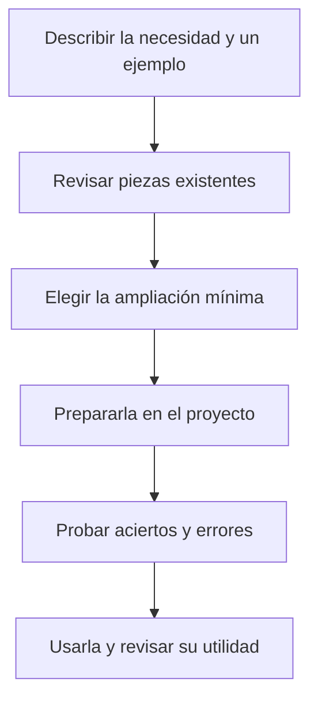
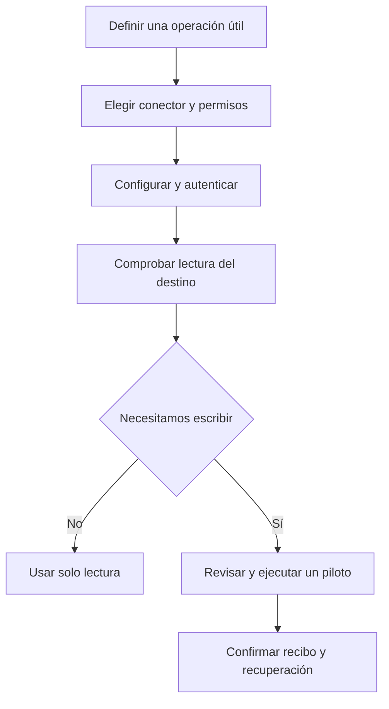

# 5. Adaptar el producto a las personas y al trabajo del equipo

Puedes elegir herramientas diferentes en cada proyecto y añadir especialidades
sin llenar el plugin de piezas que nadie necesita. Primero se concreta una necesidad,
después se elige la pieza más pequeña que la resuelve y se comprueba con un caso real.

Este capítulo separa las decisiones del responsable y las tareas de administración.
No necesitas escribir configuración para decidir qué comportamiento quieres.

## W-16. Elegir y añadir la ampliación adecuada

### Empieza por un ejemplo de trabajo

Imagina que el portal debe cumplir normas de facturación. Puedes pedir:

```text
Necesitamos comprobar moneda, impuestos y redondeos en las solicitudes de gasto.
Propón cómo incorporar esos criterios al proyecto sin crear roles duplicados.
Explica qué decidirá la persona de facturación y qué podrá comprobar el asistente.
```



### Cómo elegir sin conocer la estructura interna

| Lo que necesitas | Qué pieza lo resuelve | Ejemplo cotidiano |
|---|---|---|
| Criterios de un área | Persona de dominio: un perfil de criterios | Qué debe revisar facturación en una solicitud |
| Un especialista con una misión separada | Agente: un asistente con objetivo y límites | Revisar importes y devolver hallazgos sin modificar nada |
| Un método reutilizable | Skill: instrucciones de trabajo | Cómo comprobar redondeos con ejemplos |
| Iniciar una secuencia repetida | Comando o skill invocable | Preparar una revisión de cierre mensual |
| Una regla permanente | Instrucciones del proyecto | Toda denegación debe explicar su motivo |
| Ejecutar una operación concreta | Tool: una función o script disponible | Consultar el estado de una tarjeta |
| Acceder a un servicio | Conector o servidor MCP | Dar acceso controlado a la wiki |
| Usar ese servicio dentro del ciclo | Adaptador y binding | Comentar en Redmine cuando QA termina |

1. **El responsable describe el resultado.** Aporta ejemplos correctos e incorrectos
   y dice qué decisiones requieren a una persona. «Revisar facturación» es demasiado
   amplio; «detectar un redondeo incorrecto con estos dos importes» permite comprobarlo.
2. **Se revisa lo que ya existe.** `/work-context` ayuda a seleccionar piezas y
   `/plugin-catalog` permite explorarlas. `research-first` compara soluciones antes
   de construir. Un nombre parecido no acredita que resuelva el caso.
3. **Se prepara en el proyecto.** Así el portal puede usar Redmine y otro proyecto
   usar Jira. Las ampliaciones personales pueden vivir en el espacio del usuario;
   las compartidas por el equipo deben tener dueño, documentación y versión acordada.
   La caché instalada del plugin no es el lugar donde guardar cambios del proyecto.
4. **Se describen entradas, pasos, límites y fallos.** Un agente necesita saber qué
   puede editar y qué debe devolver. Una skill necesita explicar cuándo se usa.
   Una herramienta necesita un contrato de entrada y salida, permisos y errores.
5. **Se ensaya antes de adoptarla.** Además del caso correcto, se prueban información
   ausente, permiso insuficiente y resultado incierto. Se comprueba que no duplica
   al dueño de revisión o QA y que no publica nada por sorpresa.
6. **Se registra su uso en las tareas pertinentes.** `planner` incluye la selección
   y `implementer` usa el contexto elegido. El equipo revisa después si la pieza
   ayuda realmente. Solo se propone para el core si existe utilidad compartida y
   un responsable de mantenimiento; no se añade por acumular opciones.

### Personas reales y perfiles de criterio

Una **persona de dominio** es un documento breve, no una cuenta. Por ejemplo:

```text
Perfil de facturación: comprobar moneda, impuestos, redondeos y periodo.
Pedir ejemplos de rectificación. Ante una política fiscal ambigua, consultar
al responsable del área; no decidirla automáticamente.
```

El equipo técnico puede guardarlo en `.claude/personas/facturacion.md` y etiquetar
la tarea con el tipo `facturacion`. Es una convención del plugin para aportar
criterios. No instala un agente ni reproduce la identidad de una persona real.

Para **añadir un compañero**, el administrador lo invita en la herramienta de
trabajo y los servicios mediante sus mecanismos habituales. Acordáis quién aprueba
alcance, publica documentos, ve datos y recibe asignaciones. No se dan permisos por
escribir su nombre en un plan. Asignarle una tarjeta puede enviarle una notificación;
ese efecto se debe conocer y autorizar cuando corresponda.

### Añadir agentes, skills, comandos y reglas

El desarrollador crea un agente de proyecto cuando hace falta una misión autónoma.
Por ejemplo, `project-billing-reviewer` recibe un cambio, revisa importes y devuelve
hallazgos con evidencia; sus límites pueden prohibir editar, publicar y dar el verde
final. Elegir un modelo no concede herramientas ni permisos por sí solo.

Una skill de proyecto puede enseñar el método de redondeo a varios agentes. Debe
incluir ejemplos de activación y casos en los que no se usa. El ejemplo
`project-redmine` del capítulo 4 incluye un contrato inicial; todavía necesita
transporte real y pruebas en el proyecto.

Un comando reúne una secuencia que inicia el usuario, manteniendo un único dueño
por operación. Cada entorno admite sus formatos: una carpeta de comandos de Claude
no crea comandos automáticamente en Codex. Las reglas permanentes se ponen en las
instrucciones nativas del proyecto y se enlaza el detalle, en vez de pegar el manual
completo en cada conversación.

Para equipos técnicos, los formatos y carpetas de Claude, Codex y OpenCode están
en [Extensiones propias](../PROJECT-EXTENSIONS.md). La
[referencia de personalización](../reference/customization.md) contiene ejemplos
Markdown, TOML y JSON. Se comprueba el formato admitido por la versión instalada.

### Lenguajes y frameworks

`stack-practices` aporta criterios seleccionados según el trabajo. Incluye una guía
Go para errores, concurrencia, cancelación y pruebas; se selecciona explícitamente
con `--stack go` en el lector técnico. Eso no instala Go ni certifica compilación.
Rust tiene referencias de seguridad y pruebas; una guía general equivalente sigue
pendiente. No se presupone una especialidad completa por encontrar el nombre de
un lenguaje en el catálogo.

### Resultado y recuperación

Al terminar necesitas saber qué pieza se añadió, dónde vive, quién la mantiene y
qué casos se probaron. Pide un ejemplo de uso y uno en el que deba abstenerse.
Si dos piezas compiten por la misma función, se resuelve el conflicto antes de
usarlas. Si una pieza no se carga, se revisa su ubicación y compatibilidad nativa;
no se interpreta el inventario como prueba de ejecución.

## W-17. Conectar una herramienta o un servidor MCP

### Qué significa conectar

Una tool es una operación que el asistente puede pedir que se ejecute. Un servidor
MCP es un puente que expone operaciones de otro sistema con un protocolo común.
Ni el nombre de una tool ni la presencia de un servidor prueban que estén conectados
o tengan permiso. La cuenta, el destino y la operación se comprueban por separado.

```text
Queremos consultar nuestra wiki desde este proyecto. Busca un conector adecuado,
prepara acceso de lectura al espacio del equipo y comprueba una página de prueba.
No habilites publicación hasta que revisemos cómo se realizará y verificará.
```



1. **Concretáis qué falta.** Por ejemplo, leer la página de aprobación; después,
   quizá actualizarla. `research-first` ayuda a comparar un conector oficial o
   mantenido con otras opciones. Se revisan compatibilidad, mantenimiento y licencia.
2. **El administrador limita el acceso.** Elige cuenta y espacio correctos y guarda
   los secretos fuera de los documentos. Decide si la configuración afecta a este
   proyecto o al usuario. No se concede todo el servicio por comodidad.
3. **Configura y autentica en el entorno.** Claude, Codex y OpenCode tienen formatos
   y mecanismos propios. El manual avanzado muestra ejemplos con `.invalid`, una
   dirección deliberadamente no operativa. Hay que sustituirla por un servicio
   aprobado y comprobar el esquema de la versión instalada.
4. **Se verifica la sesión real.** Se listan operaciones disponibles y se ejecuta
   una lectura concreta. Se comprueba que el título y espacio devueltos corresponden
   al destino elegido. `/doctor` ayuda al diagnóstico; `/work-context`, al inventario.
5. **Si participa en el ciclo, se añade la integración.** El adaptador explica cómo
   usar las operaciones y el binding indica cuándo. Una conexión por sí sola no
   decide qué documentos publicar ni cuándo cambiar de estado una tarea.
6. **La escritura se prueba aparte.** Ves la vista previa de una página piloto,
   autorizas el efecto y contrastas el resultado real. Se ensaya el caso de respuesta
   perdida: consultar antes de repetir evita duplicados o sobrescrituras.
7. **Se revisa al cambiar permisos o versión.** La evidencia de ayer no acredita
   una conexión actual. `delivery-practices` ayuda a revisar configuración, permisos
   y recuperación cuando forma parte de la entrega del proyecto.

No hay una lista cerrada que impida herramientas distintas. El proyecto puede
incorporar otra con un contrato y pruebas. Tampoco todo archivo se vuelve una tool
por estar en una carpeta: el entorno tiene que admitirlo y exponerlo realmente.

Si la conexión falla, pide qué operación falló, contra qué destino y con qué cuenta
sin publicar credenciales. Mantén las operaciones no verificadas desactivadas. Si el
proveedor no ofrece una función, se presenta esa limitación y se evita simularla.

## Qué puedes hacer desde el dashboard actual

La consola operativa reúne proyectos independientes en una sola dirección local.
Puedes abrir sesiones y conversar con entornos nativos compatibles, consultar
planes y kanbans, añadir notas de tarea, preparar el siguiente trabajo y observar
operaciones recibidas. El [capítulo 8](dashboard.md) explica los recorridos completos.

La exportación HTML del catálogo sigue siendo una fotografía para consulta; no
incluye chat. La consola presenta los límites de cada entorno y no promete control
universal de aplicaciones Desktop. Las declaraciones de una integración y las
señales históricas de actividad conservan su procedencia y sus límites.
