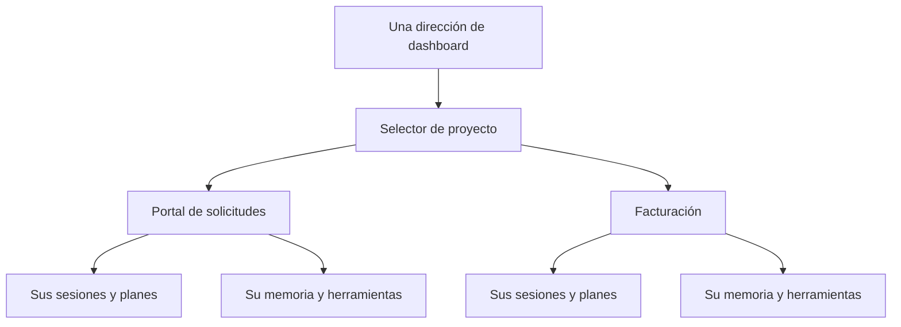
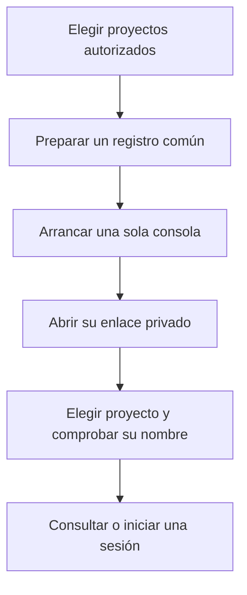
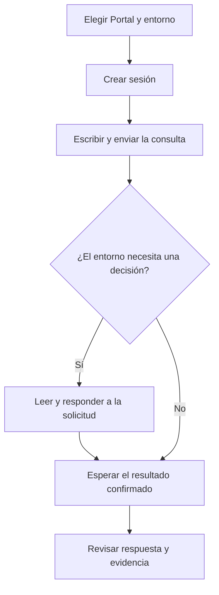
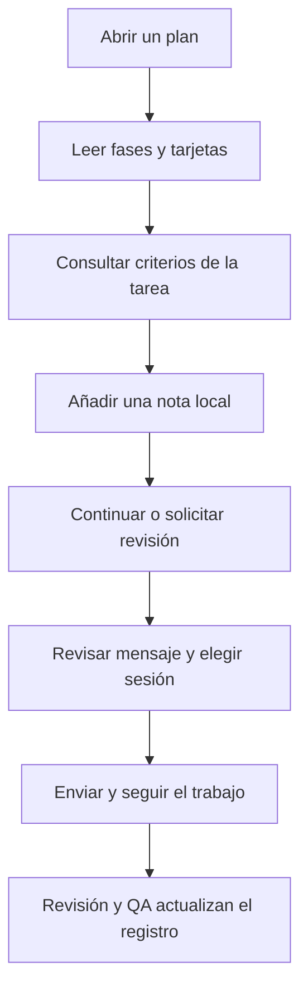
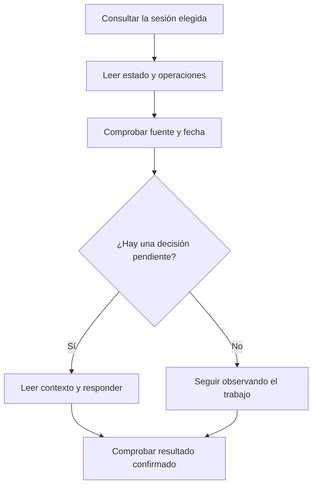
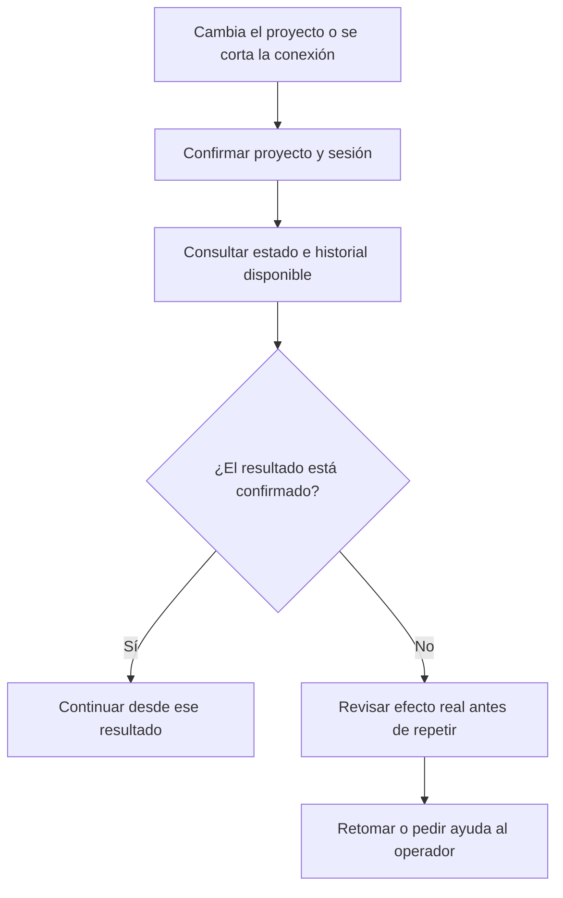

# 8. Un dashboard común para trabajar en varios proyectos

## Una sola puerta de entrada

Imagina que tu equipo mantiene el portal de solicitudes y, además, una aplicación
de facturación. No necesitas recordar dos direcciones ni abrir dos dashboards.
La consola de custom-agents tiene **una dirección local y un selector de proyecto**.
Al elegir Portal ves su trabajo. Al elegir Facturación ves el de Facturación.

No se mezclan las conversaciones, los planes, las notas de tareas, la memoria
ni los eventos. Cambiar de proyecto tampoco mueve trabajo de una carpeta a otra.
Cada sesión sigue vinculada al proyecto en el que se creó. Una sesión puede seguir
trabajando mientras consultas otro proyecto; para interrumpirla, vuelve a ella y
usa su acción correspondiente.



La consola funciona en el equipo del operador. El enlace privado permite acceder
a los proyectos registrados en ella. Si diferentes personas necesitan acceder por
red con permisos distintos, eso requiere otro despliegue con cuentas y autorización;
el selector de proyecto no proporciona esa función. Los asistentes siguen usando
los permisos del usuario y las políticas de su entorno nativo.

## Qué encontrarás en la pantalla

| Zona | Para qué sirve | Un ejemplo útil |
|---|---|---|
| Selector de proyecto | Cambiar el contexto de toda la consola | Pasar del portal a Facturación |
| Vista general | Ver trabajo pendiente y conversaciones del proyecto | Retomar la revisión de ayer |
| Sesiones | Conversar con un entorno nativo y atender sus solicitudes | Pedir que se compruebe el rechazo sin motivo |
| Planes y tareas | Abrir la cartera, un kanban y el detalle de cada tarea | Leer los criterios de T-02 y añadir una nota |
| Agentes en vivo | Consultar las operaciones recibidas y su procedencia | Ver una lectura de archivo o una herramienta terminada |
| Memoria | Consultar conocimiento local y entender sus estados | Comprobar qué decisión está aprobada |
| Integraciones | Ver declaraciones del proyecto y entornos detectados | Saber si Jira o un backend de memoria están configurados |
| Capacidades | Explorar agentes, skills, comandos y extensiones | Encontrar una guía de Go o de pruebas |

Puedes usar tema claro u oscuro. `Ctrl+K` —o `Cmd+K` en macOS— abre una búsqueda
de acciones y proyectos; Escape cierra los cuadros. Los controles tienen texto,
foco de teclado y una presentación adaptada a pantallas pequeñas. Un número ausente
se muestra como dato sin confirmar; no se convierte en cero para completar la vista.

## W-23. Preparar la consola común e incorporar proyectos

**Situación.** La responsable de área quiere consultar Portal y Facturación desde
el mismo lugar. Esta preparación la hace el administrador o una persona técnica;
el uso diario posterior no requiere editar archivos.

**Qué necesita.** El plugin o su bundle con `plugin-panel`, Python nativo y las
carpetas de los proyectos. Para conversar, hace falta además tener instalado y
autenticado al menos uno de los entornos compatibles. El dashboard no instala
Claude Code, Codex u OpenCode ni solicita sus credenciales en un formulario propio.

**Quién y qué participa.** El operador mantiene el registro; el comando
`/plugin-catalog` utiliza la skill `plugin-panel` para localizar y abrir la consola.
No es necesario un agente de implementación para listar proyectos. La herramienta
empleada es el proceso local de Python y, cuando se solicite una sesión, la CLI
nativa elegida. Ningún MCP es obligatorio para abrir la interfaz.



1. **El administrador registra las carpetas elegidas.** Prepara un archivo común
   con un identificador, nombre, raíz y entornos permitidos para cada proyecto.
   Por ejemplo, `portal` y `facturacion`. No se buscan automáticamente todos los
   repositorios del ordenador. La ubicación del registro puede estar fuera de los
   proyectos, en una carpeta del operador excluida de Git.
2. **Abre una única instancia.** `/plugin-catalog --serve --workspaces <registro>`
   indica al asistente que use la consola operativa. El servidor utiliza el puerto
   8769 por defecto. Si ya está ocupado, se revisa o reutiliza la instancia existente;
   no se crea silenciosamente otra con una dirección distinta. La forma directa
   de arranque se encuentra en la referencia técnica enlazada al final.
3. **Entrega el enlace sólo a la persona que lo utilizará.** El enlace inicial
   incluye una credencial de acceso local. No se añade a Jira, al manual ni a un
   repositorio. Tras abrirlo, el navegador retira esa credencial de la dirección.
   Reiniciar la consola genera un acceso nuevo.
4. **La responsable comprueba el selector.** Debe reconocer los nombres y elegir
   Portal antes de empezar. Que Facturación tenga menos entornos permitidos es
   válido: cada proyecto conserva su configuración.
5. **Se añade otro proyecto cuando haga falta.** El administrador edita el mismo
   registro y reinicia la consola tras revisar los turnos en curso. No abre un
   servidor nuevo por cada carpeta. No hay cambios del registro desde el navegador.

**Cómo comprobarlo.** Los dos proyectos aparecen en el selector, utilizan la misma
dirección y muestran sus propios planes. En un piloto sin runtimes habilitados
pueden funcionar las vistas locales; eso no demuestra que el chat esté disponible.
Si una carpeta falta o el registro es inválido, se corrige el registro. No se
amplían permisos ni se registran directorios personales para ocultar el error.

## W-24. Abrir una sesión, conversar y responder a una solicitud

**Situación.** Quieres preguntar por qué el portal permite rechazar una solicitud
sin explicar el motivo. No deseas iniciar todavía una implementación.

**Qué necesita.** Portal seleccionado y un entorno permitido, instalado y
autenticado. Una sesión es una conversación de trabajo de ese entorno dentro del
proyecto. No es una cuenta nueva ni una copia de todas tus conversaciones privadas.

**Quién y qué participa.** Tú das el objetivo. El entorno nativo coordina la
respuesta y puede usar agentes y skills del proyecto, por ejemplo `analyst` para
aclarar requisitos o `debug-root-cause` si pides investigar un fallo. Las operaciones
de archivos y los MCP son los que el runtime tenga realmente disponibles. El
dashboard transporta los mensajes y muestra eventos; no inventa esos permisos.



1. Pulsa **Nueva sesión**, escribe «Revisar rechazo de solicitudes» y elige el
   entorno. La consola comprueba la conexión y muestra su estado. Crear la sesión
   no envía ningún objetivo ni modifica archivos por sí solo.
2. En el chat, escribe una petición concreta. Por ejemplo:

   ```text
   Investiga por qué se acepta un rechazo sin motivo en el portal.
   Explícame qué ocurre y qué evidencia lo demuestra antes de cambiar código.
   ```

3. Pulsa **Enviar**. Que el mensaje esté admitido no demuestra que haya terminado
   el trabajo. La pantalla distingue preparación, envío en cola, ejecución,
   espera de una decisión y resultado. Puedes preparar otro texto mientras
   esperas; la consola impide enviar un segundo turno accidentalmente.
4. Si aparece una solicitud de permiso, lee la operación y su contexto. Puedes
   permitirla una vez o rechazarla cuando el entorno lo ofrezca. No se convierte
   esa respuesta en una autorización permanente. Si la información es demasiado
   grande para mostrarse completa, la consola no permite aprobarla a ciegas.
5. Una pregunta admite las respuestas que pueda representar el adaptador. Un
   formulario avanzado puede necesitar la aplicación nativa; se indica esa
   limitación. No rellenes un campo distinto para forzar su envío.
6. Al recibir el resultado, pide el archivo, caso o prueba que sostiene la
   explicación. Una operación terminada no significa que todo el objetivo esté
   aceptado. Si procede implementar, acuerda el plan del siguiente recorrido.

**Qué conserva.** La consola guarda el vínculo de la sesión; los mensajes visibles
quedan acotados en memoria de su proceso. El entorno nativo conserva su historial
según su propio contrato. Al reiniciar o retomar, la ventana visible puede ser
parcial. No se exporta razonamiento interno ni se realiza una copia adicional de
las conversaciones. La importación automática de todas las sesiones y los adjuntos
no están disponibles en esta versión; tampoco se controlan ventanas Desktop.

## W-25. Revisar un kanban, comentar una tarea y continuar el plan

**Situación.** La iniciativa «Aprobar y rechazar solicitudes» tiene cuatro tareas.
Quieres entender qué falta en T-02 y dejar una observación al equipo antes de seguir.

**Qué necesita.** Una iniciativa con plan y `tasks.md` en el proyecto. El tablero
lee esos documentos. Para ejecutar trabajo, necesitas además una sesión nativa
disponible del mismo proyecto.

**Quién y qué participa.** La persona responsable consulta y comenta. La skill
`roadmap-dashboard` y los lectores de ledger proporcionan la información que
`plugin-panel` presenta. Al continuar, el mensaje pide seguir `/dev-cycle`: el
coordinador reúne `implementer`, `reviewer` y `qa`, con skills como `tdd` y
`adversarial-review` según el plan. Las herramientas y MCP se usan dentro de la
sesión nativa; el tablero no ejecuta una operación remota por abrir una tarjeta.



1. En **Planes y tareas**, busca la iniciativa y abre su detalle. La cartera puede
   verse como lista o tablero; el kanban del plan distribuye sus tareas por estado
   y permite filtrar por fase. Una columna vacía no implica que se haya ejecutado
   nada: representa lo que dice el registro leído.
2. Abre T-02. Lee su descripción, criterios de aceptación, comprobaciones y
   hallazgos pendientes. Si el detalle es parcial, consulta la fuente antes de
   aceptar el trabajo. Las pestañas del plan permiten leer requisitos, evaluación
   y diseño cuando existen.
3. Añade «En caso de rechazo vacío, la solicitud debe seguir pendiente y explicar
   cómo corregirlo». La nota queda en esa tarea de ese proyecto. No publica un
   comentario en Jira o Redmine y no modifica un criterio aprobado por sí sola.
4. Si otra pestaña cambió las notas a la vez, la consola conserva tu texto e
   informa del conflicto. Actualiza y revisa antes de guardar. Un reintento de la
   misma petición no debe crear dos notas.
5. Pulsa **Trabajar en esta tarea**, **Solicitar revisión** o **Continuar en una
   sesión**, según tu intención. Lee la vista previa: identifica la iniciativa,
   la tarea y las notas de contexto. Elige una sesión disponible de Portal.
   Si no existe, puedes crear una y volver a la vista previa cuando esté lista.
6. Envía el mensaje. Antes del envío se contrasta que el plan no haya cambiado.
   Si cambió, revisa la nueva vista previa. El chat te permite seguir las preguntas,
   permisos, resultados y evidencias de la ejecución.
7. Vuelve al kanban para comprobar el registro actualizado. Una tarjeta no se
   considera terminada por arrastrarla ni por escribir «hecho» en un comentario.
   El cierre depende de los criterios, la revisión y QA del ciclo normal.

**Con integraciones.** Si el proyecto ha configurado y autorizado un binding de
seguimiento, el workflow de la sesión puede publicar sus eventos según ese contrato.
La nota local del dashboard sigue siendo otra fuente. Comprueba los recibos remotos;
no presupongas que todo lo visible aquí se ha sincronizado fuera.

## W-26. Entender la actividad y las herramientas utilizadas

**Situación.** Una responsable quiere saber si la sesión está trabajando, qué
operación espera y por qué una tarea aún no ha cambiado de estado.

**Qué necesita.** Una sesión conectada para recibir eventos nativos. La captura
histórica de hooks es otra fuente opcional: puede estar desactivada o ser antigua.
No se necesita activar servicios de memoria externos para ver actividad.

**Quién y qué participa.** `plugin-panel` muestra lo que recibe. Los agentes,
skills, herramientas y MCP pertenecen al trabajo nativo. Los productores de
actividad del shared kit aportan sus señales cuando están habilitados. `/doctor`
ayuda a diagnosticar configuración; no se ejecuta automáticamente para rellenar
una pantalla vacía. Ninguna animación sustituye una confirmación de ejecución.



1. Abre la sesión y mira su estado. «Esperando una decisión» significa que debes
   atender una solicitud; «En cola» indica admisión sin confirmación de inicio.
   «Sin confirmar» exige revisar el resultado, no enviar otra vez de inmediato.
2. Consulta las operaciones del lateral o **Agentes en vivo**. Una lectura,
   escritura o llamada MCP puede mostrar inicio, final o error con su fecha.
   Cuando no se informa del rol, se dice que no está informado; no se atribuye
   automáticamente la operación al implementador.
3. Distingue **disponible** de **utilizado**. Que una skill aparezca en el catálogo
   o un MCP en una declaración no demuestra que se haya usado ni conectado. Un
   evento de uso proporciona una evidencia distinta de esa declaración.
4. Contrasta la fuente y el tiempo. La captura de hooks puede mostrar eventos
   anteriores, mientras que la sesión conectada aporta sus eventos actuales.
   Una tarea que sigue «En marcha» sólo describe el ledger, no un proceso vivo.
5. Si necesitas parar, pulsa **Interrumpir** en la sesión adecuada y espera la
   confirmación. Una interrupción no revierte escrituras ya realizadas ni garantiza
   que una operación externa no llegara a su destino. Revisa sus recibos.

**Cómo comprobarlo.** Puedes explicar qué evento se recibió, de qué fuente, cuándo
y qué queda sin confirmar. El producto no muestra una supuesta productividad o
tiempo ahorrado sin una medición que lo justifique.

## W-27. Cambiar de proyecto y recuperarse de un corte

**Situación.** Dejas un borrador de mensaje en Portal, consultas Facturación y se
interrumpe la conexión con el servidor. Quieres continuar sin mezclar datos ni repetir
una operación con efectos.

**Quién y qué participa.** La persona usuaria elige el proyecto y comprueba el
resultado. `plugin-panel` aísla las lecturas y las acciones por proyecto; el
runtime nativo confirma los turnos. Para reconstruir el contexto de trabajo puedes
pedir `/work-context` o retomar el ciclo autorizado. No se exige un MCP ni una
publicación externa para recuperar un registro local.



1. Cambia al proyecto desde el selector. El chat anterior y sus notas dejan de
   mostrarse; una respuesta tardía del anterior no debe aparecer en el nuevo.
   El cambio de vista no cancela por sí solo un turno que ya estaba ejecutándose.
2. Al volver a Portal, selecciona su sesión. Los borradores permanecen separados
   en la memoria de la pestaña mientras siga abierta; cerrar la pestaña no garantiza
   conservarlos. Los mensajes no se guardan en el almacenamiento local del navegador.
3. Si se cortó la comunicación después de enviar, revisa el estado y el historial
   nativo antes de repetir. Puede haberse realizado la operación aunque faltase la
   respuesta. La consola no reenvía automáticamente un turno incierto.
4. **Desconectar** libera una conexión propia cuando la sesión no está ejecutando
   un turno. **Retomar** abre de nuevo una sesión conocida y valida su proyecto.
   No se utiliza esa acción para apropiarse de una sesión ajena ni para cerrar
   procesos de otro operador. El historial visible puede ser parcial.
5. Si el servidor reinició, pide al operador su nuevo enlace privado. Los vínculos
   de sesiones y las notas locales se conservan en el proyecto; las conexiones y
   la ventana de chat en memoria no. Comprueba la situación antes de reanudar.
6. Si una carpeta o un archivo de estado cambió inesperadamente, conserva la
   evidencia y pide diagnóstico. No lo borres sólo para quitar el aviso. Una copia
   de proyecto puede necesitar su propio registro y conexiones nuevas.

La guía de [memoria](memory.md) explica la recuperación de Kwipu, Graphify y
Graphiti. La [referencia de consola](../../skills/plugin-panel/references/control-center.md)
incluye el registro JSON, arranque directo, presupuestos y límites de protocolos.
