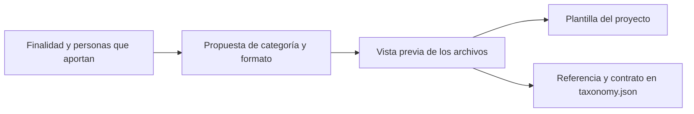
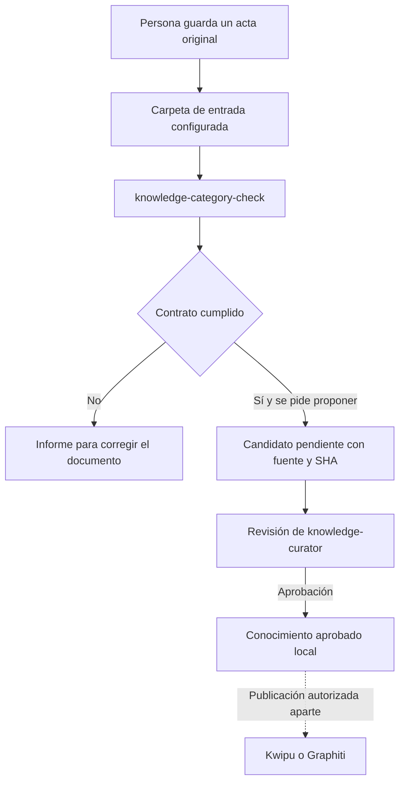

# Categorías y plantillas: aportar conocimiento con un formato común

[English](../en/guides/knowledge-categories.md)

Una categoría organiza información que el proyecto quiere conservar. Puede ser
una decisión, un procedimiento, un problema resuelto, un acta o una FAQ. Cada
proyecto decide sus categorías; el plugin no añade `meetings` o `faq` por defecto.

Una **plantilla** ayuda a redactar. Un **contrato** comprueba qué información debe
tener el documento. Una **aprobación** decide si su contenido merece incorporarse
al conocimiento. Son pasos distintos: un acta puede cumplir el formato y aun
necesitar aclaraciones sobre lo acordado.

## W-28. Crear una categoría a partir de su finalidad

Pide al asistente:

> Crea una categoría meetings para las actas que aporta nuestro equipo. Queremos
> fecha, participantes, objetivo, acuerdos y referencias. Guarda su plantilla en
> el proyecto y conserva las demás categorías y conexiones.

La skill `knowledge-category-template` propone la plantilla y el bloque que
añadiría a `.claude/knowledge-services/taxonomy.json`. Puedes elegir otra carpeta
o pedir cambios en el formato. El asistente utiliza `category-template.py` para
preparar una vista previa y aplicarla ligada al hash observado.



Por ejemplo:

```json
{
  "key": "meetings",
  "folder": "meetings",
  "min_evidence": "single_case",
  "inbox": "docs/meetings",
  "template": ".claude/knowledge-templates/meetings.md",
  "allowed_producers": ["human"],
  "required_metadata": ["fecha", "participantes"],
  "required_sections": ["Objetivo", "Acuerdos", "Referencias"],
  "routing": {}
}
```

Este es un elemento de `categories`, no una taxonomía completa para reemplazar
la existente. `inbox` contiene originales; `folder` identifica la carpeta bajo
`docs/knowledge/approved/` después de la curación. `template` apunta a un Markdown
del proyecto, fuera del plugin. Los contratos anteriores sin estos campos siguen
funcionando.

Una plantilla puede tener las claves del frontmatter y las secciones vacías.
Antes de proponer una ficha se completan evidencia, fuentes y etiquetas
`clave:valor`. Los campos obligatorios deben contener texto o listas de cadenas
no vacías. Las secciones se reconocen por encabezados Markdown `#` a `######`;
encabezados dentro de código o comentarios no satisfacen el contrato.

La plantilla no ejecuta código ni controla el asistente. Su archivo y las reglas
de validación tienen funciones diferentes: borrar la plantilla afecta a futuras
redacciones, no elimina fichas históricas aprobadas. Para cambiar una plantilla
existente mediante la skill, utiliza un archivo de revisión nuevo y cambia su
referencia. La herramienta conserva archivos diferentes que ya existan.

## W-29. Añadir actas y revisar la carpeta

Guarda el acta en `docs/meetings/` siguiendo la plantilla. Después pide:

```text
/knowledge-category-check meetings
```

La presentación del comando depende del runtime: Claude Code usa el namespace
del plugin; Codex dispone del adaptador de comando como skill; OpenCode conserva
el comando corto. Puedes pedirlo también en lenguaje natural: «revisa la categoría
meetings y dime qué falta». Consulta [INTEROP](../INTEROP.md) para la invocación nativa.

El informe distingue documentos válidos, errores de formato, conflictos de
origen e inventarios incompletos. Conserva originales y muestra los campos o
secciones que necesitan atención. No activa Kwipu, Graphiti ni un proceso de ingesta.

Si pides proponer las entradas válidas, el comando utiliza `--propose` junto al
hash de la revisión. Los candidatos quedan en `docs/knowledge/candidates/pending/`,
con ruta y SHA de la fuente original. El servicio existente conserva el productor
y el origen declarado; `knowledge-curator` sigue decidiendo su aprobación.



Repetir la misma propuesta reconoce el candidato pendiente idéntico. Una colisión
distinta se comunica sin reemplazarla. Un límite de lectura, un enlace de archivos
o una fuente modificada impiden forzar la propuesta con la vista anterior.

## W-30. FAQ de agentes y categorías mixtas

Una categoría `faq` puede usar `allowed_producers: ["agent"]` y exigir `Pregunta`,
`Respuesta` y `Referencias`. Pide a `documenter` u otro productor existente que
prepare respuestas a partir de documentación comprobable. El agente consulta
la plantilla, redacta propuestas y declara `--origin agent`. No hace falta crear
otro agente ni instalar un proveedor para cada categoría.

Para una categoría mixta usa `["human", "agent"]`. En cada revisión se declara
el origen del lote: `--origin human` o `--origin agent`. El predeterminado es
`human`, para documentos aportados por una persona. Un documento que declare otro
origen se señala como conflicto; no se cambia su etiqueta para hacerlo pasar.

| Dato | Qué significa |
|---|---|
| `allowed_producers` | Orígenes permitidos por la categoría. |
| `content_origin` | Origen declarado del contenido: humano o agente. |
| `proposed_by` | Productor que entregó la propuesta al servicio. |
| Aprobación | Decisión posterior, con motivo y SHA del candidato. |

Una persona puede revisar contenido generado por un agente sin convertirse por
ello en su autora. Estas etiquetas describen el flujo; no autentican identidades
ni impiden escrituras físicas fuera de los comandos del plugin.

## Elegir qué llega a cada herramienta

El routing existente se mantiene por categoría: `true` publica completo, `false`
excluye y `summary` utiliza el resumen. Una categoría nueva tiene routing vacío
hasta elegir destinos existentes; el backend también necesita estar habilitado.
Configurar, proponer, aprobar, exportar e indexar son estados separados.

El comando no ejecuta esos pasos externos. La primera versión de esta capacidad
no amplía los metadatos enviados a Graphiti ni modifica sus recibos de publicación.

## Resolver una configuración parcial

Si la herramienta creó la plantilla pero no pudo registrar la taxonomía, devuelve
`partial`. Conserva ambos archivos observados y obtén una vista previa nueva para
retomar. No borres la plantilla para volver a empezar. Las copias de taxonomía se
guardan en `.claude/knowledge-services/.category-backups/`, con su propio ignore.

La escritura usa el lock cooperativo del servicio de curación y comprueba los
archivos observados; no bloquea editores externos que ignoren ese lock. Los
ejemplos ejecutables están en [categorías de ejemplo](../examples/memory/categories/README.md).
