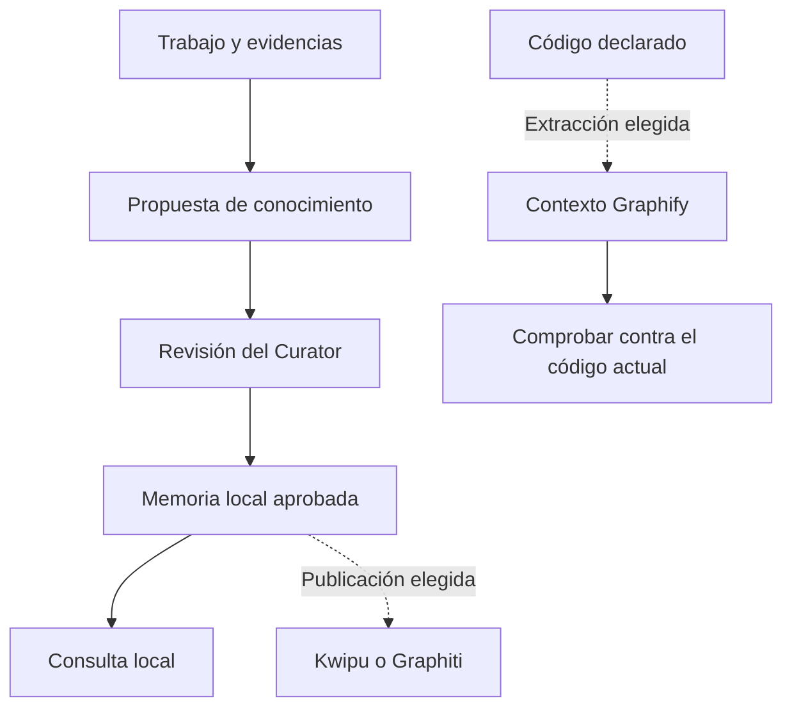
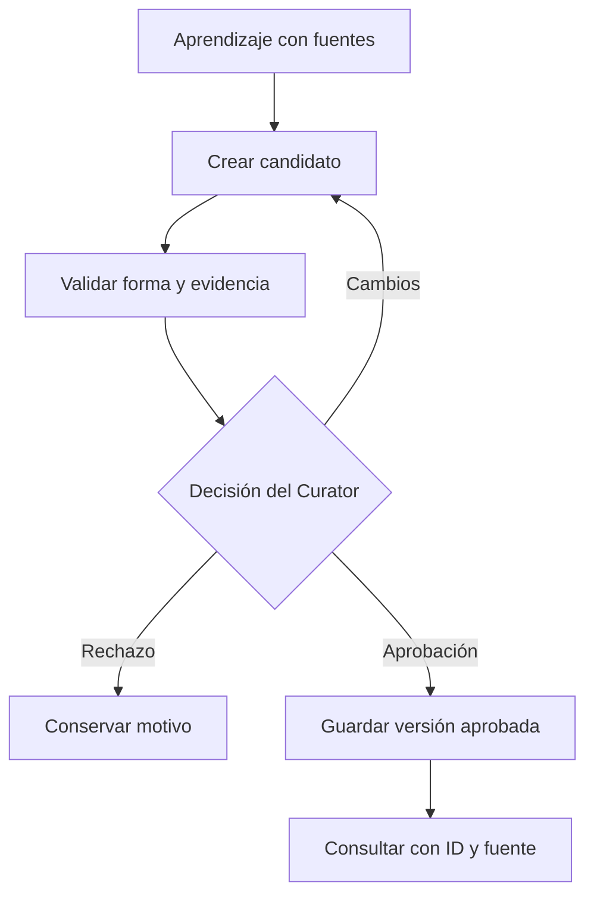
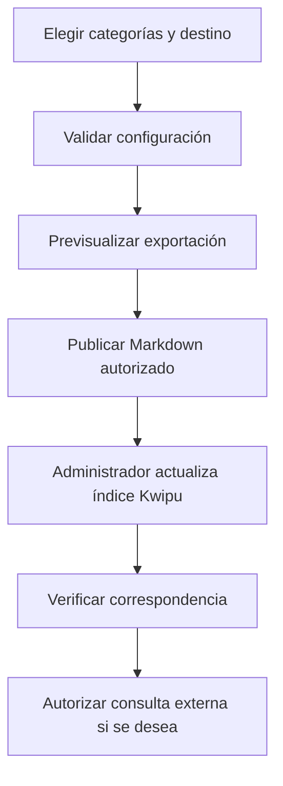
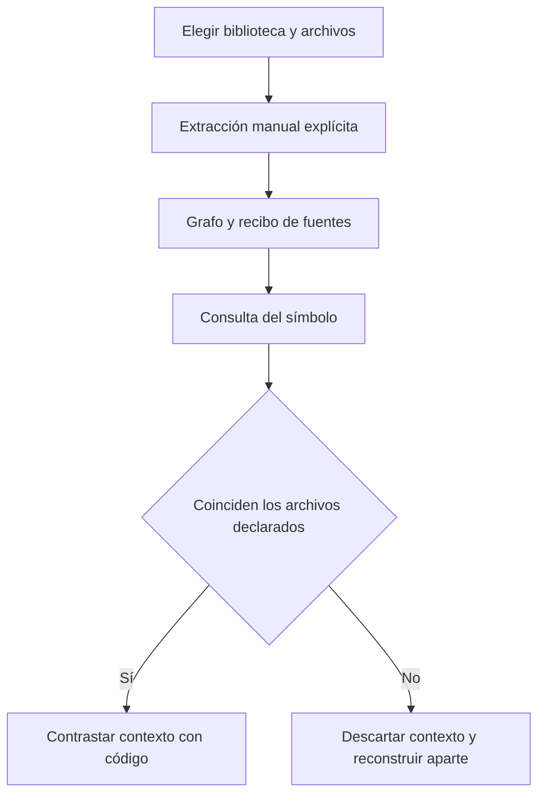
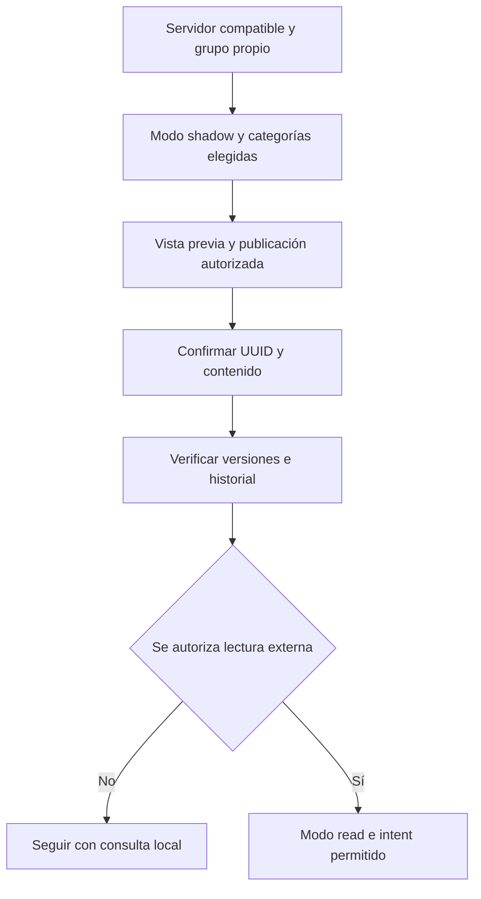

# 7. Memoria: recordar lo útil y conectar herramientas opcionales

La memoria permite retomar decisiones y aprendizajes sin depender de que alguien
recuerde una conversación antigua. No es un almacén de todo lo que el asistente dice.
Se conservan piezas concretas, con fuentes, estado y versión, para poder contrastarlas.

En el portal, «un rechazo requiere un motivo» puede ser una regla aprobada. «Ayer
falló una prueba» es un hecho de sesión. «La función decidir llama a comprobar_permiso»
es contexto de código. Son informaciones distintas y necesitan controles distintos.

## Qué pertenece al core y qué es opcional

El core conserva la memoria local y el proceso para proponer, revisar y aprobar
conocimiento. **No necesita Kwipu, Graphiti ni Graphify para trabajar.** Los servicios
externos se eligen por proyecto, igual que Jira, Confluence o Redmine. El módulo
`memory-integrations` entrega la skill `knowledge-services` para publicar y consultar
servicios cuando se configura; instalarlo no los activa.

| Pieza | Para qué sirve | Qué no demuestra |
|---|---|---|
| Journal local | Retomar qué ocurrió y qué quedó pendiente en una sesión | Que las observaciones sean reglas aprobadas |
| Candidatos | Proponer una decisión, patrón o lección con evidencia | Que ya se pueda usar como conocimiento aprobado |
| Memoria aprobada | Consultar conocimiento aceptado por el proceso de curación | Que una respuesta generada a partir de ella sea correcta |
| Kwipu opcional | Proyectar documentos aprobados y, si se autoriza, consultar su servicio documental | Que exportar archivos haya actualizado ya el índice externo |
| Graphiti opcional | Proyectar episodios y relaciones; consultar con controles de procedencia | Que un envío en cola ya esté guardado o que todo hecho extraído sea cierto |
| Graphify opcional | Extraer estructura del código para localizar símbolos y relaciones | Que ese contexto esté aprobado, cubra todo el repositorio o siga vigente |

Un **grafo** es un mapa de elementos relacionados: una decisión vinculada a su
sucesora o una función vinculada a otra que utiliza. Las herramientas no son
intercambiables por tener nombres parecidos. Puedes elegir ninguna, una o varias
para necesidades diferentes. Cada conexión necesita un responsable y pruebas.



## W-19. Crear, aprobar y consultar memoria local

### Qué necesitas y qué pides

Úsalo cuando una decisión o aprendizaje vaya a evitar repetir trabajo. Necesitas
una afirmación concreta, su contexto y evidencia que pueda revisar otra persona.
Una conversación larga o un listado de progreso no son una buena entrada de memoria.

```text
Propón como conocimiento del portal la regla de que un rechazo exige un motivo.
Incluye la decisión aprobada y las pruebas que la respaldan. Muéstrame la propuesta
y pásala al proceso de curación; no la publiques en ningún servicio externo.
```



1. **Se propone algo reutilizable.** `documenter`, `planner`, `implementer` u otro
   productor aporta el candidato al servicio compartido. Se identifica la categoría:
   decisión, patrón, trampa comprobada o lección. Se excluyen secretos, razonamiento
   interno y conversaciones crudas. No todo fallo trivial merece una entrada.
2. **Se comprueba que la propuesta esté completa.** El Knowledge Gate, una validación
   programada, revisa categoría, evidencia mínima, fuentes y etiquetas. Que una ficha
   tenga forma válida no significa que su contenido haya sido aprobado.
3. **`knowledge-curator` decide.** Es el único agente dueño de aceptar, rechazar o
   pedir cambios. Ante contradicción o alto impacto consulta a la persona responsable.
   Otros agentes no pueden escribir directamente en la carpeta aprobada para ahorrar
   este paso. Repetir una afirmación varias veces no la convierte en una regla.
4. **La decisión se guarda ligada al contenido revisado.** El servicio conserva
   motivo, identidad y versión. Si el candidato cambió mientras se revisaba, no se
   aplica una decisión antigua a un texto nuevo. La memoria aprobada vive en
   `docs/knowledge/approved/`; su inclusión en Git depende de la política del proyecto.
5. **La consulta recupera fuentes.** Pide «Busca la regla sobre el rechazo y muestra
   su ID, versión, estado y documento». `knowledge-find.py` consulta localmente sin
   activar servicios si no se indica un intent externo. También recupera el legado
   válido de decisiones, trampas y lecciones sin aprobarlo de nuevo automáticamente.
6. **Los cambios se versionan.** Si la regla cambia, se propone y revisa una versión
   nueva. Una decisión histórica no se vuelve vigente por una búsqueda. Trasladar
   conocimiento a otro proyecto crea propuestas pendientes de revisión en destino,
   no una aprobación heredada por copiar archivos.

### Ejemplo de consulta para el equipo técnico

En estos ejemplos PowerShell, `$PluginRoot` es la raíz instalada del plugin que el
administrador ha localizado y `$ProjectRoot` la raíz del proyecto consumidor.
No uses una ruta de caché de una versión antigua ni supongas que el proyecto es
el propio plugin. Las rutas de instalación se explican en la referencia avanzada.

```powershell
$SharedKit = Join-Path $PluginRoot "agent-kits/shared"
python (Join-Path $SharedKit "knowledge-find.py") --root $ProjectRoot --json "motivo de rechazo"
python (Join-Path $SharedKit "knowledge-find.py") --root $ProjectRoot --show "portal.decision.reject-reason" --json
```

El ID es ilustrativo: sustituye el ejemplo por uno realmente devuelto. Comprueba
fuente, versión y estado; no solo el resumen. Si hay IDs ambiguos o corpus incompleto,
lee el diagnóstico. Una ausencia de aciertos no prueba que no exista una decisión.
El índice de búsqueda se puede reconstruir: no sustituye los documentos originales.

La bitácora o journal ayuda a retomar la última sesión de la iniciativa y se mantiene
separada de lo aprobado. Un fallo de captura necesita diagnóstico; no se soluciona
copiando toda la conversación al corpus. [Gobierno y traslado](../MEMORY-PORTABILITY.md)
detalla la portabilidad y la revisión en el proyecto de destino.

## Antes de conectar un servicio: decisiones comunes

El responsable elige qué categorías pueden salir del proyecto y con qué finalidad.
El administrador mantiene el servicio, cuenta, endpoint y modelos si existen. El
equipo técnico configura y prueba el adaptador. El Curator conserva la aprobación
local; el publicador no la sustituye.

La **taxonomía** es el archivo que organiza categorías y destinos de memoria:
`.claude/knowledge-services/taxonomy.json`. Cada categoría declara su `routing`, es
decir, si puede enviarse a cada backend. Un backend es un destino externo configurado.
Si una categoría no lo autoriza expresamente, no se publica en ese destino.

El ejemplo completo [taxonomy.json](../examples/memory/taxonomy.json) usa el prefijo
ficticio `portal`, incluye Kwipu y Graphiti y mantiene ambos apagados y todo el routing
desactivado. No lo copies sobre una configuración existente: revisa y fusiona las
claves pertinentes con el administrador. Las categorías y la evidencia mínima son
política del proyecto y no se reducen para lograr que una entrada pase.

El puerto común usa [bindings de memoria](../examples/integrations/memory.json), con
propósito `knowledge` y la skill opcional `knowledge-services`. En ese ejemplo, el
ID del binding coincide exactamente con el ID del backend. Los bindings no suscriben
eventos automáticos: aprobar memoria no publica por sí solo. Si ya tienes bindings
de Atlassian, se añaden entradas a su lista; no se sustituye toda la configuración.
Configurar el binding no habilita la lectura ni autoriza una publicación.

Para la administración explícita, los scripts de memoria mantienen su CLI propia.
El registro común elige la integración del workflow; la taxonomía conserva los
controles de categorías y lectura. No se duplican el Curator, el router de memoria
ni la cola de recuperación para cada marca.

## W-20. Integrar Kwipu y comprobar su publicación y consulta

### Cuándo tiene sentido

Elígelo si tu equipo ya administra un stack Kwipu compatible y quiere consultar
conocimiento aprobado en su servicio documental. El plugin exporta Markdown con
un inventario de lo publicado. **No instala Kwipu, Docker, modelos ni el bridge**,
que es el servicio que atiende las peticiones del adaptador.

```text
Queremos usar Kwipu para las decisiones aprobadas del portal. Prepara una vista
previa con las entradas permitidas y el destino. Mantén la consulta externa
apagada hasta comprobar publicación, indexado y fuentes. Explícame cada paso.
```



1. **Preparar el servicio externo.** El administrador elige y fija una revisión
   compatible de su stack Kwipu, configura sus modelos y verifica el bridge. La
   integración espera salud, snapshot y consulta según el contrato del adaptador;
   un servidor con el mismo nombre no demuestra compatibilidad. Este manual no
   prescribe un instalador universal de Kwipu ni promete acceso a un stack ajeno.
2. **Preparar el proyecto.** Se instala o incluye `memory-integrations` cuando el
   modo de entrega admite selección. En la taxonomía se habilita el backend `kwipu`,
   se elige `export_dir` separado de la memoria canónica y se comprueba `health.url`.
   El ejemplo usa `http://127.0.0.1:8765/health`: es un destino de muestra, no un
   servicio que el plugin arranque. El adaptador limita sus hosts a locales/privados.
3. **Autorizar categorías.** Por ejemplo, `DECISION` puede tener
   `routing: {"kwipu": true, "graphiti": false}`. Las otras categorías permanecen
   apagadas hasta decidir lo contrario. Se valida el archivo antes de operar.
4. **Revisar la exportación.** `--dry-run` muestra qué entradas aprobadas cambiarían
   sin publicarlas. Se contrastan ID, versión, categoría y destino. Tras autorizar
   la operación, la ejecución publica los archivos propios y su `manifest.json`,
   el inventario que permite comprobarlos y actualizar sin duplicar.
5. **Dar de alta el proyecto en Kwipu si hace falta.** `/setup` puede ayudar con
   `kwipu-project-add.py`. Primero genera vista previa y huella del archivo
   `projects.yaml`; el administrador revisa y aplica esa misma huella. Solo añade
   un bloque y crea copia de seguridad. Una forma no reconocida se resuelve
   manualmente; el script no modifica o elimina entradas existentes.
6. **Actualizar el índice desde el stack.** El alta imprime los pasos externos
   de construcción de la vista y reinicio necesarios para ese stack, pero no los
   ejecuta. Los revisa y ejecuta su administrador. Exportar un archivo local no
   demuestra que Kwipu ya lo encuentre en una consulta.
7. **Verificar.** `--check` contrasta salud y correspondencia. «Incompleto» significa
   que no pudo comprobar toda la ventana; no es un verde. Si detecta desfase, nombra
   el remedio, sin reindexar por su cuenta. Abre además una entrada piloto y compara
   ID, versión y contenido con el canon local.
8. **Activar lectura solo si se desea.** Además de backend habilitado, necesita
   `config.read.enabled: true` y el intent elegido en `config.router.intents`, por
   ejemplo `evidencia: true`. Un intent explica la finalidad de la consulta. La
   pregunta solo se envía después de comprobar fuentes autorizadas y actuales.

Comandos para quien administra; se ejecutan desde el proyecto adecuado:

```powershell
$MemorySkill = Join-Path $PluginRoot "skills/knowledge-services"
$Sync = Join-Path $MemorySkill "scripts/knowledge-sync.py"
python (Join-Path $SharedKit "knowledge-schema.py") (Join-Path $ProjectRoot ".claude/knowledge-services/taxonomy.json")
python $Sync --root $ProjectRoot --backend kwipu --dry-run
# Tras revisar y autorizar la publicación:
python $Sync --root $ProjectRoot --backend kwipu
python $Sync --root $ProjectRoot --backend kwipu --check
# Solo después de habilitar y autorizar la lectura documental:
python (Join-Path $SharedKit "knowledge-find.py") --root $ProjectRoot --intent evidencia --json "regla sobre rechazo"
```

Para el alta opcional del proyecto, `$StackRoot` es la carpeta elegida que contiene
`kwipu/config/`. La huella siguiente se copia del resultado de la vista previa:

```powershell
$AddProject = Join-Path $MemorySkill "scripts/kwipu-project-add.py"
python $AddProject --root $ProjectRoot --stack $StackRoot --backend kwipu --json
# Tras revisar el bloque, usando la huella exacta recién obtenida:
python $AddProject --root $ProjectRoot --stack $StackRoot --backend kwipu --apply --esperado "<sha256-de-la-vista-previa>"
```

### Qué recibes y qué hacer si falla

La consulta distingue fuentes canónicas y `respuesta_generada`. Esta última es
**texto generado sin autoridad y no verificado**. Sus `source_nodes` vinculan las
fuentes recuperadas, pero no demuestran cada frase de la respuesta. Pide abrir la
entrada concreta antes de tomar una decisión importante.

Si el servicio falla, la consulta vuelve a memoria local e indica el motivo. Si
cambian las fuentes o hay proyección pendiente, se rechaza la respuesta externa.
Si una publicación se corta, puede haber archivos ya actualizados. Se conserva
el diario pendiente y se consulta `--outbox-status`; no se borra el inventario para
empezar a ciegas. Una siguiente ejecución autorizada reconcilia los cambios propios.
No llames `--rebuild` a un reindexado de Kwipu: reconstruye la proyección del
adaptador; el índice del stack sigue siendo responsabilidad externa.

## W-21. Integrar Graphify para entender relaciones del código

### Qué aporta y quién lo prepara

Graphify ayuda al equipo técnico a localizar funciones y relaciones. El resultado
es contexto de código, separado de la memoria aprobada. Por ejemplo, localizar qué
comprueba los permisos antes de aprobar una solicitud. No necesitas activarlo para
usar el portal ni para consultar decisiones locales.

```text
Localiza cómo se comprueban los permisos antes de decidir una solicitud.
Si hay contexto Graphify vigente, úsalo con sus fuentes; contrasta el código actual.
Si falta o está desactualizado, continúa con búsqueda normal y explica el límite.
```



1. **El equipo elige una biblioteca compatible.** El administrador instala o prepara
   por separado una revisión confiable de Graphify con las gramáticas que requiere
   su lenguaje, preferiblemente en un entorno aislado. El plugin no descarga ni
   descubre automáticamente una biblioteca desde la configuración del proyecto.
   La raíz externa elegida ejecuta código confiado; no es un sandbox universal.
2. **Declara el alcance.** El desarrollador identifica todos los archivos que influyen
   en la extracción o resolución y los pasa como inputs. No puede afirmar cobertura
   completa solo por declarar dos archivos. El productor `code-context-build.py`
   crea un grafo y un recibo con la huella de las fuentes declaradas.
3. **Construye en destinos nuevos.** El productor comprueba que los inputs no cambien
   durante la extracción y no reemplaza un grafo existente. En el ejemplo siguiente,
   `src/requests.py` es un archivo ficticio del portal y debe sustituirse por rutas
   reales relativas a la raíz del proyecto.
4. **Consulta una identidad concreta.** `code-context.py` permite ID exacto o archivo
   y etiqueta exactos. La búsqueda por texto puede encontrar varios símbolos.
   El contexto devuelve ubicaciones para revisar el código, no conclusiones de negocio.
5. **Comprueba vigencia antes de usarlo.** Si los bytes de un input declarado cambiaron,
   el lector devuelve `artifact-stale` sin ese contexto. Se genera otro par en destino
   nuevo; no se fabrica un recibo nuevo para legitimar un grafo antiguo.

```powershell
$Build = Join-Path $SharedKit "code-context-build.py"
$Query = Join-Path $SharedKit "code-context.py"
# GraphifyRoot: biblioteca externa confiable que el administrador ya preparó.
python $Build --project $ProjectRoot --graph "graphify-out/pilot-01.json" --input "src/requests.py" --graphify-root $GraphifyRoot
python $Query --project $ProjectRoot --graph "graphify-out/pilot-01.json" --source-file "src/requests.py" --label "decide()"
```

La etiqueta `decide()` es ilustrativa y debe coincidir con la del artefacto. El
recibo se llama `pilot-01.json.sources.json`. «Verified declared inputs» solo confirma
la coincidencia observada con los archivos declarados; mantiene cobertura desconocida
y contexto no aprobado. No prueba semántica ni detecta todos los archivos nuevos.

Si falta biblioteca, gramática o parser, informa de no disponible y usa búsqueda
normal. Si falla la publicación del recibo, puede quedar el grafo sin recibo: conserva
el diagnóstico y usa un destino nuevo. Un grafo sin recibo automático se presenta
como legado sin vigencia verificada, no como contexto actual certificado. Los hooks
y abrir el panel no lanzan extracciones. [Contrato y piloto](../CODE_CONTEXT.md).

## W-22. Integrar Graphiti con publicación y lectura controladas

### Cuándo elegirlo

Graphiti es una proyección externa para episodios y relaciones de conocimiento.
En este caso, un episodio es un documento publicado con su identidad y procedencia.
Puede ayudar a consultar cómo cambió una regla o qué entradas se relacionan, pero
requiere un servidor MCP compatible y administración propia. No es Graphify.

```text
Prepara Graphiti para el portal en un grupo exclusivo. Empieza publicando sin
lectura externa. Verifica las identidades guardadas antes de habilitar consultas
relacionales. No cambies ni reinicies nuestro servicio existente automáticamente.
```



1. **El administrador prepara el servidor.** Elige una revisión MCP compatible,
   almacenamiento, modelos, embeddings y credenciales del servicio. Un embedding
   es una representación numérica usada para buscar semejanzas. El plugin no
   instala ni configura los modelos del servidor. El contrato y las limitaciones
   comprobadas están en [Graphiti](../knowledge-services-graphiti.md).
2. **Se reserva un grupo exclusivo.** `group_id`, por ejemplo `portal-solicitudes`,
   separa lógicamente las publicaciones del proyecto. Debe comprobarse el aislamiento
   real del servidor: la existencia de un campo grupo en una API no lo demuestra.
   El endpoint de ejemplo es local; no se abre el servicio a la red por defecto.
3. **Se configura `shadow`.** Significa que puede publicar y comprobar, pero no servir
   consultas externas. `off` no conecta ni publica. Se habilita el backend y solo
   las categorías elegidas. `provider.llm: none` omite instrucciones del proveedor
   desde el cliente; **no desactiva el modelo del servidor ni garantiza coste cero**.
4. **Se revisa y publica.** El adaptador muestra la propuesta y, tras autorización,
   envía los episodios. El servidor asigna UUID: identificadores únicos remotos.
   «Encolado» no es «guardado». Se vuelve a leer nombre, grupo, contenido y UUID
   antes de guardar la confirmación en el manifiesto.
5. **Se comprueba el historial.** Una regla revisada conserva su versión anterior y
   un marcador de sustitución; una retirada conserva su identidad invalidada.
   Por defecto las relaciones de control son documentales (`episode`). La opción
   de aristas directas (`triplet`) exige comprobar aislamiento de escritura y no
   debe habilitarse como atajo. No se pasan IDs de episodios como si fueran entidades.
6. **Solo después se considera `read`.** Requiere modo de lectura, backend habilitado,
   intent autorizado, salud y verificación completa sin desfase. La consulta conserva
   IDs, versiones y fuentes vinculadas. Un rechazo vuelve a local con su motivo.
7. **Se ensaya recuperación.** Si se pierde la respuesta, el adaptador conserva el
   recibo y busca el episodio existente antes de enviar de nuevo. Si algo queda
   pendiente, no promete una publicación íntegra ni autoriza lectura por omisión.

Fragmento de configuración del backend; se integra en la taxonomía completa y no
es un archivo de configuración independiente. Mantiene el servicio apagado hasta
que el administrador lo revise:

```json
{
  "type": "graphiti",
  "enabled": false,
  "config": {
    "mode": "shadow",
    "endpoint": "http://127.0.0.1:8001/mcp",
    "group_id": "portal-solicitudes",
    "allow_remote": false,
    "provider": {"llm": "none"},
    "entity_map": {},
    "relations": [],
    "transition_relations": "episode",
    "router": {"intents": {"relacional": false}},
    "telemetria": false,
    "timeout_ms": 3000,
    "concurrency": 1
  }
}
```

Después de habilitar el backend y routing acordados, los comandos son:

```powershell
python $Sync --root $ProjectRoot --backend graphiti --dry-run
# Tras revisar y autorizar:
python $Sync --root $ProjectRoot --backend graphiti
python $Sync --root $ProjectRoot --backend graphiti --check
python $Sync --root $ProjectRoot --backend graphiti --outbox-status
# Solo cuando mode=read e intent relacional estén autorizados y verificados:
python (Join-Path $SharedKit "knowledge-find.py") --root $ProjectRoot --intent relacional --json "qué regla sustituye a la anterior"
```

### Cómo interpretar resultados y límites

Los hechos y resúmenes extraídos son **contenido derivado sin autoridad**. La fuente
local puede estar aprobada, pero eso no aprueba cada frase extraída por el modelo.
Una entidad con un nombre parecido no acredita procedencia: se requieren vínculos
verificados a episodios publicados. Una ventana incompleta no se convierte en éxito.

El adaptador incluye reconstrucción por una generación nueva que se verifica antes
de cambiar el manifiesto. Conserva el grupo anterior; no vacía grafos. No se ejecuta
como arreglo rutinario de un permiso o un timeout. Los envíos inciertos y relaciones
pendientes se resuelven con sus recibos; no se borran a ciegas para volver a empezar.

La evidencia existente acredita fixtures acotadas en un servidor compatible temporal.
**Despliegue en vuestro servicio, workflows de clientes nativos, utilidad comparativa
y aceptación global siguen necesitando pruebas.** La revisión instalada 0.30.1 tenía
un problema de lectura entre grupos; la prueba temporal compatible no actualizó el
servicio existente. No presentes salud verde o tests sintéticos como aceptación total.

## Elegir y retirar integraciones sin perder la memoria

Empieza por el problema: continuidad local, consulta documental, relaciones temporales
o navegación de código. Habilita solo lo necesario y prueba preguntas representativas
con fuentes esperadas. Compara utilidad y límites, no el número de herramientas.

Para dejar de usar un servicio, se deshabilita su integración y su backend conforme
al plan del administrador. Se conserva el canon local y se revisan operaciones pendientes.
Desactivar no borra datos remotos ni revoca publicaciones automáticamente: esas son
operaciones separadas. Se documenta qué datos quedaron fuera, quién los mantiene y
qué retención aplica. La búsqueda local debe seguir funcionando con todos los servicios
apagados. Los [contratos avanzados](../../skills/knowledge-services/backends/README.md)
detallan configuración, recibos y recuperación para el equipo técnico.
