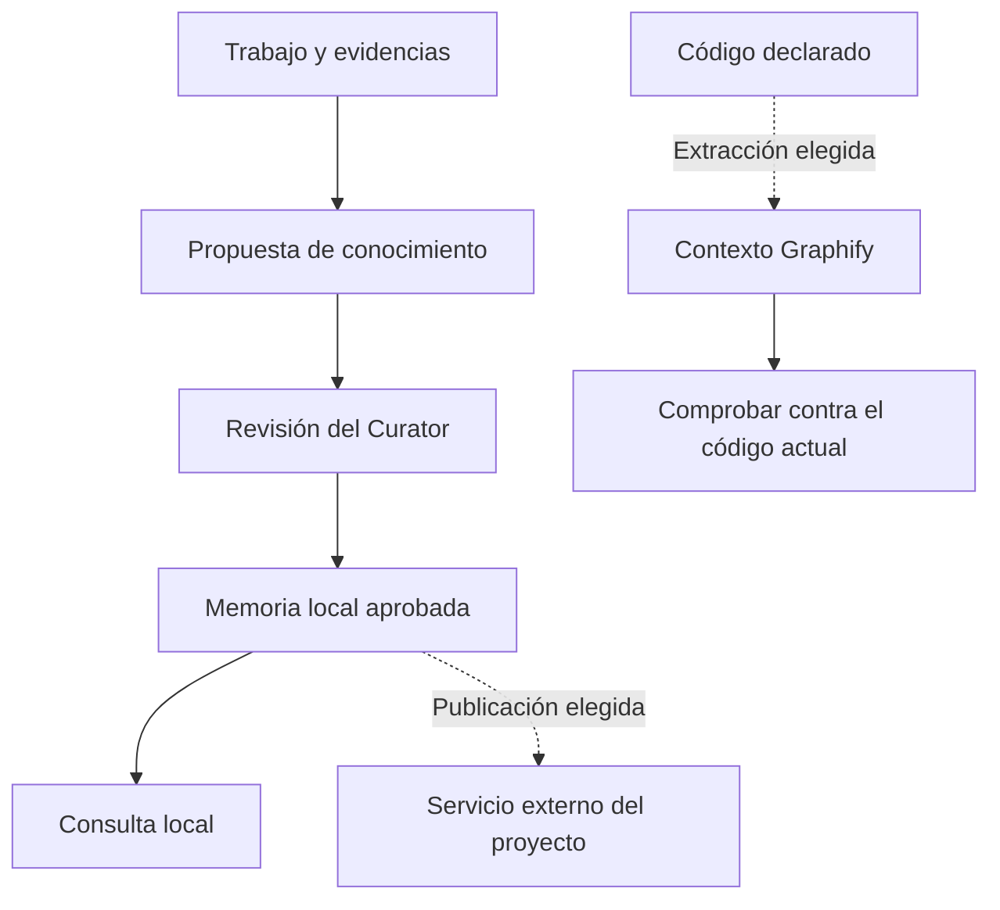
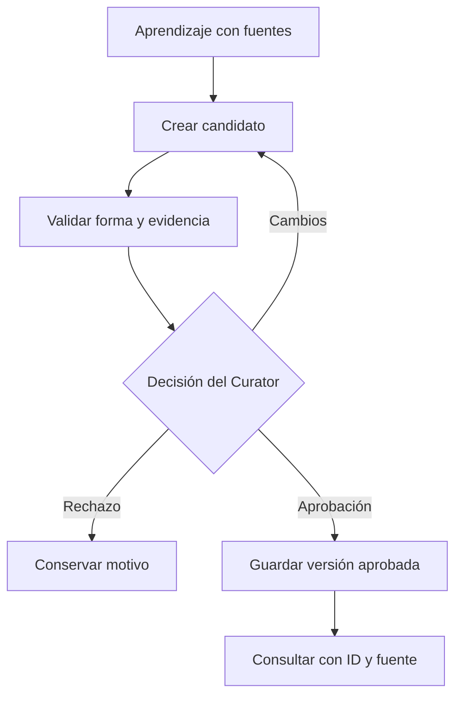
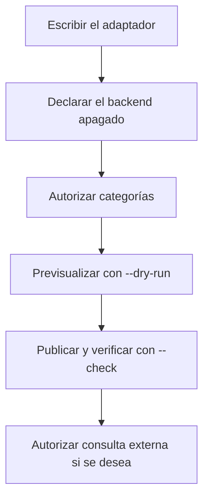
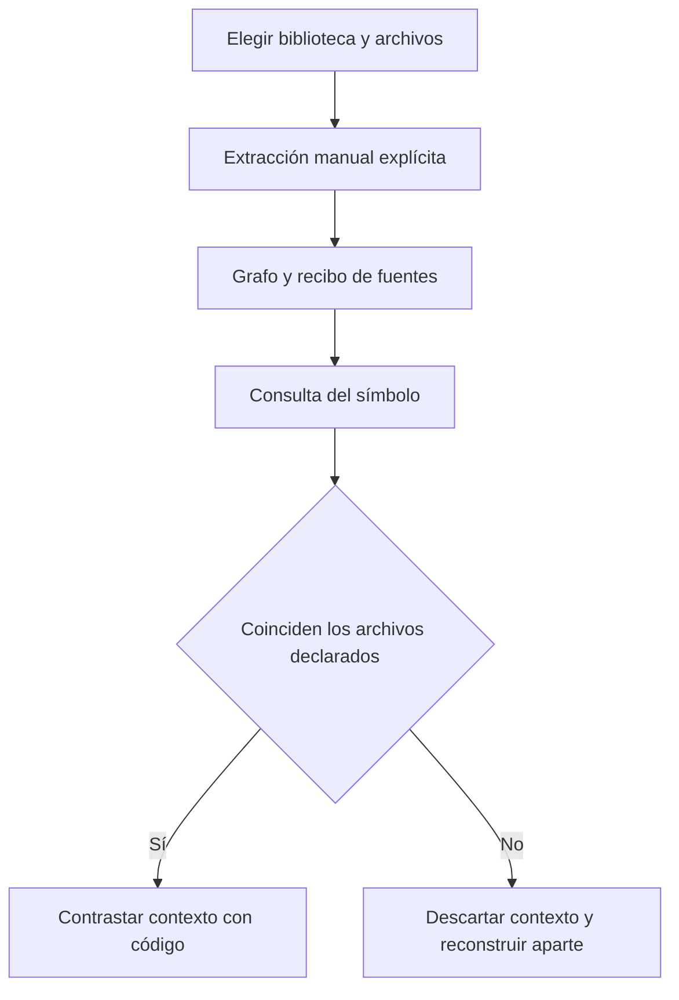

# 7. Memoria: recordar lo útil y conectar herramientas opcionales

La memoria permite retomar decisiones y aprendizajes sin depender de que alguien
recuerde una conversación antigua. No es un almacén de todo lo que el asistente dice.
Se conservan piezas concretas, con fuentes, estado y versión, para poder contrastarlas.

En el portal, «un rechazo requiere un motivo» puede ser una regla aprobada. «Ayer
falló una prueba» es un hecho de sesión. «La función decidir llama a comprobar_permiso»
es contexto de código. Son informaciones distintas y necesitan controles distintos.

## Qué pertenece al core y qué es opcional

El core conserva la memoria local y el proceso para proponer, revisar y aprobar
conocimiento. **No necesita ningún servicio externo ni Graphify para trabajar.** Los
servicios externos se eligen por proyecto, igual que Jira, Confluence o Redmine. El módulo
`memory-integrations` entrega el marco `knowledge-services` (cargador de adaptadores,
routing cerrado y cola de recuperación), **sin adaptadores incluidos**: el proyecto añade el
suyo. Instalarlo no activa nada.

| Pieza | Para qué sirve | Qué no demuestra |
|---|---|---|
| Journal local | Retomar qué ocurrió y qué quedó pendiente en una sesión | Que las observaciones sean reglas aprobadas |
| Candidatos | Proponer una decisión, patrón o lección con evidencia | Que ya se pueda usar como conocimiento aprobado |
| Memoria aprobada | Consultar conocimiento aceptado por el proceso de curación | Que una respuesta generada a partir de ella sea correcta |
| Servicio externo propio | Proyectar documentos aprobados a un servicio del proyecto mediante su adaptador y, si se autoriza, consultarlo | Que publicar ya haya actualizado el índice del servicio ni que una respuesta generada sea correcta |
| Graphify opcional | Extraer estructura del código para localizar símbolos y relaciones | Que ese contexto esté aprobado, cubra todo el repositorio o siga vigente |

Un **grafo** es un mapa de elementos relacionados: una decisión vinculada a su
sucesora o una función vinculada a otra que utiliza. Las herramientas no son
intercambiables por tener nombres parecidos. Puedes elegir ninguna, una o varias
para necesidades diferentes. Cada conexión necesita un responsable y pruebas.



## W-19. Crear, aprobar y consultar memoria local

### Qué necesitas y qué pides

Úsalo cuando una decisión o aprendizaje vaya a evitar repetir trabajo. Necesitas
una afirmación concreta, su contexto y evidencia que pueda revisar otra persona.
Una conversación larga o un listado de progreso no son una buena entrada de memoria.

```text
Propón como conocimiento del portal la regla de que un rechazo exige un motivo.
Incluye la decisión aprobada y las pruebas que la respaldan. Muéstrame la propuesta
y pásala al proceso de curación; no la publiques en ningún servicio externo.
```



1. **Se propone algo reutilizable.** `documenter`, `planner`, `implementer` u otro
   productor aporta el candidato al servicio compartido. Se identifica la categoría:
   decisión, patrón, trampa comprobada o lección. Se excluyen secretos, razonamiento
   interno y conversaciones crudas. No todo fallo trivial merece una entrada.
2. **Se comprueba que la propuesta esté completa.** El Knowledge Gate, una validación
   programada, revisa categoría, evidencia mínima, fuentes y etiquetas. Que una ficha
   tenga forma válida no significa que su contenido haya sido aprobado.
3. **`knowledge-curator` decide.** Es el único agente dueño de aceptar, rechazar o
   pedir cambios. Ante contradicción o alto impacto consulta a la persona responsable.
   Otros agentes no pueden escribir directamente en la carpeta aprobada para ahorrar
   este paso. Repetir una afirmación varias veces no la convierte en una regla.
4. **La decisión se guarda ligada al contenido revisado.** El servicio conserva
   motivo, identidad y versión. Si el candidato cambió mientras se revisaba, no se
   aplica una decisión antigua a un texto nuevo. La memoria aprobada vive en
   `docs/knowledge/approved/`; su inclusión en Git depende de la política del proyecto.
5. **La consulta recupera fuentes.** Pide «Busca la regla sobre el rechazo y muestra
   su ID, versión, estado y documento». `knowledge-find.py` consulta localmente sin
   activar servicios si no se indica un intent externo. También recupera el legado
   válido de decisiones, trampas y lecciones sin aprobarlo de nuevo automáticamente.
6. **Los cambios se versionan.** Si la regla cambia, se propone y revisa una versión
   nueva. Una decisión histórica no se vuelve vigente por una búsqueda. Trasladar
   conocimiento a otro proyecto crea propuestas pendientes de revisión en destino,
   no una aprobación heredada por copiar archivos.

### Ejemplo de consulta para el equipo técnico

En estos ejemplos PowerShell, `$PluginRoot` es la raíz instalada del plugin que el
administrador ha localizado y `$ProjectRoot` la raíz del proyecto consumidor.
No uses una ruta de caché de una versión antigua ni supongas que el proyecto es
el propio plugin. Las rutas de instalación se explican en la referencia avanzada.

```powershell
$SharedKit = Join-Path $PluginRoot "agent-kits/shared"
python (Join-Path $SharedKit "knowledge-find.py") --root $ProjectRoot --json "motivo de rechazo"
python (Join-Path $SharedKit "knowledge-find.py") --root $ProjectRoot --show "portal.decision.reject-reason" --json
```

El ID es ilustrativo: sustituye el ejemplo por uno realmente devuelto. Comprueba
fuente, versión y estado; no solo el resumen. Si hay IDs ambiguos o corpus incompleto,
lee el diagnóstico. Una ausencia de aciertos no prueba que no exista una decisión.
El índice de búsqueda se puede reconstruir: no sustituye los documentos originales.

La bitácora o journal ayuda a retomar la última sesión de la iniciativa y se mantiene
separada de lo aprobado. Un fallo de captura necesita diagnóstico; no se soluciona
copiando toda la conversación al corpus. [Gobierno y traslado](../MEMORY-PORTABILITY.md)
detalla la portabilidad y la revisión en el proyecto de destino.

## Antes de conectar un servicio: decisiones comunes

El responsable elige qué categorías pueden salir del proyecto y con qué finalidad.
El administrador mantiene el servicio, cuenta, endpoint y modelos si existen. El
equipo técnico configura y prueba el adaptador. El Curator conserva la aprobación
local; el publicador no la sustituye.

La **taxonomía** es el archivo que organiza categorías y destinos de memoria:
`.claude/knowledge-services/taxonomy.json`. Cada categoría declara su `routing`, es
decir, si puede enviarse a cada backend. Un backend es un destino externo configurado.
Si una categoría no lo autoriza expresamente, no se publica en ese destino.

El ejemplo completo [taxonomy.json](../examples/memory/taxonomy.json) usa el prefijo
ficticio `portal`, declara un backend de ejemplo apagado y deja todo el routing
desactivado. No lo copies sobre una configuración existente: revisa y fusiona las
claves pertinentes con el administrador. Las categorías y la evidencia mínima son
política del proyecto y no se reducen para lograr que una entrada pase.

El puerto común usa [bindings de memoria](../examples/integrations/memory.json), con
propósito `knowledge` y la skill opcional `knowledge-services`. En ese ejemplo, el
ID del binding coincide exactamente con el ID del backend. Los bindings no suscriben
eventos automáticos: aprobar memoria no publica por sí solo. Si ya tienes bindings
de Atlassian, se añaden entradas a su lista; no se sustituye toda la configuración.
Configurar el binding no habilita la lectura ni autoriza una publicación.

Para la administración explícita, los scripts de memoria mantienen su CLI propia.
El registro común elige la integración del workflow; la taxonomía conserva los
controles de categorías y lectura. No se duplican el Curator, el router de memoria
ni la cola de recuperación para cada marca.

## W-20. Conectar un servicio de memoria propio

### Cuándo tiene sentido

Elígelo si tu equipo ya administra un servicio de memoria (por ejemplo, un servidor MCP) y
quiere publicar allí el conocimiento aprobado o consultarlo desde allí. El plugin trae el
marco y **no trae adaptadores**: los dos que incluía hasta la versión 3.x se retiraron en
la 4.0.0 (ver el CHANGELOG), y la memoria local no cambia. No instala ni arranca servicios.

```text
Queremos publicar las decisiones aprobadas del portal en nuestro servicio de memoria.
Explícame qué hay que escribir y declarar, prepara una vista previa con las entradas
permitidas y mantén la consulta externa apagada hasta comprobar publicación y fuentes.
```



1. **El administrador prepara el servicio.** Cuenta, endpoint y credenciales son suyos;
   el plugin no los guarda ni los descubre.
2. **El equipo técnico escribe el adaptador.** Es un fichero con las seis funciones del
   [contrato](../../skills/knowledge-services/backends/README.md) (`health`, `plan`, `apply`,
   `verify`, `rebuild`, `revoke`), cargado por `type` desde `backends/<type>.py` o desde
   una carpeta propia con `--backends-dir`. Hay un adaptador de prueba de referencia en
   `skills/knowledge-services/scripts/fixtures/`.
3. **Se declara el backend, apagado.** En la taxonomía, `backends.<id>` con `type`,
   `enabled: false` y su `config`. Un `type` sin adaptador sale con un mensaje claro, no con
   un traceback.
4. **Se autorizan categorías.** Por ejemplo, `DECISION` con `routing: {"<id>": true}`. Las
   otras permanecen apagadas hasta decidir lo contrario. Se valida el archivo antes de operar.
5. **Se revisa y publica.** `--dry-run` muestra qué entradas aprobadas cambiarían. Tras
   autorizar la operación, la ejecución publica y la cola de recuperación conserva lo que
   falle. `--check` contrasta salud y correspondencia; «incompleto» no es un verde.
6. **La lectura es aparte.** Un adaptador que implemente `puede_leer` y `consultar` puede servir
   `knowledge-find.py --intent`, con backend habilitado e intent autorizado; un fallo vuelve a
   la búsqueda local con su motivo.

Comandos para quien administra; se ejecutan desde el proyecto adecuado:

```powershell
$MemorySkill = Join-Path $PluginRoot "skills/knowledge-services"
$Sync = Join-Path $MemorySkill "scripts/knowledge-sync.py"
python (Join-Path $SharedKit "knowledge-schema.py") (Join-Path $ProjectRoot ".claude/knowledge-services/taxonomy.json")
python $Sync --root $ProjectRoot --backend mi-servicio --backends-dir $CarpetaDelAdaptador --dry-run
# Tras revisar y autorizar la publicación:
python $Sync --root $ProjectRoot --backend mi-servicio --backends-dir $CarpetaDelAdaptador
python $Sync --root $ProjectRoot --backend mi-servicio --backends-dir $CarpetaDelAdaptador --check
```

### Qué recibes y qué hacer si falla

Una respuesta generada por el servicio es **texto sin autoridad y no verificado**: pide abrir
la entrada concreta antes de tomar una decisión importante. Si el servicio falla, la consulta
vuelve a memoria local e indica el motivo. Si una publicación se corta, puede haber archivos ya
actualizados: se conserva el diario pendiente y se consulta `--outbox-status`; no se borra el
inventario para empezar a ciegas. `--rebuild` reconstruye la proyección del adaptador; el
índice del servicio sigue siendo responsabilidad de su administrador.

## W-21. Integrar Graphify para entender relaciones del código

### Qué aporta y quién lo prepara

Graphify ayuda al equipo técnico a localizar funciones y relaciones. El resultado
es contexto de código, separado de la memoria aprobada. Por ejemplo, localizar qué
comprueba los permisos antes de aprobar una solicitud. No necesitas activarlo para
usar el portal ni para consultar decisiones locales.

```text
Localiza cómo se comprueban los permisos antes de decidir una solicitud.
Si hay contexto Graphify vigente, úsalo con sus fuentes; contrasta el código actual.
Si falta o está desactualizado, continúa con búsqueda normal y explica el límite.
```



1. **El equipo elige una biblioteca compatible.** El administrador instala o prepara
   por separado una revisión confiable de Graphify con las gramáticas que requiere
   su lenguaje, preferiblemente en un entorno aislado. El plugin no descarga ni
   descubre automáticamente una biblioteca desde la configuración del proyecto.
   La raíz externa elegida ejecuta código confiado; no es un sandbox universal.
2. **Declara el alcance.** El desarrollador identifica todos los archivos que influyen
   en la extracción o resolución y los pasa como inputs. No puede afirmar cobertura
   completa solo por declarar dos archivos. El productor `code-context-build.py`
   crea un grafo y un recibo con la huella de las fuentes declaradas.
3. **Construye en destinos nuevos.** El productor comprueba que los inputs no cambien
   durante la extracción y no reemplaza un grafo existente. En el ejemplo siguiente,
   `src/requests.py` es un archivo ficticio del portal y debe sustituirse por rutas
   reales relativas a la raíz del proyecto.
4. **Consulta una identidad concreta.** `code-context.py` permite ID exacto o archivo
   y etiqueta exactos. La búsqueda por texto puede encontrar varios símbolos.
   El contexto devuelve ubicaciones para revisar el código, no conclusiones de negocio.
5. **Comprueba vigencia antes de usarlo.** Si los bytes de un input declarado cambiaron,
   el lector devuelve `artifact-stale` sin ese contexto. Se genera otro par en destino
   nuevo; no se fabrica un recibo nuevo para legitimar un grafo antiguo.

```powershell
$Build = Join-Path $SharedKit "code-context-build.py"
$Query = Join-Path $SharedKit "code-context.py"
# GraphifyRoot: biblioteca externa confiable que el administrador ya preparó.
python $Build --project $ProjectRoot --graph "graphify-out/pilot-01.json" --input "src/requests.py" --graphify-root $GraphifyRoot
python $Query --project $ProjectRoot --graph "graphify-out/pilot-01.json" --source-file "src/requests.py" --label "decide()"
```

La etiqueta `decide()` es ilustrativa y debe coincidir con la del artefacto. El
recibo se llama `pilot-01.json.sources.json`. «Verified declared inputs» solo confirma
la coincidencia observada con los archivos declarados; mantiene cobertura desconocida
y contexto no aprobado. No prueba semántica ni detecta todos los archivos nuevos.

Si falta biblioteca, gramática o parser, informa de no disponible y usa búsqueda
normal. Si falla la publicación del recibo, puede quedar el grafo sin recibo: conserva
el diagnóstico y usa un destino nuevo. Un grafo sin recibo automático se presenta
como legado sin vigencia verificada, no como contexto actual certificado. Los hooks
y abrir el panel no lanzan extracciones. [Contrato y piloto](../CODE_CONTEXT.md).

## Aportar conocimiento con el formato del equipo

Los [workflows W-28 a W-30](knowledge-categories.md) explican cómo crear categorías
y plantillas del proyecto. Distinguen actas aportadas por personas, FAQ redactadas
por agentes y procedimientos mixtos. La revisión de una carpeta conserva los
originales; proponer candidatos, aprobarlos y publicarlos son pasos separados.

## Elegir y retirar integraciones sin perder la memoria

Empieza por el problema: continuidad local, consulta en un servicio propio o navegación
de código. Habilita solo lo necesario y prueba preguntas representativas
con fuentes esperadas. Compara utilidad y límites, no el número de herramientas.

Para dejar de usar un servicio, se deshabilita su integración y su backend conforme
al plan del administrador. Se conserva el canon local y se revisan operaciones pendientes.
Desactivar no borra datos remotos ni revoca publicaciones automáticamente: esas son
operaciones separadas. Se documenta qué datos quedaron fuera, quién los mantiene y
qué retención aplica. La búsqueda local debe seguir funcionando con todos los servicios
apagados. Los [contratos avanzados](../../skills/knowledge-services/backends/README.md)
detallan configuración, recibos y recuperación para el equipo técnico.
