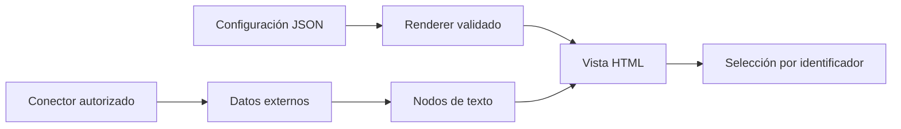
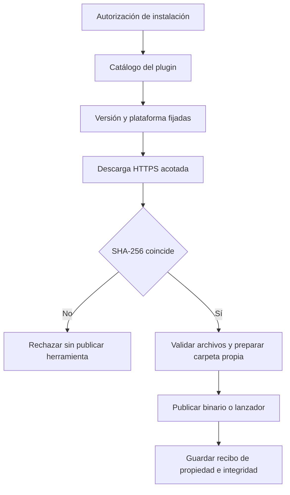

# Remediación de seguridad: vistas, PDF, CI y herramientas opcionales

Esta guía explica los cambios de la revisión Nemesis del 6 de noviembre de 2026. El arreglo confirmado evita que los datos de Jira o Confluence se interpreten como HTML ejecutable. Las otras tres medidas refuerzan la conversión PDF, los workflows de GitHub y la instalación opcional de herramientas de auditoría.

La revisión no determina por qué npm rechazó una publicación. No se ha publicado un paquete nuevo, enviado una apelación ni cambiado los servicios de conocimiento.

## Cómo se muestran los datos de Jira y Confluence

Los nombres, títulos y errores se insertan como texto. Un título que contenga etiquetas HTML se ve literalmente; no crea elementos ni ejecuta eventos. La selección conserva el identificador original de la tarea o página.

Las vistas siguen siendo opcionales. La skill correspondiente utiliza el conector autorizado por el proyecto; este cambio no añade un servidor MCP ni credenciales. Para crear una vista, prepara un JSON local y usa el renderer del bundle:

```bash
python3 agent-kits/shared/render-artifact.py --template jira-live --config config.json > vista.html
```

Ejemplo de `config.json`:

```json
{"SERVER_SEARCH":"nombre-del-conector","CLOUD_ID":"id-del-sitio","LABEL":"iniciativa-ejemplo","TITULO":"Plan del equipo"}
```

Los otros valores de `--template` son `jira-picker` y `confluence-tree`; sus campos están en las referencias de las skills. No sustituyas marcadores con concatenación de texto. El renderer valida los campos, limita el tamaño y serializa la configuración para que no cierre el bloque de script. Si falta el helper, usa el flujo conversacional.



## Cómo convertir documentos a PDF

El script mantiene el sandbox de Chromium, desactiva JavaScript y bloquea los recursos de red por defecto. Conserva la escritura atómica: el PDF de destino se sustituye sólo después de generar la nueva salida.

Copia todos los `.mjs` de `skills/to-pdf/scripts/`, su `package.json` y `skills/to-pdf/assets/theme.css` a una carpeta de herramientas externa al proyecto. Instala las dependencias allí siguiendo la skill. No basta con copiar únicamente `to-pdf.mjs`: utiliza dos módulos auxiliares.

```bash
node to-pdf.mjs documento.md --out documento.pdf
```

Para documentos de confianza que necesitan imágenes o fuentes remotas, autoriza cada origen HTTPS concreto:

```bash
node to-pdf.mjs documento.html --allow-origin https://assets.example.org
```

Se rechazan credenciales, rutas, parámetros y esquemas distintos de HTTPS en esta opción. Los demás orígenes y los archivos locales siguen bloqueados. Los recursos bloqueados producen un aviso; revisa el PDF si faltan imágenes. El modo sin red también afecta a imágenes locales del Markdown: incrústalas como datos o usa un origen HTTPS autorizado.

`--allow-js` activa JavaScript expresamente para documentos de confianza. `--unsafe-no-sandbox` permite ejecutar Chromium sin su sandbox sólo cuando el entorno lo exige, imprime un aviso y no se activa automáticamente tras un fallo. Evita esta excepción en uso habitual. La política de recursos es una defensa del renderer, no un aislamiento de red del sistema operativo ni un servicio para procesar HTML hostil. No habilites JavaScript para documentos desconocidos.

## Qué cambia en GitHub Actions

Las acciones externas están fijadas a commits completos. Actualizarlas requiere revisar el nuevo commit y sus entradas; no se resuelven etiquetas mutables durante la ejecución.

| Workflow | Permisos y secretos |
|---|---|
| CI | `contents: read`; checkout sin persistir credenciales. |
| Headless opcional | La clave de Anthropic sólo está en los dos pasos que llaman al modelo. La puerta previa conoce únicamente si existe. Claude CLI queda fijada a `2.1.311`. |
| Release | El build usa lectura. Un job separado descarga los assets y publica con `contents: write`; no ejecuta scripts del proyecto. |

Cada workflow tiene una copia `*.yml.MANUAL-COPY` idéntica en la raíz. No cambies una sola copia. Las pruebas comprueban la paridad y los límites de permisos. La validación estática del workflow de release no equivale a publicar una release; la de headless no equivale a gastar llamadas al modelo.

## Cómo instalar las herramientas opcionales de Nemesis

No se instalan al cargar el plugin. El agente pide autorización antes de ejecutar el instalador. Las pruebas de esta iniciativa no instalan ni ejecutan herramientas externas.

Requisitos: Python 3.10 o posterior; Bash para el wrapper y los lanzadores de herramientas de scripts. Los binarios nativos pueden instalarse directamente con Python. testssl necesita Bash y OpenSSL; nikto necesita Perl; wafw00f necesita un pip operativo en el Python elegido. Las herramientas pueden necesitar otros recursos cuando se utilicen, por ejemplo bases de vulnerabilidades o plantillas: esas descargas quedan fuera de la verificación del instalador.

Primero consulta el catálogo sin instalar ni acceder a la red:

```bash
python3 agent-kits/nemesis/tools/install-tools.py --list
```

Después de autorizarlo, instala sólo las herramientas necesarias:

```bash
bash agent-kits/nemesis/tools/install-tools.sh --only gitleaks,hadolint
```

`SECURITY_TOOLS_DIR` permite elegir una carpeta externa a cualquier repositorio Git. Si no se configura, se usa `~/.claude/security-tools`. No se aceptan rutas redirigidas por enlaces ni una carpeta final escribible por otros usuarios en POSIX. El bloqueo coordina ejecuciones de este instalador; no constituye una barrera contra otro proceso malicioso de la misma cuenta.



### Qué significa que una herramienta esté verificada

`tools-lock.json` fija versiones, revisiones, URLs y SHA-256. Los binarios usan assets de releases concretas. testssl, sqlmap y nikto usan archivos del commit fijado; no se clona HEAD ni se ejecuta `git pull`. testssl se obtiene de su repositorio oficial actual, `testssl/testssl.sh`.

wafw00f utiliza un directorio privado por instalación, con sus dependencias fijadas en `wafw00f-requirements.txt`. pip se ejecuta de forma aislada, sólo admite wheels con hash, no resuelve dependencias nuevas ni modifica los paquetes globales. El lanzador carga ese directorio con el Python elegido y evita crear bytecode. Esta carpeta es un destino privado de paquetes, no un entorno virtual independiente del intérprete.

Los hashes son anclas revisadas dentro del plugin. Detectan cambios respecto de esos bytes; no certifican que el software upstream sea benigno. Una nueva versión requiere revisión del mantenedor. Si cambia la compresión de un archivo upstream, el instalador rechaza el hash aunque el código pretendido sea el mismo; no hay fallback sin verificación.

El instalador rechaza rutas de escape, enlaces, archivos especiales, nombres ambiguos y archivos comprimidos que superen los límites. No ejecuta los binarios descargados para preguntar su versión. Una plataforma sin asset fijado se omite con error y no utiliza un binario de otra arquitectura. El proceso continúa con las demás herramientas y termina con código no cero si hubo fallos.

### Instalaciones anteriores y fallos

Un archivo previo que no tenga recibo nuevo se considera ajeno. Se conserva, incluso con `--force`. Una herramienta gestionada cuyo binario o árbol de scripts haya cambiado también se conserva y se rechaza su reemplazo automático. `--force` sólo reinstala una herramienta gestionada que siga intacta. La comprobación de disponibilidad del agente puede encontrar herramientas anteriores en PATH; esa presencia no acredita este contrato de integridad.

Para migrar, conserva tu carpeta antigua y elige un `SECURITY_TOOLS_DIR` nuevo y vacío. Verifica el resultado antes de cambiar PATH. No se borra ni adopta automáticamente la instalación antigua.

Si se interrumpe la preparación, pueden quedar directorios de versión sin lanzador dentro de `vendor/`; el instalador no los ejecuta ni elimina automáticamente. Si falla la escritura del recibo después de publicar un archivo, la siguiente ejecución lo rechaza como desconocido o modificado. Inspecciona el estado o usa una carpeta nueva; no fuerces la adopción editando el recibo. Las versiones anteriores se conservan para revisión, no hay limpieza automática.

## Qué se ha comprobado y qué límites conserva la evidencia

Las pruebas usan metadatos de Jira/Confluence y herramientas sintéticos. Las pruebas de DOM corren en Edge/Chromium con perfil temporal propio; no acreditan los permisos del host Cowork. Los tests del instalador no contactan objetivos, no instalan herramientas reales y no sustituyen una auditoría de sus upstreams. La prueba de conversión real de PDF se documenta por separado en el ledger.

El estado vigente, la revisión de contexto fresco y la CI están en [el ledger de remediación](../roadmap/2026-11-06-nemesis-remediation/tasks.md). Una revisión de seguridad no garantiza ausencia de malware ni demuestra la causa de un bloqueo de npm.

## Fuentes y mantenimiento de los pins

Consultadas el 6 de noviembre de 2026: [seguridad de GitHub Actions](https://docs.github.com/en/actions/reference/security/secure-use), [intercepción de solicitudes de Puppeteer](https://pptr.dev/guides/request-interception/), [API Page](https://pptr.dev/api/puppeteer.page), [testssl oficial](https://github.com/testssl/testssl.sh/releases). Cada herramienta conserva su URL de procedencia en `tools-lock.json`; los wheels incluyen metadatos y URL de PyPI. Para renovar un pin, verifica el release/commit, el asset de cada plataforma y su digest; actualiza el lock, ejecuta las regresiones y somete el diff a revisión.
