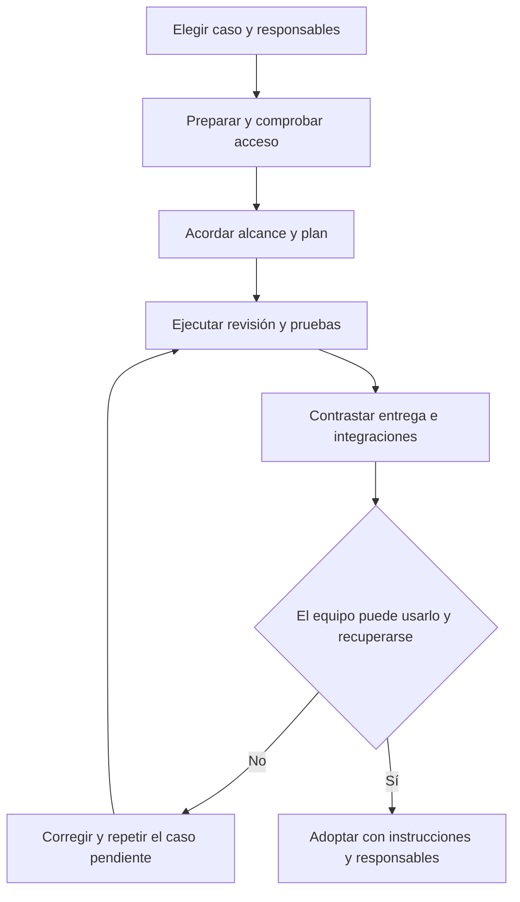

# 6. Empezar con el equipo y resolver problemas cotidianos

La mejor primera prueba es una iniciativa pequeña con un resultado que todos
puedan reconocer. En nuestro ejemplo: resolver una solicitud con un motivo de
rechazo y evitar una segunda decisión. El objetivo del piloto es comprobar el
recorrido, las responsabilidades y la capacidad de recuperarse de un fallo.

## W-18. Hacer un piloto y adoptar el producto

### Qué necesitas y qué pides

Elige un responsable de negocio, un contacto técnico y un administrador. Pueden ser
menos personas si alguien asume varios papeles, pero las decisiones deben estar
claras. Necesitáis un proyecto de prueba, un caso correcto y uno incorrecto, y un
destino piloto si vais a publicar tarjetas o documentación.

```text
Preparemos un piloto del portal. Quiero entender cada etapa, revisar el plan
antes de implementarlo y comprobar una solicitud aprobada, un rechazo sin motivo
y una segunda decisión. Al terminar, enséñame resultados, límites y pendientes.
```



1. **Preparar.** Con W-01, el administrador revisa instalación y herramientas.
   `/setup` configura lo elegido y `/doctor` diagnostica. No es necesario activar
   todas las capacidades para usar el core. El responsable puede pedir el resultado
   en lenguaje corriente: qué está listo y qué necesita intervención.
2. **Acordar el trabajo.** Con W-02 y W-03 se definen requisitos, evaluación y plan.
   El responsable revisa ejemplos y decide si continuar. No basta con aprobar un
   título: debe entender qué condiciones permitirán aceptar cada tarea.
3. **Ejecutar y observar.** Con W-04 el equipo implementa, revisa y prueba. El
   responsable pide una demostración de los tres casos elegidos. Un fallo conocido
   debe verse como pendiente de corrección y conservar su evidencia.
4. **Probar la colaboración externa si se utiliza.** En Jira o Redmine se contrasta
   al menos una creación, una nota, una transición y una respuesta incierta. En la
   wiki se comprueba publicación, actualización y conflicto. No se ensayan efectos
   en un proyecto de producción por defecto.
5. **Aceptar la entrega.** Con W-05 se revisan documentación, pruebas, pendientes y
   condiciones de publicación. El equipo puede explicar cómo retomar la iniciativa
   después de cerrar la sesión. Un commit no significa que esté desplegado.
6. **Dejar una guía del equipo.** Anotad quién mantiene accesos, quién aprueba
   publicaciones, dónde están los planes y cómo escalar incidencias. Repetid el
   caso que haya fallado antes de extender el uso a otras áreas. La adopción no
   depende solo de que los tests sean verdes: la persona destinataria debe poder
   entender el resultado y usar el recorrido.

### Comprobación antes de extenderlo

| Pregunta del responsable | Qué evidencia debería poder ver |
|---|---|
| ¿Se ha hecho lo que acordamos? | Plan, criterios y resultado de cada caso |
| ¿Quién revisó y quién probó? | Veredictos separados y referencias al informe |
| ¿Se creó la tarjeta correcta? | Enlace real al proyecto piloto y campos contrastados |
| ¿Qué ocurre si se corta una publicación? | Diagnóstico y recuperación sin duplicados |
| ¿Podemos continuar mañana? | Estado actual, próxima tarea y bloqueos claros |
| ¿Qué no está validado todavía? | Lista explícita de límites, sin convertir ausencia en éxito |

Si el piloto se bloquea, conservad el punto alcanzado y el efecto externo conocido.
No repitáis una creación o publicación cuyo resultado sea incierto. El contacto
técnico aísla el caso y el responsable decide si el alcance debe cambiar. La falta
de permiso se resuelve con el administrador, no relajando controles del proyecto.

## Una rutina diaria sencilla

Al empezar, pide «Resume el plan del portal: terminado, en curso, bloqueado y próximo
paso; contrástalo con las evidencias». `/roadmap-status` ayuda con la cartera y
`/work-resume` prepara la retoma. No tomes una vista antigua del tablero como estado vivo.

Durante el trabajo, pide «Muéstrame el estado de T-02, su última revisión y qué queda
por probar». Para una decisión, exige opciones y consecuencias comprensibles. Si
aparece una ampliación, decide si pertenece al alcance antes de añadir trabajo.

Al cerrar, pide «Guarda el punto de retoma, resume cambios y verificaciones y señala
lo pendiente». `/retro` ayuda a aprender de una iniciativa cerrada. La documentación
actualizada permite que otra persona continúe sin leer toda la conversación.

## Si aparece un problema

| Lo que ves | Qué significa o qué falta saber | Qué hacer |
|---|---|---|
| Una skill no aparece | Puede faltar instalación, ubicación o compatibilidad | Administrador: revisar inventario y entorno con `/doctor` |
| Configurado, pero no conectado | Hay una declaración; falta demostrar la operación | Probar lectura concreta con cuenta y destino correctos |
| Publicación incierta | Se perdió la respuesta; quizá el efecto ya ocurrió | Consultar y reconciliar antes de repetir |
| Revisión o QA fallidos | Un criterio o una prueba no pasó | Leer evidencia, corregir el caso y repetir la comprobación |
| Tiempo de espera agotado antes de probar | No se alcanzó la comprobación de negocio | Separar preparación y ejecución; no culpar al producto sin evidencia |
| Estado del tablero distinto del plan | Puede faltar sincronización o haber cambios externos | Comparar ambos, resolver diferencias y conservar recibos |
| Una búsqueda de memoria no usa un servicio externo | Puede estar apagado, no autorizado o desactualizado | Revisar el motivo; la búsqueda local sigue siendo válida |

### Hooks: avisos automáticos y aprobación

Un hook es una acción automática asociada a un momento, por ejemplo al comenzar
una sesión. Un fallo de hook no demuestra que haya fallado toda la implementación;
hay que identificar qué acción falló y su efecto.

«Plugin contents changed; hook approval required» indica que el entorno necesita
aprobar el contenido actual del plugin. El administrador revisa el origen y cambios
y usa la interfaz de confianza del entorno. En la CLI de Codex, la pantalla `/hooks`
puede permitir seleccionar una entrada y aprobarla con `t`; hay que comprobar la
ayuda de la versión instalada. Que una entrada diga «Unnamed hook» es un problema
de identificación en esa vista; no es una prueba de ejecución fallida. No se
corrige aceptando ciegamente todo ni alterando hashes de confianza a mano.

«El sistema no puede encontrar el archivo» exige revisar la ruta real del lanzador,
la versión instalada y el ejecutable. El error Windows 206 señala una longitud
excesiva de nombre o argumentos, pero hay que reconstruir el caso antes de atribuirlo
al plugin. Un aviso de «conversación desconocida» en Desktop puede ser un problema
de notificaciones; por sí solo no contiene el resultado del proceso del hook.

## Cómo pedir ayuda sin enviar toda una conversación

Explica qué intentabas hacer, qué esperabas, qué ocurrió, en qué entorno y versión,
y si pudo haber un efecto externo. Añade la tarea o enlace pertinente y el mensaje
de error acotado. El contacto técnico puede pedir registros concretos y redactados.
No pegues contraseñas, claves ni conversaciones privadas completas.

Para problemas repetidos de código, `debug-root-cause` organiza reproducción,
aislamiento, prueba de la causa y corrección. Para configuración, empieza por
`/doctor`. Para memoria y servicios, continúa con el capítulo 7.

## Glosario para consultar durante el uso

| Término | Explicación sencilla |
|---|---|
| Core | El método común que organiza y verifica el trabajo |
| CLI | Aplicación que se usa escribiendo en una terminal |
| Desktop | Aplicación de escritorio; no implica las mismas interfaces que una CLI |
| Runtime o entorno | La aplicación que carga y ejecuta agentes y herramientas |
| Workflow | Recorrido con pasos, decisiones y un resultado |
| Skill | Instrucciones reutilizables para realizar un trabajo |
| Tool | Operación concreta que la sesión puede ejecutar |
| MCP | Protocolo para ofrecer operaciones de un sistema al asistente |
| Adaptador | Pieza que traduce el método del plugin a un servicio |
| Binding | Configuración que elige adaptador, capacidades y momentos de uso |
| Evento | Aviso de que ocurrió algo: por ejemplo, empezó una tarea |
| Ledger | Registro local principal de tareas y estados, `tasks.md` |
| Kanban | Tablero de tarjetas agrupadas por estado |
| Gate o puerta | Comprobación obligatoria antes de continuar |
| QA | Verificación ejecutada con pruebas y evidencias |
| Recibo | Referencia que confirma una operación concreta y su resultado observado |
| Correlación | Referencia para relacionar una tarea y una operación sin duplicarlas |
| Reconciliar | Consultar lo que ocurrió y resolver diferencias antes de repetir |
| Idempotencia | Repetir una operación sin duplicar su efecto, cuando su contrato lo permite |
| Outbox | Cola local de operaciones que deben enviarse o recuperarse |
| Routing o enrutado | Regla que decide qué contenido puede ir a qué servicio |
| Hash | Huella del contenido usada para detectar cambios |
| Frontmatter | Datos de cabecera que describen un documento |
| Snapshot | Fotografía del estado observado en un momento |
| Evidencia | Resultado o fuente que permite contrastar una afirmación |
| Opt-in | Capacidad que solo se activa si se elige expresamente |

Los procedimientos avanzados de empaquetado, migración y diagnóstico permanecen
en la [referencia de operación](../reference/operations.md).
