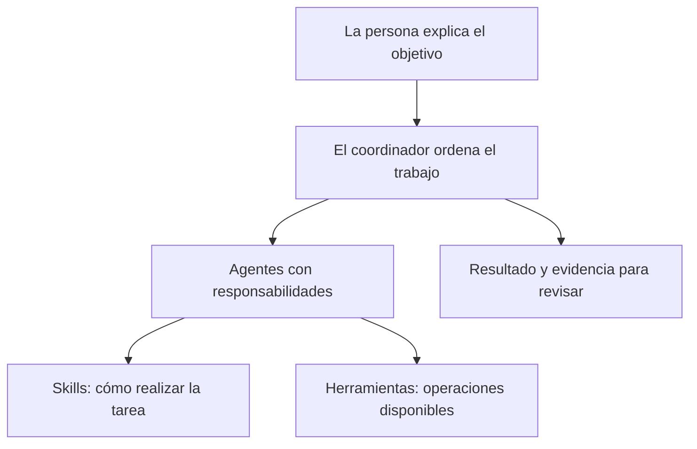
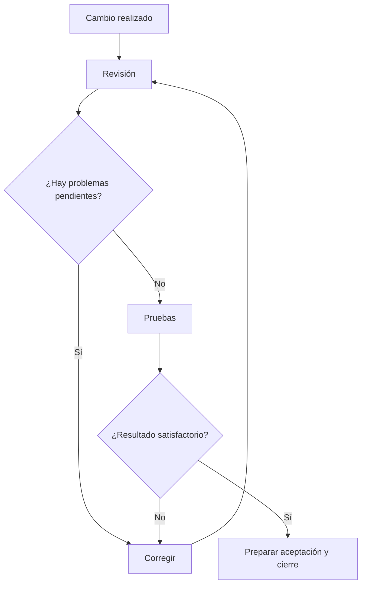

# 1. Qué es el producto y quién hace cada cosa

## Una ayuda para organizar el trabajo, no una decisión automática de negocio

Imagina que un área recibe la petición «necesitamos aprobar solicitudes internas».
Esa frase todavía deja preguntas abiertas: quién puede aprobar, qué información
necesita, si debe explicar el rechazo y cómo se sabe que todo funciona.

custom-agents ayuda a ordenar esas preguntas y el trabajo posterior. Primero aclara
la necesidad; después prepara una evaluación y un plan; a continuación implementa,
revisa y prueba. Conserva los resultados para que otra persona pueda entender lo
ocurrido y continuar. Tú y tu equipo decidís qué resultado queréis y qué aceptáis.

No hace falta usar Jira para empezar. El producto puede organizar documentos y tareas
dentro del proyecto. Si vuestro equipo utiliza Jira, Redmine o una wiki, se puede
preparar una conexión para compartir allí la información. Elegir una herramienta
externa no cambia los controles que debe superar la entrega.

## Las piezas explicadas con una comparación cotidiana

Piensa en una oficina que recibe encargos. Tiene una persona que coordina, especialistas,
procedimientos de trabajo y herramientas. El producto utiliza esas mismas ideas.

| Palabra que verás | Significado en lenguaje cotidiano | Ejemplo del portal |
|---|---|---|
| Proyecto | El espacio donde se reúne el trabajo y sus documentos | El portal de solicitudes internas |
| Iniciativa | Un cambio concreto que se quiere conseguir dentro del proyecto | Añadir aprobación y rechazo |
| Workflow o recorrido | El orden de pasos para llegar a un resultado | Definir, planificar, construir, revisar y probar |
| Comando | Una instrucción corta que inicia o consulta un recorrido | `/dev-cycle` pone en marcha el ciclo de una iniciativa |
| Agente | Un asistente con una responsabilidad concreta | El planificador divide el cambio en tareas |
| Skill | Una guía de trabajo que un asistente usa cuando la necesita | La guía de pruebas le indica cómo comprobar un comportamiento |
| Herramienta o tool | Una operación disponible en la sesión | Leer un archivo o crear una tarjeta en el sistema elegido |
| Conector MCP | Un puente que permite al asistente utilizar ciertas herramientas de otro sistema | Consultar Jira desde la sesión de trabajo |
| Persona de dominio | Criterios sobre el negocio que se incorporan a una tarea | Revisar las solicitudes desde la perspectiva de atención al usuario |

Una persona del equipo no es lo mismo que una «persona de dominio». La primera tiene
una cuenta, permisos y responsabilidades reales. La segunda es una forma de recordar
qué aspectos del negocio debe considerar un asistente. No crea una nueva persona ni
una cuenta que pueda aprobar solicitudes.

Tampoco son lo mismo una skill y una herramienta. La skill explica **cómo trabajar**;
la herramienta permite **hacer una operación**. Puedes tener instrucciones para publicar
en una wiki y, aun así, no tener una conexión disponible para hacerlo.

## Quién interviene y qué puedes pedirle

Los nombres entre paréntesis son los identificadores que verá el equipo técnico.
No necesitas invocar a cada agente por separado: el recorrido puede coordinarlos.

| Participante | Su trabajo | Un resultado que puedes pedir |
|---|---|---|
| Responsable de área o de producto | Explica la necesidad y decide el alcance | «Esto es lo que queremos resolver y así reconoceremos el resultado» |
| Analista (`analyst`) | Hace preguntas hasta convertir la idea en requisitos claros | Una explicación de qué se incluye y qué queda fuera |
| Evaluador (`evaluator`) | Estima esfuerzo, coste y riesgos con los datos disponibles | Una comparación que permita decidir si conviene continuar |
| Arquitecto (`architect`) | Compara maneras de construir la solución cuando hace falta | Opciones con ventajas, inconvenientes y una recomendación |
| Planificador (`planner`) | Divide el objetivo en fases y tareas comprobables | Un plan con responsables, criterios y forma de verificación |
| Implementador (`implementer`) | Realiza los cambios acordados | Cambios y evidencia de las comprobaciones que ha ejecutado |
| Revisor (`reviewer`) | Busca problemas y desviaciones en el trabajo realizado | Hallazgos explicados con evidencia |
| Verificador de calidad (`qa`) | Ejecuta las pruebas y comunica su resultado | Un informe de qué pasó, qué falló y qué no se pudo comprobar |
| Documentador (`documenter`) | Explica el uso y mantiene la documentación del producto | Instrucciones que el equipo pueda consultar y utilizar |
| Coordinador u orquestador | Ordena las etapas y reúne sus resultados | Un resumen de situación y la siguiente decisión |

Existen otras especialidades. Por ejemplo, `knowledge-curator` revisa qué aprendizajes
pueden convertirse en conocimiento aprobado, y `nemesis` atiende auditorías de
seguridad especializadas cuando se solicitan y están disponibles. No participan
obligatoriamente en todos los encargos.

**Ejemplo:** el implementador dice «he añadido el botón de rechazar». Eso no significa
que el cambio esté aceptado. El revisor puede detectar que no se comprueba quién tiene
permiso. QA puede encontrar que el motivo del rechazo no se guarda. El coordinador
reúne esas evidencias antes de proponer el cierre.

## Qué significa «revisado» y qué significa «probado»

Una revisión pregunta si la solución tiene defectos o incumple lo acordado. Las pruebas
intentan comprobar comportamientos mediante herramientas y casos concretos. Son dos
miradas complementarias: leer que existe una validación no demuestra que el programa
rechace una solicitud inválida cuando se ejecuta.

Cuando el manual hable de un **control de calidad** o *gate*, se refiere a una condición
que hay que superar antes de seguir. Por ejemplo: disponer de revisión sin problemas
pendientes y de pruebas satisfactorias. Si una prueba falla, el trabajo vuelve a
corrección. No se cambia el resultado para que el tablero parezca terminado.

## Dónde queda la información que permite continuar

El proyecto conserva documentos distintos para preguntas distintas. Los nombres de
archivo ayudan a encontrarlos, pero puedes pedirlos con palabras normales.

| Lo que necesitas saber | Documento | Cómo pedirlo |
|---|---|---|
| Qué se quiere conseguir | Especificación, `spec.md` | «Muéstrame los requisitos que aprobamos» |
| Qué se estima y qué riesgos hay | Evaluación, `evaluation.md` | «Explícame el esfuerzo y los supuestos de la estimación» |
| Qué solución se eligió | Diseño, `design.md`, cuando procede | «¿Por qué elegimos esta opción?» |
| Cómo se organizará el trabajo | Plan, `improvement-plan.md` | «Enséñame las fases y el orden» |
| Qué tarea está pendiente o terminada | Registro de tareas, `tasks.md` | «¿Qué queda por hacer y qué evidencia tiene cada tarea?» |
| Qué se comprobó | Carpeta de pruebas, `testing/` | «Abre el informe de verificación» |

El registro de tareas es la referencia principal del progreso local. A veces se llama
**ledger canónico**: significa «el registro que utilizamos para resolver dudas sobre
el estado». Un tablero externo puede mostrar una copia de esa información. Si hay
una diferencia, se investiga; no se da por probado el cambio porque una tarjeta esté
en una columna llamada Done.

## Qué puedes elegir para tu equipo

El núcleo del producto reúne las capacidades del ciclo común. Las ampliaciones
opcionales añaden funciones como publicar documentación o usar un proveedor concreto.
Una ampliación no debe convertirse en obligación para todos los proyectos.

El administrador puede elegir un **perfil**, que es una selección inicial de módulos:
`core` para el ciclo local, `developer` para las especialidades técnicas incluidas en
ese perfil, `research` para investigación/contenido o `full` para el catálogo completo.
Un módulo es un grupo de capacidades que se distribuyen juntas. No es una cuenta
externa ni un permiso de acceso.

Para tu área, la decisión práctica es más simple: «¿dónde trabajaremos y qué necesitamos
compartir?». Un proyecto puede usar Jira y Confluence; otro, Redmine y una wiki; otro,
solo los archivos locales. El administrador comprobará qué forma de instalación
permite entregar una selección física de archivos. Algunas instalaciones nativas
entregan el paquete completo y el uso de cada capacidad sigue siendo bajo demanda.

## Cómo reconocer una buena entrega

Pide que el cierre te muestre el objetivo acordado, lo que se terminó, sus pruebas,
los documentos y las limitaciones. Si hubo una publicación externa, pide el enlace
real. Si algo no se pudo hacer, debe quedar visible con su siguiente acción.

Una respuesta útil es: «Las cuatro tareas están verificadas; aquí están el informe
y las instrucciones. La publicación de la página sigue pendiente porque la cuenta
no tiene permiso». Son dos resultados distintos y permiten actuar sin repetir todo.

Para configurar módulos, revisar contratos o consultar los nombres internos completos,
el administrador dispone de la [referencia técnica del producto](../reference/product.md).
