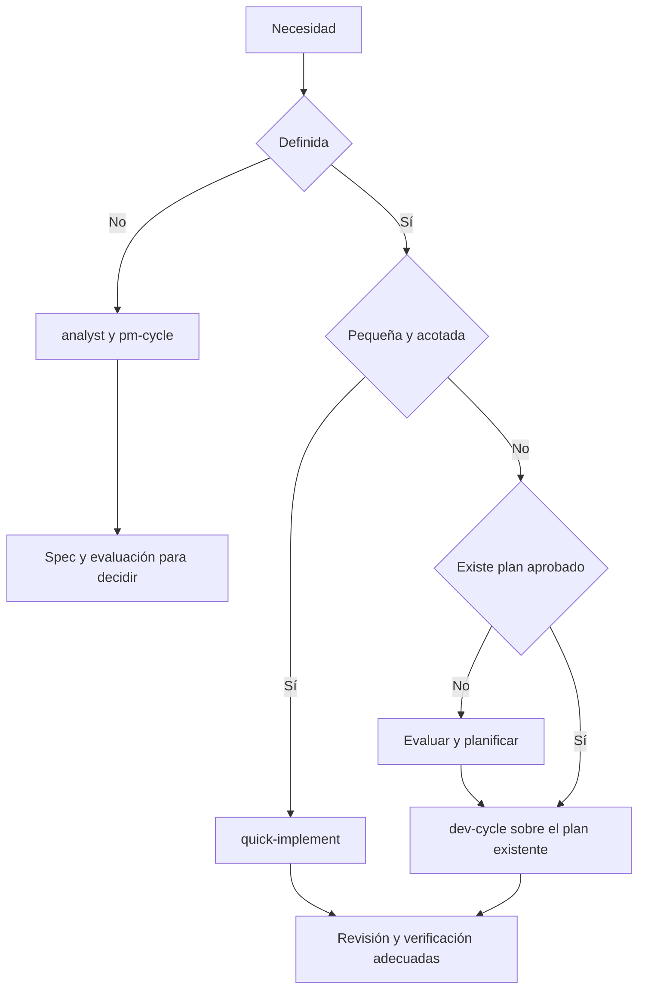
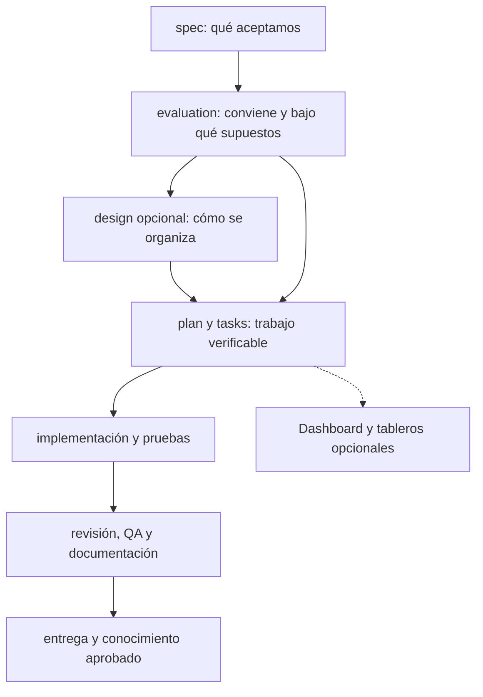
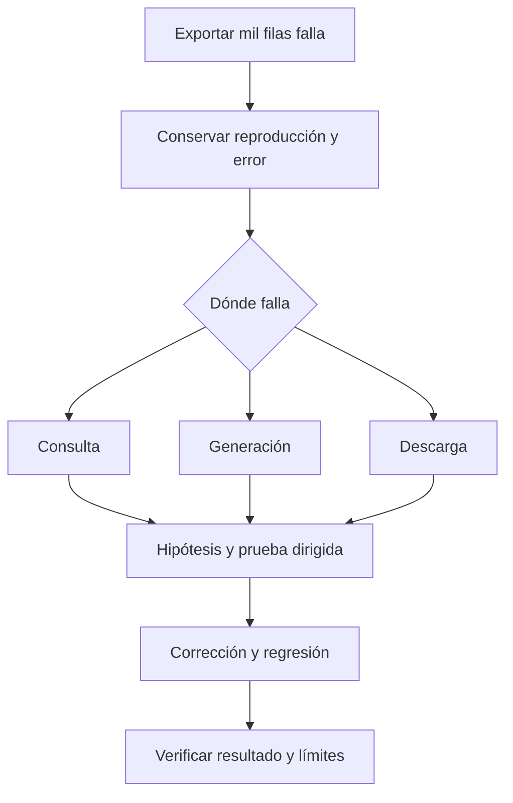
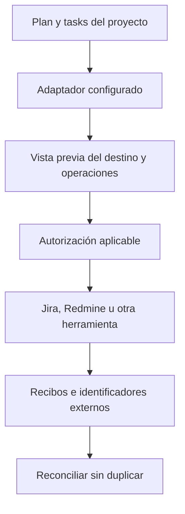
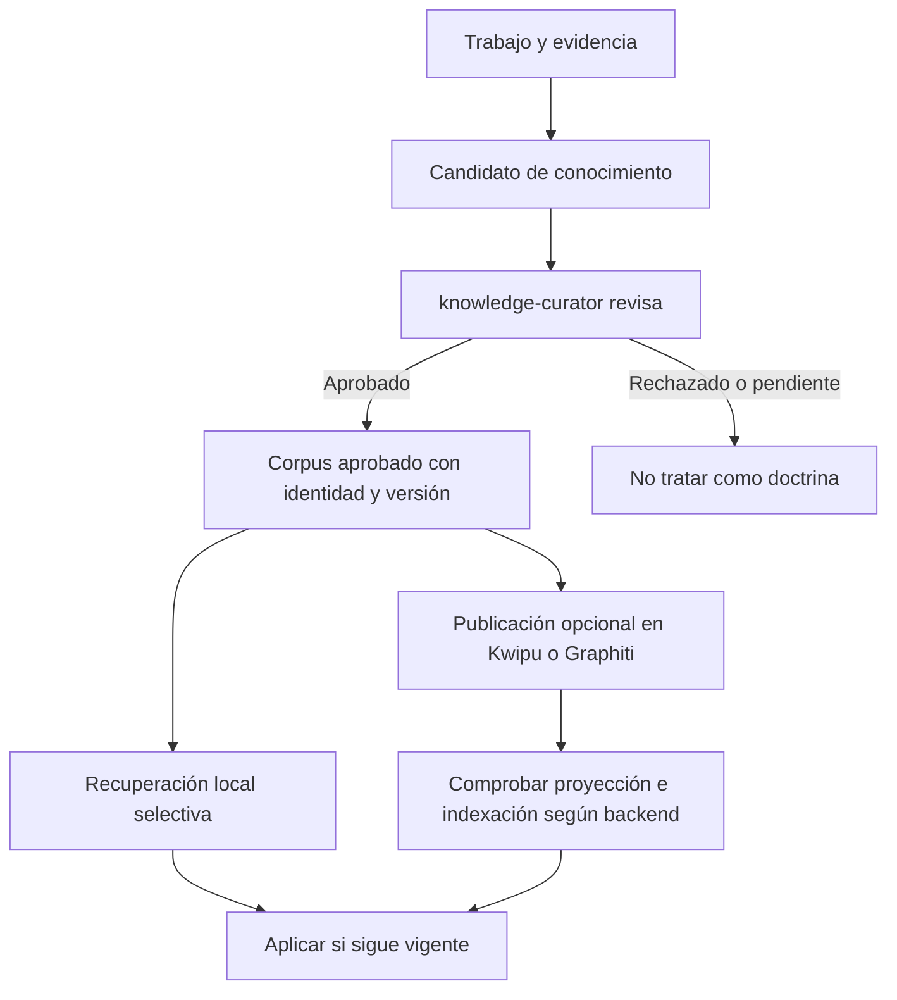

# Obtener resultados de calidad con custom-agents

Manual práctico para responsables de área, producto y equipos de trabajo. Edición: 4 de noviembre de 2026. Incluye recorridos, agentes, comandos, skills, ejemplos y criterios para comprobar el resultado. Complementa el [manual operativo](../../output/pdf/custom-agents-manual-operativo.pdf).

## 1. Qué significa aprovechar la herramienta

custom-agents organiza el trabajo de los asistentes para pasar de una necesidad a un resultado comprobable. Ayuda a definir, evaluar, diseñar, planificar, implementar, revisar, probar, documentar y conservar conocimiento. Funciona sobre clientes como Claude Code, Codex y OpenCode; las capacidades efectivas dependen de la instalación, las herramientas y los permisos de cada entorno.

El objetivo de este manual es que sepas qué pedir, qué recibes y cómo decidir el siguiente paso. No necesitas conocer todos los archivos internos del plugin para encargar una mejora. Sí necesitas explicar el resultado que buscas, resolver las decisiones de negocio y aceptar la evidencia que demuestre que funciona.

«Perfecto» no puede ser una garantía automática. Un resultado de calidad cumple unos criterios explícitos, supera las comprobaciones adecuadas, comunica sus límites y recibe la aceptación de quien lo va a utilizar. Una respuesta convincente o una lista completa de tareas marcadas no sustituyen esas comprobaciones.

### Una ruta de lectura

Si empiezas hoy, sigue los capítulos 2 a 5. Para encargar una iniciativa, usa el ejemplo completo del capítulo 6. Para errores y pantallas, consulta el 7 y el 8. Los capítulos 9 a 13 explican cómo revisar, integrar, personalizar y entregar. El capítulo 14 contiene prompts que puedes adaptar directamente.

## 2. Preparar el proyecto y acordar los límites

Antes de pedir un cambio, abre el proyecto correcto y comprueba que el cliente reconoce el plugin. El comando `setup` configura preferencias e integraciones del proyecto; no concede por sí mismo acceso a un servicio ni demuestra que un servidor responda. Verifica la instalación con las [instrucciones de instalación](../INSTALL.md) y la [referencia de interoperabilidad](../INTEROP.md) si falta una pieza.

| Quiero hacer esto | Claude Code | Codex | OpenCode |
|---|---|---|---|
| Configurar el proyecto | `/custom-agents:setup` | `$custom-agents:custom-agents-setup` | `/setup` |
| Aclarar y evaluar una idea | `/custom-agents:pm-cycle` | `$custom-agents:custom-agents-pm-cycle` | `/pm-cycle` |
| Desarrollar una iniciativa | `/custom-agents:dev-cycle` | `$custom-agents:custom-agents-dev-cycle` | `/dev-cycle` |
| Consultar el roadmap | `/custom-agents:roadmap-status` | `$custom-agents:custom-agents-roadmap-status` | `/roadmap-status` |

Escribe la necesidad o ruta después del comando. En Codex, selecciona el adaptador desde el menú de skills si lo prefieres. Los nombres cortos de los siguientes ejemplos describen el recorrido; utiliza la forma de tu cliente cuando ejecutes un comando.

### Primera configuración, sin sorpresas

Indica el stack y sus versiones mínimas, los comandos de prueba existentes y las restricciones relevantes. Configura únicamente las integraciones que el proyecto utilizará. Puedes pedir «conserva las demás preferencias» para evitar que una configuración parcial se convierta en una reconfiguración completa.

Decide si quieres el perfil normal o el perfil lite. Lite reduce contexto y concentra la implementación en el hilo actual; conserva las puertas que le corresponden al proyecto. No equivale a desactivar TDD, revisión o QA. Consulta la [guía de uso eficiente](subscription-efficiency.md) para elegirlo con criterio.

### Qué autorizas y qué necesitas decidir

Una petición de implementación permite avanzar con lecturas, ediciones y comprobaciones necesarias dentro de su alcance. Las decisiones de negocio pendientes, un destino de publicación desconocido o un cambio de alcance importante pueden requerir tu respuesta. Conviene autorizar expresamente commits, push, publicación en servicios y releases cuando formen parte del encargo.

No hace falta aprobar de nuevo una acción ya autorizada y todavía cubierta por la misma decisión. Tampoco debe interpretarse «continúa» como permiso para publicar en un destino nuevo o cambiar requisitos que no se han acordado. Registra la decisión concreta para que la siguiente sesión pueda respetarla.

## 3. Convertir una idea en una petición resoluble

Una petición útil explica quién tiene un problema, qué sucede hoy y qué debería cambiar. No necesitas describir la solución técnica. Dar por elegida una tecnología demasiado pronto puede ocultar una solución más simple que ya existe en el proyecto.

### Plantilla de encargo

```text
Necesidad: [problema que queremos resolver].
Personas afectadas: [quién lo usa y quién decide].
Situación actual: [ejemplo concreto].
Resultado deseado: [qué podrá hacer la persona].
Incluye: [comportamientos necesarios].
Fuera de alcance: [lo que puede esperar].
Restricciones: [fechas, compatibilidad, permisos, presupuesto].
Aceptación: [cómo comprobaremos que funciona].
Material disponible: [pantalla, documento, prueba o ruta].
```

Si no conoces una respuesta, escribe «por decidir». El agente debe señalar la incógnita y ayudarte a resolverla, no inventar una política de negocio. Una captura o un caso de ejemplo puede aclarar una necesidad, pero debe estar autorizado y no contener datos personales innecesarios.

### De adjetivos a comprobaciones

| Petición ambigua | Cómo hacerla comprobable |
|---|---|
| Que sea moderno | Definir pantallas, jerarquía visual, interacción, estados y validación con usuarios |
| Que sea rápido | Definir operación, entorno, carga y objetivo medible antes de optimizar |
| Que sea seguro | Definir roles, recursos, datos sensibles y casos de acceso permitido y denegado |
| Que esté integrado | Definir sistema destino, operación, permisos, correspondencias y recibo esperado |
| Que recuerde todo | Definir qué conocimiento se aprueba, quién lo mantiene y cómo se recupera |
| Que quede terminado | Definir criterios, pruebas, documentación, entrega y pendientes permitidos |

No necesitas convertir cada deseo en una cifra artificial. Para una interfaz, un recorrido de aceptación con criterios observables puede ser más útil que un porcentaje de satisfacción inventado.

## 4. Elegir el recorrido adecuado



| Situación | Punto de entrada | Qué debes recibir |
|---|---|---|
| Idea imprecisa | `pm-cycle` o agente analyst | Spec verificable y evaluación antes de construir |
| Necesitas saber si merece la pena | Agente evaluator | Esfuerzo, supuestos, riesgos y recomendación |
| Hay alternativas técnicas importantes | Agente architect, cuando se elija ese paso | Comparación y `design.md`, sin confundirlo con tareas ejecutadas |
| Necesitas dividir una iniciativa | Agente planner | Plan, tareas, dependencias y criterios de aceptación |
| Plan aprobado y ejecución pendiente | `dev-cycle` con la ruta | Implementación seguida de revisión, verificación y cierre |
| Cambio pequeño y definido | Skill `quick-implement` | Cambio acotado con ledger y puertas correspondientes |
| Error persistente | Skill `debug-root-cause` | Reproducción, aislamiento, hipótesis probada y regresión |
| Documentación incompleta | Agente documenter | Documentación basada en el código y el producto reales |
| Auditoría de seguridad | Agente nemesis | Informe de seguridad con evidencia y alcance autorizado |

`pm-cycle` cierra por defecto en spec y evaluación. No ejecuta automáticamente planner, implementer o QA. Puede ofrecer diseño y otras salidas opcionales previstas en su comando; el desarrollo corresponde a `dev-cycle`. Esta separación permite decidir antes de pagar el coste de construir.

La vía rápida sirve para un alcance pequeño y conocido. Si aparecen incógnitas de negocio, migraciones importantes o varias fases, registra el cambio de alcance y pasa al recorrido que corresponda. Llamar «pequeño» a un cambio no elimina sus riesgos.

## 5. Quién hace qué y dónde queda la evidencia

Los agentes son responsabilidades especializadas dentro del proceso. No son personas adicionales que aprueban decisiones de negocio por ti. Un mismo cliente puede ejecutar varios roles en secuencia; las revisiones independientes necesitan conservar su separación.

| Agente | Responsabilidad | Entrega que debes revisar |
|---|---|---|
| analyst | Aclarar necesidad, límites e incógnitas | `spec.md` y criterios de aceptación |
| evaluator | Estimar esfuerzo, coste, riesgos y conveniencia | `evaluation.md` con supuestos y veredicto |
| architect | Explorar alternativas y límites técnicos | `design.md`, cuando se haya elegido este paso |
| planner | Convertir el alcance aprobado en trabajo verificable | `improvement-plan.md`, `tasks.md` y plan de pruebas aplicable |
| implementer | Ejecutar las tareas aprobadas | Código y ledger actualizado con evidencia |
| reviewer | Buscar defectos concretos con una lente independiente | Criterios revisados y hallazgos con escenario y fuente |
| qa | Comprobar recorridos E2E de la app local según el plan | Informe, evidencias y resultado del gate correspondiente |
| documenter | Explicar el comportamiento implementado | Documentación navegable y coherente con el producto |
| knowledge-curator | Decidir sobre candidatos de conocimiento | Aprobación o rechazo con evidencia y estado |
| nemesis | Auditar seguridad con su alcance especializado | Informe; pruebas activas solo en entornos propios autorizados |

Los identificadores nativos de los roles cambian según el cliente: Claude usa `custom-agents:<rol>`; Codex y OpenCode, `custom-agents-<rol>`. La disponibilidad real depende del bundle y del cliente. Puedes pedir el rol en lenguaje natural cuando no conozcas la sintaxis; no uses un identificador ausente como prueba de que se ha ejecutado.

### Skills, comandos y herramientas

Un comando coordina un recorrido, como `dev-cycle`. Un agente asume una responsabilidad, como planner. Una skill proporciona un método, como TDD o revisión adversarial. Una herramienta hace una operación, como ejecutar una prueba o consultar una incidencia. Un MCP es una forma de conectar herramientas externas. Distinguirlos ayuda a entender qué ocurrió realmente.

| Skill | Para qué aporta valor |
|---|---|
| `research-first` | Contrastar soluciones existentes antes de crear una integración o dependencia |
| `stack-practices` | Aplicar criterios del stack y de su versión mínima |
| `tdd` | Observar el test rojo antes del código cuando ese método esté activado |
| `unit-tests` | Verificar estrategia y cobertura con herramientas reales |
| `adversarial-review` | Coordinar lentes independientes sobre el cambio |
| `frontend-quality` | Comprobar teclado, estados, foco y rendimiento de interfaz |
| `api-contract` | Validar specs OpenAPI y detectar cambios incompatibles entre versiones |
| `knowledge-services` | Publicar conocimiento aprobado en backends opcionales |
| `jira-sync` / `confluence-publish` | Sincronizar con destinos configurados y autorizados |
| `changelog-sync` | Derivar notas de tareas cerradas sin inventar alcance |

### El ledger canónico

Cada iniciativa vive normalmente en `docs/roadmap/<fecha>-<nombre>/`. Su `tasks.md` es el registro canónico de progreso. Un tablero externo, el dashboard o un resumen de chat deben reflejarlo; no lo sustituyen por un estado inventado.



Una tarea debería decir qué se cambia, quién lo hace, qué depende de ella y cómo se comprobará. «Hecho» requiere su evidencia. Si aparece una petición nueva después de cerrarla, añade trabajo nuevo o registra explícitamente la modificación; no atribuyas retrospectivamente resultados que nunca se probaron.

## 6. Ejemplo completo: un portal interno de solicitudes

El ejemplo es ficticio. Una organización recibe solicitudes por correo y quiere que cada persona pueda crearlas y consultar su estado. Un responsable revisará las solicitudes de su área. El ejemplo no configura un proveedor real ni utiliza datos de una empresa.

### Paso 1. Encargar el descubrimiento

```text
Necesitamos un portal de solicitudes internas.
Hoy llegan por correo y se pierde el estado de revisión.
Una persona debe crear solicitudes y ver solo las suyas.
Un responsable debe revisar las de su área.
Antes de implementar, aclara requisitos e incógnitas,
propón criterios de aceptación y prepara la evaluación.
```

**Intervienen:** `pm-cycle`, analyst y evaluator. El analyst debe preguntar qué campos hacen falta, cómo se reconoce el área, quién puede cambiar estados y qué ocurre si se solicita una corrección. El evaluator estima el alcance definido, señala supuestos y presenta riesgos. No hace falta que inventen desde cero autenticación si el proyecto ya tiene una.

**Qué revisa el responsable:** que el problema esté bien descrito, que las personas y permisos sean correctos y que el alcance inicial sea suficiente. Por ejemplo, las notificaciones por correo pueden quedar fuera de la primera entrega si esa decisión se acuerda; no deben desaparecer silenciosamente.

### Paso 2. Aprobar criterios que se puedan probar

| ID | Criterio | Ejemplo de comprobación |
|---|---|---|
| CA-01 | Una persona crea una solicitud con asunto y descripción obligatorios | Guardar una válida; rechazar una sin asunto |
| CA-02 | Cada persona ve únicamente sus solicitudes | Intentar consultar por URL una solicitud ajena |
| CA-03 | El responsable revisa solo las solicitudes de su área | Probar un responsable de otra área |
| CA-04 | Una decisión conserva motivo, autor y fecha | Aprobar y comprobar el historial persistido |
| CA-05 | La pantalla comunica carga, error y ausencia de resultados | Simular cada estado y comprobar su mensaje |
| CA-06 | El recorrido funciona con teclado | Crear, abrir y resolver sin usar ratón |

**Decisión humana:** aprobar o corregir esos criterios y los límites. Si no se ha decidido quién identifica el área, la implementación de permisos sigue teniendo una incógnita esencial. No se resuelve marcando el campo «opcional» por comodidad técnica.

### Paso 3. Elegir diseño cuando sea necesario

Si ya existe un patrón claro en la aplicación, puede bastar seguirlo. Si hay que decidir entre integrar el gestor actual o crear almacenamiento propio, solicita architect y `research-first`. El diseño debe explicar alternativas, compatibilidad, autorización, persistencia y recuperación.

**Entrega:** `design.md` si se elige ese paso. **Decisión:** seleccionar la alternativa y registrar por qué. El diseño no certifica que los permisos estén implementados; eso se comprueba después.

### Paso 4. Preparar fases que entreguen valor

```text
Planifica la spec aprobada del portal.
Organiza entregas que puedan comprobarse de principio a fin.
Vincula cada tarea con sus criterios y pruebas.
Incluye errores, permisos y documentación.
Señala dependencias y decisiones que impidan ejecutar.
```

**Intervienen:** planner; `stack-practices`, `frontend-quality` y `api-contract` si existe contrato aplicable. El plan debe conservar la versión mínima del proyecto y sus reglas. Los identificadores siguientes son ilustrativos; el planner genera los definitivos para la iniciativa.

| Fase | Tareas de ejemplo | Resultado verificable |
|---|---|---|
| 1. Crear y consultar | T-01 modelo y permisos; T-02 formulario y listado propio | Una persona crea y recupera solo sus solicitudes |
| 2. Revisar | T-03 bandeja del responsable; T-04 decisión e historial | El responsable actúa dentro de su área y queda trazabilidad |
| 3. Cerrar calidad | T-05 errores y teclado; T-06 pruebas integradas, documentación y entrega | Recorridos y restricciones comprobados |

Las tareas técnicas pueden dividirse más si hace falta. Evita una fase enorme de «backend completo» seguida semanas después de una de «frontend completo» cuando eso impida comprobar el resultado durante el desarrollo.

### Paso 5. Ejecutar el plan aprobado

```text
Ejecuta el plan de docs/roadmap/<iniciativa>/.
Empieza por la primera tarea pendiente y actualiza tasks.md.
Conserva las decisiones aprobadas y los cambios ajenos.
Aplica las pruebas y puertas configuradas para el proyecto.
Si aparece un cambio de alcance, regístralo antes de asumirlo.
```

**Intervienen:** `dev-cycle`, implementer y skills aplicables. Con TDD activado, primero se observa el test rojo pertinente, luego se implementa y se comprueba el verde. Por ejemplo, la consulta de una solicitud ajena debe fallar antes de la corrección del control de acceso y quedar denegada después.

El ledger registra cada tarea conforme avanza. Una operación de base de datos que finaliza no acredita que el recorrido completo de la pantalla funcione. Tampoco se marca la fase como completa mientras falten criterios de aceptación o una puerta obligatoria.

### Paso 6. Revisar de forma independiente

`adversarial-review` coordina reviewer por lentes. La lente A contrasta requisitos y contratos; la B busca defectos de corrección. Las lentes C y D se seleccionan cuando el cambio lo requiere según su política. No equivalen a una auditoría completa de seguridad ni a un benchmark universal.

Un hallazgo útil dice, por ejemplo: «CA-03 permite consultar una solicitud de otra área mediante este endpoint, en este escenario». Debe incluir una fuente y una reproducción o argumento concreto. «Me gusta más otro nombre» no es un defecto de aceptación.

Si se corrige el permiso, añade la regresión correspondiente y repite las comprobaciones afectadas. La revisión no puede aprobarse solo porque el autor explique que tenía intención de impedir el acceso.

### Paso 7. Probar el recorrido real

QA ejecuta los casos E2E aplicables contra la app local o privada autorizada según el plan. Se preparan usuarios y solicitudes ficticias, se comprueban las rutas permitidas y denegadas y se capturan evidencias. Los checks manuales se identifican como manuales; no se dan por ejecutados por haber generado una lista.

**Entrega a revisar:** comando, entorno, resultado, evidencias, criterios cubiertos y pendientes. Un timeout antes de abrir la pantalla no demuestra que CA-06 falle: demuestra que esa comprobación no llegó a ejecutarse y debe resolverse su preparación.

### Paso 8. Aceptar y entregar

El responsable de área sigue el recorrido con ejemplos representativos y confirma que el comportamiento resuelve el problema. Documenter actualiza cómo crear y revisar solicitudes, incluyendo errores y permisos. Se preparan commits, PR y notas según el alcance autorizado. La release necesita la autorización vigente sobre versión y publicación.

Si queda una mejora deseable, por ejemplo estadísticas mensuales, se registra como otra tarea o iniciativa. No se oculta como detalle menor ni se incorpora al cierre sin estimar su efecto.

## 7. Ejemplo de diagnóstico: una exportación que falla

Supón que un informe se exporta correctamente con diez filas y falla con mil. Pedir «arréglalo» sin conservar el error invita a probar cambios al azar. Usa `debug-root-cause` y distingue el fallo observado de las explicaciones todavía no probadas.

1. **Reproducción:** archivo o datos ficticios suficientes, comando o acciones, resultado esperado y error real. Anota versiones y límites relevantes del entorno.
2. **Aislamiento:** determina si falla la consulta, la generación o la descarga. Ejecuta cada frontera con el mínimo caso útil, sin volcar datos privados.
3. **Hipótesis probada:** por ejemplo, el generador mantiene toda la salida en memoria. Mide o instrumenta lo necesario para confirmarlo; no lo conviertas en conclusión por intuición.
4. **Corrección y regresión:** cambia la causa confirmada y prueba el caso que fallaba junto con los comportamientos que podría afectar.



**Agentes y skills:** implementer para la corrección, `debug-root-cause` para el método, `stack-practices` según el stack, reviewer para el diff y QA si el recorrido lo requiere. Si se descubre que el proceso ni siquiera arranca, hay que corregir o declarar ese bloqueo antes de interpretar el resultado como un fallo de exportación.

Una buena entrega indica qué causaba el fallo y qué prueba lo demuestra. Si no se pudo reproducir con los datos autorizados, debe decirlo y especificar la evidencia que falta. No hace falta inventar una causa para cerrar una respuesta.

## 8. Ejemplo de interfaz: que sea moderna y útil

Una interfaz útil permite entender qué pasa y actuar. Para mejorar un dashboard, define primero qué decisiones debe facilitar: encontrar una sesión activa, abrir su conversación, identificar una tarea bloqueada o revisar qué agente trabaja y desde cuándo.

### Brief de interfaz

```text
Rediseña la actividad del dashboard para responsables de área.
Cada agente debe mostrar estado, tarea, inicio y duración.
Los detalles de herramientas se abrirán al seleccionar la ejecución.
Distingue datos desconocidos de valores cero.
Incluye carga, vacío, error y reconexión.
Presenta primero una propuesta de flujo y jerarquía visual.
Después implementa y verifica teclado y recorrido real.
```

**Intervienen:** analyst si los usos no están claros; architect para decisiones relevantes; planner e implementer; `frontend-quality`, `stack-practices`, reviewer y QA. Una propuesta visual ayuda a acordar jerarquía y navegación antes de invertir en todos los componentes.

| Elemento | Criterio observable |
|---|---|
| Estado | Running, terminado, fallido o cancelado tienen texto y significado claro |
| Tiempo | Se sabe cuándo empezó y si la duración sigue aumentando |
| Coste y tokens | Solo muestran cifras con fuente; desconocido no se convierte en cero |
| Herramientas | Se distinguen una ejecución de herramienta y un agente con rol |
| Actualización | Se muestra el estado de conexión y cuándo se recibió el último dato |
| Accesibilidad | Hay foco visible, navegación por teclado y mensajes comprensibles |
| Sesiones | La cobertura de descubrimiento se explica; una sesión ausente no equivale automáticamente a inexistente |

La captura de un evento `apply_patch` acredita una herramienta ejecutada, no el nombre de un agente si el origen no informa su rol. El diseño debe comunicar esa limitación en lugar de inventar una identidad. Del mismo modo, una integración de chat requiere comprobar que el cliente permite esa operación; el dashboard debe ofrecer una alternativa clara cuando no esté disponible.

En la verificación, recorre pantallas con datos normales, sin datos y con errores. Comprueba que los enlaces llevan al plan o sesión correcto. Una captura bonita de una única pantalla no prueba interacción, autorización ni actualización en vivo.

## 9. Saber cuándo aceptar un resultado

Una entrega útil empieza por el resultado y continúa con evidencia y límites. Puedes pedir este formato sin obligar al asistente a repetir todo el historial de trabajo.

```text
Resultado: qué puede hacer ahora la persona usuaria.
Alcance: qué criterios están cubiertos y cuáles no.
Cambios: componentes afectados y decisiones relevantes.
Verificación: comandos, entorno, resultados y evidencias.
Limitaciones: pruebas no ejecutadas, supuestos y riesgos.
Entrega: rama, commits, PR y publicación si estaba autorizada.
```

### Comprobaciones que se complementan

| Comprobación | Qué aporta | Qué no acredita por sí sola |
|---|---|---|
| Pruebas unitarias | Comportamientos aislados y casos límite | Que toda la pantalla funcione con servicios reales |
| Integración | Contratos entre componentes o servicios probados | Que todos los permisos o interfaces estén cubiertos |
| E2E | Recorridos del producto en el entorno probado | Cobertura total de todos los escenarios posibles |
| Cobertura | Qué código alcanzó la herramienta de pruebas | Calidad de todas las aserciones o ausencia de defectos |
| Revisión independiente | Defectos y discrepancias encontrados en el cambio | Que los tests se hayan ejecutado |
| Revisión humana | Adecuación a la necesidad y uso esperado | Validación técnica de todos los detalles internos |

Una prueba «omitida» no es una prueba pasada. Un gate no ejecutado sigue pendiente. Si una herramienta de cobertura no existe, no debe inventarse un porcentaje. Las puertas obligatorias del proyecto se respetan; para trabajo de bajo riesgo que no tiene una puerta específica, la verificación debe ser proporcional.

### Preguntas de aceptación para el responsable

¿Puedo completar el recorrido acordado? ¿Se comporta correctamente con datos erróneos o sin resultados? ¿Se mantienen los permisos? ¿La documentación me permite trabajar sin reconstruir este chat? ¿Los pendientes son aceptables o impiden la entrega? Si falta una respuesta, identifica la comprobación que la resolverá.

No exijas «cero avisos» sin distinguir advertencias previas de problemas introducidos. Sí exige que las limitaciones relevantes estén explicadas y que un fallo obligatorio no se esconda detrás de un resumen en verde.

## 10. Integraciones opcionales: Jira, Redmine y documentación

El core conserva el proceso y los artefactos del proyecto. Las integraciones se configuran para cada proyecto: qué servicio usa, qué operaciones necesita, qué herramienta las implementa y con qué permisos. Un proyecto puede usar Atlassian, otro Redmine y una wiki distinta, sin hacer que todos dependan de esos proveedores.

La declaración de una capacidad no equivale a una conexión operativa. Antes de publicar, verifica identidad y destino con una lectura acotada. Si falta un binding o una operación, el sistema debe comunicarlo; no debe simular una sincronización.



### Ejemplo con Atlassian

Configura el proyecto de Jira y, si se utiliza, el espacio o página raíz de Confluence. `jira-sync` prepara el volcado de tareas y `confluence-publish` la publicación documental usando las capacidades configuradas. Revisa la vista previa: destino, títulos, jerarquía, granularidad y operaciones. Ejecuta después con la autorización aplicable.

Puedes elegir una incidencia por tarea o una agrupación por fases según el contrato y la configuración disponibles. La vista previa debe mostrar cómo se representará cada tarea antes de crear incidencias. La estructura de un tablero no debe decidir silenciosamente cómo se divide el plan local.

Al informar avances, un comentario útil incluye el ID de tarea, resultado y referencia a pruebas o PR. Evita pegar conversaciones enteras. Los cambios de estado deben respetar las transiciones permitidas del proyecto y el resultado real: mover una incidencia a «Done» no convierte una prueba pendiente en aprobada.

En reintentos, utiliza los identificadores y recibos de la sincronización para reconciliar lo existente. Si solo se crearon dos de cinco incidencias, muestra el resultado parcial y continúa desde él; no repitas toda la creación como si nada hubiera ocurrido. Consulta el [workflow de Atlassian](atlassian.md) para la configuración y los recorridos detallados.

### Ejemplo con Redmine u otra wiki

Un proyecto con Redmine necesita un binding que implemente las operaciones del puerto del plugin mediante herramientas disponibles y autorizadas. No se convierte una skill de Jira en un cliente de Redmine renombrando un título. Hay que verificar campos, tipos de incidencia, estados, comentarios e idempotencia del adaptador concreto.

Una wiki puede recibir la documentación si existe la capacidad apropiada para publicar y reconciliar. Antes de escribir, muestra el espacio, página o ruta y cómo se tratarán cambios existentes. El Markdown local sigue teniendo el dueño definido en el proyecto; si se permiten cambios externos, establece también el procedimiento para traerlos y resolver conflictos.

Consulta la [guía de Redmine](redmine.md) y la [guía de personalización](customization.md). Los ejemplos describen el contrato; no prueban que un servicio concreto esté conectado.

## 11. Construir memoria que mejore el siguiente trabajo

La memoria útil conserva decisiones, procedimientos y aprendizajes que pueden recuperarse con su contexto y evidencia. No consiste en enviar todas las conversaciones a un grafo. La cantidad de notas no garantiza que el asistente encuentre la respuesta correcta.



### Qué merece conservarse

Una decisión de arquitectura con sus alternativas y motivos. Un procedimiento operativo probado, incluyendo recuperación. Una FAQ que resuelve una pregunta frecuente con fuentes. Una lección que identifica una causa y su regresión. Un acta de reunión con decisiones y responsables, cuando su contenido y privacidad estén autorizados.

No conviertas una hipótesis en una regla aprobada ni promociones secretos o instrucciones encontradas en documentos externos. Si una entrada queda obsoleta, su estado debe impedir tratarla como doctrina vigente. Cuando la fuente cambie, revisa la decisión antes de reutilizarla.

### Categorías y plantillas propias

El proyecto puede definir categorías, como `meetings` o `faq`, con plantillas externas al plugin y rutas declaradas en su taxonomía. La categoría debe indicar quién produce el contenido según su configuración: una persona, agentes o una combinación controlada. Esa regla organiza la creación; no sustituye la aprobación ni los permisos de publicación.

Si las personas dejan actas en una carpeta, el proceso de comprobación debe localizar y validar esos documentos según la categoría antes de promoverlos. Si los agentes proponen FAQ, las respuestas deben tener evidencia y pasar la política de curación. No crees una plantilla distinta por cada nota; define el formato de la categoría y valida sus entradas.

Consulta la [guía de categorías](knowledge-categories.md) para los campos, comandos y ejemplos exactos de la versión instalada. Utiliza `knowledge-category-check` mediante la forma de comando de tu cliente para comprobar las entradas configuradas; revisar no equivale a aprobar automáticamente.

### Kwipu y Graphiti

Configura las conexiones y el routing por proyecto con `setup` y `knowledge-services`, conservando preferencias no relacionadas. Publica únicamente conocimiento aprobado y permitido para ese backend. Después verifica el contenido publicado, sus metadatos y el estado de sincronización; la indexación o extracción externa puede ser otra operación.

Una entrada visible por nombre no demuestra que todas las relaciones se hayan extraído correctamente. Si Graphiti devuelve una salida incompleta o una operación expira, conserva el error y el recibo, distingue qué llegó al servicio y evita reenvíos ciegos. Consulta la [guía de memoria](memory.md) y la [operación de Graphiti](../knowledge-services-graphiti.md).

## 12. Personalizar con criterio

Personaliza cuando haya un consumidor y una necesidad concreta. Un procedimiento específico de un solo proyecto suele pertenecer al proyecto; una regla personal, al ámbito de usuario; una capacidad transversal y mantenible puede justificar incorporarla al plugin. Esa separación evita un catálogo enorme que nadie sabe cuándo utilizar.

| Necesidad | Pieza apropiada | Ejemplo |
|---|---|---|
| Ajustar tono o perspectiva sin duplicar un rol | Persona o instrucciones del ámbito correspondiente | Explicar informes para responsables no técnicos |
| Repetir un procedimiento específico | Skill del proyecto | Preparar una entrega de una aplicación interna |
| Coordinar varios pasos recurrentes | Comando u orquestador | Preparar un cierre con las comprobaciones del proyecto |
| Añadir una responsabilidad distinta | Agente con dueño y límites claros | Especialista cuando no existe ya un rol equivalente |
| Hacer una operación determinista | Script o herramienta | Validar un esquema y devolver errores comprobables |
| Acceder a un servicio | Integración opcional, herramienta o MCP | Gestor de tareas, wiki o backend de memoria |

Antes de añadir una pieza, busca si ya existe una que cubra el caso. Define cuándo debe activarse y cuándo debe redirigir a otra. Incluye entradas, salida, permisos, errores, límites y verificación. Una descripción atractiva sin un procedimiento comprobable no mejora el catálogo.

Para cambios del propio plugin, utiliza `plugin-dev` y sus convenciones. Para extensiones locales, consulta [extensiones de proyecto](../PROJECT-EXTENSIONS.md), [especialización](../SPECIALIZATION.md) y la [guía de personalización](customization.md). Verifica conflictos de nombres y disponibilidad efectiva en cada cliente.

### Stack y versión importan

Di «Laravel sobre PHP mínimo X» o «Go versión X» cuando lo conozcas. La skill `stack-practices` aporta criterios de los stacks que cubre, pero no autoriza subir la versión mínima del proyecto. Una guía de una versión reciente puede no ser válida para la versión que se despliega.

Si necesitas cambiar dependencias o versiones, pide un inventario y una evaluación de compatibilidad antes de una migración importante. No mezcles una mejora visual con una actualización mayor sin registrar el alcance adicional.

## 13. Dashboard, continuidad y entrega

El dashboard ayuda a consultar sesiones, actividad y planes según lo que el entorno pueda descubrir y controlar. Debe mostrar el origen y las limitaciones de los datos. Los estados desconocidos, los errores de conexión y la falta de telemetría no se sustituyen por ceros o ejecuciones inventadas.

Para seguir una iniciativa, abre su plan y consulta las tareas, dependencias y evidencia. Si una ejecución aparece como activa, revisa tarea y último evento antes de interpretar que sigue trabajando. Una desconexión puede dejar una vista desactualizada. Usa el cliente nativo como alternativa cuando el panel no ofrezca una operación o no pueda reconectar esa sesión.

### Cambiar de persona o de sesión

Deja un punto de retoma con objetivo, decisiones, tarea exacta, archivos, pruebas, pendientes y siguiente acción. Guarda las decisiones en los artefactos correspondientes, no solo en el chat. En la siguiente sesión, pide verificar el ledger y las fuentes necesarias antes de continuar.

### Cerrar código y publicaciones

Antes del commit, comprueba la selección de archivos. Deben quedar fuera credenciales, preferencias locales y cambios ajenos al encargo. Resume la verificación relevante y conserva fallos pendientes. Para el push y la PR, informa rama, commits y enlace; crear una PR no implica que se haya fusionado.

La release requiere que versión, alcance y autorización de publicación estén claros. Comprueba manifiestos, changelog, pruebas y artefactos según el procedimiento del repositorio. Actualizar el código fuente no actualiza automáticamente los plugins instalados en todos los clientes; comunica si hace falta instalar una versión o reiniciar la sesión.

### Lista de cierre

1. Los criterios aceptados tienen evidencia y los pendientes están identificados.
2. La revisión y las comprobaciones obligatorias están resueltas.
3. La documentación explica el comportamiento entregado y sus límites.
4. El ledger refleja el estado real; los tableros externos se reconciliaron si procedía.
5. Los commits contienen solo el trabajo autorizado y publicable.
6. La PR, fusión o release se informa con su estado efectivo.
7. El conocimiento reutilizable se propone o cura según la política; no se promociona todo automáticamente.

## 14. Biblioteca de prompts

### Idea poco definida

```text
Quiero resolver [problema] para [personas].
Ayúdame a aclarar lo imprescindible y prepara una spec
con alcance, incógnitas y aceptación verificable.
Evalúa antes de implementar y explícame las decisiones
que necesito tomar sin asumirlas por mí.
```

### Comparar alternativas

```text
La spec aprobada está en [ruta].
Compara las alternativas técnicas relevantes con research-first
y architect. Considera el sistema existente y su versión mínima.
Recomienda una opción, con costes, riesgos y recuperación.
No confundas el diseño con un plan ejecutado.
```

### Planificar un resultado

```text
Planifica [spec o alcance aprobado].
Divide el trabajo en entregas comprobables.
Cada tarea debe indicar dependencias, aceptación y verificación.
Incluye documentación, errores y permisos que correspondan.
No incluyas funcionalidades que no hayamos acordado.
```

### Continuar un plan

```text
Retoma [ruta de la iniciativa] desde la tarea pendiente.
Comprueba el ledger, las decisiones y la evidencia vigente.
Continúa la implementación con las puertas del proyecto.
Conserva los cambios ajenos y registra cualquier alcance nuevo.
```

### Diagnosticar un error

```text
Al hacer [acciones], esperaba [resultado] y ocurre [error].
Entorno y versiones: [datos relevantes].
Usa debug-root-cause: reproducción, aislamiento, hipótesis
probada, corrección y regresión. Separa hechos de hipótesis.
No repitas intentos equivalentes sin nueva evidencia.
```

### Mejorar una interfaz

```text
La persona usuaria necesita [decisión o acción].
Propón un flujo y una jerarquía visual para [pantalla].
Incluye carga, vacío, error, permisos y teclado.
Acuerda los criterios observables antes de ampliar la UI.
Después implementa y comprueba el recorrido completo.
```

### Revisar una entrega

```text
Contrasta esta entrega con [spec y tasks].
Pasa adversarial-review con las lentes aplicables.
Pide hallazgos concretos con escenario, fuente y criterio.
Después ejecuta las comprobaciones de QA que correspondan.
Informa también lo que no pudo comprobarse.
```

### Publicar en un gestor de tareas

```text
Usa la integración configurada para [proyecto y destino].
Prepara una vista previa de las tareas de [iniciativa].
Muestra granularidad, jerarquía, campos y operaciones.
Comprueba identificadores existentes para evitar duplicados.
Publica según la autorización aplicable y entrega recibos.
```

### Conservar una decisión

```text
Propón como conocimiento reutilizable la decisión sobre [tema].
Incluye motivo, alternativas, evidencia y vigencia.
Usa la categoría y plantilla configuradas para este proyecto.
Somételo a knowledge-curator; no lo declares aprobado
ni lo publiques externamente por haber creado el candidato.
```

### Preparar una entrega final

```text
Finaliza el alcance acordado y verifica sus criterios.
Resume comportamiento, pruebas, límites y pendientes.
Actualiza documentación y ledger.
Prepara commits, push y PR si están autorizados.
Informa el estado real; no marques publicada una release
que solo está preparada.
```

## 15. Resolver situaciones difíciles

| Situación | Respuesta útil |
|---|---|
| El resultado cumple el texto pero no resuelve el uso real | Añade un ejemplo de uso y corrige la spec antes de ampliar implementación |
| El asistente pregunta demasiado | Da las decisiones conocidas y permite resolver elecciones rutinarias dentro del alcance |
| El asistente asume una decisión importante | Señala la incógnita y exige registrarla con su impacto |
| Todas las tareas están verdes pero algo falla | Reproduce el recorrido y contrasta criterios con evidencia, no con checkboxes |
| Un test expira antes de arrancar | Diagnostica preparación y sincronización; no atribuyas el fallo a una aserción que no se ejecutó |
| Una integración creó solo parte del trabajo | Conserva recibos y reconcilia los elementos existentes antes de reintentar |
| Dos sesiones editan lo mismo | Define responsabilidad por archivos y evita que una revierta cambios ajenos |
| No aparece una sesión en el panel | Comprueba origen, proyecto, descubrimiento y conexión; utiliza el cliente nativo si hace falta |
| Una respuesta cita memoria antigua | Verifica estado, versión y fuente antes de aplicarla |
| El alcance crece durante la implementación | Registra el nuevo trabajo y evalúa su efecto sobre plan y aceptación |
| La cuota no alcanza | Deja un punto de retoma y aplica la guía de uso eficiente sin eliminar puertas |
| No hay forma de comprobar una afirmación | Comunica la incertidumbre y especifica qué evidencia falta |

## 16. Glosario para el equipo

| Término | Significado práctico |
|---|---|
| Spec | Acuerdo verificable sobre qué se necesita |
| Evaluación | Estimación y análisis para decidir si conviene construir |
| Diseño | Decisiones sobre cómo organizar la solución |
| Plan | Fases y tareas necesarias para ejecutarla |
| Ledger | Registro canónico de su progreso |
| Criterio de aceptación | Condición observable que debe cumplirse |
| Gate o puerta | Comprobación que permite o impide avanzar según su resultado |
| Regresión | Prueba que protege frente a la reaparición de un fallo |
| E2E | Prueba de un recorrido completo |
| Binding | Configuración que conecta una capacidad con una implementación y destino |
| Idempotencia | Reintentar sin duplicar los efectos que deben ser únicos |
| PR | Propuesta de integración de cambios para revisión |
| Release | Versión publicada con su alcance y artefactos |

El criterio común es sencillo: definir lo que se quiere, trabajar sobre las fuentes correctas, comprobar lo entregado y conservar decisiones que ayuden al siguiente paso. Para configuraciones y contratos completos, sigue las guías enlazadas; para gestionar la capacidad de tu cuenta, consulta el [manual de uso eficiente](subscription-efficiency.md).
