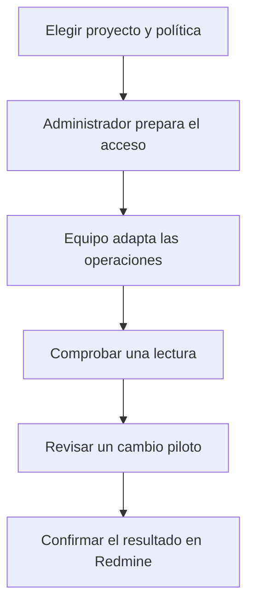
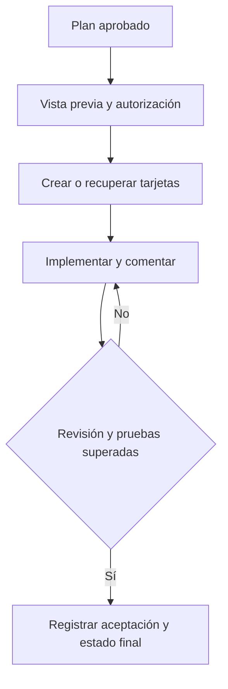
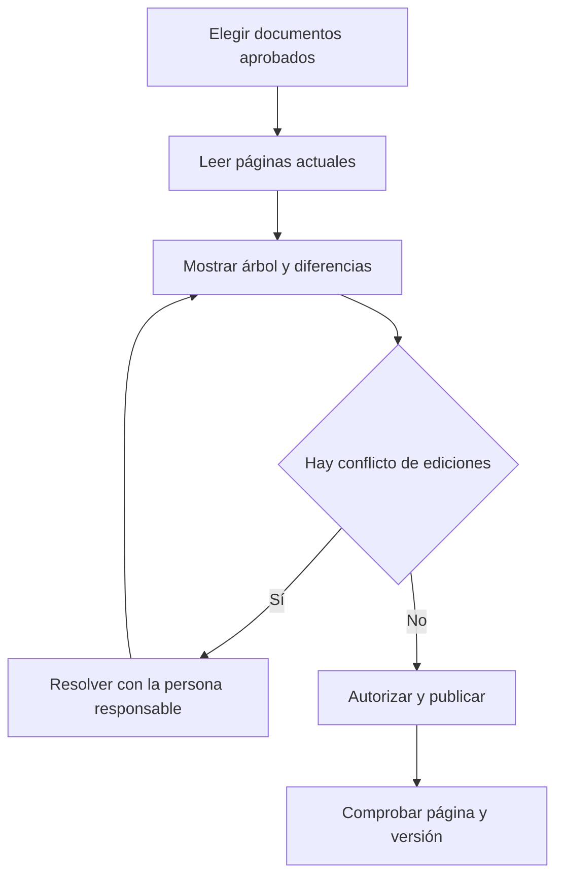

# 4. Trabajar con Redmine y con una wiki del equipo

El método del capítulo 2 se mantiene aunque tu organización use Redmine. Cambia el
lugar donde se muestran las tarjetas y la forma de comunicarse con él. **No tienes
que cambiar el plugin entero para que un proyecto utilice otra herramienta.**

Redmine llama *issue* a una tarjeta y *tracker* a su clase de trabajo: por ejemplo,
petición o incidencia. Cada instalación decide los nombres, campos y estados que
permite. Una wiki es una colección de páginas enlazadas; puede estar en Redmine o
ser un servicio distinto. Tener acceso al tablero no demuestra acceso a la wiki.

Este manual aporta una receta llamada `project-redmine`. Explica qué debe hacer una
integración de proyecto. **No instala un conector ni acredita una conexión real.**
El equipo técnico tiene que adaptarla al servicio y a las herramientas disponibles.

## W-13. Preparar Redmine para tu proyecto

### Cuándo y qué necesitas

Úsalo antes de enviar el primer plan a Redmine. El responsable decide qué equipo y
proyecto recibirán el trabajo. El administrador aporta una cuenta con los permisos
necesarios. El equipo técnico comprueba cómo hablar con esa instancia de Redmine.
No hace falta que el responsable escriba archivos de configuración.

Puedes pedir:

```text
Nuestro equipo usa Redmine. Prepara la integración para el portal de solicitudes.
Quiero una tarjeta por tarea, sin asignar personas automáticamente. Antes de
publicar, enséñame el proyecto, la clase de tarjeta, los estados y la vista previa.
```



### Qué ocurre paso a paso

1. **Acordáis la organización del trabajo.** Elegís tarjetas por tarea o por fase.
   Con tareas, T-01 permisos y T-02 decisión tendrán tarjetas separadas. Con fases,
   la tarjeta representa un grupo de tareas y no se termina al cerrar solo una.
   Decidís también quién puede asignarlas y si se publicarán tiempos medidos.
2. **El administrador elige el acceso.** Puede ser un conector o servidor MCP: el
   puente que ofrece operaciones concretas al asistente. Revisa la instancia,
   versión, cuenta y permisos. La contraseña o clave se guarda por el mecanismo
   seguro de ese entorno; nunca se pega en el plan ni en los comentarios.
3. **El equipo técnico prepara el adaptador.** La skill `project-redmine` contiene
   las instrucciones; el binding, una declaración de configuración, indica cuándo
   usarla. `/setup` ayuda a preparar el proyecto y `/work-context` muestra las
   piezas encontradas. Encontrar la declaración todavía no prueba la conexión.
4. **Se comprueban las operaciones reales.** El adaptador relaciona crear tarjeta,
   leerla, comentar y cambiar de estado con herramientas existentes. Resuelve los
   identificadores de proyecto, tracker y estados desde vuestra instancia. Si solo
   puede leer, se deja en lectura y no se anuncian escrituras disponibles.
5. **Se ensaya una lectura acotada.** El administrador comprueba que devuelve el
   proyecto esperado y que no muestra información de otros proyectos. Se prueban
   también permiso insuficiente y estado de destino inexistente.
6. **Revisas un cambio piloto.** Ves cuenta, destino, tarjeta y efecto antes de
   autorizar la publicación. Tras ejecutarlo abres el enlace y contrastas los
   campos. Solo entonces podéis afirmar que esa operación está comprobada.

### Quién interviene y qué recibes

El responsable decide la política; el administrador controla el acceso; el equipo
técnico prepara y prueba la skill. Los agentes del ciclo no se sustituyen por
Redmine: `planner` sigue planificando y `qa` sigue comprobando. Las herramientas
dependen del conector elegido, no de una lista cerrada del plugin.

Como resultado necesitas el destino probado, una relación de operaciones admitidas
y sus límites, y el enlace del piloto. Técnicamente se guardan el binding en
`.claude/integrations.json`, preferencias no secretas en
`.claude/integration-settings/redmine.json` y recibos propios en un mapa local.
El equipo técnico encontrará el contrato y un ejemplo completo en la referencia.

Si el acceso falla, el trabajo local puede continuar. No marques una tarjeta como
creada porque exista una configuración. Pide revisar cuenta, permisos y proyecto.
Si el conector no ofrece una operación, se desactiva hasta implementarla y probarla.

## W-14. Ejecutar el portal y mantener las tarjetas al día

### Qué pides y qué vas a ver

Parte de un plan aprobado y de W-13 comprobado. Puedes decir:

```text
Publica el plan aprobado en Redmine según la política acordada. Enséñame antes
las tarjetas. Durante la ejecución añade comentarios de implementación,
revisión y pruebas; termina una tarjeta solo cuando cumpla las condiciones.
```



1. **El plan se traduce a tarjetas.** `planner` entrega el listado aprobado. El
   adaptador muestra título, descripción, clase, proyecto y asignación de cada
   tarjeta. Una tarjeta de fase debe explicar qué tareas contiene. Tú revisas la
   organización antes de que se creen objetos externos.
2. **La creación deja vínculos reales.** El adaptador comprueba si cada tarjeta
   ya existe y conserva su identificador confirmado. Por ejemplo, una tarjeta
   ficticia `#481` puede corresponder a T-02. Ese vínculo permite continuar sin
   volver a crearla. Un lote puede completarse solo en parte.
3. **Al empezar se refleja el trabajo.** `implementer` inicia T-02 y la integración
   solicita un estado de trabajo permitido. Si la instancia no permite el cambio,
   informa del problema. Ese error no cambia por su cuenta el estado local.
4. **La implementación deja una nota.** Debe explicar qué cambió, dónde está la
   evidencia y qué falta. No cierra la tarjeta. En el portal: «Añadida la decisión
   de aprobación; falta revisión y comprobar que rechazar exige un motivo».
5. **La revisión y las pruebas dejan resultados separados.** `adversarial-review`
   coordina la revisión; `reviewer` examina los criterios. `qa` ejecuta las
   comprobaciones del proyecto. Si rechazar sin motivo todavía funciona, la nota
   dice fallo y la tarjeta vuelve al estado de corrección que permita Redmine.
6. **El cierre requiere ambos resultados.** El orquestador acepta la tarea cuando
   supera revisión y QA. La integración confirma el estado observado. Si la tarjeta
   representa una fase, todas sus tareas deben cumplir antes de cerrarla.

Un comentario útil, a modo de ejemplo ficticio, sería:

```text
[custom-agents · qa] · T-02 · intento 2
Resultado: superado. Rechazar sin motivo devuelve el error esperado y mantiene
la solicitud pendiente. La segunda decisión no altera una ya resuelta.
Evidencia: informe de pruebas aprobado para compartir.
Pendiente: aceptación del cierre por el flujo del proyecto.
```

La publicación la firma la cuenta real conectada; la etiqueta `qa` explica el rol
que produjo el resultado. No crea un usuario robot ni suplanta a un compañero.
Una imputación de tiempo necesita medición y unidad explícitas: una estimación no
se convierte en horas realizadas por añadirla a una tarjeta.

### Qué compruebas y cómo se recupera

Abre una tarjeta y contrasta tarea, comentarios, estado y evidencia. Si una revisión
falla, debe verse la corrección pendiente. Una nota que dice «probado» necesita un
resultado verificable, no solo un texto generado.

Si una escritura agota el tiempo de espera después de enviar, su resultado es
**incierto**: quizá llegó. El adaptador consulta la tarjeta y su referencia de
operación antes de repetir. Si el mapa local se pierde, se reconstruyen los
vínculos contrastando Redmine; no se crean todas las tarjetas de nuevo. Un fallo
de comentario y un fallo de estado pueden ser independientes y deben distinguirse.

## W-15. Compartir instrucciones en una wiki

Úsalo cuando el equipo quiera leer la guía del portal desde su wiki. Necesitas
los documentos aprobados, un destino y una integración de documentación comprobada.
No basta con tener la integración de tarjetas.

```text
Publica la guía de aprobación del portal en nuestra wiki. Muéstrame las páginas
que crearás o actualizarás y sus diferencias. No publiques capturas privadas
ni elimines páginas existentes sin una decisión aparte.
```



1. `documenter` prepara la guía comprensible y revisa su índice. El cierre de una
   fase puede entregar documentos al adaptador; eso no autoriza cualquier contenido.
2. La skill de documentación del proyecto, por ejemplo `project-wiki`, consulta
   las páginas de destino. El administrador ha tenido que verificar las operaciones
   de lectura, actualización y versionado que ofrezca su herramienta.
3. La vista previa muestra la estructura y qué cambia. El adaptador convierte el
   Markdown al formato de la wiki. Si la página cambió desde la lectura, se resuelve
   el conflicto antes de sobrescribirla. Una plataforma sin control condicional
   de versiones conserva ese límite; no se promete una actualización indivisible.
4. Tras la autorización aplicable se publica y se comprueba título, enlace y
   revisión real. Los recibos permiten una siguiente actualización sin duplicados.
5. Si se desea traer cambios de vuelta al proyecto, hay que implementar y comprobar
   esa capacidad por separado. Se comparan ambos lados y se conservan conflictos
   y metadatos locales; no se sustituye silenciosamente la copia local.

Comprueba la página con la cuenta de un lector del equipo. Si un documento se
retira localmente, su página no se borra automáticamente. Los adjuntos, borrados
y cambios de permisos necesitan decisiones específicas.

El mismo método permite una wiki corporativa, Notion u otro proveedor. Son
posibilidades de integración, no conectores instalados por aparecer en este texto.
La [referencia de Redmine](../reference/redmine.md) conserva los contratos y fuentes
oficiales para quien prepare el adaptador.
