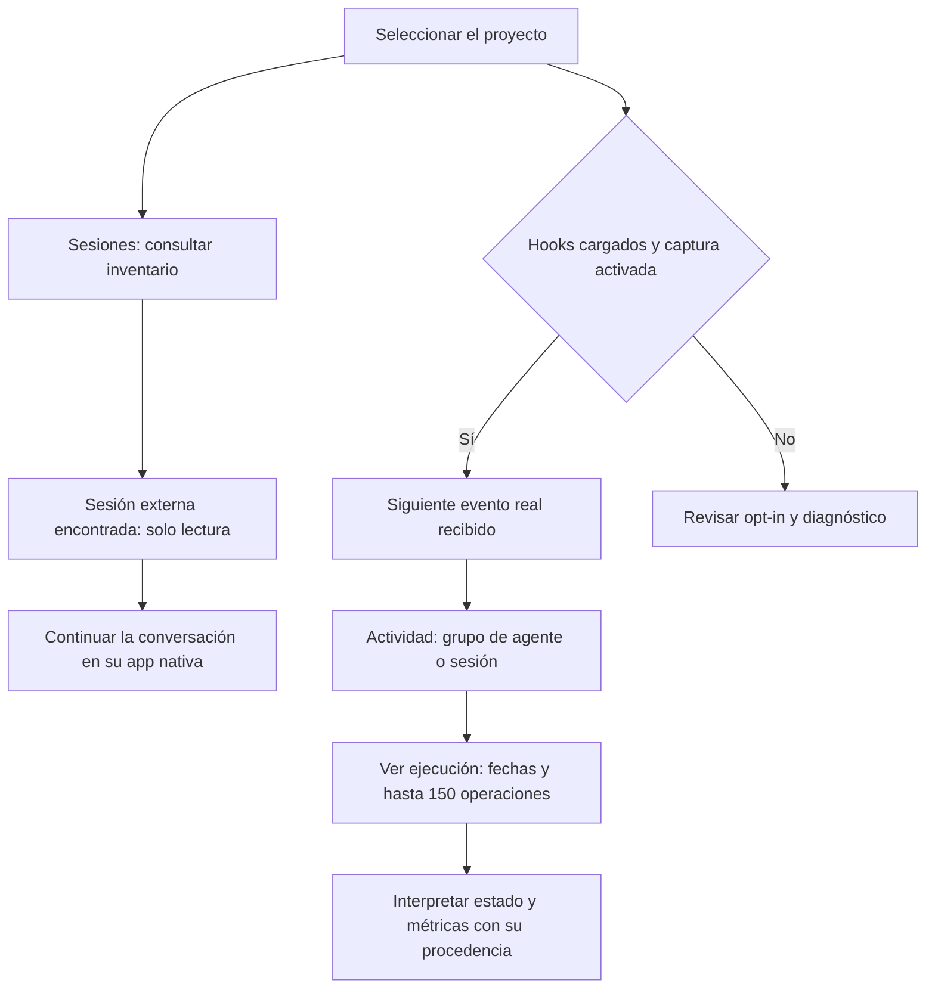

# Ver sesiones, agentes y operaciones en el dashboard

[English](../en/guides/session-visibility.md) · **Español**

**Actualizado: 2026-11-06 · cambio de Sin publicar, posterior a v3.0.0.**

Abre **Sesiones** para encontrar conversaciones del proyecto. Abre **Actividad**
para consultar agentes identificados, señales de sesión y herramientas recibidas.
El dashboard muestra lo observado; una tarjeta no demuestra que un proceso siga vivo.

## Encontrar una sesión abierta en otro terminal

1. Selecciona el proyecto cuya raíz coincide con el directorio de trabajo de la conversación.
2. Entra en **Sesiones** y espera a que termine la consulta del inventario nativo.
3. Busca su título en **Sesiones externas del proyecto**. Comprueba el proveedor,
   el identificador y la última actualización sin publicar esos datos privados.
4. Para conversar o interrumpir esa sesión, usa su aplicación nativa.
5. Pulsa **Ver actividad capturada del proyecto** para consultar las señales recibidas.

| Qué aparece | Qué significa | Cómo continuar |
|---|---|---|
| Sesión externa · Estado no confirmado | Codex informa de una conversación indexada del proyecto | Usa Codex para conversar; el inventario es de solo lectura |
| Conversación de la consola | La consola creó o conoce la conexión nativa | Abre su conversación y usa los controles disponibles |
| Lectura parcial | Un límite o error impidió completar la consulta | Interpreta el listado como una muestra, no como el total |
| Inventario no disponible | No se pudo confirmar la lectura | Consulta el diagnóstico; no equivale a cero sesiones |
| Sin descubrimiento externo | El runtime instalado no ofrece una interfaz compatible o no pudo leerse | Sus conexiones propias y hooks pueden seguir mostrando actividad |

El inventario Codex consulta metadatos indexados y no archivados del **directorio
exacto** registrado, con un máximo de 200 resultados. No incluye automáticamente
subcarpetas ni worktrees con otra raíz. Registra por separado las raíces que quieras consultar.
La consulta no carga turnos, inicia inferencia ni reanuda conversaciones externas.

El contador **Sesiones** combina conexiones propias y sesiones externas observadas.
Deduplica por proveedor e identidad nativa: una conversación conocida por ambas
vías cuenta una vez. No cuenta procesos activos. Si no hay observaciones y falla
la lectura, puede mostrar **—** en lugar de un cero que no se ha comprobado.

## Qué sesiones puede encontrar cada runtime

| Runtime | Interfaz de metadatos | Alcance |
|---|---|---|
| Codex | app-server, thread/list | Indexadas, no archivadas, cwd exacto, hasta 200 y cuatro páginas. |
| Claude Code | agents --json --cwd | Sesiones activas expuestas por la CLI, interactivas y de fondo; hasta 200, no todo el histórico. |
| OpenCode V2 | GET /api/session mediante lease privado | No archivadas, directory exacto; una página de 200 y aviso si quedan más. |

No es necesario crear la sesión desde el dashboard para encontrarla. El runtime
debe estar permitido en el registro del proyecto y su CLI compatible debe estar
instalada en ese entorno. La raíz del
proyecto debe coincidir y el dashboard debe ejecutarse en el **mismo ordenador y
entorno de usuario** que guarda el estado nativo. Si abres el dashboard de otro
ordenador, sólo ves las sesiones que ese servidor puede consultar allí. Windows,
WSL, contenedores o perfiles de usuario pueden tener almacenes diferentes.

Una sesión recién abierta de Claude puede no tener aún UUID. En ese caso, el panel
utiliza una identidad observada del proceso y su inicio para mostrarla; no la adopta
para chatear. Un trabajo de fondo sin UUID o PID puede conservar el ID corto
que comunica el runtime, con una identidad observada de sólo lectura. Si falta
la fecha de actualización, muestra el inicio comunicado.
Las fechas de lectura describen cuándo se consultó, no cuándo trabajó el agente.

Si una versión antigua de Claude no reconoce agents --json, actualiza el runtime o
continúa en el terminal; no se intenta leer transcripts como alternativa. Si hay
fallos, el contador vacío es **—**. Cero sólo se muestra después de una lectura
completa. Si ya hay sesiones observadas, el número es lo encontrado, no un total
certificado mientras la lectura sea parcial. El filtrado y la deduplicación conservan
las conexiones propias de la consola sin duplicarlas.

Comprobación manual en el equipo del dashboard, desde la raíz del proyecto:

```bash
claude agents --json --cwd "/ruta/al/proyecto"
opencode session list --format json --max-count 20
```

En Windows sustituye la ruta por la del proyecto, entre comillas. Estos comandos
muestran metadatos privados: no pegues nombres o IDs en tickets públicos. Un listado
correcto en otro equipo no demuestra que el servidor actual pueda consultarlo.

Contratos verificados el 2026-11-06: [Claude agent view](https://code.claude.com/docs/en/agent-view)
y [OpenCode V2 API](https://dev.opencode.ai/v2/docs/api). El código local se comprobó
con Claude CLI; el problema del equipo remoto se valida allí tras actualizar el plugin
y reiniciar el dashboard, sin copiar conversaciones ni editar permisos.

## Leer Actividad sin confundir una herramienta con un agente

La navegación se llama **Actividad**. En **Sesiones y agentes observados**, las
tarjetas de hooks agrupan eventos por la identidad que comunica el runtime:
agente cuando existe esa atribución, o sesión cuando falta.

Una tarjeta puede mostrar **reviewer**, **Subagente sin rol informado** o
**Actividad de sesión**. El panel no deduce el agente a partir de la herramienta.
Por ejemplo, **Herramienta: apply_patch** describe una operación, no un agente.
Codex puede comunicar la sesión sin identificar al subagente que ejecutó esa operación.

Los contadores **Agentes en curso**, **Agentes terminados** y **Sin actualizar**
cuentan grupos de subagentes capturados. **Sesiones sin atribución** cuenta grupos
de sesión sin identidad de agente. Las conexiones propias conservan sus tarjetas
y su acceso **Abrir conversación**.

| Estado de hooks | Evidencia disponible | Cómo interpretarlo |
|---|---|---|
| En curso | Subagente sin cierre comunicado y con señal de hace menos de 60 s | Último estado observado; no una comprobación del proceso |
| Actividad reciente | Grupo de sesión sin cierre y con señal reciente | Actividad de sesión, sin atribuirla a un agente |
| Terminado | Llegó un evento de fin de respuesta o ejecución | Confirma ese límite comunicado, no la destrucción del agente ni el cierre del plan |
| Sin actualizar | Falta una señal reciente o su fecha no permite confirmar actualidad | Puede haber espera, trabajo sin eventos o un cierre no recibido |

El estado de una tarea del roadmap se consulta por separado. Una tarea en
progreso no demuestra que haya un agente ejecutándose.

## Abrir la ficha y entender tiempo, tokens y dinero

1. En **Actividad**, localiza la tarjeta de hooks por rol, proveedor y última señal.
2. Pulsa **Ver ejecución**. La ficha **Detalle de ejecución** muestra estado,
   inicio, última señal, identificador local, origen y operaciones capturadas.
3. Revisa **Operaciones de esta ejecución**: herramienta, resumen, fecha,
   resultado y duración cuando se comunicaron. La tarea aparece si pudo atribuirse.
4. Si falla la lectura, pulsa **Reintentar**. Usa **Cerrar detalle** para volver a la tarjeta.
   Con teclado, activa los botones con Enter. Cerrar una ficha cargada devuelve el foco al disparador.

| Campo | Qué mide esta versión | Qué significa si falta |
|---|---|---|
| Tiempo observado | Intervalo desde el inicio comunicado; puede incluir esperas | Sin inicio comunicado, muestra No disponible |
| Inicio / Última señal | Fechas de recepción usadas por la captura local | No comunicado; no se reconstruye una fecha |
| Tokens | La captura de hooks actual no proporciona este consumo | No disponible, nunca cero supuesto |
| Coste | La captura de hooks actual no proporciona dinero consumido | No disponible; no se calcula a partir del tiempo |
| Resultado de una operación | Correcto o Error, si llegó ese dato | Resultado no comunicado |
| Duración de una operación | Milisegundos comunicados para esa herramienta | Duración no comunicada |
| Origen / Identificador local | Hooks del proyecto e identidad local del grupo | No certifican identidad de un proceso externo |

Mientras una señal sigue reciente, el tiempo observado avanza hasta el momento
de consulta. Con cierre recibido termina en ese cierre; sin actualizar, se congela
en la última señal. No representa tiempo de CPU ni tiempo exclusivo del modelo.

**Ver ejecución** abre un grupo por identidad reportada. Un nuevo inicio puede
actualizar ese mismo grupo y su inicio: no crea necesariamente una ficha por turno.
El detalle contiene como máximo las **150 operaciones más recientes** de ese grupo,
en orden de recepción, dentro de la captura conservada. El aviso de recorte indica
operaciones fuera de la ventana. La vista no promete una historia exhaustiva de cada turno.

Ejemplo ficticio: un grupo `reviewer` muestra **Terminado**, **Tiempo observado:
4 s** y una operación **Herramienta: apply_patch**. Si Tokens y Coste muestran
**No disponible**, conoces las señales y ese intervalo observado; desconoces el consumo.

## Activar la captura para los siguientes eventos

La actividad de conexiones propias llega por su puente nativo. Para recibir
también señales de hooks de sesiones externas, la captura es **opt-in por proyecto**.
Añade esta opción al objeto existente de `.claude/dev.json`, conservando sus otras claves:

```json
{
  "sesion": {
    "actividad": true
  }
}
```

Si ya existe `sesion`, añade `actividad` dentro de ese objeto sin duplicarlo.
El runtime debe tener los hooks cargados y aprobados. Ante un fallo, consulta
su gestión nativa de hooks o el diagnóstico de instalación. Una sesión nativa
nueva puede ser necesaria tras actualizar las definiciones del plugin.
No hace falta editar permisos globales, hashes de aprobación ni la caché del plugin.

Activar la captura **no recupera el pasado**. Espera a una operación real y revisa
su última señal en Actividad. Encontrar la conversación externa y capturar sus
operaciones son dos lecturas distintas: una puede funcionar mientras falta la otra.



## Si falta información

| Síntoma | Qué comprobar |
|---|---|
| La conversación actual no aparece | Proyecto seleccionado, cwd exacto, sesión indexada y no archivada, estado del proveedor y límite de lectura |
| La sesión aparece, pero no sus operaciones | Opt-in, hooks cargados y llegada de eventos posteriores a la activación |
| Aparece Actividad de sesión en lugar del agente | El runtime puede no haber comunicado identidad de subagente; no se inventa el rol |
| El agente queda Sin actualizar | Fecha de última señal y aplicación nativa; la ausencia de eventos no prueba que se detuviera |
| Falta una operación antigua | Ventana de lectura, recorte y retención; consulta el historial nativo para el contexto disponible allí |
| Tokens y Coste siguen sin datos | Los hooks actuales no entregan esas métricas; esperar más tiempo no las reconstruye |

El inventario y la captura descritos aquí no muestran razonamiento interno ni
conversaciones crudas. Esta guía documenta el cambio de **Sin publicar**; el PDF
publicado de v3.0.0 conserva su contenido histórico.

## Fuentes de este comportamiento

- [Contrato operativo de la consola](../../skills/plugin-panel/references/control-center.md).
- [Sesiones y contador](../../skills/plugin-panel/assets/console-sessions.js) y
  [deduplicación](../../skills/plugin-panel/assets/console-dom.js).
- [Tarjetas y ficha de actividad](../../skills/plugin-panel/assets/console-context.js),
  [métricas del servicio](../../skills/plugin-panel/scripts/console_service.py),
  [ventana de detalle](../../skills/plugin-panel/scripts/panel_data.py) y
  [estados y duración](../../agent-kits/shared/agent-activity.py).
- [Escenarios de la iniciativa](../roadmap/2026-11-02-session-visibility/test-plan.md) e
  [informe de QA](../roadmap/2026-11-02-session-visibility/testing/report.md), con pruebas de fixtures y límites de la comprobación real.
