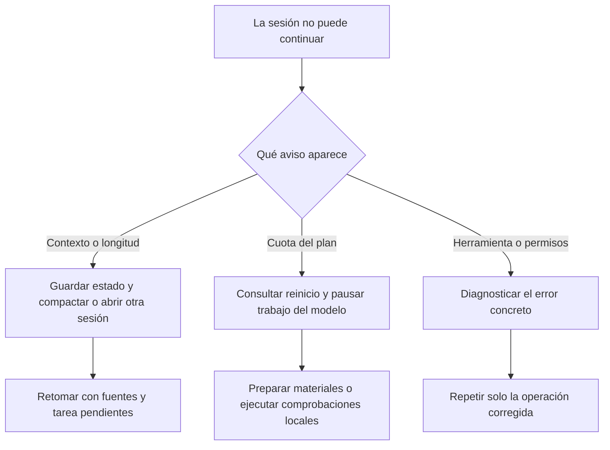
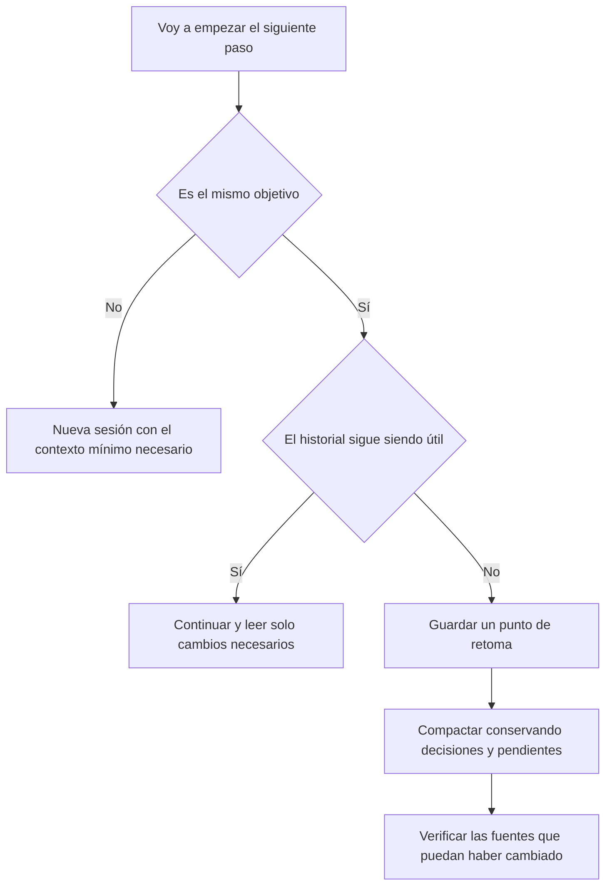
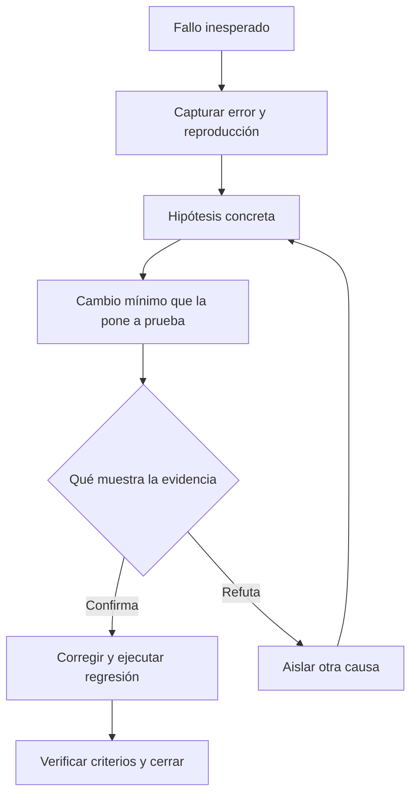

# Aprovechar Claude y Codex con una suscripción de unos 20 USD

Guía práctica para usuarios de custom-agents. Edición: 4 de noviembre de 2026. Los precios y comandos de proveedor se han contrastado con documentación oficial en esa fecha; consulta tu cuenta para conocer disponibilidad, impuestos, cuota y reinicios actuales.

## 1. Qué conseguirás con este manual

Aprenderás a dedicar la capacidad de tu cuenta al trabajo que aporta valor: comprender el problema, modificar lo necesario y comprobar el resultado. El objetivo es terminar más tareas aceptables con la misma suscripción, reduciendo contexto irrelevante, exploraciones repetidas y reintentos sin diagnóstico.

No necesitas saber programar para aplicar las rutinas y los prompts. Cuando aparezca un comando, escríbelo en el cliente indicado; los comandos del terminal no son mensajes universales para cualquier chat. El capítulo 4 distingue las interfaces.

Empieza por los capítulos 2 a 5. Usa los capítulos 6 a 11 durante el trabajo. Guarda el capítulo 12 como rutina diaria y consulta el 14 cuando la cuota se agote demasiado pronto. Para el proceso completo de calidad, sigue la [guía de resultados con custom-agents](quality-playbook.md).

### La decisión que más ayuda

Entrega al asistente un objetivo comprobable y el contexto necesario para resolverlo. Una petición de cuatro líneas que obliga a adivinar suele provocar más trabajo que una petición de quince líneas con un buen ejemplo y un criterio de aceptación.

Por ejemplo, sustituye «mejora los informes» por «en el informe mensual, añade un filtro de fecha inicial y final; conserva la exportación actual y comprueba el caso sin resultados». La segunda petición permite localizar, implementar y verificar una mejora concreta.

## 2. Entender qué estás pagando

Claude Pro anuncia 20 USD con facturación mensual e incluye Claude Code; la modalidad anual tiene otro importe y se paga por adelantado. Los impuestos y condiciones pueden variar. [Precios oficiales de Claude](https://claude.com/pricing).

La documentación de Codex incluye ChatGPT Plus entre los planes con acceso y publica su precio mensual de 20 USD. El consumo incluido depende del trabajo y de las condiciones del plan. Usar una clave API corresponde a una modalidad de facturación distinta. [Planes y uso de Codex](https://learn.chatgpt.com/docs/pricing).

| Concepto | Qué significa | Qué hacer |
|---|---|---|
| Suscripción | Acceso a capacidades y a una cuota de uso bajo las condiciones del plan | Comprueba el plan y la cuenta con los que has iniciado sesión |
| Cuota de uso | Capacidad disponible durante un periodo; puede haber varios límites | Mira el indicador y la fecha de reinicio de tu cuenta |
| Ventana de contexto | Información que puede manejar una conversación en ese momento | Conserva el estado útil y retira lo que ya no corresponde |
| Tokens | Unidades con las que el modelo procesa y produce información | Úsalos para comparar mediciones compatibles, sin convertirlos automáticamente en cuota |
| API o créditos adicionales | Otra vía de consumo que puede generar cargos | Actívala únicamente con un presupuesto deliberado |
| Caché | Reutilización técnica de contenido procesado | Aprovecha contexto estable y relevante; no supongas que todo es gratis |

En Claude, los límites de uso y los de longitud son diferentes. La documentación describe límites de cinco horas y semanales para los planes de pago, con las condiciones particulares de cada plan. El uso entre sus interfaces comparte el límite de la cuenta. Una conversación nueva libera contexto, pero no reinicia esa cuota. [Cómo funcionan los límites de Claude](https://support.claude.com/en/articles/11647753-how-do-usage-and-length-limits-work).

En Codex, no deduzcas «me quedan veinte tareas» de un porcentaje ni del precio de una API. La documentación advierte que influyen modelo, tamaño de la tarea, contexto y herramientas; las estimaciones de mensajes no constituyen una cantidad garantizada. Consulta el panel de uso para el estado actual. [Uso de Codex](https://learn.chatgpt.com/docs/pricing).

### Tres indicadores que conviene separar

Si la conversación está casi llena, necesitas gestionar contexto. Si la cuota está agotada, necesitas esperar el reinicio indicado o decidir conscientemente otra modalidad. Si una herramienta externa falla, necesitas diagnosticar esa herramienta: compactar la conversación no arregla una URL incorrecta o un permiso denegado.



## 3. Preparar una sesión en diez minutos

### Paso 1. Comprueba dónde trabajas

Abre la carpeta correcta del proyecto y confirma qué cliente estás usando. En un proyecto con varias ramas, indica la rama de trabajo. Si solo deseas análisis, dilo antes de que empiecen las modificaciones. No pegues contraseñas ni archivos de configuración completos para demostrar que una conexión existe.

### Paso 2. Comprueba tu modalidad de acceso

En la aplicación, revisa la cuenta y el plan. En Claude Code, consulta `/usage`; en Codex CLI, `/status` y el panel de uso. Son comprobaciones de estado, no instrucciones para cambiar el plan. Si aparece consumo API o créditos adicionales, revisa si corresponde a tu intención.

### Paso 3. Escoge una tarea con un final claro

«Terminar T-03 del plan» o «explicar por qué falla este caso de prueba» permite decidir cuándo parar. «Revisa todo y déjalo perfecto» deja abierto el número de búsquedas, cambios y comprobaciones. Puedes pedir una revisión amplia, pero delimita sus áreas y su entrega: por ejemplo, un informe de riesgos antes de modificar nada.

### Paso 4. Da un punto de entrada

Indica un archivo, una pantalla, una prueba que falla o la ruta del plan. No hace falta adivinar todos los archivos afectados: el asistente puede localizarlos. El punto de entrada reduce la necesidad de inspeccionar zonas ajenas al problema.

### Paso 5. Pide una comprobación proporcional

Una corrección de texto puede verificarse leyendo el resultado. Un cambio de permisos necesita casos permitidos y denegados. Una modificación de interfaz requiere comprobar estados y navegación. Ahorrar no consiste en declarar éxito sin evidencia.

Prompt para empezar:

```text
Objetivo: añadir el filtro de fechas al informe mensual.
Punto de entrada: pantalla Informes y su prueba actual.
Conserva la exportación existente.
Aceptación: rango válido, rango invertido y sin resultados.
Localiza primero los archivos responsables y trabaja ahí.
Amplía el alcance si encuentras una dependencia necesaria.
Entrega cambios, comprobaciones y limitaciones pendientes.
```

## 4. Comandos y pantallas: dónde funciona cada cosa

Los siguientes comandos pertenecen a los clientes indicados. Una aplicación Desktop puede incluir una vista de código y un chat general con capacidades distintas. Si un comando no aparece, consulta la ayuda del cliente instalado en lugar de trasladarlo a otra interfaz por intuición.

| Acción | Claude Code CLI | Codex CLI |
|---|---|---|
| Ver uso o estado | `/usage` | `/status`; panel de uso de la cuenta |
| Ver distribución del contexto | `/context` | Información de contexto disponible en el estado o interfaz de tu versión |
| Elegir modelo | `/model` | `/model` |
| Ajustar esfuerzo | `/effort`, si el modelo y la versión lo permiten | `/model` o `/model --reasoning=high`, si el modelo lo permite |
| Resumir el historial activo | `/compact` | `/compact` |
| Empezar una conversación distinta | `/clear` o nueva sesión | Nueva sesión desde la interfaz |
| Revisar servidores MCP | `/mcp` | `/mcp` |

Los comandos de Claude Code anteriores se documentan en [gestión de costes](https://code.claude.com/docs/en/costs) y [configuración del modelo](https://code.claude.com/docs/en/model-config). Para Codex, consulta [comandos del desarrollador](https://learn.chatgpt.com/docs/developer-commands?surface=cli). Las opciones efectivas pueden depender de versión, plan y políticas de organización.

En el chat general de Claude o ChatGPT puedes aplicar las técnicas de este manual mediante lenguaje natural, aunque no dispongas de esos comandos ni de acceso directo al repositorio. En ese caso aporta fragmentos relevantes o archivos autorizados y solicita las comprobaciones que realmente puedan ejecutarse. No confundas una explicación de un cambio con un cambio aplicado en el proyecto.

OpenCode utiliza la autenticación y el proveedor que tenga configurados. Instalar custom-agents allí no demuestra que el consumo esté incluido en Claude Pro o ChatGPT Plus. Comprueba las condiciones oficiales de la vía de acceso utilizada antes de asumirlo.

### Comandos del plugin

Estos son distintos de los comandos del propio cliente:

| Objetivo | Claude Code | Codex | OpenCode |
|---|---|---|---|
| Configurar el proyecto | `/custom-agents:setup` | `$custom-agents:custom-agents-setup` | `/setup` |
| Definir y evaluar una idea | `/custom-agents:pm-cycle` | `$custom-agents:custom-agents-pm-cycle` | `/pm-cycle` |
| Ejecutar el ciclo de desarrollo | `/custom-agents:dev-cycle` | `$custom-agents:custom-agents-dev-cycle` | `/dev-cycle` |

Añade la descripción del trabajo después del nombre. En Codex puedes seleccionar el adaptador en el menú de skills. Si no está disponible, verifica la instalación con la [guía de interoperabilidad](../INTEROP.md); escribir su nombre no instala la capacidad.

## 5. Elegir modelo y esfuerzo según el trabajo

Utiliza el modelo más eficiente que cumpla la tarea con las verificaciones necesarias. Para una decisión difícil, un modelo más capaz puede evitar varios intentos fallidos. Por eso conviene comparar el coste del resultado aceptado, incluyendo retrabajo, y no solo la respuesta inicial.

| Trabajo | Punto de partida recomendado | Cuándo escalar |
|---|---|---|
| Corregir texto o explicar un fragmento | Modelo eficiente disponible, esfuerzo bajo cuando proceda | La explicación contradice la fuente o falta contexto esencial |
| Cambio pequeño con aceptación clara | Modelo habitual de programación, esfuerzo moderado | El cambio cruza varios módulos o aparecen fallos difíciles |
| Investigar un error reproducible | Modelo habitual con evidencia y una hipótesis por vez | El problema tiene concurrencia, estados ocultos o causas contradictorias |
| Arquitectura, migración o permisos | Modelo con mayor capacidad de razonamiento | Revisión especializada y pruebas adicionales según el riesgo |
| Ejecutar una comprobación determinista | Herramienta de pruebas o script adecuado | El modelo interpreta los resultados cuando sea necesario |

Esta tabla es una recomendación de trabajo. No obliga a usar un modelo concreto ni sustituye la política del proyecto. Claude permite configurar modelo y esfuerzo; las definiciones de skills o subagentes y las políticas administradas pueden cambiar el nivel efectivo. [Configuración de Claude Code](https://code.claude.com/docs/en/model-config).

Codex también diferencia modelos adecuados para rapidez, programación y razonamiento complejo. Selecciona entre los que ofrezca tu cuenta y verifica el resultado sobre tu tarea. [Selección de modelo en Codex](https://learn.chatgpt.com/docs/model-selection).

### Velocidad no equivale a ahorro

Los modos acelerados pueden consumir más cuota o créditos que el modo estándar. Revisa las condiciones antes de activarlos. En Codex, `/fast` cambia el modo; no lo ejecutes como si fuera una consulta de estado. Si el objetivo es estirar la suscripción, empieza en modo estándar y cambia por una necesidad concreta de tiempo. [Uso y modalidades de Codex](https://learn.chatgpt.com/docs/pricing).

No pidas «razona al máximo siempre» como instrucción permanente. Reserva el esfuerzo adicional para la decisión que lo necesita y conserva las comprobaciones. Tampoco rebajes los revisores de un proyecto crítico únicamente porque la implementación parecía sencilla.

## 6. Dar contexto útil sin cargar todo el proyecto

El contexto es la mesa de trabajo del asistente. Debe contener las reglas aplicables, el problema y las fuentes necesarias para decidir. Un archivo irrelevante ocupa espacio; un archivo esencial omitido puede provocar una solución equivocada.

### Un orden de lectura que funciona

Primero, el objetivo y los criterios de aceptación. Después, el archivo o componente responsable y sus pruebas. A continuación, las dependencias que el cambio utiliza. Finalmente, la documentación específica que resuelve una duda. Si el comportamiento se reparte entre varios servicios, el asistente debe ampliar la lectura y explicar el límite encontrado.

Es razonable pedir búsquedas por nombre, símbolo o error antes de abrir archivos completos. Para registros largos, conserva el original como evidencia y muestra el fragmento que contiene el fallo, su contexto y el código de salida. Un resumen sin el error real dificulta el diagnóstico.

Prompt para una exploración acotada:

```text
Investiga dónde se valida el rango de fechas del informe.
Empieza por el formulario, el endpoint y sus pruebas.
Indica archivos responsables y una hipótesis verificable.
No modifiques todavía el código.
Si falta una dependencia necesaria, localízala y explica por qué.
```

### Instrucciones permanentes y documentación detallada

Mantén en `CLAUDE.md` o `AGENTS.md` las reglas estables que de verdad se aplican al proyecto: comandos de comprobación, restricciones esenciales y dónde está la información ampliada. Evita convertirlos en una copia completa del manual del producto. Claude documenta cómo carga estas instrucciones persistentes. [Memoria e instrucciones de Claude Code](https://code.claude.com/docs/en/memory).

Coloca los procedimientos específicos en skills o documentos enlazados y cárgalos cuando sean relevantes. Tener una skill instalada no significa que todo su contenido se introduzca siempre en cada conversación: Claude distingue descubrimiento y carga del cuerpo, con particularidades según la invocación. [Funcionamiento de las skills](https://code.claude.com/docs/en/skills).

### Reutilizar una lectura sin confiar en un resumen antiguo

Si el asistente ya leyó un archivo, no necesita releerlo por costumbre. Pero debe comprobar si cambió cuando esa información vaya a decidir algo importante. El recibo de fuentes de custom-agents permite comprobar bytes declarados; no certifica que la lectura cubra todo el proyecto ni que la conclusión sea correcta.

Consulta la [política de eficiencia del plugin](../TOKEN-EFFICIENCY.md) para sus límites. No copies recibos entre proyectos ni presentes un hash coincidente como una prueba funcional.

## 7. Continuar, compactar o abrir otra sesión

Continúa en la misma sesión cuando la tarea y las fuentes siguen siendo las mismas. Compacta cuando necesitas conservar el objetivo pero el historial acumula detalles que ya no ayudan. Abre otra sesión cuando cambias de problema o de proyecto; aporta un resumen de traspaso si existe una dependencia real.



### Un buen punto de retoma

Debe permitir a otra sesión entender qué queda y cómo comprobarlo, sin reconstruir toda la conversación. Guárdalo en una ubicación autorizada del proyecto o cópialo al inicio de la siguiente sesión. No incluyas secretos, transcripciones privadas ni afirmaciones de éxito sin una referencia a su evidencia.

```text
Objetivo y alcance: filtro de fechas del informe mensual.
Plan y tarea: docs/roadmap/<iniciativa>/tasks.md, T-03.
Hecho: validación del rango y pruebas unitarias.
Pendiente: comprobar la pantalla con teclado y exportación.
Decisiones: conservar el formato actual del fichero exportado.
Evidencia: comando, resultado y ruta del informe de pruebas.
Cambios: rama y archivos; indicar cambios ajenos preservados.
Bloqueos: ninguno conocido / describir el bloqueo concreto.
Siguiente paso: ejecutar la comprobación pendiente de T-03.
```

Después, pide «retoma T-03 con este estado; verifica el ledger y las fuentes necesarias». Evita «analiza todo de nuevo» si no hay un motivo. La compactación puede perder detalles; el ledger y la evidencia del proyecto conservan el estado comprobable. No compactes para intentar reiniciar límites de la suscripción.

En Codex, una bifurcación con `/fork` parte de la historia existente. Úsala para explorar una alternativa relacionada; no presupongas que crea un contexto vacío y económico para otro tema. [Comandos de sesiones de Codex](https://learn.chatgpt.com/docs/developer-commands?surface=cli).

## 8. Usar custom-agents sin multiplicar trabajo

La elección del recorrido importa más que recortar arbitrariamente cada respuesta. Para un cambio pequeño y definido, la skill `quick-implement` evita una fase de descubrimiento innecesaria y mantiene el ledger y las verificaciones que le corresponden. Para una idea imprecisa, `pm-cycle` permite aclararla y evaluarla antes de pagar el coste de implementar una solución incorrecta.

Si ya existe un plan aprobado, indica su ruta y la tarea pendiente. No pidas al sistema que cree otro plan equivalente. Si el alcance cambió, añade o ajusta las tareas explícitamente antes de ejecutarlas; una tarea terminada no debe aparentar que cubre una petición posterior.

### Perfil lite

Solicita al comando `setup` que configure únicamente el perfil `lite`, conservando las demás preferencias. Este perfil limita el contexto del despacho y realiza la implementación en el hilo actual. Mantiene revisores frescos secuenciales, el TDD elegido, revisión, QA y cobertura; no cambia por sí mismo tu plan comercial ni garantiza un modelo o un número de tokens.

```text
Configura únicamente el perfil lite de custom-agents para
este proyecto. Conserva las demás preferencias y muéstrame
el perfil efectivo. Mantén las verificaciones del proyecto.
```

Si el brief obligatorio no cabe o falta el componente que debe escribirlo, hay que dividir la tarea o reparar el bundle. No recortes requisitos de aceptación para forzar que el despacho continúe. Las reglas efectivas están en el [comando setup](../../commands/setup.md).

### Cuándo aporta valor otro agente

Una revisión independiente o una pregunta concreta sobre un módulo puede justificar otro contexto. Pedir a tres agentes que lean el proyecto completo para el mismo objetivo suele duplicar información. Define para cada uno una pregunta, fuentes, responsabilidad y formato de entrega. El paralelismo reduce a veces el tiempo de espera; no implica menos consumo total.

No elimines la independencia de la revisión para ahorrar. En tareas con revisión obligatoria, usa un traspaso conciso con criterios y evidencia. Consulta el [workflow de calidad](quality-playbook.md) para distinguir implementación, revisión y QA.

## 9. Herramientas, MCP y memoria

Conecta lo necesario para la tarea. Un proyecto que solo necesita corregir un formulario no tiene por qué consultar un gestor de incidencias, un grafo de conocimiento y cinco buscadores externos. Mantener integraciones disponibles no obliga a utilizarlas en cada paso.

Revisa `/mcp` y, en Claude Code, `/context` para entender qué está cargado. Las definiciones de herramientas pueden descubrirse de forma diferida; no asumas que todas se cargan completas al arrancar. Tampoco desactives una herramienta requerida por la política de tu organización sin valorar su función. [Gestión de contexto y herramientas en Claude Code](https://code.claude.com/docs/en/costs).

### Buscar memoria por pregunta

Pide «recupera la decisión aprobada sobre reintentos de envío» en lugar de «carga toda nuestra memoria». Comprueba la identidad, versión, estado y fuente de cada resultado relevante. Una propuesta sin aprobar no tiene el mismo valor que una decisión aceptada; un dato obsoleto no debe imponerse al código actual.

Kwipu y Graphiti son integraciones opcionales. La publicación, la indexación y la consulta son operaciones distintas, y sus servicios pueden tener costes propios. Configurar una URL no acredita que la conexión funcione ni concede permiso para enviar todo el proyecto. Consulta la [guía de memoria](memory.md) para el recorrido de aprobación y la configuración.

### Esperar sin volver a preguntar al modelo

Si una suite o un pipeline ya está en marcha, utiliza su mecanismo de espera o seguimiento. No pidas cada pocos segundos «¿ya ha terminado?» si eso provoca nuevos turnos del modelo. Al acabar, basta con el resultado y los errores accionables; conserva el registro completo para investigar fallos.

## 10. Evitar los bucles que consumen la sesión

Cuando una prueba falla inesperadamente, conserva el comando exacto, el error y el código de salida. Formula una hipótesis, cambia una causa y repite la comprobación relevante. Si no cambia la evidencia, deja de repetir el mismo intento y activa un diagnóstico de causa raíz.

Un fallo RED esperado al escribir primero el test es parte de TDD. Un servicio que no arranca o una prueba que expira antes de alcanzar el caso semántico es un problema distinto; no lo presentes como prueba de que la lógica de negocio falla.



Prompt para salir de un bucle:

```text
Detén los reintentos equivalentes. Resume la reproducción,
las hipótesis probadas y la evidencia de cada una.
Aplica debug-root-cause para aislar la causa restante.
Conserva el error completo y no declares verde un timeout.
```

No repitas toda la suite tras una edición de prosa si no afecta a ningún contrato comprobado. Sí ejecuta las comprobaciones que exige el proyecto y amplía la verificación cuando un fallo o un cambio nuevo lo justifique. La proporcionalidad depende del riesgo, no solo del número de líneas cambiadas.

## 11. Prompts reutilizables

### Pedir un cambio acotado

```text
Implementa [cambio] en [componente].
Debe cumplir [criterios concretos].
Conserva [comportamiento que no debe cambiar].
Empieza por las fuentes responsables y sus pruebas.
Mantén las puertas del proyecto y justifica ampliar el alcance.
Al terminar: resultado, pruebas y pendientes reales.
```

### Retomar sin reconstruir el proyecto

```text
Retoma [ruta del plan], tarea [ID].
Comprueba el ledger y los cambios desde la última evidencia.
Reutiliza las lecturas todavía vigentes; relee lo que cambió.
Continúa con el siguiente criterio pendiente.
```

### Pedir una respuesta concisa que conserve la evidencia

```text
Da el resultado de forma breve, con archivos afectados,
comandos de verificación, resultado y limitaciones.
Conserva los registros completos en la evidencia autorizada.
No ocultes errores ni omitas criterios para acortar la entrega.
```

### Elegir antes de ejecutar una investigación cara

```text
Necesito decidir entre [A] y [B] para [objetivo].
Compara compatibilidad, mantenimiento y coste de operación
con fuentes oficiales. Termina con una recomendación y dudas.
No construyas prototipos ni lances llamadas de pago adicionales
sin que hayamos acordado su alcance y presupuesto.
```

### Cerrar antes de agotar la cuota

```text
Finaliza la operación segura que está en curso y deja un punto
de retoma: hecho, pendiente, pruebas, archivos, rama y riesgos.
No marques completadas las comprobaciones que falten.
Después detén el trabajo del modelo hasta que lo reanudemos.
```

Estos límites de gasto son útiles cuando tú quieres imponerlos. No añadas confirmaciones a cada lectura o cambio reversible ya autorizado: interrumpir continuamente una tarea clara también produce retrabajo y contexto adicional.

## 12. Rutina de una jornada

### Antes de empezar

Mira el uso disponible y el próximo reinicio. Elige una tarea del plan con un resultado aceptable. Ten preparados un ejemplo del problema, la referencia del componente y los criterios. Revisa si hay cambios ajenos que deben conservarse.

### Durante el trabajo

Usa una conversación por objetivo coherente. Agrupa aclaraciones relacionadas en un mensaje, sin ocultar una corrección urgente hasta el final. Pide actualizaciones sobre hallazgos y decisiones, no una narración de cada archivo abierto. Conserva la evidencia y deja que las herramientas hagan cálculos y comprobaciones deterministas.

### Antes de parar

Comprueba qué está realmente terminado, qué pruebas se ejecutaron y qué sigue pendiente. Guarda un punto de retoma. Si has autorizado commits o push, exige una selección explícita de archivos; no permitas incorporar preferencias locales o secretos para simplificar el cierre.

### Registro de uso sin inventar precisión

| Dato | Ejemplo de anotación |
|---|---|
| Tarea | Filtro de fechas, T-03 |
| Modelo y modo | Los mostrados por el cliente; anotar cambios |
| Uso inicial y final | Indicadores de la misma cuenta y periodo |
| Reinicio intermedio | Sí/no y hora indicada por el proveedor |
| Otros consumos simultáneos | Chat, otras sesiones, automatizaciones conocidas |
| Resultado | Aceptado, parcial o bloqueado, con evidencia |
| Retrabajo | Motivo y número de intentos relevantes |

Una diferencia entre porcentajes no demuestra causalidad si hubo otras sesiones o un reinicio. Si la interfaz no informa tokens o dinero, escribe «no disponible». Compara varias tareas semejantes y considera la calidad obtenida; no concluyas que un modelo ahorra más por una única tarea especialmente fácil.

## 13. Cuánto ahorro está demostrado en custom-agents

La optimización del plugin compara un escenario definido: analyst, evaluator, architect y planner, cada uno con un contexto nuevo, sus instrucciones de entrada y las políticas compartidas referenciadas, sin cargar las nuevas guías condicionales. Se normaliza texto y se estima un token por cada cuatro caracteres; no es una lectura del contador nativo ni una factura.

| Rol | Reducción estimada de tokens de entrada |
|---|---|
| analyst | 89,50 |
| evaluator | 361,75 |
| architect | 464,75 |
| planner | 515,50 |
| Total del escenario | 1.431,50 |

Si se leen una vez las cuatro referencias condicionales, añaden 2.084 tokens estimados. En ese caso el balance sería 652,50 tokens adicionales antes de considerar lecturas de proyecto evitadas. La optimización busca cargar detalle cuando hace falta; no garantiza una reducción en todos los recorridos.

Consulta la [medición reproducible y sus supuestos](../roadmap/2026-11-04-token-efficiency/testing/token-estimates.md). No conviertas 1.431,50 en un porcentaje de la cuota Pro o Plus ni en dólares ahorrados. Tampoco significa que las respuestas, las herramientas o las pruebas consuman esa misma cantidad.

Un ejemplo exclusivamente ilustrativo: evitar una segunda lectura de 20.000 caracteres equivale a unos 5.000 tokens con esa aproximación, antes de descontar el recibo y las instrucciones para reutilizarla. Solo cuenta como ahorro observado si esa relectura se habría producido y la fuente sigue siendo válida.

## 14. Problemas habituales y respuesta recomendada

| Síntoma | Qué comprobar | Acción útil |
|---|---|---|
| La cuota baja rápido con mensajes cortos | Historial, archivos, herramientas y otros trabajos de la cuenta | Acota la tarea y revisa contexto; un mensaje corto puede activar muchas operaciones |
| Una sesión nueva sigue bloqueada | Límite del plan y hora de reinicio | Espera o decide otra modalidad conscientemente; no sigas creando chats |
| Compactar no mejora la respuesta | Se perdieron criterios o fuentes | Recupera el punto de retoma y verifica los archivos responsables |
| El asistente vuelve a leer lo mismo | Cambios reales, ausencia de recibo o de traspaso | Reutiliza solo fuentes comprobadas y comparte la decisión vigente |
| Hay demasiados agentes | Preguntas y responsabilidades duplicadas | Usa el perfil apropiado y mantén la independencia exigida en revisión |
| El modelo pequeño repite fallos | Dificultad real y calidad de la información | Corrige el contexto o escala la tarea difícil; evalúa el coste del resultado final |
| Se hacen búsquedas externas para todo | Necesidad de actualidad o de fuentes externas | Consulta primero las fuentes del proyecto cuando sean suficientes |
| Aparecen cargos fuera de la mensualidad | API, créditos adicionales y proveedores conectados | Revisa modalidad, límites de gasto y automatizaciones activas |
| El dashboard muestra dinero o tokens vacíos | Disponibilidad y origen de telemetría | Trátalo como desconocido; consulta el proveedor para su cuota |
| No se termina nunca | Aceptación difusa o alcance que crece | Define el siguiente resultado y registra lo demás como trabajo nuevo |

## 15. Glosario y lista para guardar

| Término | Significado práctico |
|---|---|
| Contexto | Información disponible para resolver el paso actual |
| Compactar | Resumir el historial activo para liberar espacio, conservando lo importante |
| Ledger | Registro canónico de tareas y estado, normalmente `tasks.md` |
| MCP | Mecanismo para conectar herramientas; no es una suscripción ni una autorización universal |
| Modelo | Motor que resuelve la tarea |
| Esfuerzo | Ajuste de razonamiento cuando está disponible |
| Evidencia | Resultado comprobable de una lectura, prueba u operación |
| Retrabajo | Repetir o corregir trabajo que no cumplió el objetivo |

Antes de enviar una petición, comprueba: objetivo claro, entrada localizable y aceptación. Durante el trabajo: fuentes pertinentes, modelo adecuado y verificaciones proporcionales. Al cerrar: evidencia, pendientes honestos y punto de retoma. Si falta capacidad: consulta la cuota real; cambiar de conversación no la recarga.

Las recomendaciones de organización y los prompts de este manual son propuestas prácticas, no garantías del proveedor. Para procedimientos técnicos completos del plugin, consulta el [manual operativo](../../output/pdf/custom-agents-manual-operativo.pdf), la [guía de resultados](quality-playbook.md) y la [referencia de interoperabilidad](../INTEROP.md).
