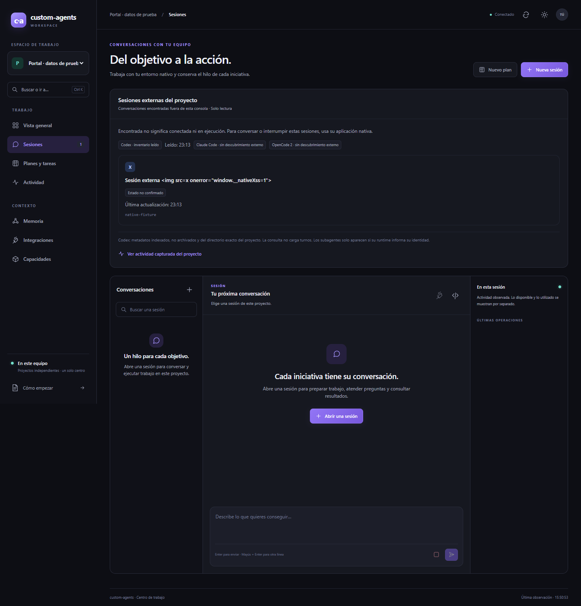
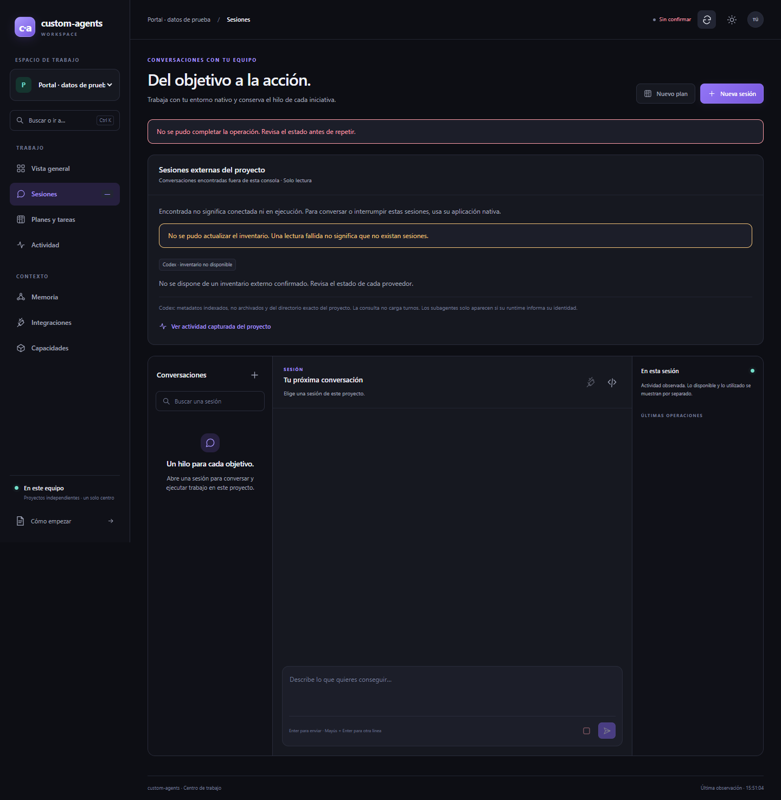
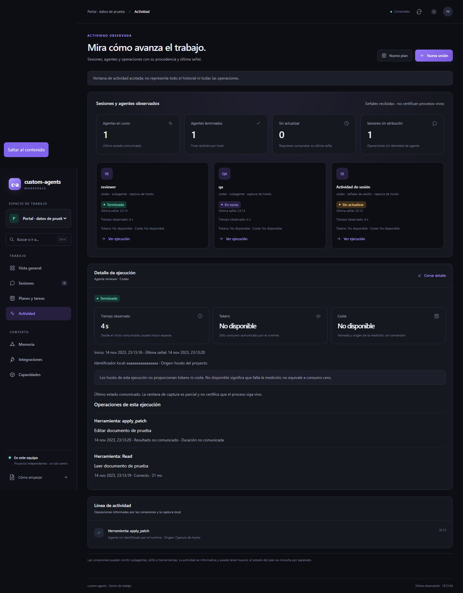
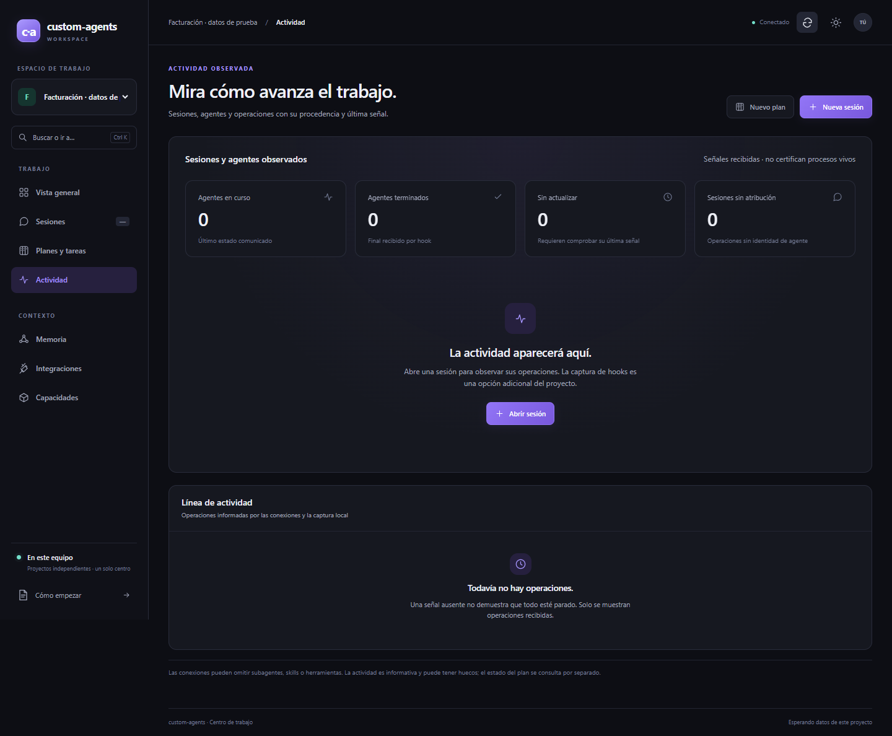
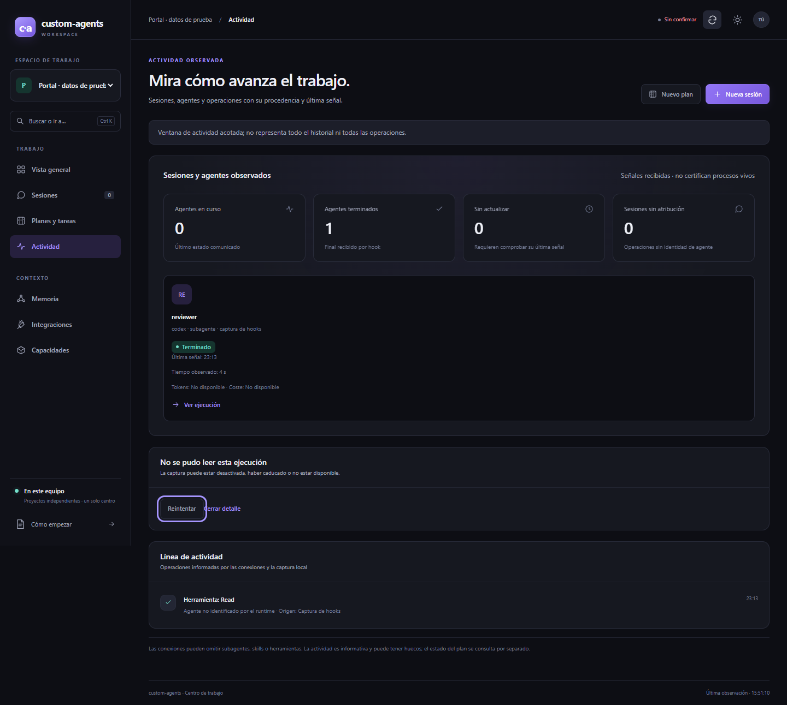
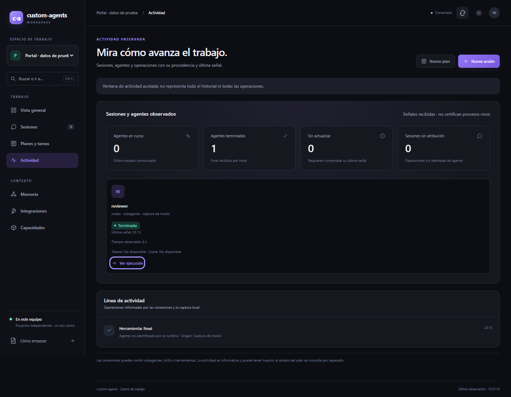

# Informe de QA — sesiones externas y actividad observable

| | |
|---|---|
| **Fecha** | 2026-11-02, segunda tanda 15:50–15:51 Europe/Madrid |
| **Estado global** | VERDE automático; M-01 pendiente |
| **Objetivo** | http://127.0.0.1, puerto efímero del fixture propio |
| **Plan** | [Plan](../improvement-plan.md) · [Escenarios](../test-plan.md) |
| **Entorno** | Windows; Playwright; Microsoft Edge 156.0.4314.50 headless; 1440×1000; es-ES; Europe/Madrid |

## Veredicto (qa-gate)

`qa-gate.py` exit 0 sobre el reporter JSON real de la segunda tanda, saneado sin alterar resultados:

```json
{
  "verdict": "VERDE",
  "counts": {
    "passed": 18,
    "failed": 0,
    "flaky": 0,
    "skipped": 0,
    "interrupted": 0
  },
  "flaky_sin_justificar": [],
  "flaky_justificados": {},
  "threshold": "verde ⟺ 0 failed, 0 flaky sin justificar, 0 interrumpidos y ≥1 test ejecutado"
}
```

## Resumen

- 6 tests × 3 repeticiones: **18/18 pasan**, 0 flaky, 0 omitidos. Duración del runner: 45,30 s.
- E2E-01 a E2E-04 cubiertos con navegador y datos ficticios. E2E-05 verificado por el orquestador en otra instancia headless propia contra el servidor real; recibo limitado a conteos y booleanos.
- M-01 sigue pendiente: no se ha inspeccionado la pestaña personal de Edge. El puente CUA no pudo verificar su URL; no se eludió ese bloqueo.
- No se iniciaron modelos ni se reconstruyeron conversaciones. La creación HTTP del caso de aislamiento usa exclusivamente `FixtureDriver`, sin ejecutable nativo.

## Puertas de entrada y cobertura

`ledger-lint.py`: exit 0, 0 incoherencias y 0 avisos.
`coverage-check.py`: exit 0:

```json
{"applies": true, "defined": ["E2E-01", "E2E-02", "E2E-03", "E2E-04", "E2E-05", "M-01"], "referenced": ["E2E-01", "E2E-02", "E2E-03", "E2E-04", "E2E-05", "M-01"], "broken_refs": 0, "tasks_sin_cobertura": [], "tests_sin_referencia": [], "gwt_cubiertos": [], "gwt_sin_cubrir": [], "gwt_sin_id": 0, "test_plan_na": false, "marcador_no_canonico": null}
```

Selector de capacidades `qa`, áreas frontend/api/testing: api-contract, backend-practices, frontend-quality y unit-tests. Se comparten los criterios de T-01/T-02/T-03. No hay OpenAPI ni bloques API-xx/A11Y-xx en este test-plan; no se ejecutó el linter OpenAPI ni se declara conformidad WCAG completa.

Pirámide: E2E **100%** (18/18 de este gate). Cobertura Python del cambio **92,58%**, mínimo configurado 90%, 124 casos, medida por el orquestador antes de esta tanda; QA no repitió ni atribuye como propia esa medición. Las evidencias de E2E no sustituyen la cobertura unitaria.

## Resultados automáticos

### E2E-01 — Sesiones externas y contador observado — PASA

T-01/T-02, 2 tests × 3. Una sesión externa y cero conexiones propias muestran contador 1, título escapado, estado no confirmado y lectura exclusiva. Enviar e interrumpir permanecen deshabilitados y no se solicita snapshot controlable de la sesión externa. Claude Code/OpenCode 2 explicitan que no ofrecen descubrimiento externo. Una conexión propia presente también en el inventario se cuenta una sola vez; otra externa eleva el total a 2. Una lectura fallida con cero observaciones muestra indisponibilidad y contador «—».




### E2E-02 — Estado y detalle de ejecución — PASA

T-03, 1 test × 3. Se distinguen agente Terminado, agente En curso y actividad de sesión Sin actualizar. Las herramientas aparecen como operaciones, con ausencia explícita de atribución cuando procede. El detalle muestra fechas, 4 s observados y origen hooks; Tokens y Coste muestran «No disponible», acompañado de la explicación de que no equivale a cero. Cada operación conserva herramienta, resumen y resultado/duración sólo cuando existen.



### E2E-03 — Aislamiento de proyectos — PASA

T-01/T-02, 2 tests × 3. Se retienen y liberan respuestas de inventario y detalle del proyecto anterior después del cambio de workspace: no reaparecen su sesión, agente, operación ni ficha. Una sesión creada por el driver ficticio devuelve 200 en su workspace y 404 `session_not_found` en el vecino, con autenticación válida en ambas lecturas.



### E2E-04 — Recuperación y teclado — PASA

T-03, 1 test × 3. El botón Ver ejecución conserva foco tras llegar una nueva operación; Enter abre la ficha, Tab alcanza Cerrar detalle y Enter cierra devolviendo foco al disparador. Dos respuestas 503 consecutivas conservan el foco de Reintentar. La recuperación con contenido idéntico restaura la ficha y elimina el error y Reintentar. Se usaron aserciones web-first; sin esperas temporizadas ni `networkidle`.




### E2E-05 — Comprobación real sin ejecutar modelos — PASA, recibo del orquestador

T-01/T-02. Microsoft Edge headless propio contra el servidor real local. Sesión actual visible, cinco sesiones externas y cinco tarjetas nativas; once tarjetas de actividad y 150 operaciones en el detalle. La ausencia de consumo comunicado por hooks se explica. Estos conteos reflejan una observación concreta y no acreditan procesos vivos. El recibo queda separado de las 18 ejecuciones del gate de fixtures:

```json
{
  "current_session_visible": true,
  "session_count": 5,
  "native_cards": 5,
  "activity_cards": 11,
  "execution_operations": 150,
  "missing_hook_usage_is_explicit": true,
  "private_edge_tab_inspected": false
}
```

La captura real permanece privada; este informe sólo incorpora capturas de fixtures. QA recibió el recibo, no inspeccionó la pestaña personal ni copió la captura real.

## Primera tanda y corrección del harness

El primer gate fue NO-VERDE: 15 passed, 3 failed, 0 flaky. Los tres fallos eran repeticiones del caso HTTP adicional de E2E-03, antes de comprobar el aislamiento: la creación esperaba 200 y recibió 401 `authentication_required`.

Diagnóstico aislado probado: cliente HTTP independiente con cero cookies → 401; contexto del navegador con cookie HttpOnly y cabecera de autorización → creación 200 con esquema que contiene ID, lectura propia 200 y lectura vecina 404 `session_not_found`. El producto exige ambas credenciales en `control_center.py::_auth`, igual que sus pruebas HTTP. El error estaba en usar el fixture Playwright `request`, que no comparte las cookies del navegador.

Se cambió únicamente el harness a `page.context().request`; las aserciones 200/404, umbrales, reintentos y producto quedaron intactos. Segunda tanda completa con tres repeticiones: 18 passed, 0 failed, 0 flaky. El primer resultado y su gate se conservan, sin justificar ni ocultar ningún flaky:

```json
{
  "verdict": "NO-VERDE",
  "counts": {
    "passed": 15,
    "failed": 3,
    "flaky": 0,
    "skipped": 0,
    "interrupted": 0
  },
  "flaky_sin_justificar": [],
  "flaky_justificados": {},
  "threshold": "verde ⟺ 0 failed, 0 flaky sin justificar, 0 interrumpidos y ≥1 test ejecutado"
}
```

## Checklist manual

- [ ] **M-01 — Edge del usuario**: inspeccionar su pestaña personal cuando el puente pueda verificar la URL; el Edge headless de QA no sustituye esa comprobación. Cubre T-01 y el recorrido real del usuario.

## Trazabilidad

| Tarea | Escenarios | Resultado |
|---|---|---|
| T-01 | E2E-01, E2E-03, E2E-05, M-01 | Automáticos pasan; M-01 pendiente |
| T-02 | E2E-01, E2E-03, E2E-05 | Pasan |
| T-03 | E2E-02, E2E-04 | Pasan |

## Evidencias y límites

- Reporter real saneado: [results.json](raw/results.json); [gate final](raw/qa-gate.json).
- Primera tanda: [initial-results.json](raw/initial-results.json), [gate inicial](raw/initial-qa-gate.json).
- Puertas: [ledger-lint](raw/ledger-lint.txt), [coverage-check](raw/coverage-check.json).
- Recibo real seguro: [real-edge-receipt.json](raw/real-edge-receipt.json).
- Specs/config y originales crudos/trazas permanecen en la caché privada `~/.claude/tool-cache/qa/session-visibility-20261102/`. Sólo se exportó JSON saneado mediante el redactor canónico y eliminación adicional de capabilities. No se copiaron cookies, cabeceras privadas ni trazas al repositorio.
- Guardrail bash del kit aprobado contra el origen loopback antes de cada fixture. Sólo se cerraron procesos y navegadores propios; no se tocó el servidor real.
- Localizadores de controles por rol/nombre accesible. Para acotar contenedores sin rol propio se usaron `#activity-run-detail` y clases de métricas; esto no valida toda su semántica accesible.
- Las integraciones de inventario y actividad están interceptadas en E2E-01 a E2E-04: prueban el comportamiento de la UI; el servidor real se acredita separadamente con E2E-05.
- Memoria consultada: GOT-007 (aceptada) exige verificar tras el último cambio; custom-agents.GOT-022 (aprobado) distingue señales observadas y procesos vivos. No hay flaky ni propuesta de memoria.
- Handoff al orquestador para documentación y puertas de cierre. QA no modifica estados del ledger ni declara cerrada la iniciativa. PDF no solicitado.

Saneamiento previo a commit: se sustituyeron rutas de usuario, workspace y caché por marcadores genéricos en ambos reporters JSON. Los stats y los veredictos antes/después son idénticos; el gate inicial conserva 15 pasan/3 fallan y el final 18 pasan/0 fallan. Se repitieron ambos gates y la comprobación de rutas privadas y capabilities, con cero coincidencias.
