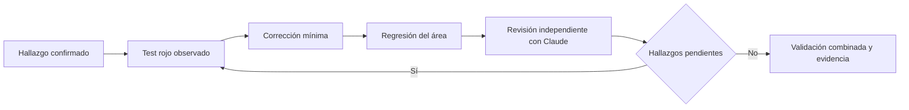

# Implementación de correcciones

| Artefacto | Referencia |
|---|---|
| Spec | [spec.md](spec.md) |
| Ledger | [tasks.md](tasks.md) |
| Evaluación | Corrección autorizada, sin presupuesto inventado |

Trabajar sobre la versión auditada, en la rama fix/audit-remediation de un checkout limpio ya existente. La raíz con preferencias privadas permanece intacta. Ejecución secuencial conforme a subagentes:false.

Las pruebas usan archivos señuelo, HOME aislado y MCP falsos. La autenticidad de los manifiestos y la frontera de publicación se revisan antes de efectos. Se regeneran los derivados interop; el roadmap conserva RED/GREEN por tarea. No se confunden tests unitarios con compatibilidad E2E real ni con el dictamen interno de npm.
